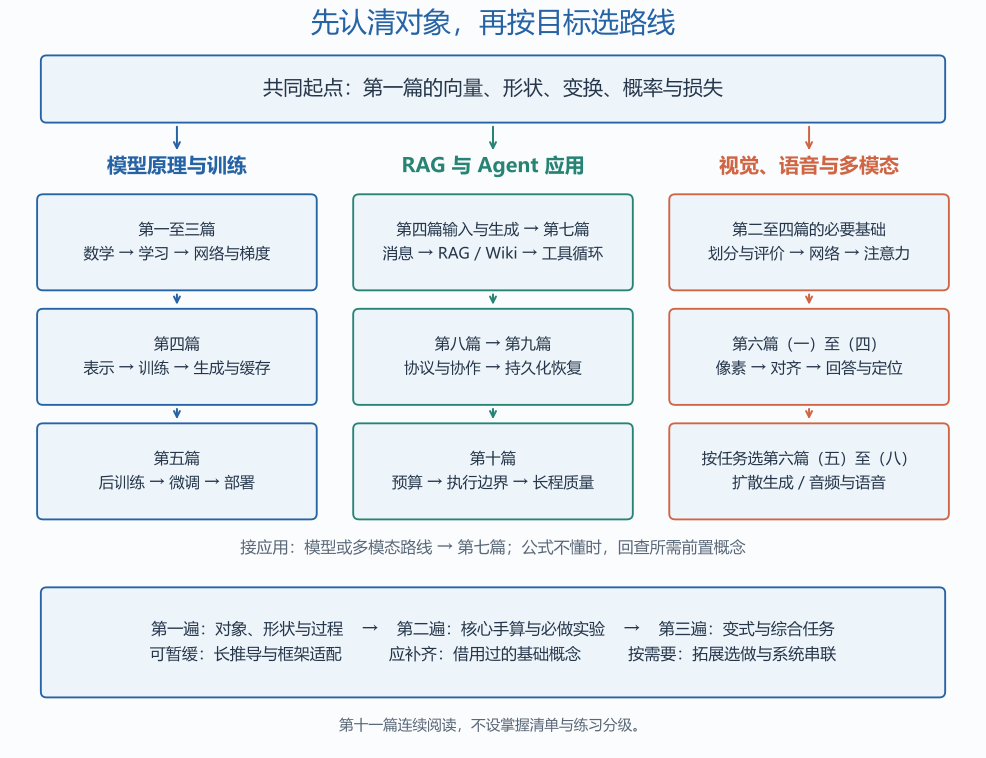

# 00-序言与学习路线

[TOC]

## 这本笔记的起点

今天打开任何一个技术社区，关于 AI 与 Agent（智能体）的教程几乎分裂成了两个互不相通的世界：
一类教程停留在十年前的传统教材写法里，上来就是连篇累牍的矩阵求导与概率公理，算完一整章公式，读者还是不知道这些数字怎么变成一句通顺的回答、怎么去读硬盘里的本地文件；另一类教程则走到了相反的极端，教你用五行框架代码拼一个聊天机器人，遇到回答出错、工具乱调或者进程崩溃，唯一的办法就是往提示词（Prompt）里塞更多的感叹号和“请你务必认真思考”。

可只要你真正动手搭一个哪怕最简单的实用系统——比如贯穿本书的**“学习资料助手”**，就会发现“调一下模型接口”从来都不是故事的全部。

假设这个资料助手刚刚收到了一条日常学习记录：
> `"读完注意力笔记，用了 40 分钟，做对 3 道题。"`

现在我们要围绕这条记录干三件再普通不过的事：
第一，根据它预测“读完下一篇笔记大概要花多少分钟”，这需要把页数、难度和历史速度变成数字向量，通过训练找出参数规律；
第二，当用户追问“注意力机制是怎么按内容寻址的”时，去本地笔记库里翻出对应的原文段落作为回答依据，这需要计算文本与问题之间的相似度并核验引用来源；
第三，替学习者把生成的下周阅读计划正式保存下来、并在下周一按时提醒，这又离不开文件沙箱、SQLite 数据库事务、权限检查以及进程意外退出后的断点恢复。

你看，这三件事全都顶着“AI 助手”的帽子，但底下真正干活的代码模块却处在四个截然不同的层次上：
* **训练程序（Training）**：负责根据样本数据计算损失梯度，真正修改模型的权重参数；
* **推理程序（Inference）**：冻结现成的权重参数不变，只根据当前送入的上下文序列算出下一项的输出分布；
* **应用程序（Application / RAG & Tools）**：负责按权限与版本检索外部证据、组装本轮要喂给模型的上下文、严格校验模型提出的工具调用参数，再去执行确定性的外部函数；
* **运行系统与工程马具（Runtime & Harness）**：守在最外层，负责记下任务推进到了哪个业务阶段、管住上下文预算与安全边界，保证哪怕半路断网或进程暴毙，重启后依然能認出同一项任务接着往下跑，绝不把同一份计划重复提交两遍。

把这四层物理边界拆得一清二楚，最大的好处就是**出了故障知道该去哪一层抓人，不再拿玄学当药方**：
如果预测数值离谱是因为特征单位没对齐，那就去改第一层的数据表示；如果验证集考了满分、一上线就抓瞎，那是第二层把测试数据泄漏进了训练集，得重做数据划分；如果模型把“切片共享数据”说成了“切片会自动复制”，要去查第七篇的检索召回与引用核验；而如果用户因为网络卡顿点了两次确认，导致数据库里存了两份一模一样的计划，那就得去修第九篇的数据库原子事务与业务幂等键——要是这时候你还趴在提示词里叮嘱模型“请你千万只存一次”，那就是找错了衙门、纯属竹篮打水了。

平时满天飞的技术名词，只要放进这张分层地图里，也就各自找到了老实本分的位置：**人工智能（AI）**是构造智能行为的总称；**机器学习**让程序从数据误差里反求参数规律，**深度学习**用多层非线性变换逐层提取特征表示，而**神经网络**则是其中最核心的一类计算图模型。**自然语言处理、计算机视觉与语音处理**对应着不同物质形态的输入输出模态；而 **RAG（检索增强生成）**、**MCP（模型上下文协议）** 与 **Agent（智能体）**，则是把静态模型与外部知识库、确定性工具及持久化状态机组织成完整应用的工程方法。做一个靠谱的学习资料助手，完全可以同时用上精确的词法检索、神经网络向量嵌入和铁板钉钉的 SQLite 事务代码——它们本来就各司其职地工作在同一个系统的不同位置上。

## 从已有 Python 经验出发

读这本笔记之前，你只需要具备基础的 Python 编程经验：能看懂函数定义、列表与字典操作、模块导入、`try/except` 异常处理、`pathlib` 文件路径以及 `with` 上下文管理语句即可。
如果你读过前作[《Python 现代开发学习笔记》](https://github.com/KiriAky107/python-modern-notes-examples)，两本书的工程脉络是直接连通的：环境配置可以回查前作第一篇“运行程序与管理项目”；跨进程 HTTP 请求、JSON 序列化和 SQLite 数据库操作对应前作的相关基础小节；前作第十七篇“综合项目”里的“训练、选权重与最终评估”和“从声明重建环境”可以直接与本书第五、六篇的模型交付接轨；而前作第十八篇“LangChain、LangGraph、RAG 与 Agent Runtime 初步”，则正好可以作为本书第七至十篇的先导预习材料。

本书里的数学推导拒绝背诵悬空的黑话定义，全部从具体的坐标、面积和预测误差直接算起。每一个数学符号第一次登场时都会标明它的张量形状（Shape），每一个神经网络和语言模型都配有一份可以用纸笔从头算到底的微型输入样本。
最有效的学习方法，是在看代码之前**先拿张草稿纸亲手算出中间矩阵的每一项数值**，然后再跑配套程序比对输出；一旦手算结果和程序打印结果对不上，不要只盯着最后的损失分数瞎猜，直接顺着计算图一步步比对，找出**第一个发生分歧的中间量（First Divergence）**——只要抓住了第一个分歧点，底层的算法逻辑就真正长进你自己的脑子里了。

## 每篇的掌握重点与拓展阅读

本书所说的“必须掌握”，标准只有三条：**能讲清物理含义、能亲手算出中间值、能写出断言检查边界**。看懂一段结论之后，还要能明确指出它的输入是什么、输出是什么，以及当外部条件改变时哪一步会跟着变。下表列出了前十篇的核心账单；右列的“拓展阅读”可以在第一遍阅读时暂缓跳过，等遇到具体深入问题时再回来细啃。

| 篇章 | 必须掌握（核心基线） | 拓展阅读（深入推演与变式） |
| --- | --- | --- |
| [第一篇：表示与数学基础](01-数据表示与数学基础.md) | 分清向量、坐标与基，写对数组形状；把点积、矩阵乘法和行列式连到方向夹角、空间变换与面积缩放；理解正交投影、条件概率、导数和交叉熵，并完成微型样本手算 | 深入（八）节 PCA 与 SVD 的矩阵分解、降维压缩与重建，比较非共线扰动下的一维近似误差；把换基、投影与最小二乘拟合彻底打通 |
| [第二篇：机器学习](02-从预测到机器学习.md) | 沿“前向预测 → 损失计算 → 梯度反传”走完一次参数更新；亲手推导逻辑回归的 $p-y$ 梯度；严格区分训练集、验证集与测试集，识别预处理数据泄漏，读懂混淆矩阵 | 横向比较近邻（k-NN）、决策树、聚类与协同过滤推荐的处理机制；动态改变二分类阈值，定量分析精确率（Precision）与召回率（Recall）的取舍 |
| [第三篇：神经网络](03-神经网络深度学习与上下文表示.md) | 沿同一张计算图完成前向传播与反向传播；认清二维卷积的局部感受野与参数共享、RNN 的时间步展开与 BPTT 梯度累加；分清 LSTM 的细胞状态与隐藏状态，写清 Q、K、V 的形状与注意力加权过程 | 拉长序列长度观察梯度衰减现象；对比 LSTM、GRU 与 Attention 读取历史信息的路径差异，改变查询向量后重新手算注意力权重分布 |
| [第四篇：语言模型](04-大语言模型的架构训练与生成.md) | 串起 UTF-8 字节、Token 编号、嵌入查表、自注意力与词表输出概率；说明位置编码与下三角因果掩码的作用；核对错位监督（Teacher Forcing）、训练与保留测试集；理解解码采样与 KV Cache 的全局历史偏移 $p+i$ | 完整展开 Softmax 雅可比导数与注意力三路反向梯度、置换等变性证明与 RoPE 旋转相消推导；核对多头拆分的内存步幅（`stride`）、成块缓存追加、GQA/MQA 显存账单与滑窗裁剪冲突 |
| [第五篇：后训练与部署](05-后训练微调与部署.md) | 分清提示条件、有效回答监督位置（$P-1\le t\le P+R-2$）与跨位置梯度回传路径；手算 SFT、DPO 和 LoRA 的核心步骤；区分推理时改上下文与训练时改权重；核对参数量账单、对称量化误差与四种模型文件格式职责 | 深入推导 DPO 的 KL 正则拉格朗日闭合解，以及 PPO 的回报、价值基线、GAE 递推与正负优势双向截断；完成推理草稿预算、8∶2 示范风格比例、偏好方向与低温采样的对照实验 |
| [第六篇：多模态](06-视觉语音与多模态.md) | 追踪灰度／RGB 图像的通道轴与 ViT Patch 切块六轴重排；手算 CLIP 双向对比损失与 VLM 跨模态投影拼接；同步变换检测框与分割掩码；区分音频采样点、STFT 声学帧与文字 Token，追踪 ASR—LLM—TTS 级联交接文本 | 推导 DDPM 扩散模型的累计加噪公式、高斯后验配方与范围裁剪采样；枚举并动态规划递推 CTC 对齐路径与软后验梯度；顺着 RVC 锁定源码核查负四次方距离加权、F0 零值插值与帧率对齐 |
| [第七篇：RAG 与工具闭环](07-模型调用RAG与工具闭环.md) | 用 `deepcopy` 还原每轮真实消息快照；检查资料权限、版本前置过滤、字符区间切分与九维向量坐标契约；手算 BM25 词频饱和与 RRF 融合并完成两道引用安检；理解 LLM Wiki 三态修订与索引一致性；执行十道严格参数校验与带预算熔断的原生 Agent 循环 | 将临时资料检索扩展为持续自维护的 LLM Wiki 知识库；增加同义与否定条件样本，对比重排效果；沿着 Computer Use 的屏幕截图缩放、坐标矩阵逆映射与动作后重读扩展界面操控实验 |
| [第八篇：协议与协作](08-协议扩展框架与多智能体.md) | 区分本地函数、HTTP 与 MCP 协议边界，读懂 `initialize` 三步握手、工具调用报文与两层错误位置；区分 Skill 三级按需加载、Plugin 打包与执行器权限；跑通 `Finder / Checker / Coordinator` 多智能体协作，算清 `2035` 通信字节与 `8332` 模型重读账单 | 向多智能体链路注入缺证据、篡改主张、伪造核验通过和共享预算耗尽等故障；将原生组件 1:1 映射到 LangChain 与无状态 LangGraph，对比默认状态覆盖与 `operator.add` 列表累加 |
| [第九篇：Runtime](09-AgentRuntime状态与恢复.md) | 严格区分四类身份编号、五种 FSM 业务状态与全局事件序号；跑通四进程接力恢复；核对 `expected_version` 乐观锁、四表原子事务、`os._exit` 故障窗口、Outbox 投递去重，以及队列租约期限与防护令牌（Fencing Token）的联合约束 | 将原生持久化流程二次映射到 LangGraph 的 `SqliteSaver` 检查点与 `interrupt` 节点重入探针；剖析“业务事务已提交但图检查点未前进”的双事务间隙，跑通全故障穿刺接力 |
| [第十篇：Harness](10-AgentHarness上下文与长程任务.md) | 算清 `192` 字节上下文预算裁剪账单；分开检查点、长期记忆四类记录与本轮输入；解耦单次尝试（`Attempt`）与业务阶段；识别提示词注入与信任边界，检查物理路径、无 Shell 固定子进程与四维确认绑定（`gate`）；用追踪锁定首次偏差并用三维回归样本抓出退步 | 深入剖析常驻型 Super-agent 的 `Router / Worker / Watchdog` 分工、两级事件准入与直接投递对 KV Cache 前缀稳定性的保持；对照十概念全景图与计算机软硬件架构完成终极复盘 |

表中右列“拓展阅读”对应的实验在练习表中标记为**拓展选做**，非常适合在走完主线后回过头来串联精读。每篇末尾的练习题表会明确标出每道题的具体核验要求，我们按“在知识链条上是不是必经之路”来分级，而不是按“数学公式长不长”来简单贴标签。

## 按目标选择三条阅读路线

具备了基础 Python 能力之后，无论你的最终目标是训模型、做多模态还是搭智能体应用，全书的第一处共同起点都是**“数据表示”**：数组里的每一个坐标到底在测量什么？矩阵的行和列分别对应哪个维度？参与内积运算的两边单位和坐标顺序是否一致？如果连表示契约都没对齐就急着去换大模型或套新框架，错误就会像幽灵一样一路潜伏到最终结果里。

根据你当前最迫切的学习或工作目标，可以从以下三条主线中挑选一条切入：

| 目标阅读路线 | 主线推荐推进顺序 | 第一遍可暂缓跳过的内容 | 阶段通关自检标准 |
| --- | --- | --- | --- |
| **路线 A：模型原理与训练微调** | 第一篇 → 第二篇 → 第三篇 → 第四篇 → 第五篇；（如需处理图像与音频，再顺接第六篇） | 第一遍可暂缓 SVD 细推、多头底层内存步幅、注意力完整三路反传与 PPO GAE 细节；第七至十篇等需要把模型接成工程系统时再读 | 能从输入张量形状一路手写到损失函数与一步参数更新；能在独立保留测试集上检验重组泛化；能双精度对账完整前向与 KV Cache 增量前向 |
| **路线 B：RAG 与 Agent 系统工程** | 第一篇（向量、矩阵形状、概率与交叉熵） → 第四篇（一）及（三）至（六）（分词、因果视野与解码缓存） → 第七篇 → 第八篇 → 第九篇 → 第十篇 | 先不展开反向传播求导、PPO 强化学习、扩散去噪和语音转换；需细看注意力来源时回查第三篇（九），需核查数据泄漏与指标时回查第二篇（四）、（六） | 任何一句回答都能追溯回带哈希与区间的原始证据；任何一次工具调用都能核对 Schema 与回执配对；拔掉进程重启后能说清恢复点、幂等保护与熔断原因 |
| **路线 C：视觉、语音与多模态** | 第一篇（形状、几何变换、概率与损失） → 第二篇（四）、（六） → 第三篇（二）至（四）、（九） → 第四篇（一）至（五） → 第六篇 | 纯图像方向可先暂缓第六篇（六）至（八）声学部分；纯语音方向可先抓采样时间轴与级联交接文本，再回补视觉切块；PPO 与 Runtime 队列不作为前置依赖 | 能亲手列出一份从原始像素网格／音频采样点到模型输入序列的形状流转账单；能核对 CLIP 非对称配对索引、框与掩码同步变换及交接文本留痕 |

请注意：这三条路线允许你在第一遍阅读时跳过整段复杂的数学证明，但**绝不会取消核心概念的前置依赖**。
比如走“路线 B（应用路线）”读到第七篇的 BM25 与 RRF 时，要能回到第一篇的对数与归一化；读到向量检索契约时，要检查单位向量与坐标顺序；读到第十篇 Super-agent 的直接投递与前缀缓存时，要先在第四篇弄懂什么是 Q、K、V 与因果掩码。走“路线 C（多模态路线）”读到 CLIP 双向对比损失时，要能接上第二篇的数据集划分纪律与第一篇的交叉熵导数，而不能只记住一句模糊的“图文越接近越好”。

当你想把不同路线合流时，接口也非常清晰：从“模型路线”或“多模态路线”接入“应用路线”，汇合点就在**第七篇第一节的模型调用与消息快照**；第八篇先解决单次运行内的跨进程协议（MCP）与多角色协作，第九篇再解决进程崩溃退出后的状态机与事务恢复，第十篇最后把上下文预算、安全沙箱与长程评测全部合拢。

## 三遍阅读法：怎样把一本书读薄又读透？

面对一本同时包含数学推导、底层张量代码与分布式系统事务的讲义，最忌讳的是从第一页开始试图“一口气把每个字、每道题全背下来”，那样很容易在半路陷入细节泥潭而弃坑。我们推荐采用**“三遍往返阅读法”**：

### 第一遍：认清对象，走通过程（建立全景骨架）

第一遍顺着你选定的路线往下读，重点看每节开头的矛盾引入、具体数字小例子、SVG 过程图和代码块打印出来的最终输出。每读完一小节，合上书用自己的话在纸上记下三个问题：**这一步送进去的输入对象长什么样？中间哪个核心运算改变了它？最后拿什么条件去检查输出对不对？**
遇到向量就在纸上画箭头方向，遇到多维张量就顺手写下括号形状 `(B, T, d)`，遇到 Runtime 和 Harness 就记下数据存在内存还是 SQLite 的哪张表里。看到公式里不认识的符号当场往前翻两页找到它的定义，先让每一个数学符号在脑子里对应上一个具体的代码变量。

在这一遍里，你可以放心跳过高斯后验配方的代数展开、注意力长链反传手算、PPO 的优势递推以及第三方框架适配细节，也不急着去跑耗时几分钟的完整训练实验。只要走完模型路线能讲清“预测误差是怎么顺着计算图改掉权重的”，走完应用路线能讲清“外部证据怎么进窗口、工具怎么过校验、进程死了怎么靠数据库活过来”，第一遍就算大功告成。

### 第二遍：手算核心，核对实验（亲手对齐账单）

第二遍回到刚读过的篇章，专门攻克篇末练习表里标为**必做**的基础与核心题目。
做题时严守一条纪律：**先在草稿纸上写出你预期的张量形状、中间浮点数值或数据库表状态，然后再敲命令运行程序核对！** 一旦程序跑出来的数字跟你纸上算的不一样，千万别一眼带过，顺着配套代码打印出的中间状态字典，找出**第一次发生分歧的位置**。做梯度题时，同时核对旧参数、单步梯度改变量以及更新后再次前向的损失是不是真降了；做系统题时，同时核对冻结的消息快照、提交后的四张表记录以及注入故障后的残留现场。

在这一遍里，要把第一遍借用过的概念底座彻底夯实：走应用路线的必须亲手算一遍九维余弦、BM25 四项贡献与 192 字节上下文预算；走多模态路线的必须亲手核对切块逆还原、CLIP 归一化投影导数与边界框翻转；走模型路线的则要把局部导数一步步拼成完整的反向传播链条。

### 第三遍：改变条件，串起任务（压力测试与融会贯通）

第三遍再去挑战标为**拓展选做**的题目，并把第一遍跳过的硬核推导补齐。这一遍的核心玩法是**“每次故意改坏或变动一个条件，做破坏性压力测试”**：
比如给第一篇的 PCA 加上非共线噪声扰动、把第三篇的 RNN 序列拉长观察梯度消失、把第六篇 CLIP 测试集的文本列顺序打乱、把第七篇的笔记原文改掉一个字却不更新 Wiki 索引、或者把第九篇的 `os._exit` 强退精准卡在 `commit()` 前后一微秒。先用理论预测“改了这个条件后，哪一步会报错或哪个指标会退步”，再跑实验验证你的预测。

最后，顺着你自己的业务目标，把多篇内容串成一个端到端的大任务。这三遍阅读并不需要等全书十篇都读完了才统一开始第二遍——完全可以在同一篇或相邻两篇内部灵活往返。而排在最后的**第十一篇《技术回顾与自主意识生成的哲学思考》**则保持一气呵成的连续阅读，不设练习题分级，用前十篇拆穿的全部技术底牌，去回答关于意识、劳动与人的现实问题。

## 文件链接与代码包路径约定

本书的公开源码与分章仓库托管在 GitHub：[understanding-AI-and-Agents-in-depth](https://github.com/KiriAky107/understanding-AI-and-Agents-in-depth)。其中分章 Markdown 阅读入口统一放在 `分章/` 目录下，矢量配图放在 `assets/` 目录下，全部可运行示例程序放在 `现代AI示例/` 目录下。你既可以在网页端直接点击链接在线浏览，也可以克隆或下载压缩包到本地对照运行。

在正文引用配套文件时，我们会同时给出 GitHub 在线链接和形如“（代码包内：`...`）”的本地相对路径。请记住一条唯一定位规则：**正文中凡是标有“代码包内”的路径，一律以解压后的项目根目录为起点计算，与你把导出的 PDF 放在电脑哪个文件夹里毫无关系！**
例如看到“代码包内：`现代AI示例/modern_ai/agent.py`”，意思就是打开代码包根目录，依次进入 `现代AI示例` 文件夹和 `modern_ai` 子文件夹，就能找到 `agent.py`。

通过 GitHub 页面右上角的 **Code → Download ZIP** 下载的公开包，已完整包含所有分章正文、SVG 配图、可运行示例源码与详细练习题解。`docs/` 目录下仅公开 `练习题解.md`；其他 JSON 实验核验记录及 `tools/` 目录下的本地构建检查脚本，仅随作者另行提供的完整离线学习包提供（这类本地专属文件在正文中只标注“代码包内”路径，不挂公开的 GitHub 链接）。至于实验运行过程中动态生成的 `.sqlite` 临时数据库、日志与进度文件，均在受控临时目录中按实验说明创建和自动清理，不属于预置静态源码。

## 唯一虚拟环境与快速运行入口

为了彻底告别“跑一章代码配一次环境、装一堆互相冲突的包”的折腾，全书从第一篇到第十篇的所有配套程序统一收拢在同一个 `现代AI示例/` 工程目录下。项目由 [`pyproject.toml`](https://github.com/KiriAky107/understanding-AI-and-Agents-in-depth/blob/main/%E7%8E%B0%E4%BB%A3AI%E7%A4%BA%E4%BE%8B/pyproject.toml)（代码包内：`现代AI示例/pyproject.toml`）声明依赖，并由 [`uv.lock`](https://github.com/KiriAky107/understanding-AI-and-Agents-in-depth/blob/main/%E7%8E%B0%E4%BB%A3AI%E7%A4%BA%E4%BE%8B/uv.lock)（代码包内：`现代AI示例/uv.lock`）死死锁定每一个依赖包的精确版本与哈希值。无论是手算核验、微型模型训练、LangChain/LangGraph 对照、MCP 管道通信还是 SQLite 多进程故障恢复，**全程共用这唯一一个 `.venv` 虚拟环境**。

Python 版本统一锁定为 **3.12**，默认直接安装轻量级的 **CPU 版 PyTorch**——不需要昂贵的独立显卡，也不需要配置任何外部商业大模型的付费 API Key，一台普通的轻薄笔记本就能在几秒到几十秒内把全书所有的公式核对、模型训练和跨进程恢复实验从头跑通：

~~~powershell
# 进入现代AI示例目录，严格依据锁文件一键创建唯一虚拟环境。
cd 现代AI示例
uv sync --frozen --all-extras --python 3.12

# 后续直接显式调用该环境下的解释器运行各篇基础入口，不依赖终端是否激活了虚拟环境。
.\.venv\Scripts\python.exe -m modern_ai math
.\.venv\Scripts\python.exe -m modern_ai learning
.\.venv\Scripts\python.exe -m modern_ai networks
.\.venv\Scripts\python.exe -m modern_ai language
.\.venv\Scripts\python.exe -m modern_ai retrieval
~~~

上面这五个快捷入口分别对应前半部分的基石实验：`math` 打印第一篇线性代数与概率手算步骤的中间量；`learning` 输出第二篇的数据集划分、泄漏对照与回归分类结果；`networks` 输出第三篇的计算图反传梯度与序列隐藏状态；`language` 运行第四篇的 `TinyLM` 训练与第六篇的多模态表示核对；`retrieval` 则展示第七篇的混合检索召回候选与引用核验。第五篇至第十篇的专项实验（如 `posttraining`、`visual_audio`、`rag_agent_lab`、`ecosystem_lab`、`persistence_lab` 与 `harness_lab`）在各自篇章末尾均列有明确的独立运行命令。

由于所有基础实验的数据均由确定性代码结合固定随机种子（如 `seed=17`）生成，或直接读取仓库内置的轻量语料 `data/notes.json`，运行时完全离线闭环。如果你在完成第三遍拓展任务时，自行接入了开源社区的 7B/14B 大权重模型、外部真实图文数据集或远端 API 服务，请务必養成工程留痕习惯：将所用的 `model_id`、权重修订号 `revision`、分词器版本、随机种子 `seed`、浮点精度 `dtype` 以及输入文本的 SHA-256 摘要一并记录下来，并把远端网络通信耗时与本地检索计算耗时分开记账，确保任何一次实验结论都能经得起复现检验。

## 全书篇章总览与配套资料

| 篇章或资料文件 | 核心内容提要 |
| --- | --- |
| [第一篇](01-数据表示与数学基础.md) | 从词频检索困境出发，掌握向量、空间基、矩阵变换、行列式、正交投影、PCA/SVD 压缩与交叉熵误差 |
| [第二篇](02-从预测到机器学习.md) | 线性回归与逻辑回归梯度更新、正则化与反求约束、训练/验证/测试划分、防数据泄漏与分类评价指标 |
| [第三篇](03-神经网络深度学习与上下文表示.md) | 异或折线与多层感知机、计算图自动微分反传、二维卷积、RNN/LSTM 时间展开与 Attention 按内容寻址 |
| [第四篇](04-大语言模型的架构训练与生成.md) | UTF-8 字节与 BPE 分词、多头自注意力前反向、RoPE 与因果掩码、Pre-LN 块、自回归训练、采样与 KV Cache |
| [第五篇](05-后训练微调与部署.md) | SFT 回答掩码与提示梯度、DPO 成对偏好与 KL 推导、PPO 轨迹与双向截断、思维链与口癖、LoRA、量化与模型格式 |
| [第六篇](06-视觉语音与多模态.md) | ViT 图像切块、CLIP 双向对比与归一化导数、VLM 序列拼接、框与掩码同步变换、DDPM 扩散、STFT/梅尔谱、CTC 与 RVC |
| [第七篇](07-模型调用RAG与工具闭环.md) | 跨进程 HTTP 边界、`deepcopy` 快照与 Prompt 五要素、前置过滤、BM25/RRF 混合检索、LLM Wiki 维护、JSON 十道校验与 Agent 循环 |
| [第八篇](08-协议扩展框架与多智能体.md) | 本地/HTTP/MCP 三种边界与 `stdio` 握手、Skill 三级渐进加载与 Plugin、三角色多智能体协作账单、LangChain 与无状态 LangGraph 映射 |
| [第九篇](09-AgentRuntime状态与恢复.md) | 四类身份编号与七张 SQLite 表、五态 FSM 与乐观锁、四表原子事务与 `os._exit` 恢复、Outbox 去重、队列租约与防护令牌、LangGraph 检查点与节点重入 |
| [第十篇](10-AgentHarness上下文与长程任务.md) | 192 字节上下文预算账单、滑窗/摘要与长期记忆、尝试现场与业务阶段分离、路径与无 Shell 沙箱、注入防御与 `gate` 确认绑定、首次偏差追踪、三维评测与常驻 Super-agent |
| [第十一篇](11-技术回顾与主观意识的思考.md) | 破除第一人称语法幻觉、逻辑与思维的倒置批判、自然本能扬弃与自主需要、对象化实践与中文房间、死劳动与活劳动价值转移、社会关系制约下的真实之爱 |
| [后记](12-后记.md) | 十一篇全书脉络回顾、持续学习建议与核心参考文献索引 |
| [项目说明](https://github.com/KiriAky107/understanding-AI-and-Agents-in-depth/blob/main/%E7%8E%B0%E4%BB%A3AI%E7%A4%BA%E4%BE%8B/README.md)（代码包内：`现代AI示例/README.md`） | 唯一虚拟环境构建指南、源码模块职责对照与全套运行命令速查 |
| [练习题解](https://github.com/KiriAky107/understanding-AI-and-Agents-in-depth/blob/main/docs/%E7%BB%83%E4%B9%A0%E9%A2%98%E8%A7%A3.md)（代码包内：`docs/练习题解.md`） | 全书 83 道练习题的完整纸面推导过程、预期中间状态与一键验证入口（兼容保留旧题号） |

## 练习编号与审阅约定

为了在拆章扩充后保持题号体系清晰稳定：第一至四篇沿用原有的“篇号-序号”格式（如 `03-02`、`04-08`）；拆分细化后的第五至十篇则分别采用语义明确的双字母前缀——**`PT`（后训练 Post-training）、`MM`（多模态 Multimodal）、`RA`（检索与智能体 RAG & Agent）、`PE`（协议与生态 Protocol & Ecosystem）、`RT`（运行时 Runtime）、`HA`（工程马具 Harness）**，徹底避免与旧题重号。全书共计 **83 道练习题**，每一道题都可以直接通过 `python -m modern_ai.solutions <题号>` 单独运行并打印出供核对的中间状态字典。

无论你选择哪一条阅读路线、跳过了哪些拓展小节，请始终守住本书最核心的那条审阅底线：
**检查一个模型训练结果，至少要同时核对输入张量形状、数据集划分边界、损失计算公式与一步更新后的参数变化；检查一个智能体（Agent）的运行结果，至少要同时核对实际送入模型的上下文快照、工具调用的校验回执、状态机的阶段转移记录，以及最终原子提交进数据库的真实业务事实。**