# 一、数据表示与数学基础

[TOC]

## （一）资料的数值表示

### 1. 用词频表示文本

假设学习资料助手里存着三段文字：

| 编号 | 原文 |
| --- | --- |
| d0 | 切片介绍：切片共享数据。 |
| d1 | 共享数据；复制后得到复制品。 |
| d2 | 切片。 |

现在用户提问：“切片共享”。如果直接用 Python 现成的字符串查找，会遇到什么情况？

~~~python
# 精确子串查找要求两个词在原文中紧邻，三段文字都未必满足。
texts = ["切片介绍：切片共享数据。", "共享数据；复制后得到复制品。", "切片。"]
question = "切片共享"
print([question in text for text in texts])
# 拆成两个词后，能够分别观察每个词是否出现。
print([[word in text for word in ["切片", "共享"]] for text in texts])
~~~

直接做子串匹配时，只有 `d0` 返回真。但如果用户把问题换成“共享与切片”，意思没变，三条结果却全变成了假。把问题拆成“切片”和“共享”两个词分别检查，虽然能重新看出 `d2` 命中了“切片”、`d1` 命中了“共享”，但布尔值只能回答“有没有”，没法直接给相关程度排个名次。要排出先后顺序，就得先把文字转成能直接比较大小的数字表示。

一段话里有词序、语气和推理逻辑，一口气全装进来太复杂，我们先只挑三个能数出来的量：“切片”出现的次数、“共享”出现的次数、“复制”出现的次数。把词表顺序固定为“切片、共享、复制”，`d0` 就能写成 `(2, 1, 0)`，`d1` 写成 `(0, 1, 2)`，`d2` 写成 `(1, 0, 0)`，问题写成 `(1, 1, 0)`。

括号里的每个位置都绑定了固定的含义。第三个位置是 0，代表这段话里没出现“复制”；哪怕它是 0 也必须留着占位，不能随手删掉让后面的数字往前挤，否则不同记录的同一个位置对不齐，就没法放在一起比较了。

~~~python
import numpy as np
vocabulary = ["切片", "共享", "复制"]
texts = ["切片介绍：切片共享数据。", "共享数据；复制后得到复制品。", "切片。"]
# 第 i 行对应第 i 段文字，第 j 列统计词表中的第 j 个词。
documents = np.array([[text.count(word) for word in vocabulary] for text in texts], dtype=float)
# 对问题采用与文档完全相同的计数规则，才可以对应比较。
query = np.array(["切片共享".count(word) for word in vocabulary], dtype=float)
print(documents.tolist(), query.tolist())
~~~

代码里的 `np` 是 NumPy 库的常用简写，`np.array` 用来把普通列表转成数值数组；指定 `dtype=float` 是为了让坐标保存为浮点数，方便后面做除法归一化时保留小数。列表推导式的外层循环遍历每一段资料，内层循环按固定顺序数词表里的每个词。这里还用不到矩阵乘法，单看循环就能核对每个数字是怎么从原文里数出来的。

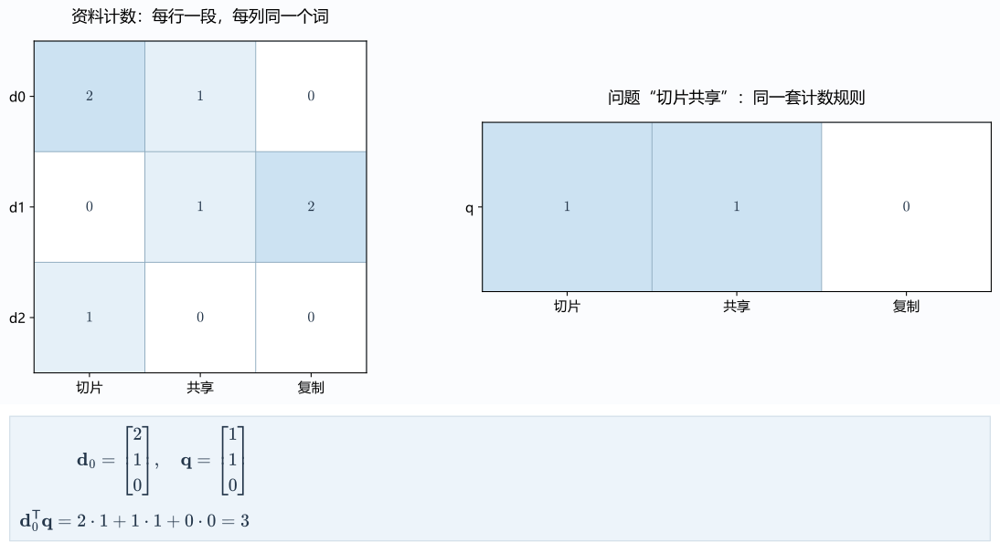

### 2. 表示与信息取舍

如果把 `d0` 改成“共享介绍：切片。切片。”，数出来的结果依然是 `(2, 1, 0)`。这种只数词频的办法保住了词出现的次数，却把词的先后顺序丢掉了。同样，要是用户问“切片不共享吗”和“切片共享吗”，由于词表里根本没有记录“不”这个否定词，两个截然相反的问题也会得到一模一样的数字表示。

这说明任何一种数学表示都在做取舍：它把任务里的一部分关系抽出来变成数字，同时必然漏掉另一些信息。这种词频表示虽然粗糙，但已经能撑起基础的字面检索，并且把缺陷摆在了明面上——第五篇做工程检索时，我们会先靠这类数字快速筛出候选文档，再拿完整原文做核对；而在第三、四篇里，则会引入新的结构，把词序和上下文重新装进表示里。

## （二）点积与余弦相似度

### 1. 点积与重合计数

有了数字表示，怎么算匹配分数？既然问题只关心“切片”和“共享”，就给这两个位置各赋权重 1；不关心“复制”，权重给 0。拿这套权重去算 `d0`，得分是 $1\times2+1\times1+0\times0=3$；同理算得 `d1` 是 1 分，`d2` 也是 1 分。

把问题的一组数记为粗体字母 $\mathbf q$，文档的一组数记为 $\mathbf d$；用 $q_j$ 表示问题的第 $j$ 个坐标，$d_j$ 表示文档在相同位置上的坐标（下标 $j$ 只是位置编号，不是乘法）。本例一共有三个位置，把对应位置的数字相乘再加起来，写成公式就是：

$$
\mathbf q\cdot\mathbf d=\sum_{j=1}^{3}q_jd_j =q_1d_1+q_2d_2+q_3d_3.
$$
中间的圆点代表**点积（Dot Product）**，算出来的结果是一个单独的数。符号 $\sum$ 表示连加，底下的 $j=1$ 代表从第 1 项开始，顶上的 3 代表一直加到第 3 项为止。这个公式只是把刚才手算的计分规则写了出来，词表扩充到几万个词时也是同样的写法。

问题里的数字还可以用来表达侧重点。比如检索者更看重“共享”，可以把问题权重改成 $\mathbf q=(1,2,0)$，这时 `d0` 得分变成 4，`d1` 变成 2，`d2` 还是 1。系数的变化反映的是人对检索需求的取舍，数学运算本身只负责按给定的系数算账，不会自己长出需求来。

### 2. 向量长度与归一化

点积看起来很顺手，但很容易被钻空子。要是把 `d2` 里的“切片”连着重复抄十遍，它的表示就成了 `(10, 0, 0)`，点积得分直接飙升到 10，把同时包含“切片”和“共享”的 `d0`（3 分）远远甩在后面。这是因为点积把两件事混在了一起：一是文档内容与问题的方向是否吻合，二是文档本身的字数（总计数）有多大。

如果我们希望“把同一段话单纯复制十遍”不会凭空提高它的相关性排名，就得把文档自身“长度”的影响除掉。在平面上画一个坐标 `(3, 4)`，横着走 3、竖着走 4，斜边长度按勾股定理算出来是 $\sqrt{3^2+4^2}=5$。推广到 $k$ 个坐标，向量的长度（也叫范数，用双竖线表示）就是所有坐标平方和再开根号：

$$
\Vert{}\mathbf d\Vert{}=\sqrt{d_1^2+d_2^2+\cdots+d_k^2}
$$
把一个向量的每个坐标都除以它自己的长度，就能得到一个长度为 1 的新向量，这个操作叫**归一化**。归一化之后，各个坐标之间的比例丝毫未变。拿本例来说，`d0` 的长度是 $\sqrt{2^2+1^2+0^2}=\sqrt5$，归一化后变成 $(\frac{2\sqrt5}{5}, \frac{\sqrt5}{5}, 0)$；问题 $\mathbf q$ 的长度是 $\sqrt2$，归一化后变成 $(\frac{\sqrt2}{2}, \frac{\sqrt2}{2}, 0)$。

现在拿归一化之后的向量重新算点积：`d0` 得分为 $\frac{3\sqrt{10}}{10}\approx0.948683$；`d1` 为 $\frac{\sqrt{10}}{10}\approx0.316228$；`d2` 为 $\frac{\sqrt2}{2}\approx0.707107$。排名变成了 `d0` 第一、`d2` 第二、`d1` 第三。哪怕把 `d2` 里的“切片”重复十遍，除以长度 10 之后，归一化向量还是 $(1, 0, 0)$，得分依然稳稳停在 $0.707107$。这种消掉长度后再算点积的指标，就是检索里最常用的**余弦相似度**（它和几何夹角的关系会在第七节推导）。

~~~python
# 每行分别求长度：axis=1 沿该行的三个特征汇总。
lengths = np.linalg.norm(documents, axis=1, keepdims=True)
unit_documents = documents / lengths
unit_query = query / np.linalg.norm(query)
# @ 在这里对每条记录计算“对应项相乘后求和”。
scores = unit_documents @ unit_query
order = np.argsort(-scores)
print(scores.round(6).tolist(), order.tolist())
~~~

代码里 `np.linalg.norm` 用来求长度，`keepdims=True` 让算出来的三个文档长度保持 `(3, 1)` 的列形状，这样在做除法时就能自动和三行文档一一对齐。`np.argsort` 默认按从小到大返回位置下标，给分数加上负号再排，就相当于按原分数从高到低排序。不过要注意，算出来的只是候选排序，真正回答用户问题还得靠第五篇把对应的原文取出来。

如果用户搜的是词表里根本没有的“数据库”，问题向量 $\mathbf q$ 就会变成全零 `(0, 0, 0)`，算出来的长度为 0，做除法归一化时直接报错或产生无效值（`NaN`）。这并不是除法公式写错了，而是当前的三词词表根本没收录这个信息；在工程代码里遇到全零向量应当直接拦截并返回“无匹配结果”，而不能硬往下算。

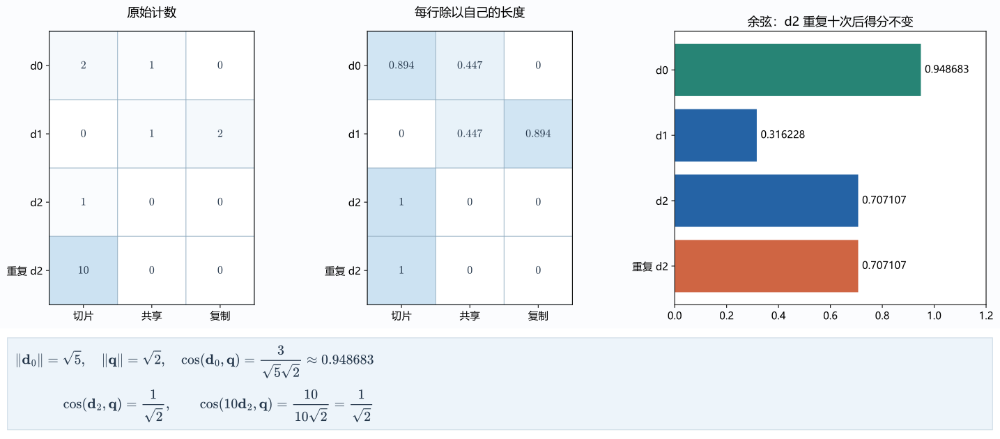

## （三）向量与线性组合

### 1. 向量的含义

如果把 `d0` 和 `d1` 两段话合并成一篇文档，新文档里的词频就变成了 `(2, 2, 2)`，正好等于 `(2, 1, 0) + (0, 1, 2)`；如果把同一篇文档完整抄两遍，词频就整体乘 2。也就是说，“合并文本”和“重复文本”这两种实际操作，刚好对应着这组数字上的“按位相加”和“整体乘一个数”。有了这种实打实的对应关系，我们才能放心地用统一的数学运算去批量处理文本。

在数学上，凡是允许做加法和数乘（乘以一个单独的数）、并且满足一套一致运算规则的对象，就叫做**向量（Vector）**。物理课上带箭头的位移是向量，这里的词频数组满足这套规则，因此也是向量。但并不是代码里随便塞几个数的列表都能当向量用：比如把一个人的`(年龄, 身份证后四位)`装进数组，拿两个人的数组相加，算出来的结果在现实里毫无意义。把数据写成向量之前，必须先问清楚：坐标相加和放大，在当前任务里到底对应什么实际含义？

单独的一个数字叫**标量（Scalar）**，向量里的每一个坐标值叫**分量**。在数学推导里，通常习惯把向量竖着写成一列，称为列向量；为了排版省地方，常写成横行再在右上角加个转置符号 $\mathsf T$，比如 $\mathbf q=[1,1,0]^\mathsf T$（转置就是把行和列调换过来）。这样一来，前面的点积也可以写成矩阵乘法的形式 $\mathbf q^\mathsf T\mathbf d$：左边躺着的行向量和右边立着的列向量逐项配对相乘再相加，最后浓缩成一个标量。

~~~python
# 一维数组没有显式的行列方向，转置不会添加轴。
a = np.array([3., 4.])
column = np.array([[3.], [4.]])
row = np.array([[3., 4.]])
print(a.shape, column.shape, row.shape)  # (2,)、(2,1)、(1,2)
print(a.T.shape, column.T.shape)        # (2,)、(1,2)
~~~

数组的 `shape` 属性给出了每一条轴（维度）的长度。注意 `(2,)` 里面的逗号是 Python 单元素元组的语法，代表这是一个只有一条轴、长度为 2 的一维数组，它既不分显式的行也不分列，对它做 `.T` 转置形状不会变；而 `(2, 1)` 是 2 行 1 列的二维列向量，转置后才会变成 `(1, 2)` 的行向量。数学公式里默认把单个样本写成列向量，而写代码时习惯把一批样本一行行叠起来存放，靠转置和 `shape` 检查就能把这两套习惯稳稳接上。

把数字本身与装数字的轴分开看：标量 $3$ 只有一个值，列向量 $[3,4]^{\mathsf T}$ 有两个分量，矩阵则把多条记录的分量排成行列。下图中的一维数组与二维列向量虽然都存着 $3$、$4$，代码能沿哪些轴运算却不同。转置只交换已有的轴，不会凭空补出一条新轴；因此在数学推导与数组代码之间来回转换时，要同时核对数值和形状。

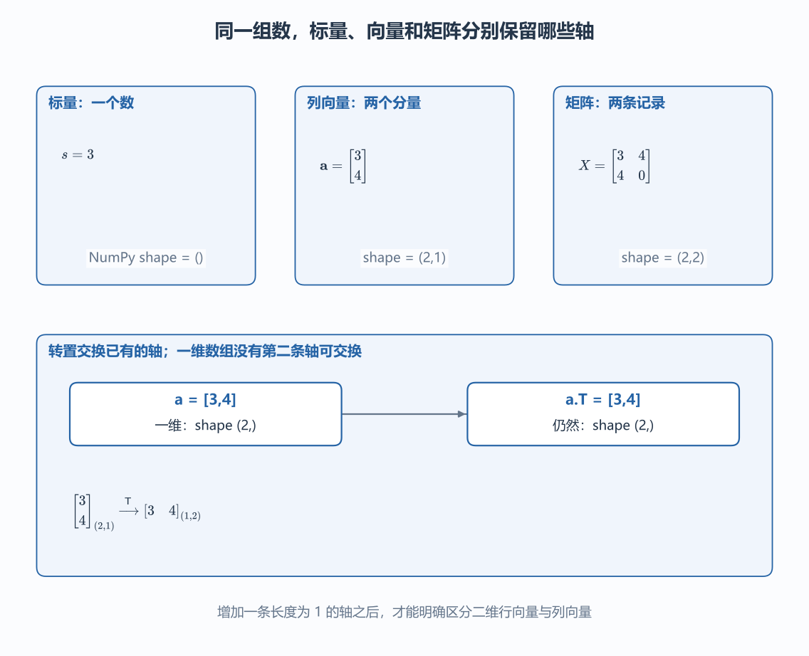

### 2. 加权组合与方向

再看学习记录里的“页数”和“题数”。设 $\mathbf e_1=(1,0)$ 代表“多读 1 页”，$\mathbf e_2=(0,1)$ 代表“多做 1 道题”。那么“读 3 页、做 4 题”就可以拆写成 $3\mathbf e_1+4\mathbf e_2$。一旦选定了这两个基本变化方向，其他任何页数和题数的搭配都能由它们按比例拼出来，不用每次重新发明规则。

像 $\alpha\mathbf u+\beta\mathbf v$ 这样，拿几个向量各自乘上标量系数再加起来，就叫做**线性组合**。系数为 0 代表不沿着那个方向走，系数为负数则代表往反方向走。比如拿实际完成的 `(3, 4)` 减去原计划的 `(4, 0)`，得到 `(-1, 4)`，意思非常明确：比原计划少读了 1 页、多做了 4 道题。哪怕日常阅读的页数本身不能是负数，一旦进入“比较差异”和“计算调整方向”的环节，负数坐标就有了实实在在的含义。

## （四）向量空间

既然算差异、算误差调整时免不了出现负数和小数，我们就不能把眼光局限在“非负整数”里，而要把词频和记录放进允许任意正负实数的空间里去算。数学上用 $\mathbb R$ 表示实数集，$\mathbb R^3$ 就代表由三个实数坐标组成的全部有序三元组；写 $\mathbf d\in\mathbb R^3$ 时，符号 $\in$ 读作“属于”，意思是向量 $\mathbf d$ 是这个三维实数空间里的一员。

在 $\mathbb R^3$ 里，随便挑两个向量加起来，结果还在 $\mathbb R^3$ 里；随便挑个向量乘上任意实数，结果也跑不出 $\mathbb R^3$。这种“怎么算都不会掉出集合外”的性质，叫做**对加法和数乘封闭**。再加上里头有不改变加法结果的零向量 $\mathbf 0$、每个向量都有能把自己抵消成零的相反向量，而且加法交换律、结合律和数乘分配律全都成立——满足这一整套规矩的集合，就叫做**实向量空间**。

用这个标准一量就会发现，“所有长度为 1 的归一化文档向量”凑在一起，**并不是**一个向量空间。因为你随便拿两个长度为 1 的向量加起来，新向量的长度通常不再是 1；拿它乘个 2，长度变成了 2，立刻就掉出了“单位向量”这个圈子。它只是整个向量空间里的一个受约束子集（球面）。分清“原始数据受现实限制能取哪些值”和“中间计算需要在多大的向量空间里展开”，写代码时才不会把约束加错地方。

向量空间里装的也不一定非得是一串数字。比如所有形如 $f(t)=at+b$ 的一次函数，拿两个一次函数相加还是个一次函数，乘上任意实数也依然是一次函数，所以它们也构成一个向量空间。在这里，函数 $t$ 和常数函数 $1$ 就是两个基本方向（基），而系数 `(a, b)` 则是具体某个函数在这两个方向下的坐标。函数本身是要研究的对象，`(a, b)` 只是它在当前基下的一种数字表示；换一套基，坐标数字会跟着变，但背后指代的那个函数对象并没有变。

再看一种情况：假设我们收集了一批学习记录，发现每个人的“题数”永远是“页数”的整整两倍，也就是所有记录都长成 `(u, 2u)` 的样子。这些点在平面上串成了一条穿过原点的斜线。你拿这条线上的任意两个点相加，或者乘上任意倍数，结果依然老老实实待在这条线上——像这样待在大空间里、自己本身又满足封闭性要求的小空间，叫做**子空间**。注意子空间必须穿过原点 $\mathbf 0$；如果是一条不经过原点的平移直线，乘个 0 就会掉回原点，跳出直线之外，因此成不了子空间。

怎么判断手头的一组向量到底提供了几个真正独立的方向？可以看方程 $\alpha\mathbf u+\beta\mathbf v=\mathbf 0$。如果 $\mathbf u=(1,2)$、$\mathbf v=(2,4)$，只要取 $\alpha=2,\beta=-1$，加起来就抵消成了零向量，说明 $\mathbf v$ 只是 $\mathbf u$ 的翻倍，根本没提供新方向，这叫**线性相关**。反过来，如果除了让系数全都取 0（$\alpha=\beta=0$）之外，再也没法把它们凑成零向量，就说明谁也替代不了谁，这叫**线性无关**。能够线性组合出目标空间里所有对象、彼此又线性无关的一组向量，就叫做这个空间的**基（Basis）**；基里包含的向量个数，就是空间的**维数（Dimension）**。哪怕你手里攒了一万条 `(u, 2u)` 这样的样本，它们张成的子空间里真正独立的变化方向也只有 1 个，维数就是 1。

图中左侧的两条箭头分别是 $\mathbf u=(1,2)$、$\mathbf v=(2,4)$，沿任意比例组合，都只能在同一条直线上移动。右侧把第二条方向换成 $\mathbf w=(1,0)$，先沿 $\mathbf u$ 走两倍，再沿 $\mathbf w$ 走一倍，就到了 $(3,4)$。更一般地，先用 $(y/2)\mathbf u$ 得到 $(y/2,y)$，再用 $(x-y/2)\mathbf w$ 补齐第一坐标，就能到达任意 $(x,y)$。灰色直角坐标保持固定，淡蓝线显示这两个方向平移后的线族；图框只截取了平面的一部分。

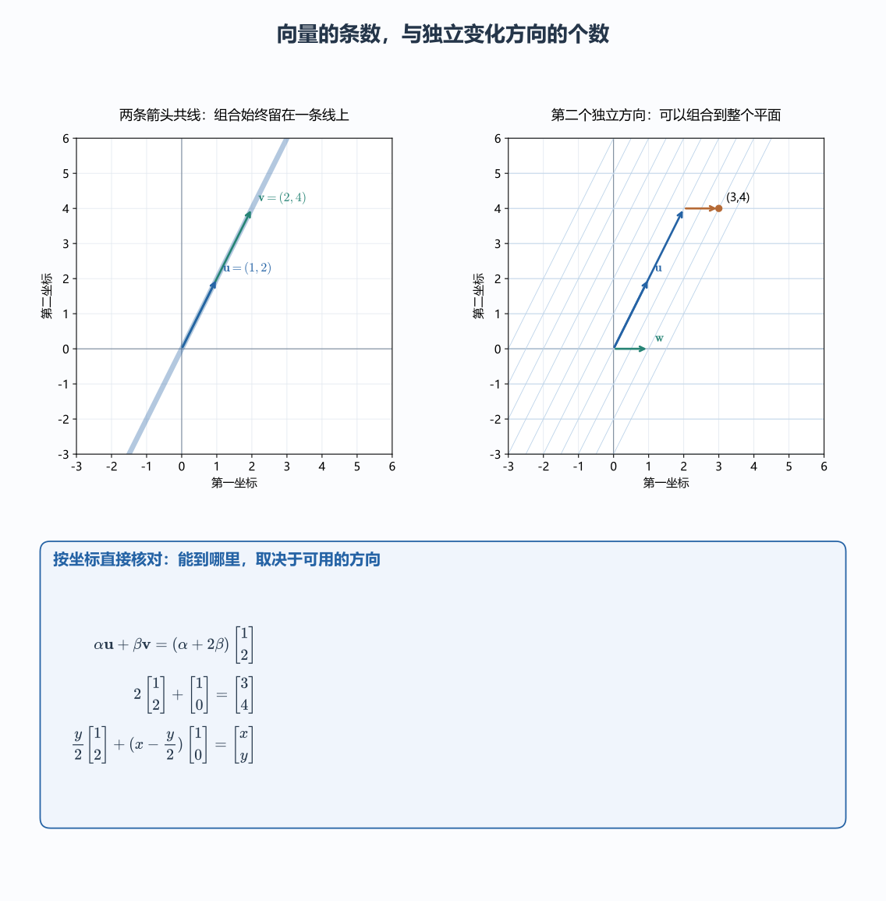

到这里，向量空间把各种对象的线性组合规矩统一了起来，坐标则把这些规矩落成了代码能算的数字。接下来我们要看的是：怎样用矩阵给一整批向量同时施加规则，并在不同表示之间做转换。

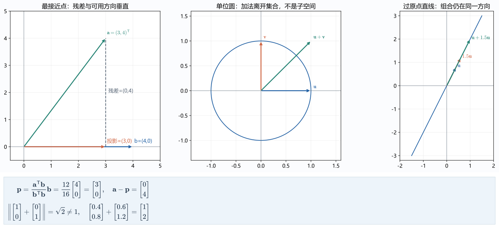

## （五）矩阵与批量运算

做完检索，假设我们要根据“读了多少页”和“做了多少题”来批量估算学习耗时。取两条可手算的记录：记录 A 是 3 页、4 题，记录 B 是 4 页、0 题，统一按`(页数, 题数)`的顺序摆放。

### 1. 矩阵的行列与形状

把记录 A 放第一行、记录 B 放第二行，叠成一个二维表格，这就是**矩阵（Matrix）**：

$$
X=\begin{bmatrix}3&4\\4&0\end{bmatrix}
$$
通常用大写字母 $X$ 表示整个矩阵，用带两个下标的 $X_{ij}$ 表示第 $i$ 行、第 $j$ 列的那个数字（比如第 1 行第 2 列的 $X_{12}=4$）。要注意的是，数学公式里的行列编号习惯从 1 数起，而 Python 的索引从 0 数起，所以公式里的 $X_{12}$ 在代码里对应的是 `x[0, 1]`。

如果手头有 $n$ 条记录，每条记录有 $d$ 个特征，组成的矩阵就记作 $X\in\mathbb R^{n\times d}$。这里的 $\times$ 不是把两个数乘起来，而是用来隔开行数和列数，对应代码里的 `shape=(n, d)`。二维数组叫矩阵；等后面处理彩色图像批次时，数据会有`(样本数, 颜色通道, 高度, 宽度)`四条轴，这种不限轴数的多维数组在深度学习里统称为**张量（Tensor）**。

两个矩阵相加，要求形状一模一样，直接把对应位置的数字加起来就行。矩阵的转置 $X^\mathsf T$ 则是把原来的行变成列、列变成行，满足 $(X^\mathsf T)_{ji}=X_{ij}$。本例里的 $X$ 碰巧是个对称矩阵，转置后看着和原来一样，但绝大多数矩阵转置后形状或数字位置都会改变。

### 2. 矩阵与向量相乘

现在定两条计算规则：
* **规则一（算预计耗时）**：读 1 页平均花 2 分钟，做 1 道题花 1 分钟。拿记录 A `(3, 4)` 来算，耗时是 $2\times3+1\times4=10$ 分钟。
* **规则二（算题页差）**：用题数减去页数，系数分别是 $-1$ 和 $1$。拿记录 A 来算，结果是 $(-1)\times3+1\times4=1$。

这两条规则干的是同一件事：把输入向量里的各个坐标分别乘上一组固定系数，再加起来。我们干脆把第一条规则的系数放第一行，第二条规则的系数放第二行，打包成一个规则矩阵 $W$：
$$
W=\begin{bmatrix}2&1\\-1&1\end{bmatrix}
$$
让矩阵 $W$ 作用于列向量 $\mathbf a=[3, 4]^\mathsf T$：第一行系数读取完整输入算出第一个输出 10，第二行系数读取同一个输入算出第二个输出 1。写在一起就是矩阵与列向量的乘法：$$W\mathbf a= \begin{bmatrix} 2\times3+1\times4\\ (-1)\times3+1\times4 \end{bmatrix} =\begin{bmatrix}10\\1\end{bmatrix}.$$

从这个过程能一眼看出矩阵乘法的维度规矩：$W$ 有几行，就代表定下了几条规则，输出向量就有几个分量；$W$ 有几列，就代表每条规则需要消耗几个输入特征，因此输入向量必须恰好有几个分量。一般地，若 $W$ 的形状是 $(m, d)$，列向量 $\mathbf x$ 的形状是 $(d, 1)$，乘出来的结果就是 $(m, 1)$。常说的“内侧维度 $d$ 必须相等”，原因就在这里——每条规则的系数必须和输入特征一个对一个刚好配平，多一个或少一个都没法相乘求和。

把第 $i$ 条规则算出来的第 $i$ 个输出写成通用公式，就是：$$y_i=\sum_{j=1}^dW_{ij}x_j.$$

当 $d=2$ 时，展开来就是刚才手算的 $W_{i1}x_1+W_{i2}x_2$。

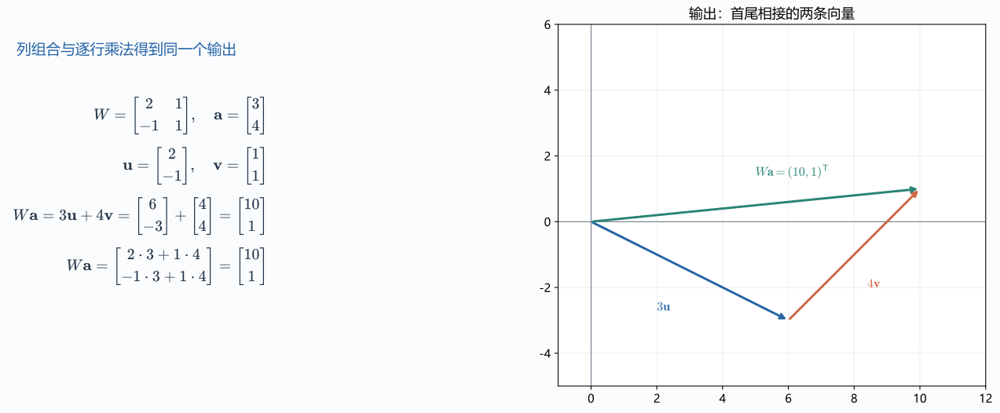

### 3. 批量矩阵计算

如果右边放的不只是一列向量，而是好几列向量并排拼成的矩阵 $B$，那么矩阵乘矩阵 $AB$ 其实就是用 $A$ 挨个去乘 $B$ 的每一列，再把算出来的各列结果并排拼好。落实到第 $i$ 行、第 $k$ 列的单个数字上，就是拿 $A$ 的第 $i$ 行和 $B$ 的第 $k$ 列做点积：$(AB)_{ik}=\sum_j A_{ij}B_{jk}.$

因此，形状为 $(m, d)$ 的矩阵乘以 $(d, p)$ 的矩阵，内侧的 $d$ 配平消掉，最终得到 $(m, p)$ 的矩阵。

在写代码时，我们习惯把样本按行存放在 $X$ 里（形状为 $n\times d$），而规则矩阵 $W$ 也是按行存放每条规则（形状为 $m\times d$）。要让 $X$ 里的每一行样本都和 $W$ 里的每一行规则做点积，只需先把 $W$ 转置成 $d\times m$，再算 $XW^\mathsf T$：

~~~python
import numpy as np
# X 每行一条记录；W 每行一条输出规则。
x = np.array([[3., 4.], [4., 0.]])
w = np.array([[2., 1.], [-1., 1.]])
# @ 表示矩阵乘法；* 表示逐元素乘法，二者不同。
print(x @ w.T)  # [[10, 1], [8, -4]]
print(x * w)    # [[6, 4], [-4, 0]]
~~~

跑出来的结果第一行是 `[10, 1]`（记录 A 的两个输出），第二行是 `[8, -4]`（记录 B 的两个输出）。千万注意 Python 里的 `@` 才是矩阵乘法，而星号 `*` 只是把两个矩阵相同位置的数字硬乘一下，完全没有“跨列相加汇总”的步骤，绝不能混用。

如果每次开始学习前还有固定的 3 分钟准备时间，预测公式就变成了 $W\mathbf x+\mathbf b$，多出来的这项 $\mathbf b$ 叫做**偏置（Bias）**。在 NumPy 里，当你拿形状为 `(n, m)` 的批量输出直接加上形状为 `(m,)` 的一维偏置时，程序会自动把这行偏置复制 $n$ 份，挨个加到每一条样本上，这种机制叫做**广播（Broadcasting）**。广播虽然省事，但也极容易埋雷：比如你手里有一列预测值形状是 `(n, 1)`，而真实标签是一维数组 `(n,)`，拿它俩直接相减时，NumPy 不会报错，而是会把两边广播成一个 `(n, n)` 的大方阵（算出两两样本之间的差），导致后续损失完全算错。养成随时打印检查 `shape` 的习惯至关重要。

可以拿一组完全正确的预测来暴露广播错误：两条预测为 $3$、$5$，对应标签也为 $3$、$5$，逐样本误差本应全为零。若预测形状为 $(2,1)$、标签形状为 $(2,)$，直接相减会产生四项：第 $i$ 行第 $j$ 列保存“第 $i$ 条预测减第 $j$ 条标签”。两项非对角误差来自不同记录之间的错误配对。下图把标签先整理成 $(2,1)$，才恢复“自己的预测减自己的标签”。图中均方误差使用所有误差平方的平均值，没有另乘 $1/2$。

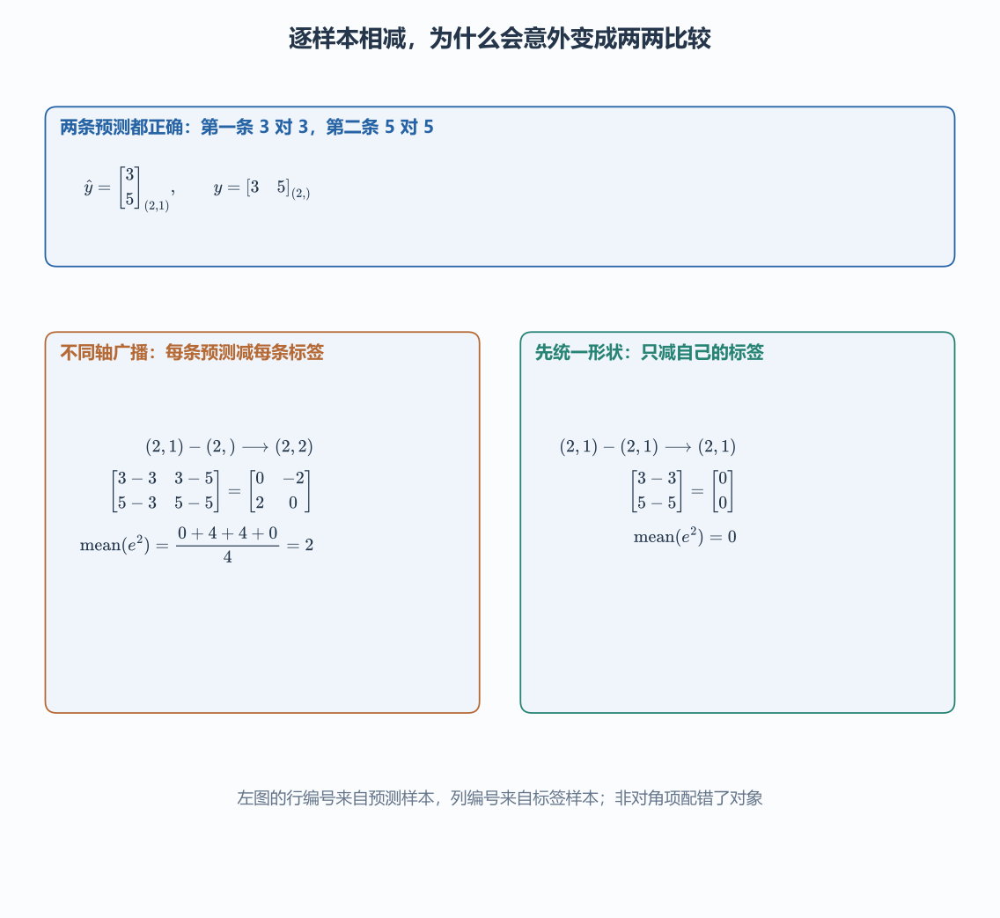

## （六）矩阵变换、行列式与换基

换一组矩阵系数，不只是换了几个算术数字，而是对整个空间做了一次几何变形。要看清一个 $2\times2$ 矩阵到底对平面干了什么，只需盯住两条最简单的基向量：$\mathbf e_1=(1,0)$ 乘上矩阵后，刚好变成矩阵的第一列；$\mathbf e_2=(0,1)$ 乘上矩阵后，刚好变成矩阵的第二列。既然平面上的任何向量都能拆成 $x_1\mathbf e_1+x_2\mathbf e_2$，那么经过矩阵变换后，它就必然落到“第一列乘 $x_1$ 加第二列乘 $x_2$”的位置上。**只要知道两条基向量被搬到了哪儿，整个平面上所有点的去向就全都锁死了**——这就是矩阵能够完整刻画线性变换的根本原因。

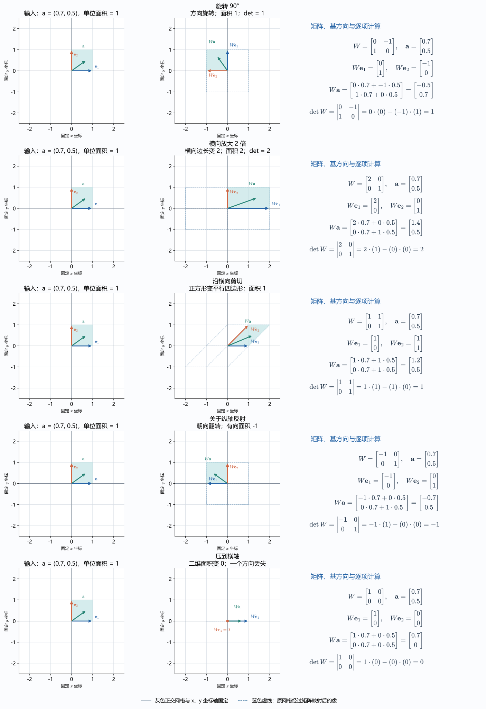

图中灰色直角网格和 $x,y$ 坐标轴始终固定，横纵每一单位的画面长度相同。蓝色虚线是原网格经过矩阵作用后的像，剪切会使这些虚线倾斜；点的输出坐标仍沿固定的灰色坐标轴读取。每行左侧是输入，中央是变换结果，右侧列出矩阵和逐项计算。输入中蓝色箭头为 $\mathbf e_1$，橙色为 $\mathbf e_2$，绿色为 $\mathbf a=(0.7,0.5)$；输出中的 $W\mathbf e_1$、$W\mathbf e_2$ 和 $W\mathbf a$ 分别标出它们的像。浅色区域是单位正方形的像，其有向面积由行列式记录。

* **旋转**：保持长度、夹角和网格面积全都不变；
* **缩放**：把横向拉长，面积也跟着成倍放大；
* **剪切**：像推一副扑克牌一样让平行线侧滑，夹角变了，但底和高没变，因此面积保持为 1；
* **反射**：像照镜子一样把平面翻过来，面积大小不变，但蓝橙箭头的顺逆时针朝向颠倒了；
* **降维投影**：把所有点都拍扁到横轴上，原本独立的两个方向塌缩成了一条线，围成的二维面积直接变成了 0。

数学上用**行列式（Determinant，记作 $\det W$）**这一个数字，来专门记录变换后“单位正方形的有向面积变成了原来的多少倍”。

对于二维矩阵 $W=\begin{bmatrix}a&b\\c&d\end{bmatrix}$，变换后的两条边分别是第一列 $(a,c)=a\mathbf e_1+c\mathbf e_2$ 和第二列 $(b,d)=b\mathbf e_1+d\mathbf e_2$。拆开来看四个分量的组合：同一方向自己和自己围不出面积（面积为 0）；正序的 $(a\mathbf e_1, d\mathbf e_2)$ 围出矩形面积 $ad$；反序的 $(c\mathbf e_2, b\mathbf e_1)$ 因为朝向翻了过来，给出负面积 $-bc$。合在一起，有向面积的伸缩倍数就是：

$$
\det W = ad - bc.
$$

行列式的绝对值代表面积（三维就是体积）放大或缩小的倍率，正负号则代表空间的朝向有没有被翻转；一旦 $\det W=0$，就说明空间被拍扁降维了，信息发生了不可逆的丢失。不过要注意，旋转和剪切的行列式都可以是 1，说明单凭行列式这一个数，还不足以还原矩阵变换的全部细节。

如果对向量接连做两次变换——先做 $B$，再做 $A$，那么面积就会先乘上 $\det B$，再乘上 $\det A$，所以复合变换的行列式满足 $\det(AB)=\det A\,\det B$。把矩阵的几何含义和列操作对应起来看也十分直观：交换矩阵的两列，等于把两条基方向对调，空间朝向翻转，行列式变号；把某一列乘上 $k$，平行四边形的一条边长变成 $k$ 倍，面积也乘 $k$；把一列的倍数加到另一列上，等于让平行四边形沿边做剪切滑动，底和高都不变，行列式也不变。

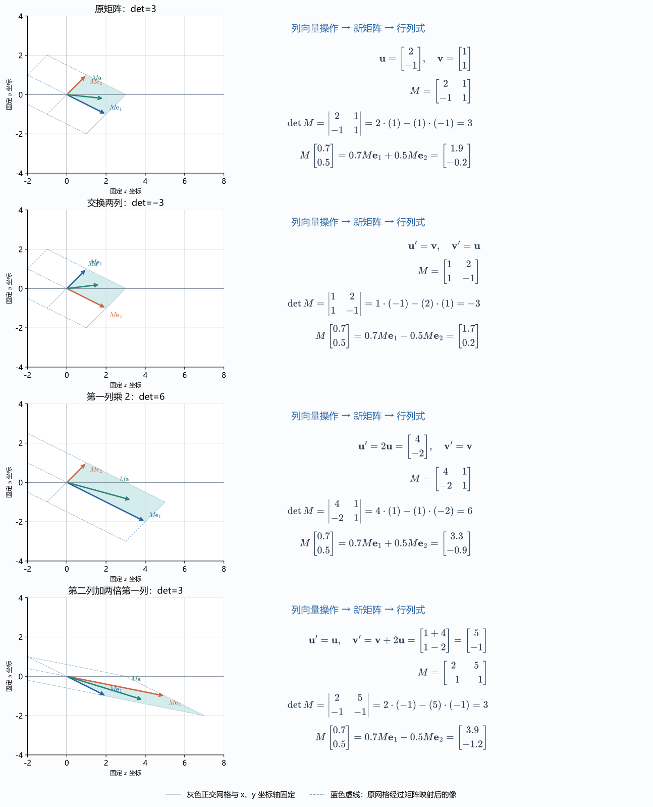

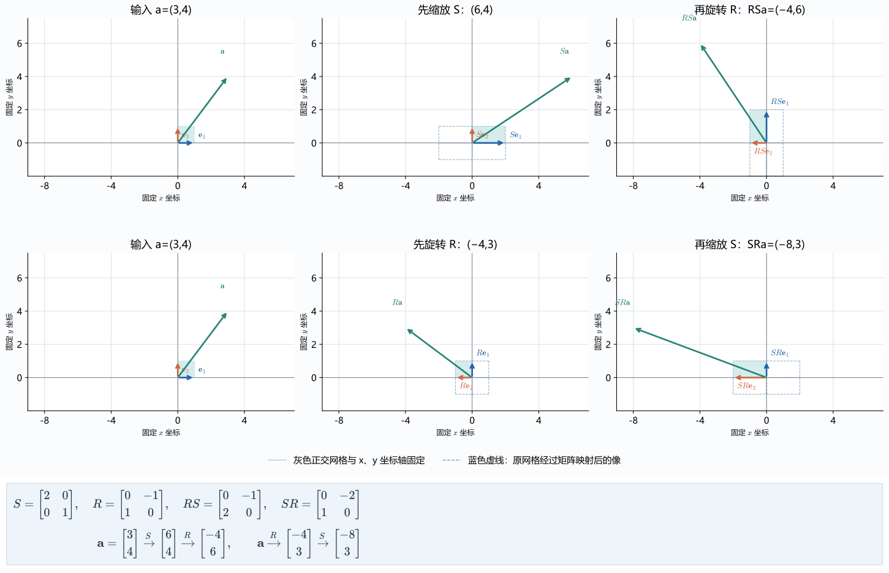

再看连续做两次变换时的先后顺序。上图中，第一行是“先沿横轴放大 2 倍，再逆时针转 90 度”；第二行是“先逆时针转 90 度，再沿横轴放大 2 倍”。虽然两种顺序最后算出来的面积都是原来的 2 倍，但同一个绿色向量最终落脚的位置却完全不同。拿具体的矩阵算一下就能验证：单位矩阵 $I=\begin{bmatrix}1&0\\0&1\end{bmatrix}$ 让任何向量保持原样；横向放大 2 倍的对角矩阵是 $S=\begin{bmatrix}2&0\\0&1\end{bmatrix}$；逆时针旋转 90 度的矩阵是 $R=\begin{bmatrix}0&-1\\1&0\end{bmatrix}$。对 $\mathbf a=(3,4)$ 先缩放再旋转，算的是 $R(S\mathbf a)=(RS)\mathbf a=(-4, 6)$；反过来先旋转再缩放，算的是 $S(R\mathbf a)=(SR)\mathbf a=(-8, 3)$。**矩阵乘法从右往左作用的顺序，严格记录了动作发生的先后次序**，所以 $RS$ 和 $SR$ 通常不能随便交换。

这种满足 $W(\alpha\mathbf u+\beta\mathbf v)=\alpha W\mathbf u+\beta W\mathbf v$（先组合再变换，等于先变换再组合）的规则，就叫**线性映射**。线性映射永远把原点映射到原点；如果额外加上一个非零的偏置 $\mathbf b$（写成 $W\mathbf x+\mathbf b$），把原点也一起平移走，就叫做**仿射映射**。

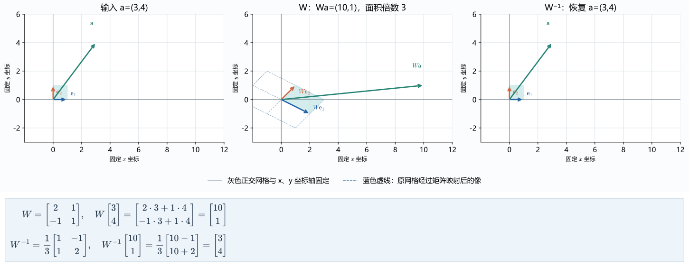

### 1. 基与坐标变换

前面我们把矩阵看成“推着向量在空间里搬家”；换个角度，如果向量站在原地不动，我们改用另一套基方向去测量它，矩阵又起什么作用？

还是看位置固定在 $(3, 4)$ 的那条学习记录 $\mathbf a$。原来我们用单页 $\mathbf e_1=(1,0)$ 和单题 $\mathbf e_2=(0,1)$ 当尺子，量出来的坐标是 3 和 4。现在换一套新尺子（新基）：设 $\mathbf u=(1,1)$ 代表“1 页配 1 题的均衡单元”，$\mathbf v=(1,-1)$ 代表“页数多于题数的偏科单元”。要拼出原来的 $(3,4)$，各需要多少个 $\mathbf u$ 和 $\mathbf v$？设新坐标为 $c_1, c_2$：

$$
c_1\mathbf u+c_2\mathbf v=\mathbf a.
$$

把数值代进去按行展开，就是方程组 $c_1+c_2=3$ 和 $c_1-c_2=4$。两式相加消去 $c_2$，立刻算出 $c_1=3.5, c_2=-0.5$。如果把两条新基竖着排成矩阵 $B=[\mathbf u\ \mathbf v]$，上面的拼合关系就是 $\mathbf a=B\mathbf c$；反过来从原坐标求新坐标，就是乘上逆矩阵 $\mathbf c=B^{-1}\mathbf a$。

可以看到，客观存在的学习记录还是那一条，但在旧基下它叫 `(3, 4)`，在新基下它叫 `(3.5, -0.5)`。机器学习里做特征工程和表示学习，干的正是这种“换尺子”的活：原始坐标记录的往往是零散的表层读数（几页、几题），而变换后的新坐标则试图对齐更有概括力的方向（比如第一维直接反映“总投入工作量”，第二维反映“读与练的结构比例”）。至于换了尺子之后好不好用，全看这套变换有没有把任务关心的关键方向给弄丢（也就是看矩阵是不是把空间拍扁了）。

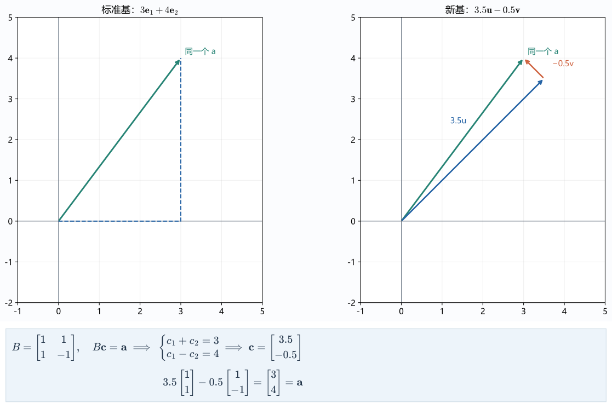

## （七）投影与最小二乘

在实际任务里，如果为了节省存储或提取主干，规定不能完整保存二维平面上的每一个点，只能沿着某一条给定的方向（比如记录 B 的方向）去近似记录 A，怎样找一个离 A 最近的点？这就引出了空间里的距离、夹角与正交投影。

### 1. 距离与余弦的几何联系

前面第二节已经用勾股定理算过单个向量的长度：$\mathbf a=(3,4)$ 的长度 $\|\mathbf a\|=\sqrt{3^2+4^2}=5$，$\mathbf b=(4,0)$ 的长度 $\|\mathbf b\|=4$。平面上两点之间的直线距离（欧氏距离），就是它们差向量的长度：拿 $\mathbf a-\mathbf b=(-1, 4)$ 求长度，得到距离为 $\sqrt{(-1)^2+4^2}=\sqrt{17}$。因为每一维的差都做了平方，正负误差不会互相抵消；但这也意味着，如果某一个特征的单位很小、数值动辄成千上万，它一平方就会彻底主导整个距离，所以算距离前必须留神各维度的量纲。

再看点积 $\mathbf a^\mathsf T\mathbf b=3\times4+4\times0=12$。为什么第二节里说“把点积除以俩向量的长度，算出来的就是夹角的余弦”？我们可以拿差向量的长度平方来推导。把 $\|\mathbf a-\mathbf b\|^2$ 按普通代数展开：

$$
\|\mathbf a-\mathbf b\|^2
=(\mathbf a-\mathbf b)^\mathsf T(\mathbf a-\mathbf b)
=\|\mathbf a\|^2+\|\mathbf b\|^2-2\mathbf a^\mathsf T\mathbf b.
$$

另一方面，$\mathbf a$、$\mathbf b$ 和差向量 $\mathbf a-\mathbf b$ 首尾相接，正好围成一个三角形。按初中学过的三角形余弦定理，第三边的平方等于：

$$
\|\mathbf a-\mathbf b\|^2
=\|\mathbf a\|^2+\|\mathbf b\|^2-2\|\mathbf a\|\|\mathbf b\|\cos\theta.
$$

把上下两个式子一对比，前面两项一模一样，最后一项必然相等，直接消掉 $-2$ 就得到了点积的几何恒等式：

$$
\mathbf a^\mathsf T\mathbf b=\|\mathbf a\|\|\mathbf b\|\cos\theta.
$$

把两边的长度除过去，$\cos\theta=(\mathbf a^\mathsf T\mathbf b)/(\|\mathbf a\|\|\mathbf b\|)=12/(5\times4)=0.6$。这就是余弦相似度的真正来历：两个向量方向完全相同时夹角为 0 度，$\cos\theta=1$；方向完全相反时为 $-1$；互相垂直时夹角 90 度，$\cos\theta=0$，此时点积也是 0，数学上把点积为 0 的两个向量称为**正交（Orthogonal）**。如果把 $\mathbf b$ 放大两倍变成 $(8,0)$，它和 $\mathbf a$ 的欧氏距离拉大到了 $\sqrt{41}$，但夹角余弦稳稳停在 $0.6$ 不变——关心绝对差异大小时用欧氏距离，只关心方向和结构比例时用余弦相似度。

### 2. 正交投影

现在回到近似问题：只能在 $\mathbf b=(4,0)$ 这条直线上挑一个点 $\lambda\mathbf b$ 来代替 $\mathbf a=(3,4)$，系数 $\lambda$ 取多少时，近似点离 $\mathbf a$ 最近？

“离得最近”就是让残差向量 $\mathbf r=\mathbf a-\lambda\mathbf b$ 的长度平方最小。写出关于 $\lambda$ 的函数并展开：

$$
f(\lambda)=\|\mathbf a-\lambda\mathbf b\|^2
=\|\mathbf a\|^2-2\lambda\mathbf a^\mathsf T\mathbf b+\lambda^2\|\mathbf b\|^2.
$$

这是一个关于 $\lambda$ 的开口向上的抛物线，最低点出现在顶点处：

$$
\lambda=\frac{\mathbf a^\mathsf T\mathbf b}{\|\mathbf b\|^2}=\frac{12}{16}=0.75.
$$

把 $\lambda=0.75$ 乘回 $\mathbf b$，得到直线上的最近点 $\mathbf p=0.75\times(4,0)=(3,0)$，这个点就叫做 $\mathbf a$ 在 $\mathbf b$ 上的**正交投影**。再看此时的残差 $\mathbf r=\mathbf a-\mathbf p=(0, 4)$，拿它和 $\mathbf b=(4,0)$ 算点积，结果正好是 $0\times4+4\times0=0$！这在几何上再自然不过了：从点 A 往直线 B 引垂线，垂足就是最近点；如果残差跟直线还不垂直，说明顺着直线方向挪一挪还能让斜边变得更短，那就还没走到最近的地方。

### 3. 最小二乘与正交化

如果允许用好几列向量（拼成矩阵 $X$）做线性组合来逼近目标向量 $\mathbf y$，预测值就写成 $X\boldsymbol\beta$，其中 $\boldsymbol\beta$ 是各列的组合权重。当目标 $\mathbf y$ 落在这几列张成的子空间外面时，方程 $X\boldsymbol\beta=\mathbf y$ 根本没有精确解，我们只能退而求其次，在子空间里找一个离 $\mathbf y$ 最近的投影点。

跟刚才单条直线的道理完全一样：要想离得最近，残差向量 $\mathbf y-X\boldsymbol\beta$ 必须和子空间里的**每一列**都垂直（点积全为 0）。写成矩阵形式就是：

$$
X^\mathsf T(\mathbf y-X\boldsymbol\beta)=\mathbf 0
\quad\Longrightarrow\quad
X^\mathsf TX\boldsymbol\beta=X^\mathsf T\mathbf y.
$$

这就是线性回归里大名鼎鼎的**最小二乘正规方程**。它不是凭空掉下来的死公式，而是直接从“残差与所有可用方向正交、再也榨不出任何可逼近分量”这一几何事实推出来的（第二篇我们还会从求导角度再推一次）。在实际写代码时，为了防止列与列之间太接近导致矩阵求逆数值不稳，通常直接调用 `np.linalg.lstsq` 来求解。

如果在逼近之前，我们手头的基向量彼此之间已经两两垂直且长度为 1（称为**标准正交基**），算投影就会变得极其简单，每个方向各自算点积就行，互不干扰。怎样把一组普通的基改造得互相垂直？用的就是刚才的“减投影”法（**Gram–Schmidt 正交化**）：比如有 $\mathbf u=(1,1)$ 和 $\mathbf v=(1,0)$，先留着 $\mathbf u$ 不动；算出 $\mathbf v$ 在 $\mathbf u$ 上的投影是 $(1/2, 1/2)$，拿 $\mathbf v$ 减去这段投影，剩下的残差 $(1/2, -1/2)$ 就必然和 $\mathbf u$ 垂直了！最后再把它们各自除以自己的长度化成单位向量，拼成矩阵 $Q$，就会满足极其漂亮的 $Q^\mathsf TQ=I$。矩阵的 **QR 分解**正是利用这个过程，把普通矩阵 $X$ 拆成标准正交矩阵 $Q$ 乘以上三角矩阵 $R$，从而稳健地解出最小二乘问题。

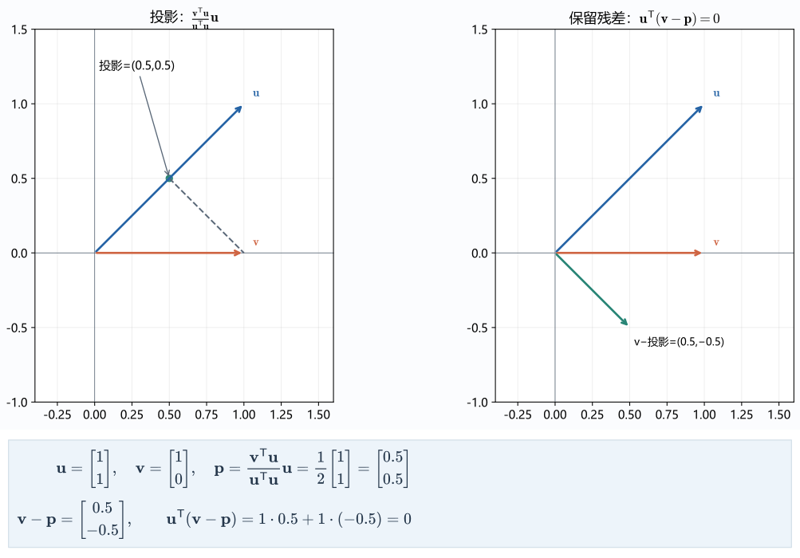

## （八）PCA 与奇异值分解

### 1. 中心化与协方差

假设我们采集了三条二维特征记录：$(1,2)$、$(2,4)$、$(3,6)$。先算出第一列的平均值是 2，第二列的平均值是 4。把每条记录都减去平均值，相当于把坐标原点平移到这批数据的正中心（这步叫**中心化**，记作 $X_c$）：

$$
X_c=\begin{bmatrix}-1&-2\\0&0\\1&2\end{bmatrix}.
$$

一眼就能看出，这三行数据的第二列永远是第一列的 2 倍，三个点在平面上严丝合缝地排在同一条穿过原点的直线上。既然所有变化都顺着这一条直线发生，我们只要记下每个点沿着这条直线走了多远（1 个数字），就能把原来的两个坐标完整还原出来，存储量直接减半。

当特征维度很高、肉眼看不出共线关系时，怎么靠计算找出数据变化最大的方向？我们需要先算出**样本协方差矩阵 $C$**：拿中心化后的矩阵转置乘以自己，再除以样本数减一（$n-1$）：

$$
C=\frac{1}{3-1}X_c^\mathsf TX_c=
\begin{bmatrix}1&2\\2&4\end{bmatrix}.
$$

这个 $2\times2$ 方阵里的每个数字都有清楚的统计含义：左上角的 $\frac{(-1)^2+0^2+1^2}{2}=1$ 是第一个特征自己的波动大小（方差）；右下角的 4 是第二个特征的方差；而右上角和左下角的 2，则是第一列与第二列对应相乘再平均的结果（协方差），正数代表两个特征同涨同跌，0 则代表没有线性联动。（分母用 $n-1$ 而不是 $n$，是因为样本均值本身就是从这批数据里估出来的，消耗了 1 个自由度，除以 $n-1$ 才能无偏地估计总体方差。）

### 2. 特征向量与 PCA

现在任选一个长度为 1 的方向向量 $\mathbf v$，把中心化后的数据全都投影到 $\mathbf v$ 上，投影点的坐标就是 $X_c\mathbf v$。这批投影点沿该方向摊开的方差有多大？算一下平方平均：

$$
\frac{1}{n-1}(X_c\mathbf v)^\mathsf T(X_c\mathbf v)
=\mathbf v^\mathsf T\left(\frac{1}{n-1}X_c^\mathsf TX_c\right)\mathbf v
=\mathbf v^\mathsf TC\mathbf v.
$$

我们要找一个压缩方向，使得投影过去之后保留的数据波动（方差 $\mathbf v^\mathsf TC\mathbf v$）最大。试着把刚才那条直线的单位方向 $\mathbf v=[1, 2]^\mathsf T/\sqrt5$ 代进去乘一下 $C$：

$$
C\mathbf v=
\frac1{\sqrt5}\begin{bmatrix}1&2\\2&4\end{bmatrix}\begin{bmatrix}1\\2\end{bmatrix}
=\frac1{\sqrt5}\begin{bmatrix}5\\10\end{bmatrix}
=5\mathbf v.
$$

神奇的事情发生了：普通向量乘上矩阵 $C$ 后方向都会被掰歪，唯独这个 $\mathbf v$ 乘上 $C$ 之后，**方向纹丝不动，仅仅是长度被拉长了 5 倍**！数学上把这种满足 $C\mathbf v=\lambda\mathbf v$ 的非零向量叫做矩阵 $C$ 的**特征向量（Eigenvector）**，放大倍数 $\lambda$ 叫做对应的**特征值（Eigenvalue）**。本例中，$\mathbf v_1=[1,2]^\mathsf T/\sqrt5$ 的特征值是 $\lambda_1=5$；而跟它垂直的方向 $\mathbf v_2=[-2,1]^\mathsf T/\sqrt5$ 乘上 $C$ 等于零向量，特征值是 $\lambda_2=0$，说明垂直方向上连一丝一毫的数据变化都没有。

因为协方差矩阵 $C$ 永远是实对称矩阵，它一定能找出一套两两垂直的单位特征向量作为坐标系的基。把任意单位方向写成这套基的组合，它的投影方差就等于各个特征值按组合系数平方的加权平均——加权平均当然不可能超过这里头最大的那个数（最大特征值 $\lambda_1$）。因此，**最大特征值对应的特征向量，就是数据方差最大的方向**。这就是**主成分分析（PCA）**寻找第一主成分的全部数学依据。

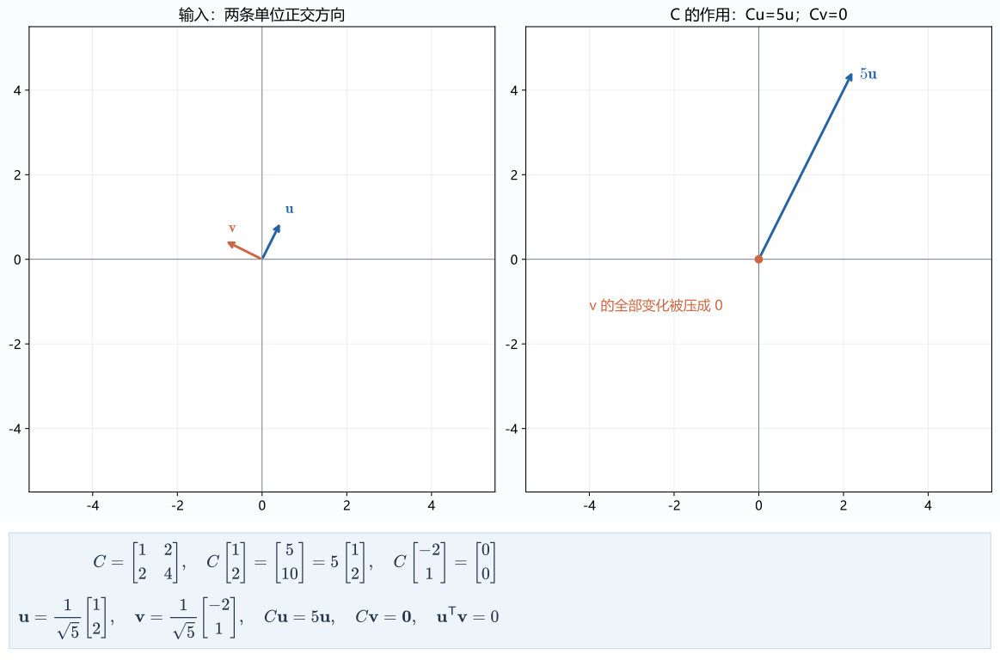

### 3. 奇异值分解（SVD）

先算 $X_c^\mathsf TX_c$ 再求特征向量虽然直观，但当特征维度成千上万时，硬算这个大协方差方阵既费内存又损失数值精度。更通用的办法是不算协方差，直接对长方形的数据矩阵做**奇异值分解（SVD）**：

$$
X_c=U\Sigma V^\mathsf T.
$$

任何形状的矩阵都能这样拆成三步正交与伸缩的组合。比如前面第五节里的二维变换矩阵 $W=\begin{bmatrix}2&1\\-1&1\end{bmatrix}$，用 SVD 拆开后，中间对角线上的两个非负数字（称为**奇异值**）大约是 $2.302776$ 和 $1.302776$，它俩乘起来正好等于行列式面积倍数 3。如下图所示，它对平面网格的作用被干净地拆成了三拍：先用正交矩阵 $V^\mathsf T$ 做一次纯旋转/反射，再用对角矩阵 $\Sigma$ 沿着横纵轴做纯拉伸，最后再用正交矩阵 $U$ 转到最终位置。

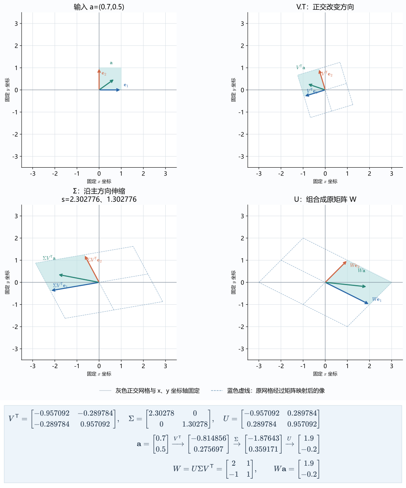

回到我们的中心化数据矩阵 $X_c$。两边同时算 $X_c^\mathsf TX_c$，利用正交矩阵 $U^\mathsf TU=I$ 的性质，中间的 $U$ 直接消掉了：

$$
X_c^\mathsf TX_c = (U\Sigma V^\mathsf T)^\mathsf T(U\Sigma V^\mathsf T) = V\Sigma^\mathsf T\Sigma V^\mathsf T.
$$

对比协方差矩阵特征分解，立刻看出：**SVD 分解出来的右奇异矩阵 $V$ 的各列，正好就是协方差矩阵的特征向量（主方向）**；而奇异值的平方除以 $n-1$，正好就是对应的特征值（各主方向上的方差）！在本例中，$X_c$ 的两个奇异值是 $\sqrt{10}$ 和 $0$，平方除以 $2$，就得到了刚才算出的特征值 $5$ 和 $0$。

现在做一维压缩：只取第一主方向 $\mathbf v_1=(1,2)/\sqrt5$，把三条中心化记录投影上去，得到的 1 维主成分分数分别是 $(-\sqrt5, 0, \sqrt5)$。需要恢复数据时，拿这 1 个分数乘回主方向，再加上刚才减掉的均值 $(2,4)$，第一条记录算出来是 $-\sqrt5\times(1,2)/\sqrt5+(2,4)=(1,2)$，三条记录分毫不差地还原了回来（注意：特征向量整体加个负号指向相反方向，投影分数也会跟着变号，两者相乘负负得正，重建结果完全不变）。

~~~python
import numpy as np
# keepdims 让均值保留成一行，逐样本广播相减。
x = np.array([[1., 2.], [2., 4.], [3., 6.]])
mean = x.mean(axis=0, keepdims=True)
centered = x - mean
# vh 已经是 V 的转置，第一行就是第一条主方向。
u, singular, vh = np.linalg.svd(centered, full_matrices=False)
direction = vh[0]
scores = centered @ direction
restored = scores[:, None] * direction[None, :] + mean
print(singular, scores, restored)
~~~

代码里 `axis=0` 表示顺着样本行往下汇总，算出每一列特征的均值；`np.linalg.svd` 返回的第三项 `vh` 已经是转置好的 $V^\mathsf T$，所以直接取第一行 `vh[0]` 就是第一主方向。重建时，`scores[:, None]` 把一维的分数变成 `(3, 1)` 的列，乘上 `(1, 2)` 的行方向，靠广播直接还原出 `(3, 2)` 的二维坐标（具体返回值规格可查阅 [NumPy SVD 接口文档](https://numpy.org/doc/1.26/reference/generated/numpy.linalg.svd.html)）。

在真实数据里，点不会完美排成一条直线，而是带着噪声偏离主线，这时第二个奇异值就不再是 0。如果为了压缩强行丢掉后面的方向，重建出来的坐标就会有误差——**丢掉的那些奇异值的平方和，正好等于整批数据重建误差的平方和**。另外，PCA 只认方差大小，不认业务含义：如果你把“阅读时间”从“小时”改成“秒”，数值放大 3600 倍，方差就会放大上千万倍，PCA 会误以为这一列包含了全部信息。所以做降维之前，必须先检查各个特征的单位和量纲是否处于同一水平。

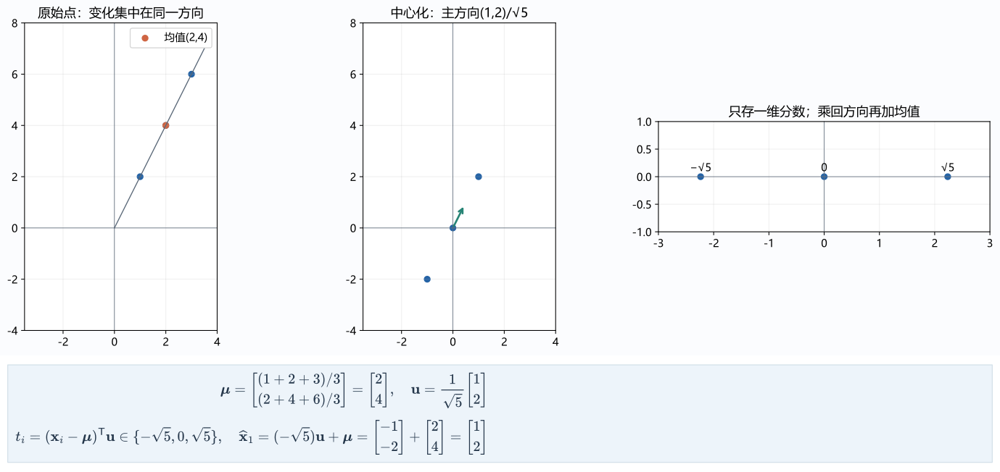

## （九）概率与统计

### 1. 条件概率与贝叶斯公式

数学变换和距离都是确定性的，但真实记录里充满了不确定性。比如统计了 100 条学习记录，发现其中有 20 条属于“较难资料”（记为事件 $D$），在这 20 条较难资料里，有 15 条发生了“阅读超时”（记为事件 $T$）；而在另外 80 条普通资料里，也有 10 条发生了超时。

概率用来衡量某类结果在总体里占多大比例：抽中较难资料的概率是 $P(D)=20/100=0.2$；总共发生超时的记录有 $15+10=25$ 条，所以 $P(T)=25/100=0.25$。如果已经知道某条记录属于较难资料，它超时的比例是多少？记作条件概率 $P(T|D)$，中间的竖线读作“在 $D$ 已经发生的条件下”。既然范围已经缩小到了那 20 条较难记录里，分母就只数这 20 条，所以 $P(T|D)=15/20=0.75$。

反过来问：如果系统现在只观察到某次学习“超时了”（$T$ 已发生），它背后是“较难资料”（$D$）的概率 $P(D|T)$ 是多少？

我们盯住“既较难又超时”的那 15 条交集记录（记作 $D\cap T$）。它在 100 条总记录里的占比是 $15/100$。要算出这个占比，有两条完全等价的路径：一是先看较难资料占总体的比例 $P(D)$，再乘上较难资料里超时的比例 $P(T|D)$；二是先看超时记录占总体的比例 $P(T)$，再乘上超时记录里属于较难资料的比例 $P(D|T)$。两边画等号：

$$
P(D|T)P(T) = P(T|D)P(D)
\quad\Longrightarrow\quad
P(D|T)=\frac{P(T|D)P(D)}{P(T)}
=\frac{(15/20)\times(20/100)}{25/100}=\frac{15}{25}=0.6.
$$

这就是**贝叶斯公式**的全部来由——不过是“用两种顺序数同一个交集，再把分母除过去”。在观察到超时之前，较难资料原本的占比 $P(D)=0.2$ 叫做**先验概率**；较难资料导致超时的可能性 $P(T|D)=0.75$ 叫做**似然**；看到超时证据之后，把判断更新为 $P(D|T)=0.6$，就叫做**后验概率**。如果两个事件互不相干（统计独立），那么知道其中一个发生，绝不会改变另一个发生的概率；而这里知道 $D$ 发生后，$T$ 的概率从 $0.25$ 猛增到了 $0.75$，说明难度与超时显然不独立。

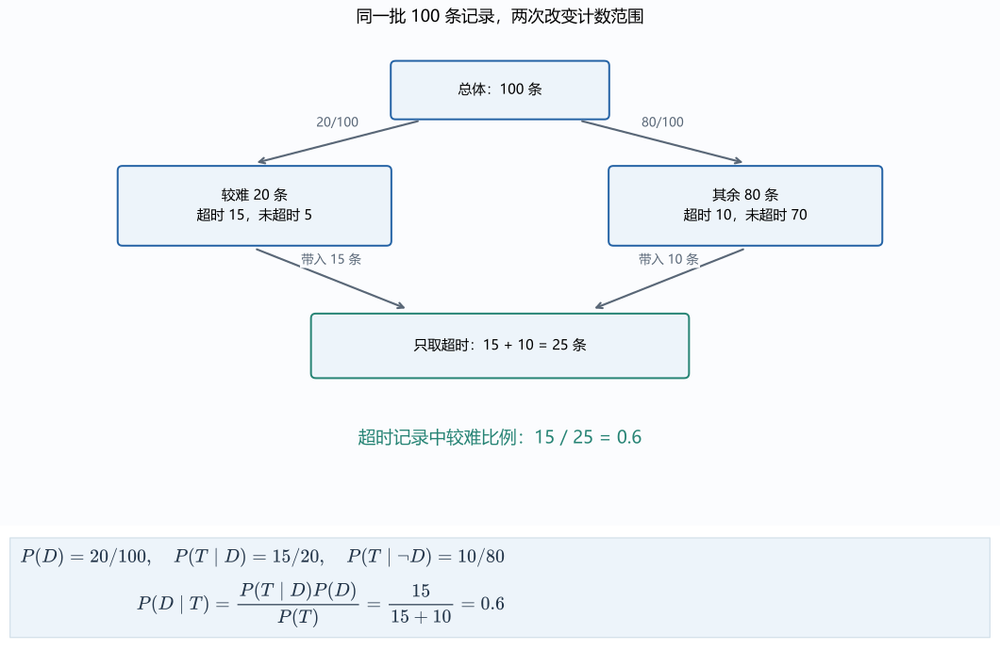

### 2. 期望、方差与抽样评估

把随机结果映射成数字，就得到了随机变量 $Y$。假设检索命中记 1 分、未命中记 0 分，命中概率为 $0.6$，那么长期试下去的平均得分（称为**期望**，记作 $E[Y]$）就是按概率加权求和：$E[Y]=1\times0.6+0\times0.4=0.6$。光有平均值还不够，为了衡量每次结果偏离平均值有多远，把偏离量的平方按概率加权平均，就得到**方差**：

$$
\operatorname{Var}(Y)=0.6\times(1-0.6)^2+0.4\times(0-0.6)^2=0.24.
$$

不同结构的随机现象对应着不同的概率分布：单次抛硬币式的成败（0 或 1）服从**伯努利分布**；独立重复测 $n$ 次算总成功次数服从**二项分布**；从好几个互斥类别里挑一个（比如第四篇从词表里挑下一个词）服从**类别分布（Categorical Distribution）**；而连续的测量误差则常围绕均值呈钟形对称波动，对应**正态分布（高斯分布）**。

在实际评估模型时，我们不可能测遍全宇宙的数据，只能抽出一批样本算平均分。如果每次抽样相互独立且来自同一个总体（独立同分布），样本均值的波动范围（标准误）大约是 $s/\sqrt n$（$s$ 是样本标准差）。表面上看，测试样本数 $n$ 攒得越多，算出来的平均分就越稳；但这里藏着一个工程上极易踩中的坑——**样本真的独立吗？** 如果测试集里的 1000 条记录，其实是同一个学习者连续 1000 次刷同一类题的记录，这些样本之间高度相关，根本不满足“独立抽样”的前提。如果把同一个人的记录随机打散，一半分进训练集、一半分进测试集，模型考出来的高分只是因为它“背熟了这个老熟人的习惯”，等真正上线遇到新用户时照样一败涂地。因此，数据怎么分组、怎么切分，直接决定了评估分数的真假。

## （十）导数与参数更新

### 1. 斜率与导数

现在来看怎么让程序自动从数据里找规律。假设有一条最简单的记录：输入特征 $x=3$，真实目标 $y=4$。我们用不带偏置的预测规则 $\hat y=wx$ 去猜目标（字母顶上戴帽子 $\hat y$ 代表预测值）。
* 如果权重参数猜 $w=1$，算出来 $\hat y=3$，比真实值小了 1；
* 试着把权重往大调一点，取 $w=1.1$，算出来 $\hat y=3.3$，离 4 近了些；
* 再调到 $w=1.3$，算出来 $\hat y=3.9$，就非常接近了。

为了让程序自己知道“往哪边调、调多少”，先得把预测失误的程度变成一个光滑的数字指标——**损失函数（Loss Function）**。这里取预测误差平方的一半：

$$
L(w)=\frac{1}{2}(wx-y)^2=\frac{1}{2}(3w-4)^2.
$$

之所以要平方，一是为了让正误差和负误差都受到惩罚，二是因为误差越大平方涨得越快，能逼着模型优先消灭大错；至于前面乘个 $1/2$，完全不会改变最低点的位置，纯粹是为了待会儿求导时刚好和指数掉下来的 2 约掉，写起来干净。算一下：$w=1$ 时损失 $L=0.5$；$w=1.1$ 时损失降到了 $0.245$。

如果不靠人工试数，怎么直接算出在 $w=1$ 这个位置上，把 $w$ 往大拨一点点，损失 $L$ 会怎么变？我们给 $w$ 加一个微小的变化量 $\Delta w$，把新的损失 $L(w+\Delta w)$ 展开，再减去原来的 $L(w)$：

$$
L(w+\Delta w)-L(w)
=\frac{1}{2}\bigl[3(w+\Delta w)-4\bigr]^2 - \frac{1}{2}(3w-4)^2
=3(3w-4)\Delta w+\frac{9}{2}(\Delta w)^2.
$$

两边同时除以变化量 $\Delta w$，算出这一小段上的平均变化率：

$$
\frac{L(w+\Delta w)-L(w)}{\Delta w} = 3(3w-4) + \frac{9}{2}\Delta w.
$$

当变化量 $\Delta w$ 缩得极其微小、无限趋近于 0 时，后面带着 $\Delta w$ 的那一项就彻底消失了，只剩下前一项 $3(3w-4)$。这个极限值就是损失函数在 $w$ 处的瞬时变化率，也就是**导数（Derivative）**，记作 $\frac{dL}{dw}=3(3w-4)$。把当前的 $w=1$ 代进去，算出导数（曲线切线的斜率）等于 $-3$。斜率是负数，说明在 $w=1$ 这个点上，**参数 $w$ 往右增大，损失 $L$ 就会往下掉**。

### 2. 梯度下降与步长

既然导数指明了让损失上升的方向，我们只要反着导数的方向走（即顺着负斜率方向走），就能让损失降下来。这就是**梯度下降（Gradient Descent）**的更新公式：

$$
w' = w - \eta\,\frac{dL}{dw}.
$$

这里的希腊字母 $\eta$（读作 eta）叫做**学习率（Learning Rate）**，用来控制每一步迈多大。拿刚才的 $w=1,\frac{dL}{dw}=-3$ 来试：
* 如果取学习率 $\eta=0.1$，更新后的参数是 $w'=1 - 0.1\times(-3)=1.3$，代回损失函数一看，$L(1.3)=0.005$，一步就迫近了谷底！
* 但如果贪快，把学习率设成 $\eta=1$，更新后 $w'=1 - 1\times(-3)=4$，一步迈过了头，直接蹿到了对面更高的山坡上，损失反而暴涨到了 $L(4)=32$。

这说明导数只能告诉你脚下这一寸土地往哪边倾斜，却管不了走太远之后地形会怎么拐弯；步长必须和函数的弯曲程度（曲率）配合好，才不会越调越糟。

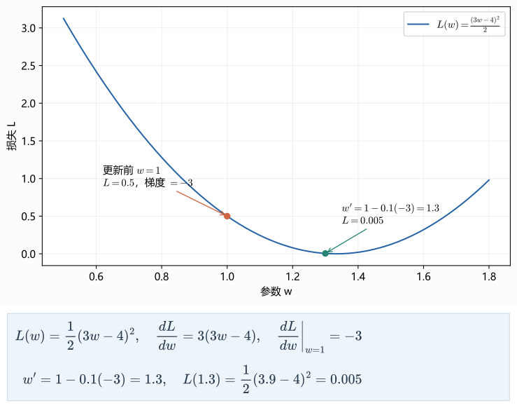

当模型不止一个参数（比如同时有权重 $w$ 和偏置 $b$，预测 $\hat y=wx+b$）时，我们先按住其他参数不动，只对其中一个参数求导，算出来的叫**偏导数**（符号写成弯头的 $\frac{\partial L}{\partial w}$ 和 $\frac{\partial L}{\partial b}$）。把所有参数的偏导数按顺序打包成一个向量，就叫做**梯度（Gradient）**，记作 $\nabla L$（倒三角符号 $\nabla$ 读作 nabla）。

### 3. 链式法则

在实际程序里，从输入到最终损失往往要经过好几步中间计算。比如刚才的公式可以拆成三步流水线：
1. 先算线性输出：$z = wx$
2. 再算预测误差：$e = z - y$
3. 最后算平方损失：$L = \frac{1}{2}e^2$

如果把 $w$ 轻轻拨动 $\Delta w$，这股变化是怎么一步步传到最终损失 $L$ 的？
* 第一棒：因为 $z=wx$，所以 $w$ 变动 1 个单位，会让中间量 $z$ 变动 $\frac{\partial z}{\partial w}=x$ 倍；
* 第二棒：因为 $e=z-y$，常数 $y$ 不动，$z$ 变动多少，误差 $e$ 就跟着变动多少，放大倍数是 $\frac{\partial e}{\partial z}=1$；
* 第三棒：因为 $L=\frac{1}{2}e^2$，误差 $e$ 变动 1 个单位，会让最终损失 $L$ 变动 $\frac{\partial L}{\partial e}=e$ 倍。

三棒接力下来，总的变化率就是把沿途每一小段的局部变化率直接乘起来：

$$
\frac{\partial L}{\partial w}
=\frac{\partial L}{\partial e}\cdot\frac{\partial e}{\partial z}\cdot\frac{\partial z}{\partial w}
=e\cdot 1\cdot x = (wx-y)x.
$$

把 $x=3, y=4$ 代进去，正是刚才展开平方算出来的 $3(3w-4)$！这条“总导数等于沿途局部导数连乘”的规矩，就是微积分里的**链式法则（Chain Rule）**。第三篇要讲的神经网络反向传播（Backpropagation），本质上就是把这条链式法则推广到了几十上百层的矩阵运算上。看到这里也就能明白：所谓模型“从错误中学习”，并不是程序突然生出了悔改的意识，而仅仅是顺着链式法则算出每个参数对损失的局部斜率，再机械地做了一次减法。

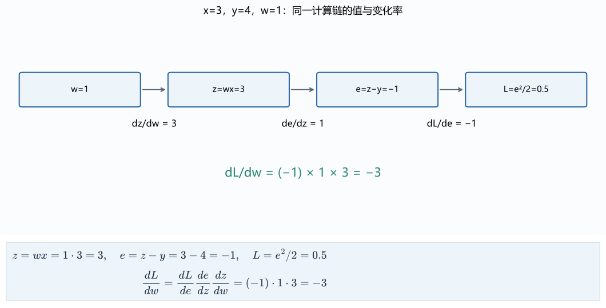

## （十一）熵、交叉熵与 KL 散度

平方误差适合用来预测像“耗时多少分钟”这样的连续数字；但如果任务是分类或者预测下一个词（模型给出的是各个类别的概率），怎么衡量模型猜得好不好？

先看概率与信息量的关系。如果两件独立的事同时发生，总概率是各自概率相乘：$P(A,B)=P(A)P(B)$。但我们衡量“两件事一共带来了多少信息”时，直觉上希望信息量是**相加**而不是相乘。数学上能把“乘法变成加法”的工具正是**对数（Logarithm）**：$\log(ab)=\log a+\log b$（本书中不写底数的 $\log$ 默认指以常数 $e\approx2.71828$ 为底的自然对数）。因为概率 $p$ 介于 0 到 1 之间，取对数后 $\log p$ 是负数或 0；在前面加个负号变成 $-\log p$，刚好满足：**事件发生的概率 $p$ 越小，一旦发生就越让人意外，它包含的信息量 $-\log p$ 就越大**；必然发生的事件概率为 1，信息量 $-\log 1=0$。

假设一个分类任务有两个类别，真实情况下的发生比例（真实分布 $p$）是对半开：$p=(0.5, 0.5)$。如果按真实概率去加权平均各类别的信息量，就得到了这个分布本身的**熵（Entropy）**：

$$
H(p)=-\sum_i p_i\log p_i = -0.5\log 0.5 - 0.5\log 0.5 \approx 0.6931.
$$

熵衡量的是系统自身的不确定程度：两类对半开最难猜，熵最大；如果结果百分之百固定落在第一类，分布是 $(1, 0)$，没有任何悬念，算出来的熵就是 0。

现在让模型来猜这两个类别的概率，假设模型输出的预测分布是 $q=(0.8, 0.2)$。如果拿模型给出的惊喜度 $-\log q_i$，按真实发生的比例 $p_i$ 去算平均代价，得到的就是**交叉熵（Cross-Entropy）**：

$$
H(p,q)=-\sum_i p_i\log q_i = -0.5\log 0.8 - 0.5\log 0.2 \approx 0.9163.
$$

对比一下：如果模型的预测分布 $q$ 和真实分布 $p$ 完全一致，算出来的代价本来最低只能是熵 $H(p)=0.6931$；现在因为模型预测偏了，平均代价涨到了 $0.9163$，多付出的这部分差额 $0.9163-0.6931=0.2231$，就叫做两个分布之间的 **KL 散度（$D_{\rm KL}(p\|q)=H(p,q)-H(p)$）**。模型分布 $q$ 离真实分布 $p$ 差得越远，交叉熵就越大。

在具体的单条样本分类任务里，真实标签是铁板钉钉的：比如当前样本真实属于第 1 类，那么它的真实概率分布就是 $p=(1, 0)$。代进交叉熵公式，第 2 项乘以 0 直接消掉，整条公式就只剩下极简的一项：

$$
L = -1\cdot\log q_1 - 0\cdot\log q_2 = -\log q_1.
$$

当模型给正确类别分配的概率 $q_1=0.8$ 时，损失是 $-\log 0.8\approx0.2231$；如果模型猜得很离谱，给正确类别只分了 $q_1=0.01$ 的概率，损失就会飙升到 $-\log 0.01\approx4.605$。**压低交叉熵损失，就等价于逼着模型把尽可能高的概率分给那个真实的正确类别**——第二篇的逻辑回归分类和第四篇训练大语言模型预测下一个 Token，用的全都是这同一个损失函数。

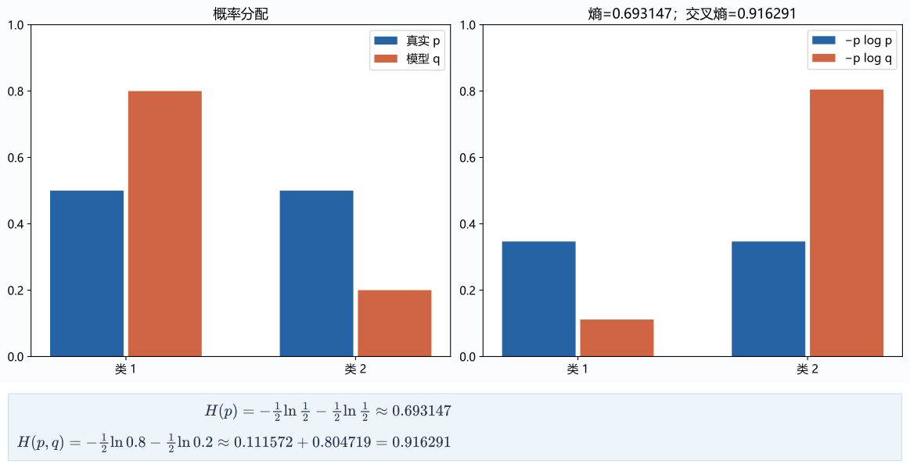

## （十二）运行与练习

本章推导的所有固定样本和中间数值，都完整保存在 [`modern_ai/mathlab.py`](https://github.com/KiriAky107/understanding-AI-and-Agents-in-depth/blob/main/%E7%8E%B0%E4%BB%A3AI%E7%A4%BA%E4%BE%8B/modern_ai/mathlab.py)（代码包内：`现代AI示例/modern_ai/mathlab.py`） 中。运行 `.\.venv\Scripts\python.exe -m modern_ai math`，即可将程序输出的向量长度、余弦相似度、矩阵变换结果、PCA 重建坐标以及单步梯度更新值与上面的纸面手算逐项核对。

| 题号 | 要求 | 任务 |
| --- | --- | --- |
| 01-01 基础 | **必做** | 分别构造形状为 `(2,)`、`(2,1)`、`(1,2)` 的数组，核对转置前后的形状变化 |
| 01-02 运算 | **必做** | 手算并编程核对 $W[4,0]^\mathsf T$，对比矩阵乘法 `@` 与逐元素乘法 `*` 的结果差异 |
| 01-03 推导 | **必做** | 针对秩亏损矩阵，对右侧目标 `(3,6)` 和 `(3,7)` 分别做消元，写出对应解集或无解原因 |
| 01-04 几何 | **必做** | 将向量 `(3,4)` 换算到新基 `(1,1)`、`(1,-1)` 下的坐标，再乘回基矩阵验证还原 |
| 01-05 推导 | **必做** | 展开投影残差平方函数求最小值，导出投影系数公式并验证残差与投影方向正交 |
| 01-06 错误分析 | **必做** | 将“题数”特征的单位改为“每十题”，对比量纲改变前后欧氏距离、余弦相似度与回归系数的变化 |
| 01-07 扩展 | **拓展选做** | 给共线的 PCA 样本加入微小非共线扰动，对比保留一维主成分与保留全部二维时的重建平方误差 |
| 01-08 推导 | **必做** | 从差商出发推导平方损失导数，对比学习率取 `0.1` 与 `1.0` 时单步更新后的损失变化 |

全部练习的详细推导与代码实现见 [练习题解](https://github.com/KiriAky107/understanding-AI-and-Agents-in-depth/blob/main/docs/%E7%BB%83%E4%B9%A0%E9%A2%98%E8%A7%A3.md)（代码包内：`docs/练习题解.md`）。到这里，我们已经能够把文字记录变成向量，用点积和余弦比较方向，用矩阵执行批量变换与降维，并算出了误差对参数的导数。不过在本章里，像“读一页花 2 分钟、做一题花 1 分钟”这样的矩阵系数还是我们拍脑袋直接给定的；进入第二篇，我们将让程序从真实数据集中自动拟合出这些参数，并检验学出来的规则在面对从未见过的新记录时到底管不管用。