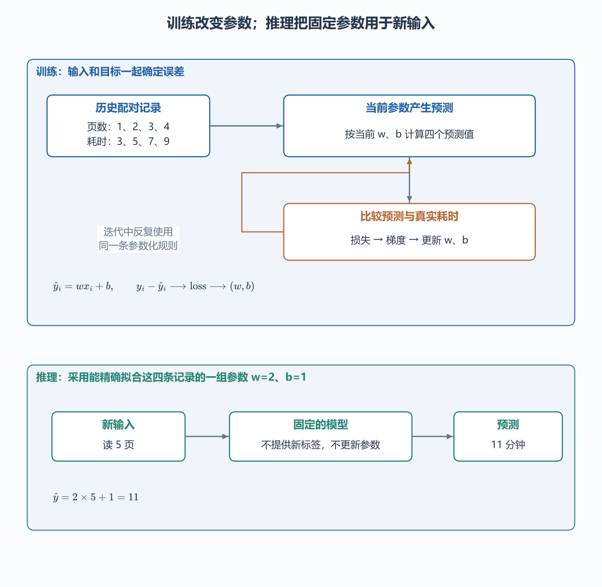
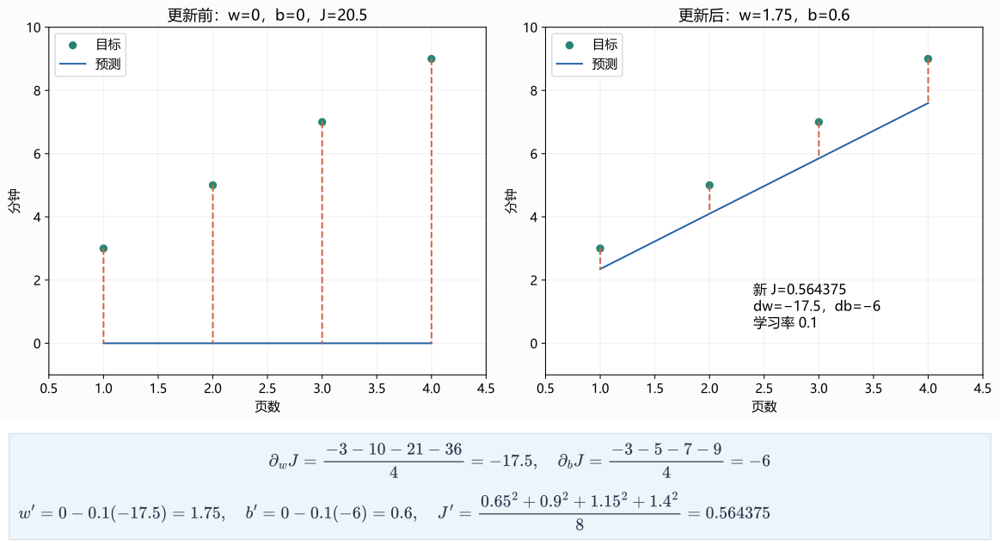
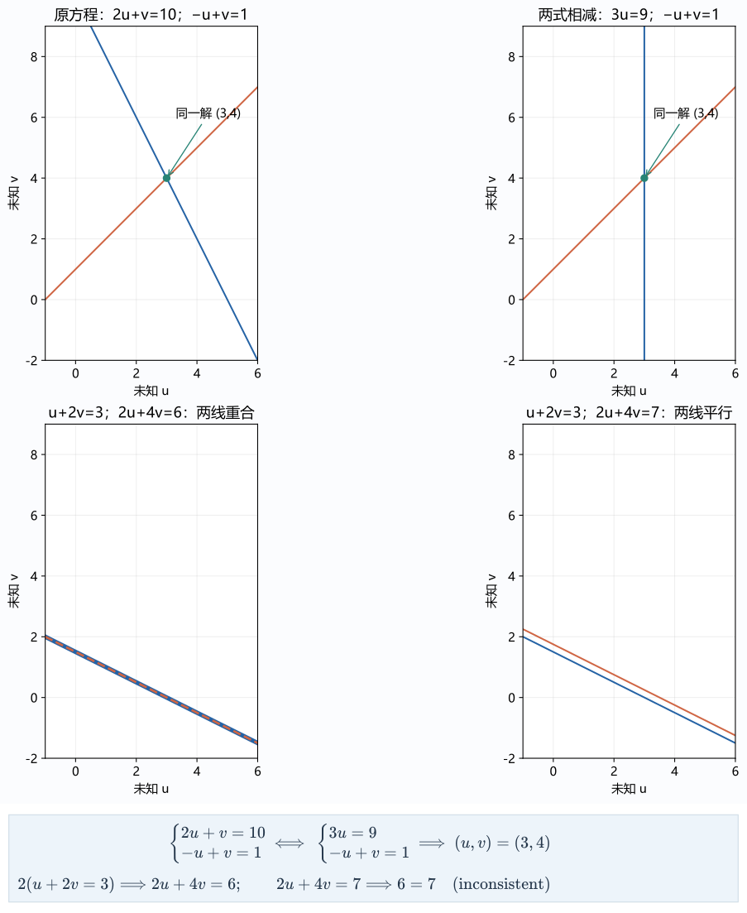
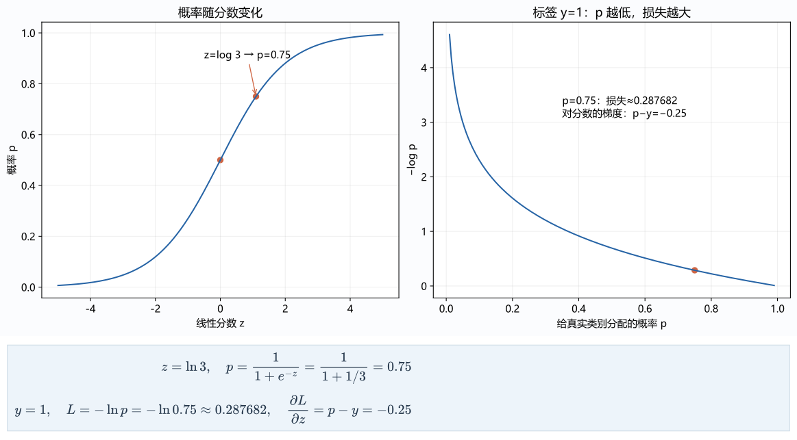
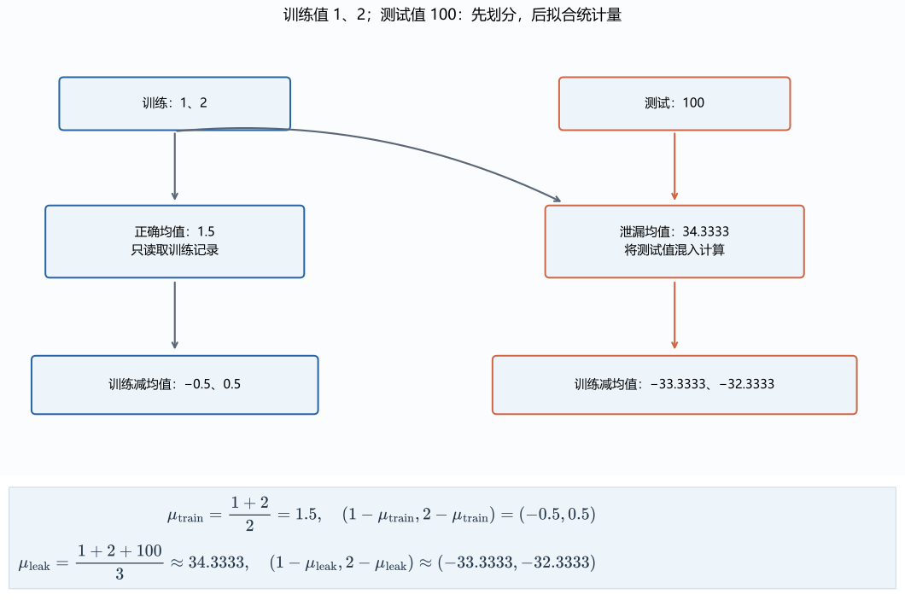
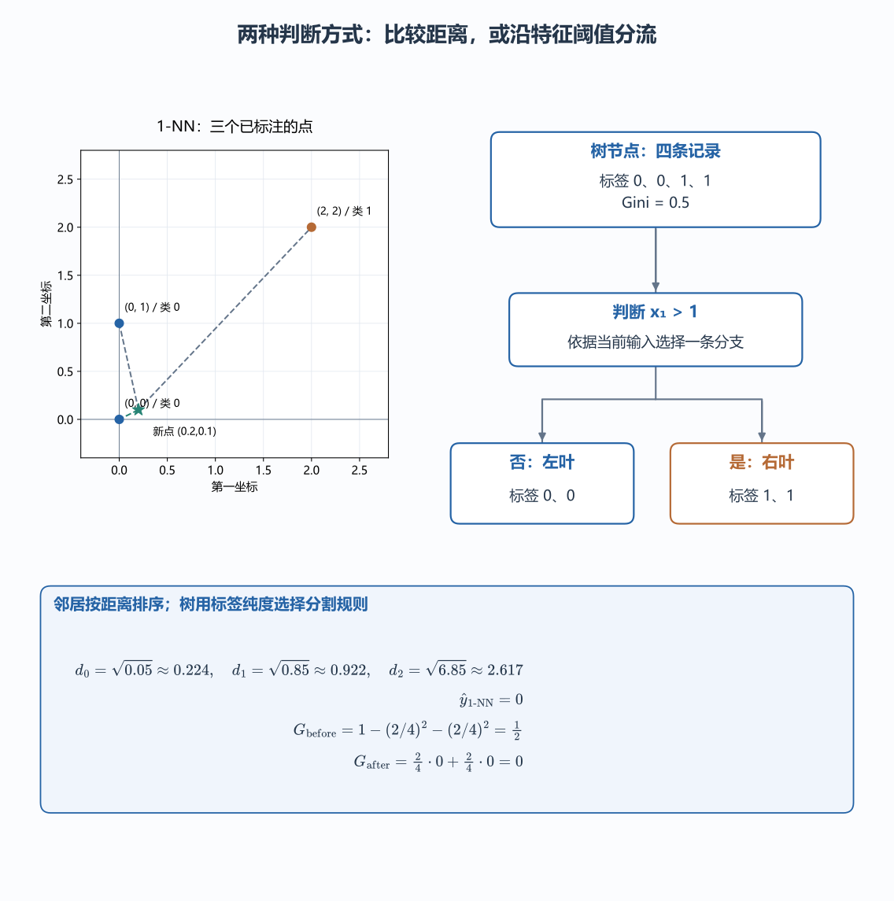
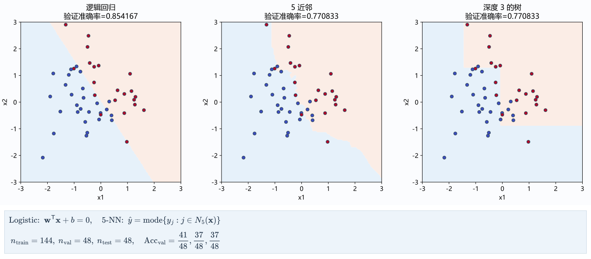
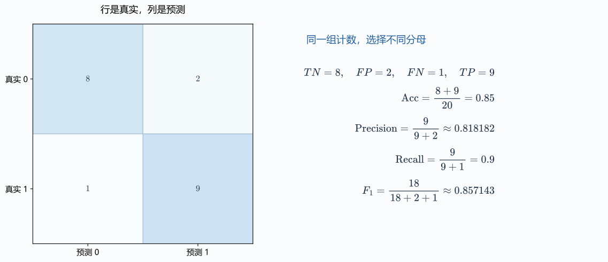
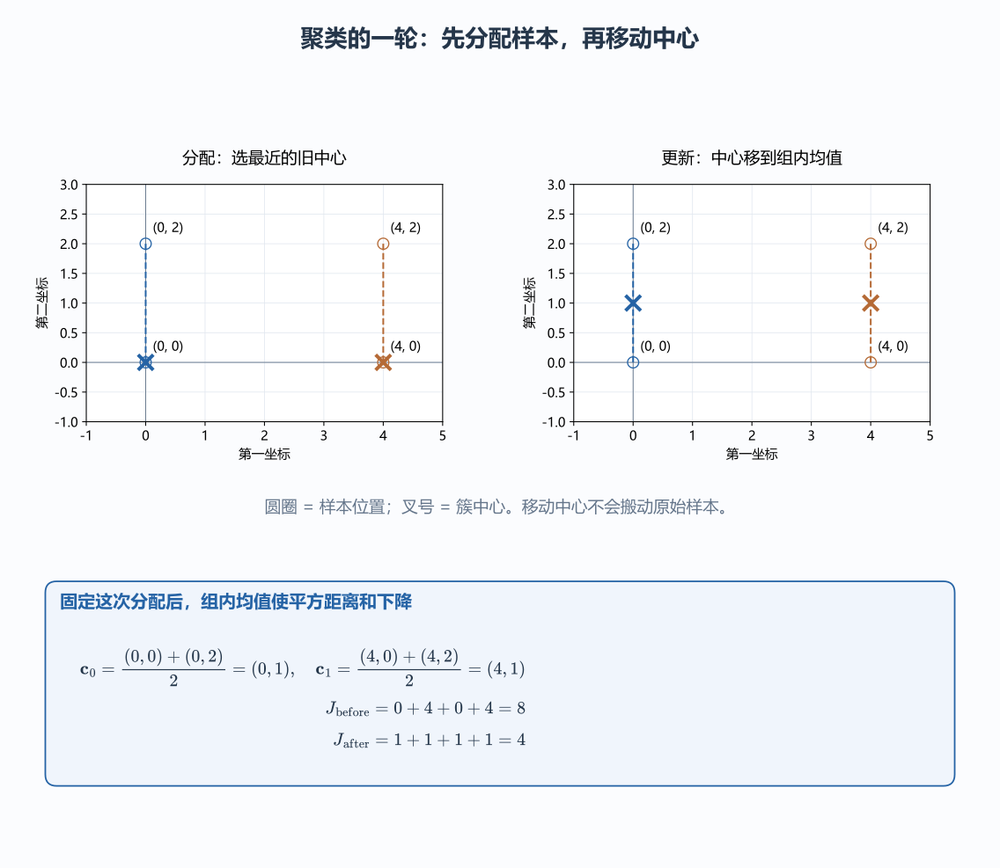

# 二、从预测到机器学习

[TOC]

## （一）样本、预测与目标

假设手头有四条真实的学习记录：阅读页数分别是 $x=(1, 2, 3, 4)$，实际耗费的分钟数分别是 $y=(3, 5, 7, 9)$。如果写一条死规则“不管读几页，一律猜 6 分钟”，程序虽然能跑通，却完全浪费了“页数”提供的信息。

为了把页数用起来，我们设第 $i$ 条记录的预测值为 $\hat y_i=wx_i+b$。这里的两个可调参数合记为 $\theta=(w, b)$：斜率 $w$ 控制每多读一页增加多少分钟，截距 $b$ 则代表打开资料、准备纸笔的固定耗时。在这个过程里，**历史数据**负责提供对齐的目标，**模型**给出带参数的数学函数，**训练（Training）**通过缩小误差把具体的参数值找出来，而**推理（Inference）**则是把训练好的参数固定住，代入新输入算出预测结果。

按照数据里有没有标准答案（标签）以及反馈怎么给，常见的机器学习任务可以分为三类：
- **监督学习**：每条输入都配有明确的标签（比如刚才的页数配实际耗时），直接让模型去拟合从输入到标签的映射。
- **无监督学习**：数据只有输入、没有人工标签，让算法自己去发现样本之间的内在结构（比如把页数、题数和耗时相近的学习记录自动聚成几类）。
- **强化学习**：没有现成的“每一步正确动作标签”，而是让策略（Policy）根据当前**状态（State）**挑选**动作（Action）**，再从环境返回的**奖励（Reward）**中学习如何拿到最大的长期累计回报。比如考前还剩两轮复习时间（状态包含剩余时间与当前掌握度），动作可以选“刷熟练的旧题”或“啃没见过的新题”：刷旧题每轮稳拿即时奖励 $1$，两轮奖励序列是 $(1, 1)$；啃新题第一轮拿 $0$，但一旦啃下来，第二轮能拿高额奖励 $3$，序列是 $(0, 3)$。如果给下一轮的远期奖励打个九折（设折扣因子 $\gamma=0.9$），第一条稳健路线的累计回报是 $1 + 0.9\times 1 = 1.9$，而第二条先难后易路线的累计回报则是 $0 + 0.9\times 3 = 2.7$。强化学习优化的不是眼下这一步赚多少，而是当前动作引出的整条后续轨迹的总回报（第四篇的大模型强化学习后训练就会用到这一套概念）。

沿着“目标值在哪一步参与计算”看训练与推理：训练时，真实耗时要与当前预测一起形成误差，再由误差决定参数怎样调整；新输入到来时，已经确定的参数直接给出结果。对上面四条记录，$w=2,b=1$ 能逐项满足 $y_i=2x_i+1$，所以代入新页数 $x=5$ 得到预测 $11$ 分钟。这个数是模型的预测，真实耗时要等实际学习结束后另行测量；仅仅算出它，并没有执行一次参数更新。

## （二）线性回归与参数拟合

回到刚才的四条阅读记录。同一组参数 $(w, b)$ 必须同时照顾全部四条数据：如果只盯着第一条记录把误差调成 0，另外三条可能错得一塌糊涂。要衡量一套参数在整批数据上的总体好坏，得先把四条记录各自的误差汇总成一个总分。直接把误差加起来不行，因为猜高了的 $+2$ 和猜低了的 $-2$ 会互相抵消；所以先对每条误差做平方，再求全批样本的平均值。设样本总数 $n=4$，求和下标 $i$ 依次遍历第 1 到第 4 条记录，单条样本的损失记作 $\ell_i$，整批样本的平均损失记作 $J$，再乘上 $1/2$ 方便求导时约掉指数 2，就得到了线性回归的**半均方误差（Half MSE）**：

$$
J(w,b)=\frac{1}{2n}\sum_{i=1}^n(wx_i+b-y_i)^2.
$$
顺着第一篇的链式法则来求梯度。记第 $i$ 条记录的预测误差为 $e_i = wx_i+b-y_i$：
- 对权重 $w$ 求偏导时，把 $b$ 看作常数。预测值对 $w$ 的局部导数是 $x_i$，半平方误差对 $e_i$ 的局部导数是 $e_i$，两段相乘，单条记录贡献的导数就是 $e_ix_i$；
- 对偏置 $b$ 求偏导时，预测值对 $b$ 的局部导数是 $1$，单条记录贡献的导数就只剩 $e_i$。

因为求和的导数等于导数的求和，把四条记录的导数加起来再除以样本数 $n$，就得到整批损失对两个参数的偏导数：

$$
\partial_wJ=\frac1n\sum_{i=1}^n e_ix_i,\qquad \partial_bJ=\frac1n\sum_{i=1}^n e_i.
$$
我们从 $w=0, b=0$ 的全零起点开始手算第一轮更新：

1. 代入 $w=0, b=0$，四条记录的预测值全是 $0$，误差向量为 $e=(-3, -5, -7, -9)$，初始平均损失高达 $J=\frac{1}{8}(9+25+49+81)=20.5$；
2. 算偏导数：将误差与输入 $x=(1, 2, 3, 4)$ 逐项相乘再平均，得到 $\partial_wJ = (-3 - 10 - 21 - 36)/4 = -17.5$；将误差直接取平均，得到 $\partial_bJ = (-3 - 5 - 7 - 9)/4 = -6$；
3. 设学习率 $\eta=0.1$，同时更新两个参数：$w' = 0 - 0.1\times(-17.5) = 1.75$，$b' = 0 - 0.1\times(-6) = 0.6$。

换上这套新参数 $(1.75, 0.6)$ 重新预测，四条结果变成了 $(2.35, 4.1, 5.85, 7.6)$，新误差缩小到了 $(-0.65, -0.9, -1.15, -1.4)$，损失直接从 $20.5$ 骤降到了 $0.564375$。

注意这里的**“同时更新”**：$\partial_wJ$ 和 $\partial_bJ$ 必须基于同一份旧参数算出来的旧误差 `error`。如果在代码里先改了 `w`，又拿改过之后的 `w` 去重新算误差求 `db`，那就变成交替更新的另一种算法了。在写代码时先把 `error` 数组单独存下来，正是为了锁住当前这一步的计算状态。

~~~python
import numpy as np
# 所有梯度由同一份旧预测得到。
x, y = np.arange(1., 5.), np.array([3., 5., 7., 9.])
w, b, rate = 0., 0., 0.1
error = w * x + b - y
dw, db = np.mean(error * x), np.mean(error)
w, b = w - rate * dw, b - rate * db
print(w, b, np.mean((w * x + b - y) ** 2) / 2)
~~~

当每条记录包含 $d$ 个特征时，输入就是形状为 $(n, d)$ 的矩阵 $X$，批量预测写作 $\hat{\mathbf y}=X\mathbf w+b\mathbf 1$，权重梯度直接写成矩阵乘法 $\frac{1}{n}X^\mathsf T(\hat{\mathbf y}-\mathbf y)$。如果给 $X$ 最右边补上一列全为 1 的常数列，拼成 $\tilde X=[X, \mathbf 1]$，就能把偏置 $b$ 也并进参数向量 $\theta$ 里。令梯度直接等于零向量，就能推出跟第一篇几何投影一模一样的**正规方程**：

$$
\tilde X^\mathsf T\tilde X\theta = \tilde X^\mathsf T\mathbf y
$$
拿本例的四条数据代进去，一步就能算出精确解 $w=2, b=1$（损失为 0）。不过在实际工程里，如果特征列之间存在共线冗余，$\tilde X^\mathsf T\tilde X$ 就会不可逆，所以代码里绝不要硬写 `np.linalg.inv` 求逆，而是调用底层的最小二乘求解器。

在配套代码的 `learning.linear_descent` 与 `sklearn.linear_model.LinearRegression` 中，分别用梯度下降和最小二乘拟合了这四条数据：前者用来观察参数一步步逼近的过程，后者直接给出解析终点。按照 scikit-learn 的统一约定，调用 `.fit(X, y)` 会修改模型对象内部保存的参数，而调用 `.predict(X)` 则只读取已保存的参数做前向推理。

### 1. 线性方程与解的唯一性

为什么有时候正规方程能算出唯一的一组最优参数，有时候却算不出唯一解？要搞清这个问题，最直接的办法是先退回没有噪声的精确方程组，看看什么时候能从输出唯一地反推出未知数。

#### 1.1 消元法

回到第一篇第（五）节的例子：假设已经知道某条记录算出来的“预计时间”是 10、“题数减页数”是 1，现在反过来求未知的页数 $u$ 和题数 $v$。这相当于解二元一次方程组：

$$
\begin{cases}
2u+v=10,\\
-u+v=1.
\end{cases}
$$

用第一式减去第二式消掉 $v$，立刻得出 $3u=9$，即 $u=3$；再代回第二式算出 $v=4$。写成矩阵形式，就是已知矩阵 $W$ 和输出 $\mathbf y$，反求满足 $W\mathbf x=\mathbf y$ 的未知向量 $\mathbf x$。

在纸上或程序里做系统消元时，不需要反反复复抄写字母 $u$ 和 $v$，只需把系数矩阵 $W$ 和右边的常数项 $\mathbf y$ 拼成一张**增广矩阵**：

$$
[W\mid\mathbf y]=
\left[
\begin{array}{cc|c}
2 & 1 & 10\\
-1 & 1 & 1
\end{array}
\right].
$$

中间的竖线用来隔开左边的系数和右边的目标值。解方程时允许做三种**初等行变换**：交换两行的位置、给某一行整体乘上非零常数、把某一行的倍数加到另一行上。因为这三种操作都能原路倒退回去，所以无论怎么变，方程组的解集都丝毫不会改变。消元的目标，是一行接一行地把左下角的系数消成 0，让每一行都比上一行少一个未知数；每一行里打头阵、用来消掉下面各行同列数字的那个非零首项，就叫做**主元（Pivot）**。

#### 1.2 秩、零空间与方程组

并不是所有方程组都能像刚才那样顺利解出唯一答案。假设系数矩阵换成了：

$$
A=\begin{bmatrix}1&2\\2&4\end{bmatrix}
$$

第二行系数 `(2, 4)` 刚好是第一行 `(1, 2)` 的整两倍。拿第 2 行减去第 1 行的 2 倍做消元，左边直接变成了全零 `0u + 0v`：
- **情况一（无穷多解）**：如果右侧目标给的是 `(3, 6)`，消元后第二行变成 $0u+0v=0$。这意味着第二条方程完全是第一条方程的复读机，根本没有提供半点新约束。我们可以随便挑一个实数赋给 $v$（称为自由变量），再令 $u=3-2v$，凑出来的每一对 `(u, v)` 都是合法解，解集在平面上排成一整条直线。
- **情况二（无解）**：如果右侧目标改成 `(3, 7)`，消元后第二行就变成了荒谬的 $0u+0v=1$。两条方向相同的约束给出了自相矛盾的目标（在几何上对应两条永不相交的平行线），方程组彻底无解。

消元结束后，真正立得住的非零主元个数，就叫做矩阵的**秩（Rank）**。秩既代表矩阵里真正线性无关的**独立列方向数**，也代表方程组里不重样的**独立行约束数**。比如矩阵 $A$ 虽然有 2 列，但第二列是第一列的翻倍，独立方向只有 1 个，所以它的秩 $r=1$。

如果我们令右侧目标等于零向量，解齐次方程 $A\mathbf x=\mathbf 0$，找出来的全部解向量组成的集合就叫做矩阵 $A$ 的**零空间（Null Space）**。在本例中，满足 $u+2v=0$ 的所有解都可以写成 $t(-2, 1)$（$t$ 为任意实数）。零空间揭示了一个关键事实：**只要你顺着零空间的方向 $(-2, 1)$ 去改动输入向量 $\mathbf x$，乘上矩阵 $A$ 之后增加的量全都是 0，输出结果纹丝不动！** 换句话说，矩阵 $A$ 在变换过程中把 $(-2, 1)$ 这个方向上的信息彻底抹杀了。

对于一个有 $n$ 列的矩阵，消元后有 $r$ 个列拿到主元（被锁死），剩下的 $n-r$ 个列没有主元，变成可以随便取值的自由变量，每个自由变量提供一个零空间基方向。因此，**矩阵的秩 $r$ 加上零空间的维数，永远等于总列数 $n$**。这也从根源上解释了为什么一旦变换矩阵发生了降维压缩（零空间不为空），就再也不可能从输出 100% 唯一地倒推出原始输入。

#### 1.3 逆矩阵与可逆条件

只有当方阵 $W$ 的列向量全部线性无关（满秩，零空间里只有零向量），每一个输出 $\mathbf y$ 才刚好唯一对应一个输入 $\mathbf x$。这时，把输出还原回输入的逆向操作本身也是一个线性变换，对应的矩阵就叫做 $W$ 的**逆矩阵**，记作 $W^{-1}$（右上角的 $-1$ 代表逆操作，绝不是把矩阵里的每个数字取倒数），满足左乘右乘都等于单位矩阵：$W^{-1}W=WW^{-1}=I$。

拿刚才满秩的 $W=\begin{bmatrix}2&1\\-1&1\end{bmatrix}$ 做消元反解，可以算出它的逆矩阵是：

$$
W^{-1}=\frac13\begin{bmatrix}1&-1\\1&2\end{bmatrix}
$$
随手验算一下 $W^{-1}W$：结果左上角是 $(1\times2+(-1)\times(-1))/3=1$，左下角是 $(1\times2+2\times(-1))/3=0$，完整的乘积正好是单位矩阵 $I$。不过在工程代码里解方程 $W\mathbf x=\mathbf y$ 时，直接调 `np.linalg.solve(w, y)` 用消元法求 $\mathbf x$ 既快又准，不要先算 `np.linalg.inv(w)` 再去做乘法。

怎么一眼判断一个方阵能不能求逆？结合第一篇第（六）节讲过的几何面积就一清二楚了：二维方阵的行列式 $\det W=ad-bc$ 度量的是两列基向量围成的平行四边形有向面积。这里 $W$ 的行列式是 $2\times1-1\times(-1)=3\neq 0$，说明两条列向量撑开了整个二维平面，没有方向丢失，所以一定可逆；而矩阵 $A=\begin{bmatrix}1&2\\2&4\end{bmatrix}$ 的行列式是 $1\times4-2\times2=0$，说明两列共线、二维面积被拍扁成了 0，丢掉的方向再也找不回来，因此绝不可逆。把这个结论代回前面的线性回归正规方程 $\tilde X^\mathsf T\tilde X\theta=\tilde X^\mathsf T\mathbf y$：只要特征矩阵的各列线性无关，$\tilde X^\mathsf T\tilde X$ 就满秩可逆，最优参数 $\theta$ 就唯一确定；一旦特征里混入了互相共线的冗余列，就会出现无穷多组参数给出同一个预测结果的情况。

## （三）逻辑回归与分类

预测阅读时长输出的是连续实数；但如果任务变成判断“这篇资料适不适合当前学习者阅读”，真实标签就只剩两个离散值：$y\in\{0, 1\}$（花括号列出允许取的值：$0$ 代表不适合，$1$ 代表适合）。如果还拿线性回归去硬算，算出来的 $\hat y=wx+b$ 完全可能是 $-3.5$ 或者 $+8.2$，没法直接当成“适合的概率”来用。我们需要给线性打分套上一层转换函数，把任意正负实数平滑地压缩到 $(0, 1)$ 区间内，同时保证线性分数越高，转换出来的概率也越大。

怎么设计这个函数？设某篇资料“适合”的概率为 $p$，那么“不适合”的概率就是 $1-p$。拿它俩一除，比值 $\frac{p}{1-p}$ 在统计上叫做**胜算（Odds，即发生与不发生的赔率比）**：两类各占一半（$p=0.5$）时胜算是 $1$；适合概率占 $p=0.75$ 时，胜算就是 $0.75/0.25=3$。胜算的取值范围是 $(0, +\infty)$，再给它取个自然对数变成**对数胜算** $\log\frac{p}{1-p}$，取值范围就刚好铺满整个实数轴 $(-\infty, +\infty)$！

现在令这个对数胜算直接等于线性打分 $z=\mathbf w^\mathsf T\mathbf x+b$：

$$
\log\frac{p}{1-p} = z.
$$

两边同时取指数得 $\frac{p}{1-p}=e^z$，把分母乘过去反解出 $p$，再分子分母同除以 $e^z$，就推导出大名鼎鼎的 **Sigmoid 函数**（记作 $\sigma(z)$）：

$$
p = \sigma(z) = \frac{e^z}{1+e^z} = \frac{1}{1+e^{-z}}.
$$

代几个数看看它的脾气：当线性打分中立（$z=0$）时，$p=\frac{1}{1+1}=0.5$；当 $z=\log 3\approx 1.0986$ 时，$p=0.75$；当 $z$ 趋向正无穷时，$e^{-z}$ 趋近于 0，概率无限逼近 1；当 $z$ 趋向负无穷时，概率无限逼近 0。

求导时，Sigmoid 有一个极其漂亮的化简性质：把 $(1+e^{-z})^{-1}$ 按链式法则对 $z$ 求导，得到 $\frac{e^{-z}}{(1+e^{-z})^2}$；把它拆成两项相乘 $\frac{1}{1+e^{-z}}\cdot\frac{e^{-z}}{1+e^{-z}}$，前一项正是 $p$，后一项正是 $1-p$！所以 Sigmoid 的导数可以直接用它自己的输出表示：

$$
\sigma'(z) = p(1-p)
$$
有了预测概率 $p$，接下来用第一篇第（十一）节的交叉熵来构造损失函数。对于单条样本，如果真实标签 $y=1$，模型猜对的概率就是 $p$；如果真实标签 $y=0$，模型猜对的概率就是 $1-p$。用指数写法 $p^y(1-p)^{1-y}$ 可以把这两种情况合成一个式子（$y=1$ 时后半截指数为 0 变成 1；$y=0$ 时前半截变成 1）。训练的目标是让真实标签出现的概率越大越好；给它取负对数，就把“最大化概率乘积”转成了“最小化损失之和”，得到单条样本的**二元交叉熵损失（Binary Cross-Entropy）**：

$$
\ell = -\log\bigl[p^y(1-p)^{1-y}\bigr] = -y\log p - (1-y)\log(1-p)
$$

现在顺着链式法则求损失 $\ell$ 对线性打分 $z$ 的导数 $\frac{\partial\ell}{\partial z}$：
1. 第一步，先求损失 $\ell$ 对概率 $p$ 的导数（注意 $\log(1-p)$ 求导会多出一个负号，把前面的减号变成加号）：
   $$
   \frac{\partial\ell}{\partial p} = -\frac{y}{p} + \frac{1-y}{1-p} = \frac{-y(1-p) + p(1-y)}{p(1-p)} = \frac{p-y}{p(1-p)}
   $$
   
2. 第二步，乘上刚才算好的 Sigmoid 导数 $\frac{\partial p}{\partial z}=p(1-p)$，分母上的 $p(1-p)$ 刚好被干净利落地约掉：
   $$
   \frac{\partial\ell}{\partial z} = \frac{\partial\ell}{\partial p}\cdot\frac{\partial p}{\partial z} = \frac{p-y}{p(1-p)}\cdot p(1-p) = p - y
   $$
   

化简出来的结果令人惊叹：复杂的对数和指数求导全部抵消，**损失对线性分数的梯度，居然就是简单的“预测概率减真实标签”（$p-y$）**！再往前乘上线性层对参数的导数，立刻得到权重梯度 $\partial_{\mathbf w}\ell=(p-y)\mathbf x$ 和偏置梯度 $\partial_b\ell=p-y$。拿数值验证一下：如果某条样本真实标签 $y=1$，模型只给了 $p=0.75$ 的概率，那么分数梯度就是 $0.75-1=-0.25$；梯度下降减去负梯度，就会把这条样本的线性分数 $z$ 往高里推，让下次预测的概率更接近 1。这就是**逻辑回归（Logistic Regression）**的全部训练机制（虽然名字里带着“回归”二字，干的却是实打实的分类活）。

最后要注意，**“输出概率 $p$”和“做出分类决策”是前后分开的两步**。模型只负责算出 $p=0.75$；至于到底判成 1 类还是 0 类，需要人为卡一个**分类阈值 $t$**（默认常取 $t=0.5$，当 $p\ge t$ 时判为 1）。如果业务上怕误报，把阈值提高到 $t=0.8$，判为 1 的样本就会减少。这个阈值属于模型的超参数，必须在**验证集**上敲定，绝不能等看完了测试集的错题之后再去偷改阈值刷分。

## （四）数据预处理

在真实的表格数据里，不同特征的取值范围往往相差悬殊：比如“阅读页数”在 $1$ 到 $100$ 之间变动，而“资料难度等级”只在 $1$ 到 $5$ 之间变动。如果直接拿原始数值去跑梯度下降，由于梯度 $\partial_w\ell = (p-y)x$ 里直接乘了输入特征 $x$，页数那一列的梯度数值会比难度那一列大出几十倍——同一个学习率 $\eta$ 乘上去，页数权重已经在剧烈震荡了，难度权重却几乎挪不动步。

为了让不同特征站到同一条起跑线上，训练前通常要做**标准化（Standardization）**：对第 $j$ 列特征，先算出它在训练集上的平均值 $\mu_j$（希腊字母 $\mu$ 读作 mu，代表中心位置）和标准差 $s_j$（代表典型波动幅度）。然后把每个数值减去均值、再除以标准差：

$$
x'_{ij} = \frac{x_{ij}-\mu_j}{s_j}.
$$

减去 $\mu_j$ 让特征的中心对齐到 $0$，除以 $s_j$ 让特征的典型波动幅度统一变成 $1$，这样各列梯度的步长就很容易同步控制了。

除了数值缩放，真实数据里还会遇到缺失值和文字类别：缺失的数值可以用**训练集的中位数**来填补；像“文章、视频、练习”这样的离散文字类别，则可以用**独热编码（One-Hot Encoding）**转成 `(1,0,0)`、`(0,1,0)`、`(0,0,1)` 这样的二进制列。如果将来测试集里突然冒出了训练集没见过的新类别，程序必须走预先定好的兜底分支（比如映射为全零向量），而不能临时拿测试集去重新扩充编码表。

这里有一条贯穿机器学习工程的铁律：**预处理里用到的均值 $\mu_j$、标准差 $s_j$、中位数和编码词表，全都是从数据里学出来的参数，必须且只能从训练集（Training Set）里计算！**

如果图省事，先把整个数据集放在一起算了全局均值和标准差，做完标准化之后再去切分训练集和测试集，那么测试集的分布信息就已经顺着 $\mu_j$ 和 $s_j$ 偷偷溜进了训练过程——这叫做**数据泄漏（Data Leakage）**。同样，如果把同一篇长文档切出来的不同段落随机分进训练集和测试集，模型靠死记硬背文档的用词习惯就能在测试集上考出虚高分数。正确的做法是：要检验模型对“新用户”的泛化能力，就必须**按用户 ID 分组切分**（同一个人的记录绝不跨训练集和测试集）；要检验模型“用过去预测未来”的能力，就必须**按时间先后一刀切开**。在写代码时，应当用 scikit-learn 的 `Pipeline` 把“缺失填充 $\rightarrow$ 类别编码 $\rightarrow$ 标准化缩放 $\rightarrow$ 分类器”绑成一个整体管道，这样在做交叉验证时，每一折都会严格只拿当前折的训练子集去重新拟合统计量（具体反例可参考 [scikit-learn 官方常见陷阱说明](https://scikit-learn.org/1.6/common_pitfalls.html)）。

## （五）近邻、决策树与正则化

线性回归和逻辑回归都是先假设一条直线（或超平面），再调参数。如果不画这条全局直线，还有别的建模思路吗？

### 1. k 近邻（k-NN）

假设手里已经标好了三条记录：$(0,0)\to 0$、$(0,1)\to 0$、$(2,2)\to 1$。现在来了一条新记录 $(0.2, 0.1)$，怎么猜它的类别？

最朴素的办法是不去拟合什么直线公式，直接拿新记录和已知记录比远近。用第一篇讲过的**欧氏距离**（也就是平面上的直线距离：把两个点在各个坐标上的差值分别平方、加起来再开根号 $\sqrt{(\Delta x_1)^2+(\Delta x_2)^2}$）逐一计算：
- 离 $(0,0)$ 的距离是 $\sqrt{(0.2-0)^2+(0.1-0)^2}=\sqrt{0.05}$；
- 离 $(0,1)$ 的距离是 $\sqrt{(0.2-0)^2+(0.1-1)^2}=\sqrt{0.2^2+(-0.9)^2}=\sqrt{0.85}$；
- 离 $(2,2)$ 的距离是 $\sqrt{(0.2-2)^2+(0.1-2)^2}=\sqrt{(-1.8)^2+(-1.9)^2}=\sqrt{6.85}$。

离它最近的是第一条记录 $(0,0)$，于是直接把第一条的标签 `0` 赋给它。这就是 **k 近邻算法（k-Nearest Neighbors）**：训练阶段什么参数都不算，原封不动地把训练样本存起来；预测阶段找出离新样本距离最近的 $k$ 个老样本，按少数服从多数投票决定类别。

k 近邻的脾气很明显：第一，因为它直接把各个坐标的差值平方相加，特征如果不做标准化，数值范围大的那一列（比如页数）会完全主导距离的大小，绑架“谁是邻居”的判断；第二，超参数 $k$ 控制着分界线的光滑程度——取 $k=1$ 时，只听最近那 1 个点的意见，模型对单个异常噪声点极其敏感，分界线坑坑洼洼；把 $k$ 调大，靠多个邻居投票能抹平局部噪声，分界线变得平滑；第三，如果有 $n$ 条 $d$ 维训练样本，每次预测都要现场跟所有老样本算一遍距离，计算量和内存占用都随着 $n\times d$ 线性增长。

### 2. 决策树

另一种思路很像玩“海龟汤”（一种提问者不断抛出问题、主持人只能回答“是”或“不是”来逐步锁定真相的推理游戏）：每次挑一个特征和一个临界值（比如先问“阅读页数超过 10 页吗？”，根据“是”或“否”分流后，再问“难度等级大于 3 吗？”），靠一个个是非题把数据一刀刀切进不同的分支。

怎么知道这一刀切得好不好（相当于海龟汤里问出了一个能瞬间排除大半错误选项的关键问题）？假设当前节点上有 4 条记录，真实标签是两正两负 `(0, 0, 1, 1)`，正负完全混杂在一起。我们用 **Gini 不纯度（基尼不纯度）**来衡量一个节点里标签有多乱（它的物理含义是：从这个节点里随机抽两条记录，它俩属于不同类别的概率）：

$$
\operatorname{Gini} = 1 - p_0^2 - p_1^2 = 1 - (0.5)^2 - (0.5)^2 = 0.5.
$$

如果找到一个特征阈值（比如 `x1 > 1.0`），一刀切下去，答“否”的左边子节点分到两条全为 `0` 的 `(0, 0)`，答“是”的右边子节点分到两条全为 `1` 的 `(1, 1)`。这时候左右两个子节点各自内部全都清一色，不纯度双双降为 $1 - 1^2 - 0^2 = 0$！**决策树**在生长时，每一步都在遍历所有特征和候选切分点，专门挑选能让切分后左右子节点加权不纯度降得最多的那一个“是非题”。

但如果不加限制地任由决策树一路追问下去，直到每个叶子里只剩 1 条样本，训练误差虽然能降到完美的 0，这棵树却只是为训练集里的每一个噪声点专门定制了一个钻牛角尖的孤立分支。推理时，一棵深度为 $h$ 的树只需顺着分支从上往下做 $h$ 次“是或否”的大小比较就能给出结果，速度极快；但为了防止它死记硬背噪声，必须对树的最大深度（`max_depth`）或叶节点最小样本数加以限制。

把两种判断画在一起，可以看清预测时程序在做什么。左侧沿用近邻例子的三个已标注样本，新点到它们的距离约为 $0.224$、$0.922$、$2.617$，取 $k=1$ 就读取最近点的类别。右侧沿用树节点的四个标签，按特征阈值分成两个纯叶节点；预测时只根据输入落入哪条分支来读取叶节点的结果。左右是各自前文的样本，分别展示距离计算与阈值分流，不把两幅图的输出当作同一数据集上的效果比较。

### 3. 欠拟合、过拟合与正则化

把逻辑回归、浅层决策树和 k 近邻放在同一个二维验证集上对比（见下图），三种模型的性格差异一目了然：逻辑回归永远切出一条笔直的分界线；决策树因为每次只拿单个特征跟阈值比大小，只能沿着横轴或纵轴方向切出阶梯状的矩形盒子；而 k 近邻则顺着局部样本的分布围出弯曲的边界。到底选哪一个，不能靠“谁听起来更高级”拍脑袋，而要看同一份验证集上的评估指标、错题分布和推理耗时——如果底层数据本来就是由一条直线加点高斯噪声生成的，复杂的树和近邻模型不仅不会自动占优，反而更容易被噪声带偏。

通过对比训练集损失和验证集损失的走势，可以诊断模型的复杂度是否合适：
- **欠拟合（Underfitting）**：训练损失和验证损失双双居高不下，说明模型结构太死板（比如拿直线去拟合圆圈）或者特征信息不够，连训练集里的基本规律都没抓出来。
- **过拟合（Overfitting）**：训练损失一路往下降，验证损失却在探底之后调头往上升，说明模型容量过大，已经开始把训练集里偶然出现的噪声和局部巧合当成普遍规律死背了下来。

要抑制过拟合，除了限制树深、补充更多训练数据、提前停止训练（Early Stopping）之外，最通用的数学手段是在损失函数后面追加一项对参数大小的惩罚——比如 **L2 正则化（权重衰减）**，在原损失 $J$ 上加上 $\frac{\lambda}{2}\|\mathbf w\|^2$（$\lambda>0$ 为正则化强度）。求导后，权重的梯度会多出一项 $+\lambda\mathbf w$，每次更新变成：

$$
\mathbf w' = \mathbf w - \eta(\nabla_{\mathbf w}J + \lambda\mathbf w) = (1-\eta\lambda)\mathbf w - \eta\nabla_{\mathbf w}J.
$$

可以看到，只要某个特征的权重 $w_j$ 试图变得很大，惩罚项就会把它往 0 的方向拽回来，逼着模型用尽量平缓、不依赖单一极端权重的系数去拟合数据。同样，正则化系数 $\lambda$ 选多大，也只能看训练和验证集的表现来定。

## （六）混淆矩阵与分类指标

分类模型跑完验证集，只报一个“准确率 85%”往往会掩盖严重问题。要想把错题账算清楚，必须先列出**二元混淆矩阵（Confusion Matrix）**。本书约定矩阵的**行代表真实标签（0 在上、1 在下），列代表预测标签（0 在左、1 在右）**：

$$
\begin{bmatrix}TN&FP\\FN&TP\end{bmatrix}
=\begin{bmatrix}8&2\\1&9\end{bmatrix}.
$$

在这个 20 条样本的验证集里，四个格子的含义分别是：
- **真阴性 $TN=8$**：真实为 0，模型也正确判为 0；
- **假阳性 $FP=2$（误报）**：真实为 0，模型却错判成了 1；
- **假阴性 $FN=1$（漏报）**：真实为 1，模型却漏掉判成了 0；
- **真阳性 $TP=9$**：真实为 1，模型也正确判为 1。

从这四个基础计数出发，不同的分母选法对应着不同的业务关注点：
- **准确率（Accuracy）**：$\frac{TP+TN}{N}=\frac{9+8}{20}=\frac{17}{20}=85\%$，看的是全体样本里猜对了多少。但如果数据极度偏斜（比如 1000 条样本里有 990 条都是阴性 0、只有 10 条阳性 1），一个无脑全猜 0 的废柴模型也能拿到 $99\%$ 的准确率，却连 1 个阳性样本都抓不出来！
- **精确率（Precision，查准率）**：$\frac{TP}{TP+FP}=\frac{9}{9+2}=\frac{9}{11}\approx 81.8\%$，分母是**所有被模型判为 1 的样本**（第 2 列），看的是“模型每次报阳性时，有多大把握没冤枉人”。
- **召回率（Recall，查全率）**：$\frac{TP}{TP+FN}=\frac{9}{9+1}=\frac{9}{10}=90\%$，分母是**所有真实为 1 的样本**（第 2 行），看的是“真正该抓出来的阳性样本里，模型到底抓住了几成”。
- **$F_1$ 分数**：精确率与召回率的调和平均数 $F_1=\frac{2TP}{2TP+FP+FN}=\frac{18}{18+2+1}=\frac{18}{21}\approx 85.7\%$，只有当精确率和召回率都不拉胯时，$F_1$ 才会高。

对于预测阅读时长的**回归任务**，最常用的两个指标是 **MAE（平均绝对误差，$\frac{1}{n}\sum|\hat y_i-y_i|$）**和 **RMSE（均方根误差，$\sqrt{\frac{1}{n}\sum(\hat y_i-y_i)^2}$）**。两者的单位都和原目标一致（分钟），但因为 RMSE 先平方再开方，它对偶尔出现的极端大误差比 MAE 敏感得多。在工程报告里，绝不能只扔出一个全集平均误差就交差，必须同时给出测试样本量和分桶误差分布——否则就算短文章猜得很准把平均误差拉得很低，长文章被系统性严重低估的毛病也会被平均数掩盖掉。

当手头的数据量不大、单次切分出来的验证集只有几十条样本时，验证分数的偶然波动会很大。这时可以用 **$K$ 折交叉验证（$K$-Fold Cross-Validation）**：先把测试集锁进保险箱绝不动用，将剩下的开发数据均分成 $K$ 份，轮流拿其中 1 份当验证集、其余 $K-1$ 份当训练集，跑完 $K$ 轮算平均验证分来挑选模型配置和超参数；等最佳配置敲定后，再用这套配置在全部开发数据上重新训练一次，最后打开保险箱在测试集上做唯一一次终考。为了保证实验可复现，代码里需要固定随机数种子（`seed`），并把操作系统、数值库版本和运行硬件一并记入实验档案。

## （七）聚类与推荐

如果拿到手的只有一批包含`（页数, 题数, 耗时）`的历史记录，没有任何人工打好的标签，我们依然可以用无监督学习先摸清数据的分布底细。

最常用的是 **k-means 聚类**：先随机定下 $k$ 个簇中心，然后重复两步循环——第一步（分配），算每条记录离哪个中心最近，就把它划归哪个簇；第二步（更新），把每个簇里分到的所有样本求平均值，作为该簇的新中心。这两步交替迭代，每次都在压低样本到所属簇中心的平方距离之和，直到中心不再移动为止。要注意的是，算法标出来的“簇 0、簇 1”只是顺手编的序号，本身没有任何业务含义，需要人工去查看每个簇的中心坐标（比如簇 0 平均是“高页数少题”，簇 1 是“低页数多题”）才能解释它代表什么人群。配合第一篇讲过的 **PCA 降维**，还可以把高维特征压到二维平面上画散点图，直观检查各簇分得清不清楚。

把一轮聚类展开到四个二维点，就能观察“分配”和“更新”各改了什么。取样本 $(0,0)$、$(0,2)$、$(4,0)$、$(4,2)$，两个初始中心放在 $(0,0)$、$(4,0)$。按最近中心分配后，左边两点归一组，右边两点归另一组；各组取均值，中心便移动到 $(0,1)$、$(4,1)$。记 $J$ 为四个样本到所属中心的平方距离之和，它由 $8$ 降到 $4$。图中圆圈始终留在原来的位置，移动的是叉号所表示的中心。

这套向量表示也能直接搭起一个最简单的**推荐系统**：把某个学习者过去读完且评价不错的资料向量加起来求平均，作为他当前的“兴趣中心向量”；然后拿这个兴趣向量去和库里的未读资料逐一算余弦相似度，挑分数最高的推荐给他。但这种纯靠历史均值打分的办法很快会撞上**信息茧房（反馈闭环）**：如果用户一开始只读过两篇 Python 基础文章，算出来的兴趣向量就会死死指在 Python 基础方向，系统接下来满屏只给他推同类文章；至于多模态或系统工程的资料，因为根本没机会曝光在他面前，他自然不会点击，而系统又会把“没点击”当成“不喜欢”，导致推荐视野越来越窄。因此，真实的推荐与检索工程必须在最高分候选之外，强制预留一部分探索位置（Exploration）或加入类别覆盖率约束，主动打破历史数据的自我循环。

## （八）预测项目与练习

本章的配套实验代码位于 [`modern_ai/learning.py`](https://github.com/KiriAky107/understanding-AI-and-Agents-in-depth/blob/main/%E7%8E%B0%E4%BB%A3AI%E7%A4%BA%E4%BE%8B/modern_ai/learning.py)（代码包内：`现代AI示例/modern_ai/learning.py`）。程序使用固定随机种子 `17` 生成 $240$ 条二维特征样本 $(x_1, x_2)$，真实标签 $y\in\{0, 1\}$ 由以下带高斯噪声的线性规则生成：

$$
y=\mathbb 1[x_1+0.6x_2+\epsilon>0],\qquad
\epsilon\sim\mathcal N(0, 0.3^2).
$$

式中的指示函数 $\mathbb 1[\cdot]$ 在括号内条件成立时取 $1$，否则取 $0$；$\epsilon$ 是均值为 $0$、标准差为 $0.3$ 的正态分布随机噪声。程序严格按 $144 / 48 / 48$ 的比例将数据切分为训练集、验证集与测试集：
1. 只在 $144$ 条训练集上计算均值和标准差，完成特征标准化，并分别拟合逻辑回归、$5$ 近邻（5-NN）和最大深度为 $3$ 的决策树；
2. 在 $48$ 条验证集上对比三个模型的指标、记录错题样本，并专门在验证集上调节逻辑回归的分类阈值；
3. 所有模型选型与阈值调整全部锁死后，最后在 $48$ 条保留测试集上做一次性评估，输出混淆矩阵、错误样本详情及拟合/推理耗时。

拿到模型结果后，怎样做一次合格的**错误分析（Error Analysis）**？我们从验证集里挑出模型“错得最自信”（比如预测概率高达 $0.9$，真实标签却是 $0$）的样本，顺着数据生成的源头往回查：看看这条样本的原始坐标是不是刚好卡在分界线 $x_1+0.6x_2=0$ 附近，再看是不是那次随机抽出来的噪声 $\epsilon$ 碰巧特别大，把原本在线这一侧的点硬推过了分界线。

注意错误分析的纪律：**绝不能因为发现某条测试样本带了较大噪声，就手动去篡改测试集的标签，然后宣称“模型准确率提升到了 98%”**——那叫篡改考卷。合法且可验证的改进动作，是只根据验证集的错题分布去调整分类阈值或特征组合，然后去检查从未参与调整的保留测试集上，精确率与召回率到底发生了什么变化。

~~~powershell
# 输出完整配置、划分和错误样本，不写模型或数据副本。
.\.venv\Scripts\python.exe -m modern_ai learning
~~~

| 题号 | 要求 | 任务 |
| --- | --- | --- |
| 02-01 基础 | **必做** | 手算四条阅读记录在线性回归下的第一轮梯度更新与更新后的半均方误差 |
| 02-02 推导 | **必做** | 完整写出二元交叉熵对概率 $p$ 的偏导与 Sigmoid 导数相乘通分的过程，化简出 $p-y$ |
| 02-03 错误分析 | **必做** | 对比“先全集标准化再切分”与“先切分再仅用训练集标准化”，列出泄漏的统计量数值与代码修正位置 |
| 02-04 扩展 | **拓展选做** | 仅根据验证集将逻辑回归阈值从 $0.5$ 调高，报告测试集混淆矩阵四个格子的变化及精确率/召回率得失 |

到这里，我们已经打通了从“给定公式手动填参数”到“用数据自动拟合参数、并在验证与测试集上严格检验泛化能力”的完整闭环。但无论是线性回归还是逻辑回归，都受制于 $wx+b$ 这个线性函数的先天限制——如果平面上有四个点，$(0,0)$ 和 $(1,1)$ 属于 0 类，而 $(0,1)$ 和 $(1,0)$ 属于 1 类（即**异或 XOR 问题**），你在二维平面上无论怎么转那条直线，都绝不可能把这两类点一刀分开。要想解开这类非线性纠缠，模型必须学会自己把原始输入变换成新的中间表示——这正是第三篇神经网络与深度学习要解决的核心问题。
