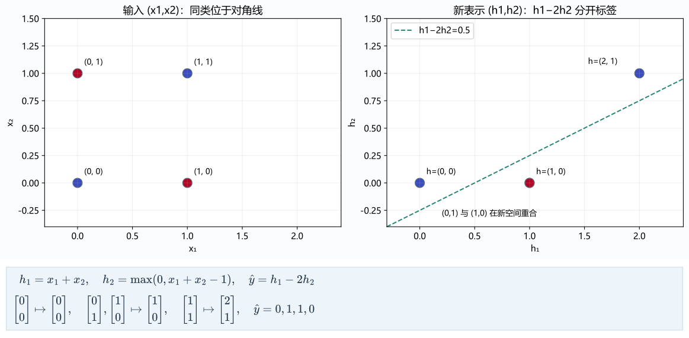
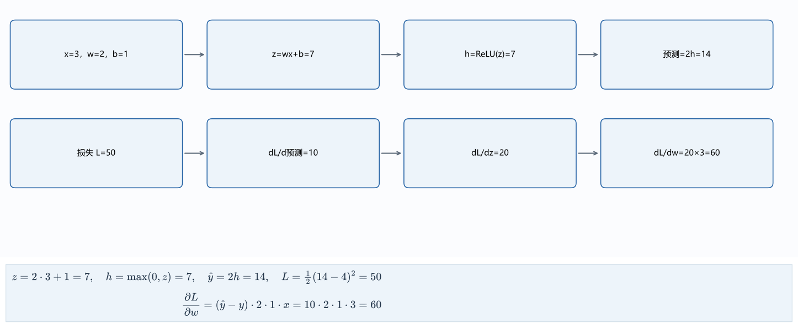
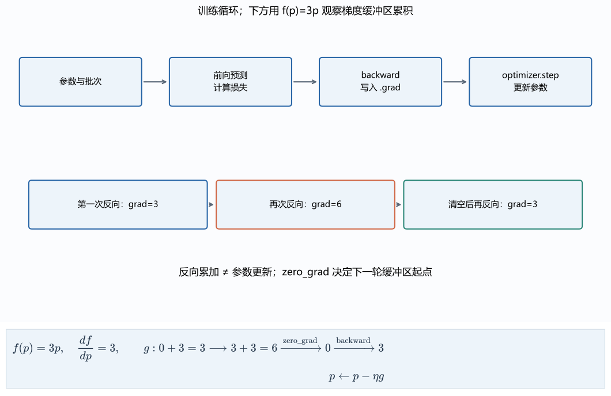
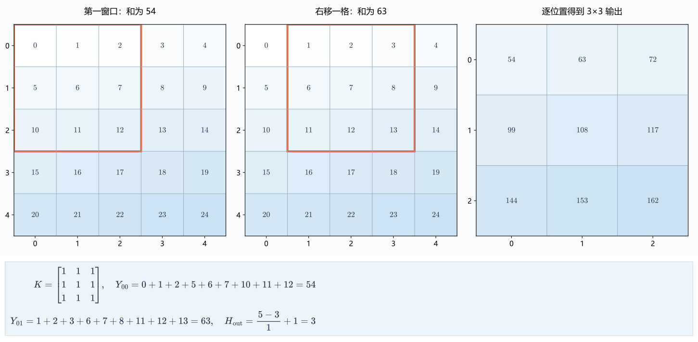
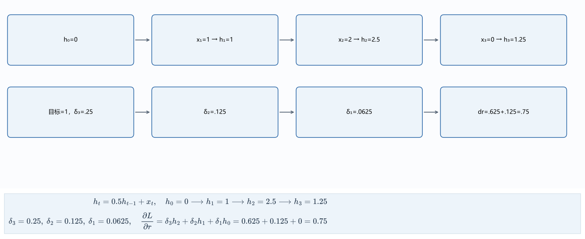
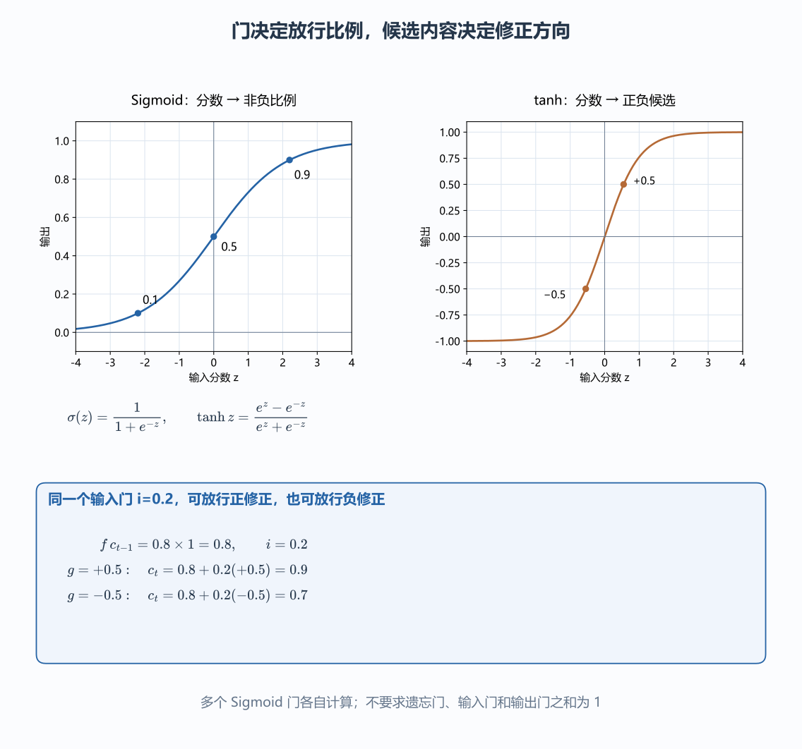
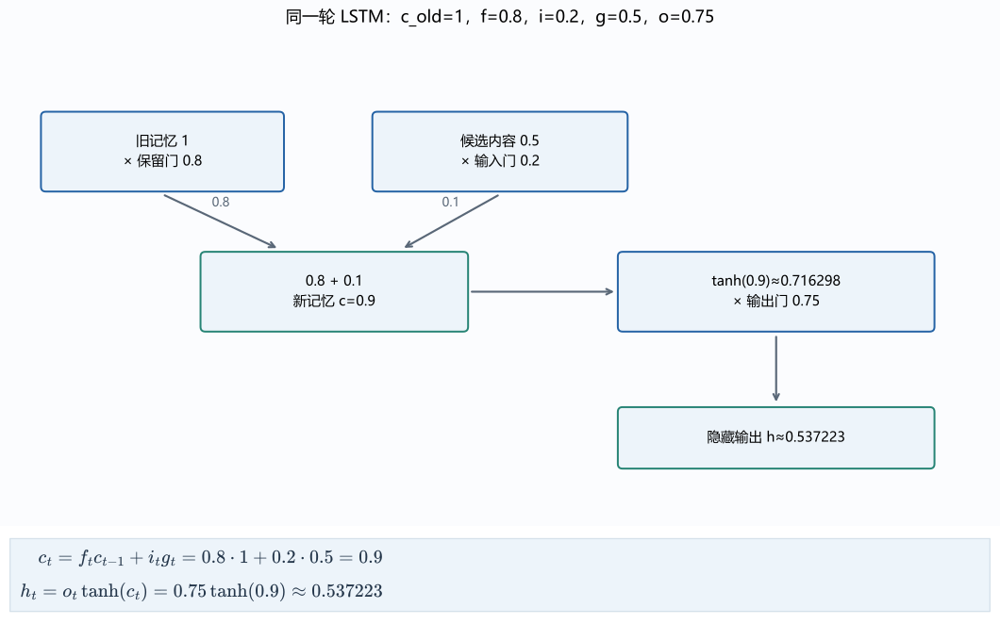
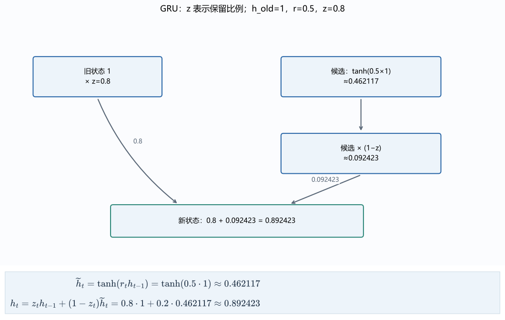
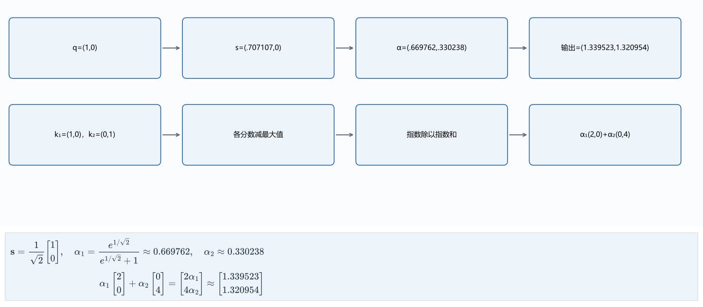
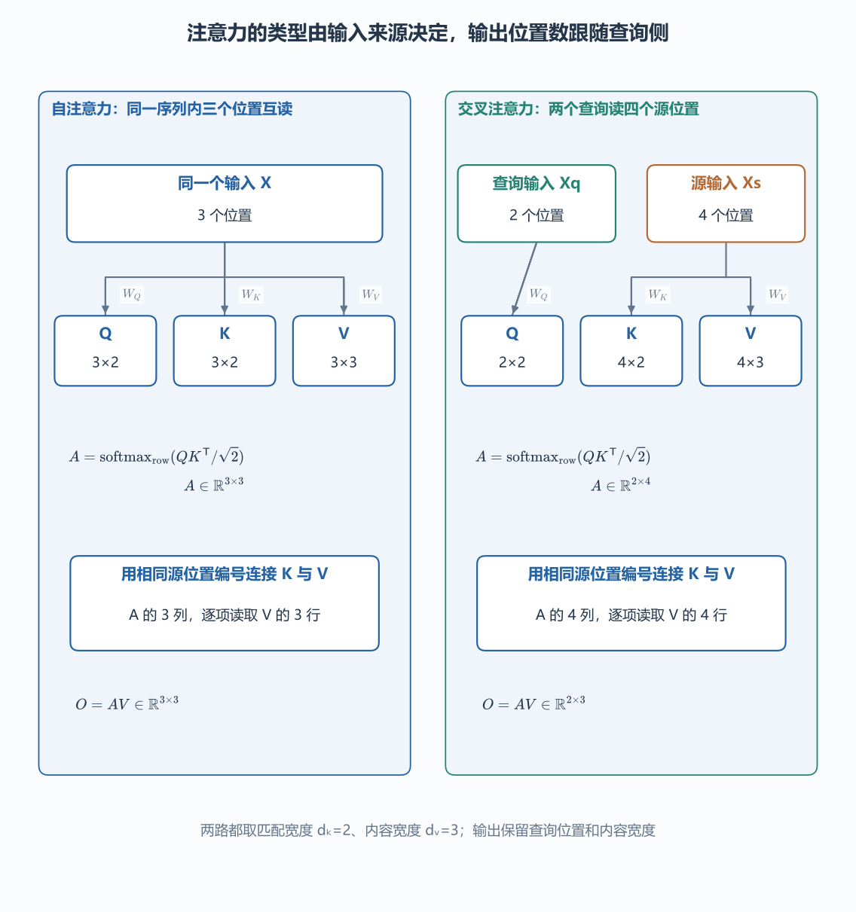

# 三、神经网络、深度学习与上下文表示

[TOC]

## （一）异或与非线性

第二篇末尾留下了一个死结：平面上有四个点，输入为 $(0,0)$ 和 $(1,1)$ 时标签为 $0$，输入为 $(0,1)$ 和 $(1,0)$ 时标签为 $1$（即**异或 XOR 问题**）。同属 $0$ 类的两个点占了一条对角线的两头，同属 $1$ 类的两个点占了另一条对角线的两头，你在平面上无论怎么摆放一条直线，都不可能把这两组点一刀分开。

既然单靠一条直线切不开，我们先观察一下两个输入坐标相加的和 $s=x_1+x_2$。把四个点 $(0,0)$、$(0,1)$、$(1,0)$、$(1,1)$ 代进去，算出来的和分别是 $s=0, 1, 1, 2$，而对应的目标标签是 $0, 1, 1, 0$。对比这两串数字就能看出门道：我们需要一个**在 $s\le 1$ 时跟着 $s$ 一起往上涨、一旦 $s>1$ 就调头往下跌**的折线规则。单靠一个线性函数，斜率从头到尾是锁死的，绝不可能走到半路自己拐弯。

怎么拼出这个拐弯的规则？我们可以拆成两条特征来配合：
1. 第一条特征保留原来的和：$h_1 = s$；
2. 第二条特征专门用来捕捉“超过 $1$ 的那部分超出量”：当 $s\le 1$ 时它保持为 $0$，当 $s>1$ 时它等于 $s-1$。写成数学式子就是 $h_2 = \max(0, s-1)$。

现在拿第一条特征减去第二条特征的 $2$ 倍，即 $\hat y = h_1 - 2h_2$：在 $s\le 1$ 的前半段，$h_2=0$ 不起作用，输出按斜率 $+1$ 上升；一旦跨过 $s=1$ 的门槛，斜率为 $+1$ 的 $h_1$ 被斜率为 $-2$ 的 $-2h_2$ 反超，合成的总斜率立刻从 $+1$ 折成了 $1-2=-1$！把四个点代进去一算，输出不多不少正好是 $0, 1, 1, 0$。

深度学习里把 $\max(0, z)$ 这个“负数一律掐断归零、正数原样放行”的简单折线函数命名为 **ReLU（Rectified Linear Unit，修正线性单元）**。用它来写刚才构造的两条中间特征，就是：

$$
h_1=\operatorname{ReLU}(x_1+x_2),\qquad h_2=\operatorname{ReLU}(x_1+x_2-1)
$$

你看，这两个所谓的“隐藏层神经元”并不是什么神秘的黑盒，它们就是为了把原本纠缠在一起的四个点，搬运到一个能用直线轻松切开的新坐标系里。

把这套“先做线性组合、再套一层非线性折弯”的操作写成通用矩阵形式，就是多层神经网络的骨架：第一层算出隐藏表示 $\mathbf h=\phi(W_1\mathbf x+\mathbf b_1)$（其中 $\phi$ 代表像 ReLU 这样的非线性**激活函数**），第二层再拿隐藏表示算出最终预测 $\hat{\mathbf y}=W_2\mathbf h+\mathbf b_2$。千万注意中间那个激活函数 $\phi$ 不能省：如果去掉它，两层直接连乘 $W_2(W_1\mathbf x)=(W_2W_1)\mathbf x$，根据第一篇的矩阵乘法结合律，不管你叠多少层矩阵，乘完之后依然只是一个单层矩阵换了个马甲，连一条直线的弯都拐不了。所谓的“深度学习”，深就深在层与层之间交替插入了非线性激活函数，从而获得了把空间反复折叠、组合出复杂分界面的能力。

## （二）前向传播与反向传播

网络有了多层之后，末端的预测误差怎样一路倒推回来修改第一层的参数？我们拿一个极小的标量网络把整条链路手算一遍。

设输入 $x=3$，真实目标 $y=4$。网络分两步走：第一层算线性输出 $z=wx+b$，经过激活函数得到隐藏值 $h=\operatorname{ReLU}(z)$；第二层乘上权重 $v$ 得到预测值 $\hat y=vh$，最后算半平方损失 $L=(\hat y-y)^2/2$。

给定初始参数 $w=2, b=1, v=2$，先从左往右算一遍**前向传播（Forward Pass）**：

$$
z=2\times3+1=7,\quad h=\operatorname{ReLU}(7)=7,\quad \hat y=2\times7=14,\quad L=\frac{(14-4)^2}{2}=50
$$

前向计算不仅算出了损失 $50$，还在内存里顺手把沿途的中间状态 $x=3, z=7, h=7, \hat y=14$ 全都记在了**计算图（Computation Graph）**上。接下来从右往左算**反向传播（Backward Pass）**：
1. 预测值 $\hat y=14$ 比目标 $y=4$ 大了 $10$，所以损失对预测值的起始斜率是 $\frac{\partial L}{\partial\hat y}=\hat y-y=10$；
2. 往回退到乘法节点 $\hat y=vh$。因为 $\hat y$ 对 $v$ 的局部斜率是另一项 $h=7$，对 $h$ 的局部斜率是 $v=2$，所以上游传来的梯度 $10$ 在这里兵分两路：一路乘上 $h$ 变成参数 $v$ 的梯度，另一路乘上 $v$ 继续往左传给隐藏节点 $h$：

$$
\frac{\partial L}{\partial\hat y}=10,\quad \frac{\partial L}{\partial v}=10\times7=70,\quad \frac{\partial L}{\partial h}=10\times2=20
$$

3. 继续从 $h$ 往左退：因为当前 $z=7>0$，处在 ReLU 正半轴斜率为 $1$ 的平滑段上，局部导数为 $1$，梯度 $20$ 原封不动穿过激活函数传给 $z$；最后在 $z=wx+b$ 处，乘上 $x=3$ 得到 $w$ 的梯度，乘上 $1$ 得到 $b$ 的梯度：

$$
\frac{\partial L}{\partial z}=20\times1=20,\quad \frac{\partial L}{\partial w}=20\times3=60,\quad \frac{\partial L}{\partial b}=20\times1=20
$$

整个反向传播干的只有一件事：**每个节点接住右边上游传过来的梯度，乘上自己这一步的局部导数，再往左传给下游**；如果同一个参数分叉通向好几条路径，就把各条路径传回来的梯度加起来。

验证一下梯度的效果：假设这轮只更新 $w$，取学习率 $\eta=0.01$，更新后 $w'=2-0.01\times60=1.4$。重新做一次前向计算：$z'=1.4\times3+1=5.2$，$\hat y'=2\times5.2=10.4$，新损失降到了 $L'=(10.4-4)^2/2=20.48$。如果同时更新 $w, b, v$ 三个参数，则必须统一使用刚才同一张旧计算图里算出来的 $60, 20, 70$。

怎么确认自己手推的链式法则没写错？可以用第一篇导数定义里的**中心差分**做验算：把 $w$ 往右拨一点点 $\epsilon$、再往左拨一点点 $\epsilon$，算两次前向损失求斜率 $\frac{L(w+\epsilon)-L(w-\epsilon)}{2\epsilon}$。取 $\epsilon=10^{-6}$ 时，算出来的数值斜率跟手算的 $60$ 几乎分毫不差。不过，有限差分每检查 1 个参数就得额外跑两次前向计算，面对几亿参数的网络根本跑不起，只适合在写单元测试时拿来核对少量梯度；深度学习框架靠的是**自动微分（Autograd）**，直接顺着前向记录的计算图一次性反传算出所有参数的精确链式导数（具体机制可参考 [PyTorch 自动微分官方教程](https://pytorch.org/tutorials/beginner/basics/autogradqs_tutorial.html)）。

~~~python
import torch
# requires_grad 让叶子参数进入反向图；float64 与手算检查一致。
w = torch.tensor(2., dtype=torch.float64, requires_grad=True)
loss = (2 * torch.relu(3 * w + 1) - 4).square() / 2
loss.backward()
print(loss.item(), w.grad.item())  # 50.0、60.0
~~~

## （三）训练循环与优化器

实际训练时不会一条样本算一次，而是把 $B$ 条样本叠成一个批次矩阵 $X\in\mathbb R^{B\times d}$ 一起送进去，第一层批量输出 $H=\phi(XW_1^\mathsf T+\mathbf b_1)$。偏置 $\mathbf b_1$ 会沿着样本轴自动广播加到每一行上；最后的损失则对这 $B$ 条样本取平均，这样无论批次大小 $B$ 设成 16 还是 64，算出来的梯度量级都保持稳定，不用每次改批次大小都去重调学习率。这种每次抽一小批样本来估计总体梯度的办法，就是**小批次随机梯度下降（Mini-batch SGD）**。

在 PyTorch 里，一轮标准的训练循环由固定四步组成：

~~~python
# optimizer 保存参数引用；每轮先清除上一轮累积值。
optimizer.zero_grad(set_to_none=True)
prediction = model(batch_x)
# CrossEntropyLoss 接收原始 logits 和整型类别，不先做 softmax。
loss = criterion(prediction, batch_y)
loss.backward()
optimizer.step()
~~~

这几行代码里藏着三个新手最容易踩坑的状态机制：
1. **梯度默认累加与显式清零**：调用 `loss.backward()` 时，PyTorch 不会覆盖参数原有的 `.grad` 属性，而是直接往里**相加**。这原本是为了方便做**梯度累积**（比如显存太小塞不下大批量时，可以把两个等大的微批次各自的 `loss / 2` 分别做 `backward()`，累加出来的梯度正好等价于大批量合并后的平均梯度；若微批次大小不等，则需按样本数比例加权）。但也正因如此，每轮正常更新前必须先调 `optimizer.zero_grad()` 把上一轮残留的旧梯度清掉，否则旧梯度会像滚雪球一样一直叠在新梯度上。
2. **训练/推理模式切换 vs. 关闭梯度图**：`model.train()` 和 `model.eval()` 负责切换特定网络层的运行开关，而 `with torch.no_grad():` 负责关掉自动微分的计算图记录，**两件事互不替代**。例如 **Dropout（随机失活）**层在训练模式下会按概率 $p$ 随机把一部分激活值掐成 0，并把幸存下来的值除以 $1-p$（放大以保持期望不变），防止神经元之间抱团死记硬背；到了测试推理时，调了 `model.eval()` 它才会关掉随机掐断、放行完整激活。同理，**BatchNorm（批归一化）**在训练时用当前批次的均值方差做归一化并顺带更新全局滑动统计量，在 `eval()` 下则冻结并直接读取存好的统计量；而后续 Transformer 爱用的 **LayerNorm（层归一化）**则是在单条样本自己的特征轴内部算均值方差，不依赖批次里的其他样本。
3. **初始化与优化器步长自适应**：网络参数绝不能图省事全部初始化成同一个常数（比如全 0），否则同一层的所有神经元在前向时算出完全一样的输出，反向时拿到一模一样的梯度，更新完还是双胞胎，整层网络直接退化成 1 个神经元。权重的初始数值也不能太大或太小，否则连乘几十层后激活值和梯度不是指数爆炸就是缩成 0——**Xavier 初始化**和专门配合 ReLU 的 **Kaiming 初始化**，正是通过输入输出通道的宽度来精确控制初始权重的方差。在更新步长上，工业界最常用的 **Adam 优化器**不仅维护了梯度的一阶指数移动平均（类似物理惯性动量，顺坡加速、抑制左右摇摆），还维护了梯度平方的二阶移动平均（用来除以梯度的历史波动幅度，给平时梯度罕见的参数放大步长，给梯度剧烈的参数收小步长），并做了零起点偏差校正。

当训练曲线跑崩时，不要靠玄学乱猜，每一条异常都能直接连回具体的数值机制：学习率设得太大（如第一篇设成 $1$）会让参数在山谷两侧越蹦越高；学习率过大还可能把带 ReLU 的神经元参数直接一脚踹进负数深渊，导致它对所有样本算出来的 $z$ 全都小于 0，局部导数永远是 0，从此再也拿不到半点梯度更新（俗称**“死亡 ReLU / Dead ReLU”**，就像把水龙头彻底焊死了）；而训练损失诡异震荡，则往往是因为漏写了 `zero_grad()` 或者误把已经算过 Softmax 的概率又送进了自带 Softmax 的 `CrossEntropyLoss`。配套代码 `networks.training_diagnostics` 专门重现了这几种典型的故障现场。

## （四）卷积与局部特征

如果处理的是一张二维图像，把所有像素直接拉平（Flatten）成一长条向量喂给全连接层，会立刻遇到一个荒唐的问题：画面里的同一条竖直边缘，仅仅是往右平移了 1 个像素，落在拉平向量里的坐标位置就全变了，全连接层得从头再去学一遍另外一套权重来识别它。

既然图像里的局部结构（比如边缘、拐角、纹理）不管出现在左上角还是右下角，长相都是一样的，我们干脆拿一个尺寸固定的小权重矩阵（称为**卷积核 / Kernel**），像拿着放大镜在方格纸上滑窗一样，从左到右、从上到下挨个读取局部邻域——**不同位置共享同一套卷积核参数**。

看一个可直接手算的例子：输入是一张单通道 $5\times5$ 的灰度图，像素值按行依次填上 $0$ 到 $24$。拿一个 $3\times3$ 全为 $1$ 的卷积核盖在左上角第一个窗口上，对应位置相乘再相加，算出来的左上角第一个输出就是：

$$
(0+1+2)+(5+6+7)+(10+11+12)=54.
$$

把卷积核往右平移 1 格（步长 $S=1$），盖住的新窗口里每行三个数都比刚才大了 1，共 9 个数，算出来的第二个输出直接变成 $54+9=63$。在二维平面上滑完一圈，原本 $5\times5$ 的输入就变成了一张 $3\times3$ 的输出特征图。如果输入图像有 $C_{\rm in}$ 个通道（比如 RGB 彩色图有 3 个通道），想要提取 $C_{\rm out}$ 种不同的局部特征，卷积层的权重张量形状就是 $(C_{\rm out}, C_{\rm in}, K_h, K_w)$：每一个输出通道都拿着自己那一组 $(C_{\rm in}, K_h, K_w)$ 的核，在同一空间窗口上把所有输入通道的乘积全部加起来，汇总成该位置上的 1 个数字。

沿着任意一条空间边（比如高度 $H$），经过核大小 $K$、边缘补零填充 $P$（Padding）、滑动步长 $S$（Stride）以及核内空洞膨胀系数 $D$（Dilation，常规紧挨着的卷积 $D=1$）之后，输出长度的通用计算公式是：

$$
H_{\rm out}=\left\lfloor\frac{H+2P-D(K-1)-1}{S}\right\rfloor+1.
$$

式中的 $\lfloor\cdot\rfloor$ 表示向下取整（滑到边缘不够再放下一个完整窗口时直接丢弃）。代入刚才的 $H=5, K=3, P=0, S=1, D=1$，算出 $H_{\rm out}=\lfloor(5-2-1)/1\rfloor+1=3$；如果设了 2 个输出通道，单张样本跑出来的完整特征图形状就是 $(1, 2, 3, 3)$。跟在卷积层后面的**最大池化（Max Pooling）**或**平均池化（Average Pooling）**则不带任何可学习参数，只负责在局部小窗口里挑最大值或算平均值，用来缩小特征图尺寸。

当多个卷积层叠在一起时，后一层特征图上的 1 个点，实际上汇总了前一层 $3\times3$ 的区域，而前一层这 $3\times3$ 的区域又汇总了原始图像上整整 $5\times5$ 的像素范围——这个“高层输出里的 1 个点，往回追溯能看到原始输入多大的地盘”，就叫做**感受野（Receptive Field）**。用递推公式来算：设第 $l$ 层的感受野宽度为 $r_l$，相邻两个输出点在原图上对应的跨度间隔为 $j_l$（初始输入层 $r_0=1, j_0=1$），那么每经过一层，跨度与感受野的更新规则就是：

$$
r_l = r_{l-1} + (K_l-1)D_lj_{l-1},\qquad j_l = j_{l-1}S_l.
$$

## （五）序列与上下文

从图像回到文本，会撞上第一篇“表示同时意味着取舍”留下的另一个难题：同一个词在不同上下文里需要不同表示。看这两句话：
* 句子 A：“**苹果**发布了新手机”
* 句子 B：“**苹果**切成了小块”

两句话开头都是“苹果”这个词，但后续任务显然需要区分前者是一家科技公司、后者是一种水果。在把文字送进神经网络之前，通常先建一张包含 $V$ 个词的词表，给每个词发一个整数身份证号（索引）；再准备一张形状为 $E\in\mathbb R^{V\times d}$ 的**词嵌入矩阵（Embedding Matrix）**，直接把第 $i$ 行抽出来，作为第 $i$ 个词的 $d$ 维稠密向量表示（这在数学上等价于拿第 $i$ 位为 1 的独热行向量去乘矩阵 $E$，反向传播时只会更新本轮被查到的那几行参数）。

但问题在于，查表拿到的静态词向量是死板的：只要输入是“苹果”，不管放在哪句话里，从嵌入表里抽出来的永远是同一行一模一样的数字。要想区分这两个“苹果”，模型的处理函数就不能只看当前这 1 个词，而必须接收整条序列 $(\mathbf x_1, \ldots, \mathbf x_T)$，让同一个词在不同的**上下文（Context）**里生成不同的动态表示。

这里还要立刻划清一条任务边界：**当前这个位置到底允许看到哪些上下文？**
* 如果是“读完一整句话再做情感分类”，模型在编码开头的“苹果”时，完全可以开启**双向（Bidirectional）**视野，偷看后面的“手机”或“小块”来帮自己消歧；
* 但如果是像大语言模型那样“根据上文逐词往后续写”，模型在读到开头的“苹果”时，后面的词根本还没生成出来，此时只允许使用**单向（Unidirectional / Causal）**视野，绝不能在评估或训练时让未来的信息提前泄漏到当前位置。

## （六）循环神经网络（RNN）

在单向顺序读取的限制下，如果每次只把当前时刻的词向量 $\mathbf x_t$ 孤零零地送进全连接层，那么读到“苹果”时算出来的结果永远一成不变。怎样让过去读过的词影响现在的判断？最直接的办法，就是**把上一时刻算出来的中间结果存下来，跟当前时刻的新输入一起喂给当前步**。这个一步接一步往下传的中间向量，就叫做**隐藏状态（Hidden State，记作 $\mathbf h_t$）**——数据集里从来没有直接给 $\mathbf h_t$ 标过什么“标准答案”，它里面到底记住些什么，全靠最终任务的损失函数倒逼着学出来。

这就是**循环神经网络（RNN）**。跟卷积层在空间位置上共享参数类似，RNN 在所有时间步 $t=1, 2, \ldots, T$ 上**共享同一套权重参数**：

$$
\mathbf z_t=W_x\mathbf x_t+W_h\mathbf h_{t-1}+\mathbf b,\qquad
\mathbf h_t=\tanh(\mathbf z_t),\qquad
\mathbf o_t=W_o\mathbf h_t.
$$

核对一下张量形状：设每个时刻的输入词向量 $\mathbf x_t\in\mathbb R^d$，隐藏状态 $\mathbf h_t\in\mathbb R^m$，输出类别数为 $c$，那么吃进当前输入的权重 $W_x$ 形状为 $(m, d)$，承接上一步旧状态的循环权重 $W_h$ 形状为 $(m, m)$，输出层权重 $W_o$ 形状为 $(c, m)$。**权重参数 $(W_x, W_h, W_o, \mathbf b)$ 在训练结束后就固定锁死了，而隐藏状态 $\mathbf h_t$ 则是在推理时随着每一条输入序列动态刷新的临时记忆。**

为了看清早期的输入是怎么顺着状态一路传到末尾的，我们先暂时拿掉双曲正切激活函数 $\tanh$，看一个最简单的标量线性循环：$h_t = x_t + r h_{t-1}$。设衰减系数 $r=0.5$，初始状态 $h_0=0$，依次送入序列 $(x_1, x_2, x_3) = (1, 2, 0)$：

| 时刻 $t$ | 当前输入 $x_t$ | 上一步旧状态贡献 $r h_{t-1}$ | 合成新状态 $h_t$ |
| --- | --- | --- | --- |
| $1$ | $1$ | $0.5\times 0 = 0$ | $1 + 0 = 1$ |
| $2$ | $2$ | $0.5\times 1 = 0.5$ | $2 + 0.5 = 2.5$ |
| $3$ | $0$ | $0.5\times 2.5 = 1.25$ | $0 + 1.25 = 1.25$ |

注意第 3 步：尽管当前输入是 $x_3=0$，状态 $h_3$ 依然算出了 $1.25$，因为它记住了前两步攒下来的底子。现在做个对照实验：**保持 $x_2=2, x_3=0$ 完全不动，只把最开头的输入从 $x_1=1$ 改成 $x_1=3$**。重新算一遍，三个时刻的状态立刻变成了 $3 \to 3.5 \to 1.75$，最末端的输出跟着涨了 $0.5$！把递推式从头展开就能看穿这个变化量是从哪儿来的：

$$
h_3 = x_3 + r h_2 = x_3 + r(x_2 + r x_1) = x_3 + r x_2 + r^2 x_1.
$$

最早的输入 $x_1$ 每往后传一步就要乘一次 $r$，传到第 3 步时身上乘了 $r^2=0.25$，所以 $x_1$ 增加 $2$，末端 $h_3$ 就精确增加 $2\times 0.25 = 0.5$。如果把非线性激活函数 $\tanh$ 装回去（$\tanh$ 把实数压到 $-1$ 到 $1$ 之间，在原点附近接近斜率为 1 的直线，越往两头越平缓），送入两步序列 $(1, 0)$，则第一步算出 $h_1=\tanh(1)\approx 0.761594$，第二步算出 $h_2=\tanh(0 + 0.5 h_1)\approx 0.3634$。

## （七）时间反向传播（BPTT）

既然同一个循环参数 $r$（或矩阵 $W_h$）在时间步 $1, 2, 3$ 上被反反复复用了三次，反向传播算梯度时该怎么给它记账？

把上面三次循环沿时间轴摊开，画成三个首尾相连的计算节点（这就叫**沿时间反向传播，Backpropagation Through Time，简称 BPTT**）。虽然图上画了三个乘以 $r$ 的地方，但内存里自始至终只有**同一个参数 $r$**。微调一下 $r$，三个时间步的计算结果会同时跟着变；根据本章（二）节讲过的链式法则分叉相加原则，**共享参数的最终梯度，必须把它在所有时间步上产生的梯度贡献全部加起来**。

我们拿刚才 $x=(1, 2, 0), r=0.5$、末端状态 $h_3=1.25$ 的线性例子来手算验证。假设只在第 3 步末端计算半平方损失 $L=(h_3-1)^2/2 = (1.25-1)^2/2 = 0.03125$：
1. 先把对状态的梯度 $\delta_t = \frac{\partial L}{\partial h_t}$ 从第 3 步一步步往回传（每往左退一步，由于 $h_t = x_t + r h_{t-1}$，就要乘上一次局部导数 $r=0.5$）：

$$
\delta_3=\frac{\partial L}{\partial h_3}=h_3-1=0.25,\qquad
\delta_2=r\delta_3=0.125,\qquad
\delta_1=r\delta_2=0.0625.
$$

2. 在每一个时间步 $t$ 上，$h_t = x_t + r h_{t-1}$ 对当前这一步使用的 $r$ 求局部导数，结果都是上一步的状态 $h_{t-1}$。把三个时间步各自的贡献 $\delta_t h_{t-1}$ 加起来，就得到参数 $r$ 的总梯度：

$$
\frac{\partial L}{\partial r} = \delta_1 h_0 + \delta_2 h_1 + \delta_3 h_2
= 0.0625\times 0 + 0.125\times 1 + 0.25\times 2.5 = 0 + 0.125 + 0.625 = 0.75.
$$

不信的话，可以直接对刚才展开的多项式 $h_3 = x_3 + r x_2 + r^2 x_1$ 求导验证：$\frac{\partial h_3}{\partial r} = x_2 + 2r x_1 = 2 + 2\times 0.5\times 1 = 3$，再乘上末端误差 $\delta_3=0.25$，算出来同样是 $0.25\times 3 = 0.75$，两条路线分毫不差！

推广到带 $\tanh$ 激活、且每个时刻都有即时损失 $\ell_t$ 的一般向量版 RNN，设 $\boldsymbol\delta_t = \frac{\partial L}{\partial\mathbf z_t}$（序列最末端之后的 $\boldsymbol\delta_{T+1}=\mathbf 0$），由于 $\tanh(z)$ 的导数是 $1-\tanh^2(z)=1-h^2$，反向递推公式就是把“当前步输出的梯度”与“下一步传回来的梯度”加起来，再逐元素乘上 $\tanh$ 的导数：

$$
\boldsymbol\delta_t=
\left(W_o^\mathsf T\nabla_{\mathbf o_t}\ell_t+
W_h^\mathsf T\boldsymbol\delta_{t+1}\right)
\odot(1-\mathbf h_t^2).
$$

算出所有时刻的 $\boldsymbol\delta_t$ 后，把各时刻的外积加起来，就得到共享权重矩阵的总梯度：$\nabla_{W_h}L=\sum_t\boldsymbol\delta_t\mathbf h_{t-1}^\mathsf T$，$\nabla_{W_x}L=\sum_t\boldsymbol\delta_t\mathbf x_t^\mathsf T$。

看着这条连乘递推式，RNN 的先天软肋也就暴露无遗了：当序列拉长到几十上百步时，早期的梯度要一路连乘几十次 $W_h^\mathsf T$ 和 $(1-\mathbf h_t^2)$ 才能传到开头。就像几百人排成一排玩“传话游戏”，如果每一步的乘子大于 1，传到最后音量会震耳欲聋（**梯度爆炸**，工程上通常靠**梯度裁剪 Gradient Clipping** 强行把过长的梯度向量缩回安全阈值）；如果每一步的乘子小于 1（比如刚才的 $r=0.5$），传过 20 步之后，第 1 步留下的声音就只剩 $0.5^{19}\approx 1.9\times 10^{-6}$（**梯度消失**）。末端算出来的误差根本传不回开头，导致普通 RNN 成了“喜新厌旧的金鱼记忆”——永远只能记住最近刚读过的几个词，稍微远一点的铺垫全都忘得一干二净。

## （八）门控记忆：LSTM 与 GRU

普通 RNN 之所以留不住长程记忆，是因为它用死板的固定规则（比如每步固定乘 $0.5$）对待所有历史信息：哪怕句子最开头出现了一个决定全局的关键主语，中间隔了十几个无关紧要的修饰词，每读一个修饰词，新内容都会强行冲刷一次旧状态，把早期线索冲淡。

要想打破这个僵局，就得给状态通道装上几个动态调节的水龙头——也就是**门控机制（Gating Mechanism）**：让模型根据当前读到的词，自己算出一个介于 $0$ 到 $1$ 之间的比例系数（用第二篇逻辑回归一节讲过的 Sigmoid 函数 $\sigma$），动态决定**“旧记忆保留几成”**以及**“新内容写入几成”**。

公式里的圆圈加点符号 $\odot$ 代表**逐元素相乘（Hadamard Product）**：两个同样长度为 $m$ 的向量对应位置直接相乘，不求和，算出来还是长度为 $m$ 的向量。这就像一排有 $m$ 个独立阀门的闸门：某个坐标位置上的门值算出来接近 $1$，那一维的历史记忆就几乎无损放行；门值算出来接近 $0$，那一维的旧记忆就当场清空。

### 1. LSTM 的记忆通道

**长短期记忆网络（LSTM）**专门开辟了一条受保护的**细胞状态（Cell State，记作 $\mathbf c_t$）**当内部草稿纸，用来跑长途传输；另外维护一个**隐藏状态 $\mathbf h_t$** 作为每个时刻对外暴露的摘要汇报。

因为每个门都要同时参考“刚才记住了什么”和“现在新读到了什么”，最省事的做法是先把上一步的隐藏状态 $\mathbf h_{t-1}\in\mathbb R^m$ 与当前输入 $\mathbf x_t\in\mathbb R^d$ 首尾拼接起来。沿用单样本列向量的写法，方括号 $[\mathbf h_{t-1},\mathbf x_t]$ 表示**沿特征维直接拼长**：

$$
\mathbf u_t=[\mathbf h_{t-1},\mathbf x_t] =\begin{bmatrix}\mathbf h_{t-1}\\\mathbf x_t\end{bmatrix} \in\mathbb R^{m+d}.
$$
拼接之后，原来的 $m$ 个历史特征和当前的 $d$ 个输入特征一并保留，总长度直接相加（比如隐藏宽度 $m=5$、输入宽度 $d=3$，拼完就是 $8$ 维；二维列矩阵形状从 $(5,1)$ 和 $(3,1)$ 变成 $(8,1)$，一维张量则从 `(5,)` 和 `(3,)` 变成 `(8,)`）。

接下来，遗忘门要给旧草稿纸 $\mathbf c_{t-1}$ 的每一个坐标单独算一个保留比例，所以输出还得变回 $m$ 维：权重矩阵 $W_f$ 的形状设为 $(m, m+d)$，乘上 $(m+d, 1)$ 的列向量 $\mathbf u_t$ 刚好得到 $(m, 1)$，再加上同形状的偏置 $\mathbf b_f$。其余三个变换矩阵 $W_i, W_g, W_o$ 的形状也全都是 $(m, m+d)$，算出来的三个门、候选内容、细胞状态与隐藏状态的宽度统统对齐为 $m$。

在写批量代码时，习惯把每条样本横着放成一行：$B$ 条样本的旧状态是 `(B, m)`，当前输入是 `(B, d)`，沿着最后一条特征轴（`dim=-1`）拼接成 $U_t$，形状就是 `(B, m+d)`，前面的批次轴 `B` 保持不动：

~~~python
import torch
# 两条样本；每条分别有 5 维旧状态和 3 维当前输入。
h_prev = torch.zeros(2, 5)
x_t = torch.zeros(2, 3)
joined = torch.cat((h_prev, x_t), dim=-1)
print(joined.shape)  # torch.Size([2, 8])
~~~

单条列向量算的是 $W_f\mathbf u_t$，换成按行叠放的批量矩阵 $U_t$（代码里的 `joined`）后，对应的计算就是 $U_tW_f^\mathsf T$，输出形状从 `(B, m+d)` 变成 `(B, m)`。在每个时刻，先用拼好的 $\mathbf u_t$ 算出三个门和一个候选内容：
- **遗忘门 $\mathbf f_t$**：控制旧草稿纸 $\mathbf c_{t-1}$ 保留多少；
- **输入门 $\mathbf i_t$**：控制当前新算出来的**候选内容 $\mathbf g_t$** 往草稿纸上写多少；
- **输出门 $\mathbf o_t$**：控制把更新后的草稿纸拿去对外展示多少。

写成完整公式就是：

$$
\mathbf f_t=\sigma(W_f\mathbf u_t+\mathbf b_f),\qquad \mathbf i_t=\sigma(W_i\mathbf u_t+\mathbf b_i)
$$

$$
\mathbf g_t=\tanh(W_g\mathbf u_t+\mathbf b_g),\qquad \mathbf o_t=\sigma(W_o\mathbf u_t+\mathbf b_o),
$$

$$
\mathbf c_t=\mathbf f_t\odot\mathbf c_{t-1}+\mathbf i_t\odot\mathbf g_t,\qquad \mathbf h_t=\mathbf o_t\odot\tanh(\mathbf c_t)
$$

注意这几个式子里激活函数的分工，完全是由它们各自干的活决定的：
* **三个门（$\mathbf f_t, \mathbf i_t, \mathbf o_t$）一律用 Sigmoid（$\sigma$）**：因为门回答的是“放行几成比例”，每个坐标都需要一个介于 $0$ 到 $1$ 之间的非负系数。Sigmoid 刚好把任意实数分数平滑压进 $(0, 1)$：
  $$
  \sigma(z)=\frac{1}{1+e^{-z}},\qquad \sigma(0)=0.5,\quad \sigma(\ln 9)=0.9,\quad \sigma(-\ln 9)=0.1.
  $$
  线性打分从 $0$ 涨到 $\ln 9$，阀门开度就从五成升到九成；跌到 $-\ln 9$，就关小到只剩一成。而且注意，三个门各自算各自的 Sigmoid，彼此之间**没有**“加起来必须等于 $1$”的限制——遗忘门和输入门完全可以同时开到很大，做到既保留老记忆、又叠加新信息。
* **候选内容（$\mathbf g_t$）用双曲正切（$\tanh$）**：因为往草稿纸上写内容，既可能需要往上加（正修正），也可能需要往下减（负修正），所以必须用关于 $0$ 对称、取值落在 $(-1, 1)$ 之间的 $\tanh$：
  $$
  \tanh z=\frac{e^z-e^{-z}}{e^z+e^{-z}},\qquad \tanh 0=0
  $$
  
  盯住某一维旧记忆来看：假设保留项是 $f_t c_{t-1}=0.8\times 1=0.8$，输入门开度 $i_t=0.2$；如果候选内容算出正数 $g_t=+0.5$，就往草稿纸里写入 $+0.1$，合成 $0.9$；如果算出负数 $g_t=-0.5$，就写入 $-0.1$，抵消成 $0.7$。一句话：**输入门 $\mathbf i_t$ 管“改多大步子”，候选内容 $\mathbf g_t$ 管“往正还是往负改什么”**。虽然单步写进去的候选值被 $\tanh$ 限制在 $(-1, 1)$ 里，但草稿纸 $\mathbf c_t$ 跨过多个时间步不断累加后，数值完全可以突破 $1$；所以在最后对外汇报时，要先用 $\tanh(\mathbf c_t)$ 把读数重新压回 $(-1, 1)$ 的标准范围，再乘上输出门 $\mathbf o_t$ 决定最终端出去多少。

把两个函数画在同一段输入范围内，分工会更清楚：Sigmoid 的纵坐标始终为正，可以直接乘在要放行的内容上；$\tanh$ 的纵坐标可以跨过零，给候选内容保留正负方向。下图保持输入门为 $0.2$，只把候选从 $+0.5$ 换成 $-0.5$，同一份保留量 $0.8$ 就分别变成 $0.9$ 和 $0.7$。门的开度没有变，写入方向却反过来了。

拿一组标量数字手算一步就能看懂它的分工：设旧记忆 $c_{t-1}=1$，当前算出来遗忘门 $f=0.8$、输入门 $i=0.2$、候选内容 $g=0.5$、输出门 $o=0.75$。那么旧记忆保留下 $0.8\times 1=0.8$，新内容写进去 $0.2\times 0.5=0.1$，合成的新草稿纸就是 $c_t = 0.8 + 0.1 = 0.9$；最后经过 $\tanh$ 压缩再乘上输出门，对外输出的隐藏状态是 $h_t = 0.75\times\tanh(0.9)\approx 0.537223$。

为什么 LSTM 能缓解梯度消失？盯住草稿纸的更新式 $\mathbf c_t=\mathbf f_t\odot\mathbf c_{t-1}+\cdots$：它对上一步 $\mathbf c_{t-1}$ 的直接局部导数就是遗忘门 $\mathbf f_t$！只要模型学到某段历史线索很重要，把对应维度上的遗忘门 $\mathbf f_t$ 开到接近 $1$、输入门 $\mathbf i_t$ 关到接近 $0$，记忆和梯度就能顺着这条加法高速公路跨越几十个时间步几乎无损地传过去。

### 2. GRU 的门控更新

LSTM 维护两条状态通道加四个矩阵，参数量较大。**门控循环单元（GRU）**干脆把草稿纸和对外状态重新合二为一（只留一个 $\mathbf h_t$），并把遗忘门和输入门绑成一个联动开关——**更新门 $\mathbf z_t$**：如果旧状态保留 $\mathbf z_t$ 的比例，那么新候选内容 $\tilde{\mathbf h}_t$ 就自动分到剩下的 $1-\mathbf z_t$ 比例（就像一个此消彼长的调水阀）。另外设一个**重置门 $\mathbf r_t$**，用来在生成新候选内容时决定要不要参考旧状态。

为了和 PyTorch 的底层实现严格对齐，我们用两个下标给参数命名：第一个下标 $r, z, n$ 分别代表重置门（Reset）、更新门（Update）和新候选内容（New）；第二个下标 $x, h$ 分别代表“当前输入分支”与“旧隐藏状态分支”。三个输入权重 $W_r, W_z, W_n$ 形状都是 $(m, d)$，三个循环权重 $U_r, U_z, U_n$ 形状都是 $(m, m)$，所有偏置向量长度都是 $m$：

$$
\begin{aligned}
\mathbf r_t&=\sigma(W_r\mathbf x_t+\mathbf b_{r,x}+U_r\mathbf h_{t-1}+\mathbf b_{r,h}),\\
\mathbf z_t&=\sigma(W_z\mathbf x_t+\mathbf b_{z,x}+U_z\mathbf h_{t-1}+\mathbf b_{z,h}),
\end{aligned}
$$

$$
\tilde{\mathbf h}_t=\tanh\bigl(W_n\mathbf x_t+\mathbf b_{n,x}+\mathbf r_t\odot(U_n\mathbf h_{t-1}+\mathbf b_{n,h})\bigr),\qquad
\mathbf h_t=\mathbf z_t\odot\mathbf h_{t-1}+(1-\mathbf z_t)\odot\tilde{\mathbf h}_t.
$$

你可能会问：为什么每一行非要拆成两个偏置 $\mathbf b_{\cdot,x}$ 和 $\mathbf b_{\cdot,h}$？在前面两个门（$\mathbf r_t$ 和 $\mathbf z_t$）里，两路偏置确实是直接加在一起的，完全可以合并写成一个 $\mathbf b_r=\mathbf b_{r,x}+\mathbf b_{r,h}$。但在算候选内容 $\tilde{\mathbf h}_t$ 时，这里采用了与 PyTorch 一致的 `reset-after`（先线性变换、后乘重置门）顺序：旧状态分支的偏置 $\mathbf b_{n,h}$ 括在括号里面，要先和 $U_n\mathbf h_{t-1}$ 相加，再一起受重置门 $\mathbf r_t$ 的缩放控制；而输入分支的偏置 $\mathbf b_{n,x}$ 则在括号外面直接相加。比如某一维上 $r_t=0.5$，那么括号里的 $b_{n,h}=0.4$ 乘完门只剩 $0.2$ 的作用，而括号外的 $b_{n,x}=0.4$ 却是实打实的 $0.4$，两边根本没法合并成一个固定常数。在 PyTorch 的 `nn.GRUCell` 里，正是把三个输入分支偏置按 $r, z, n$ 顺序拼成长度为 $3m$ 的 `bias_ih`，把三个旧状态分支偏置拼成同样长度为 $3m$ 的 `bias_hh`。

代入一组标量核对：设 $h_{t-1}=1, r=0.5, z=0.8, U_n=1, x=0$、全部偏置为 $0$，则候选状态为 $\tilde h_t = \tanh(0.5\times 1)\approx 0.462117$，合成的新状态为 $h_t = 0.8\times 1 + (1-0.8)\times 0.462117 \approx 0.892423$。（注：部分文献会把 $z_t$ 反过来定义为“新内容的写入比例”，也就是把最后一步的 $\mathbf z_t$ 和 $1-\mathbf z_t$ 位置对调，看论文或移植代码时务必核对这一行符号。）

## （九）注意力机制（Attention）

不管是普通 RNN 还是加上了门控的 LSTM、GRU，骨子里都受制于同一个瓶颈：**它们必须在读每个词的当下，把过去读过的所有信息硬塞进一个固定长度的向量 $\mathbf h_t$ 里**。这就像出门远行前，强迫你把一辈子的家当全都塞进一个固定尺寸的行李箱里背在身上——当你读完长长的一段话，在末尾突然被问到“谁发布了手机？”或者“水果切成了什么？”时，所需的关键证据位于开头的不同位置，而那个固定大小的状态向量早就装不下所有细节了。

既然把所有历史硬压成一个向量这么痛苦，为什么不换个思路：**干脆别压缩了，把历史上每个位置的表示全都原样留着，等末尾遇到具体问题时，再拿着问题去翻前面的历史记录，按相关程度当场汇总答案？**

这就是彻底改写现代 AI 架构的**注意力机制（Attention Mechanism）**——借用 2017 年那篇里程碑论文的标题来说，既然能随时回头按需查表，笨重的循环状态就不再是必需品，**Attention Is All You Need（注意力就够了！）**。

具体怎么实现“拿着问题去翻历史”？注意力机制把参与计算的角色拆成了三个：
* **查询（Query，记作 $\mathbf q$）**：代表当前位置正在寻找什么信息（比如末尾提问时的检索词）；
* **键（Key，记作 $\mathbf k_j$）**：贴在每个历史位置 $j$ 上的索引标签，专门用来和查询 $\mathbf q$ 比对匹配度；
* **值（Value，记作 $\mathbf v_j$）**：每个历史位置 $j$ 真正存放的干货内容，一旦键匹配上了，就把对应的值按比例提取出来。

我们拿一组两维向量手算一次完整的注意力读取。设当前查询 $\mathbf q=(1, 0)$，历史上有两个位置：位置 1 的键为 $\mathbf k_1=(1, 0)$、值为 $\mathbf v_1=(2, 0)$；位置 2 的键为 $\mathbf k_2=(0, 1)$、值为 $\mathbf v_2=(0, 4)$。计算分三步走：

1. **算匹配打分（Score）**：拿查询 $\mathbf q$ 和每个历史位置的键 $\mathbf k_j$ 算点积。查询与键都有 $d_k$ 个特征，点积会累加 $d_k$ 项乘积；为控制分数随维数增长的尺度、避免 Softmax 过早集中到几乎单一位置而使梯度变小，除以 $\sqrt{d_k}$（这里键宽 $d_k=2$，就除以 $\sqrt2$）：

$$
s_j = \frac{\mathbf q^\mathsf T\mathbf k_j}{\sqrt{d_k}},\qquad
\mathbf s = \left(\frac{1\times1+0\times0}{\sqrt2},\ \frac{1\times0+0\times1}{\sqrt2}\right) = (0.707107,\ 0).
$$

2. **转成加权比例（Softmax）**：点积算出来的原始分数有正有负，加起来也不等于 1，没法直接当百分比权重用。我们对每个分数先取自然指数 $e^{s_j}$ 把它变成正数，再除以所有位置指数的总和——这个把任意实数向量变成“全为正且总和严格等于 1”的概率分布的函数，就是 **Softmax**：

$$
\alpha_j = \frac{e^{s_j}}{\sum_k e^{s_k}},\qquad
\boldsymbol\alpha = \operatorname{softmax}(\mathbf s) = \left(\frac{e^{0.707107}}{e^{0.707107}+e^0},\ \frac{e^0}{e^{0.707107}+e^0}\right) \approx (0.669762,\ 0.330238).
$$

3. **按比例提取值（Weighted Sum）**：拿算出来的注意力权重 $\alpha_1, \alpha_2$ 分别乘上各自位置的值 $\mathbf v_1, \mathbf v_2$ 再加起来，得到最终读取出来的上下文表示：

$$
\text{Output} = \alpha_1\mathbf v_1 + \alpha_2\mathbf v_2
\approx 0.669762\times(2, 0) + 0.330238\times(0, 4) = (1.339523,\ 1.320954).
$$

你看，因为当前查询 $\mathbf q=(1,0)$ 和位置 1 的键 $\mathbf k_1=(1,0)$ 完全同向，位置 1 就分到了约 $67\%$ 的高权重，输出结果也主要由 $\mathbf v_1$ 主导；如果把查询换成 $\mathbf q=(0,1)$，去匹配位置 2 的键，两个位置的权重就会瞬间对调为 $(0.330238, 0.669762)$，提取出来的内容立刻变成以 $\mathbf v_2$ 为主！

### 1. 自注意力与交叉注意力

在真正的可训练神经网络里，查询、键和值并不是人工写死的，而是把输入序列矩阵分别乘上三个可学习的投影矩阵算出来的：

$$
Q=X_qW_Q,\qquad K=X_kW_K,\qquad V=X_vW_V.
$$

单看这三个乘法式子，还分不出它属于哪一种注意力；真正的区分标准在于**三个输入矩阵 $(X_q, X_k, X_v)$ 到底来自哪条序列**：

| 输入来源 | 注意力类型 | 位置之间的读取关系 |
| --- | --- | --- |
| 同一段序列 $X_q=X_k=X_v=X$ | **自注意力（Self-Attention）** | 同一句话里的各个位置互相查看、结合上下文更新自己的表示 |
| 查询来自目标侧 $X_q=X_{\rm target}$，键值来自源侧 $X_k=X_v=X_{\rm source}$ | **交叉注意力（Cross-Attention）** | 目标序列的各个位置（如译文、文本提问）去读取另一段源序列（如原文、图像特征）的表示 |

前面我们手算的例子，把单个外部查询 $\mathbf q$ 和两条历史记录分开给出，演示的正是交叉注意力式的读取；如果令 $X_q=X_k=X_v=X$，让序列里的每个词同时充当查询者与被查询者，就变成了**自注意力**。哪怕自注意力的三个输入源完全相同，三个投影矩阵 $W_Q, W_K, W_V$ 依然各司其职、独立训练，负责把同一个词分别投射成“我要找什么（$Q$）”、“我挂什么标签供别人匹配（$K$）”以及“我实际交出什么干货内容（$V$）”。第四篇在此基础上加上屏蔽未来位置的掩码，就构成了大语言模型逐词生成的因果自注意力（两类注意力的原始定义可对照 [Transformer 论文第 3.2.3 节](https://arxiv.org/html/1706.03762v7)）。

### 2. Attention 的矩阵形状

为了在写代码时绝不把张量维度搞混，我们拿单个注意力头、单条样本（把每个位置的向量横着放成一行）来核对一次完整的形状流转。设查询侧有 $T_q$ 个位置，输入特征宽度为 $d_{\rm in,q}$；被读取的源序列有 $T_s$ 个位置，输入特征宽度为 $d_{\rm in,s}$。无论是自注意力还是交叉注意力，键和值通常都从同一个源序列 $X_s$ 投影而来（即 $X_k=X_v=X_s$），以确保第 $j$ 个键和第 $j$ 个值严格绑定在同一个历史位置上。

记住 **$d_k$ 和 $d_v$ 是投影之后的列数（特征宽度）**：$d_k$ 是查询与键对齐后的匹配维度，$d_v$ 是值向量携带的内容维度：

| 矩阵对象 | 张量形状（Shape） | 每一行代表什么 |
| --- | --- | --- |
| 查询侧输入 $X_q$ | $(T_q, d_{\rm in,q})$ | 查询序列中 1 个位置的原始输入表示 |
| 源序列输入 $X_s$ | $(T_s, d_{\rm in,s})$ | 被读取序列中 1 个位置的原始输入表示 |
| 查询投影矩阵 $W_Q$ | $(d_{\rm in,q}, d_k)$ | 把查询输入投射到 $d_k$ 维匹配空间 |
| 键投影矩阵 $W_K$ | $(d_{\rm in,s}, d_k)$ | 把源输入投射到同一个 $d_k$ 维匹配空间 |
| 值投影矩阵 $W_V$ | $(d_{\rm in,s}, d_v)$ | 把源输入投射到 $d_v$ 维内容空间 |
| 查询矩阵 $Q=X_qW_Q$ | $(T_q, d_k)$ | 第 $i$ 行是第 $i$ 个查询向量的行形式 $\mathbf q_i^\mathsf T$ |
| 键矩阵 $K=X_sW_K$ | $(T_s, d_k)$ | 第 $j$ 行是第 $j$ 个键向量的行形式 $\mathbf k_j^\mathsf T$ |
| 值矩阵 $V=X_sW_V$ | $(T_s, d_v)$ | 第 $j$ 行是第 $j$ 个值向量的行形式 $\mathbf v_j^\mathsf T$ |

*（注：表中投影矩阵采用右乘约定，如 $W_Q$ 形状为 $(d_{\rm in,q}, d_k)$；而在 PyTorch 中，`nn.Linear(d_in_q, d_k)` 内部存储的 `.weight` 形状是转置后的 $(d_k, d_{\rm in,q})$，前向计算执行 `X_q @ weight.T`，最终算出来的 $Q$ 依然是 $(T_q, d_k)$。）*

只有当 $Q$ 和 $K$ 的最后一维都是 $d_k$ 时，它们才能逐项相乘求和。把 $K$ 转置成 $(d_k, T_s)$ 后与 $Q$ 相乘，一步就能算出所有位置两两配对的打分矩阵 $S$，再按行做 Softmax 得到注意力权重矩阵 $A$：

$$
S=\frac{QK^\mathsf T}{\sqrt{d_k}}
\in\mathbb R^{T_q\times T_s},\qquad
A=\operatorname{softmax}_{\text{按行}}(S)
\in\mathbb R^{T_q\times T_s}.
$$

这里的 $S_{ij}$ 是第 $i$ 个查询对第 $j$ 个键的打分，$A_{ij}$ 则是归一化后的读取比例（每一行有 $T_s$ 个正数，加起来等于 1）。最后拿权重矩阵 $A$ 去乘值矩阵 $V$，就把各行的值按比例汇总了出来：

$$
O=AV\in\mathbb R^{T_q\times d_v},\qquad
O_{i,:}=\sum_{j=1}^{T_s}A_{ij}V_{j,:}.
$$

把这两步矩阵乘法的维度首尾摆在一起，谁被消掉、谁被留下一目了然：

$$
\underbrace{(T_q,d_k)}_{Q}
\ \underbrace{(d_k,T_s)}_{K^\mathsf T}
\longrightarrow\underbrace{(T_q,T_s)}_{S\text{ 与 }A},
\qquad
\underbrace{(T_q,T_s)}_{A}
\ \underbrace{(T_s,d_v)}_{V}
\longrightarrow\underbrace{(T_q,d_v)}_{O}.
$$

在自注意力中，$T_q=T_s=T$，中间的权重矩阵 $A$ 是一个 $(T, T)$ 的方阵；而在交叉注意力中，两侧长度无需相等（比如 $2$ 个查询位置去读 $4$ 个源位置，$A$ 就是 $(2, 4)$）。加上批次轴 $B$ 之后，$Q, K, V$ 形状分别为 $(B, T_q, d_k)$、$(B, T_s, d_k)$、$(B, T_s, d_v)$，注意力权重为 $(B, T_q, T_s)$，最终输出为 $(B, T_q, d_v)$。

拿刚才的手算例子做个维度变形就能彻底吃透：**为什么 $d_v$ 不必等于 $d_k$，但 $K$ 和 $V$ 的行数必须都是 $T_s$？**
刚才手算时 $T_q=1, T_s=2, d_k=d_v=2$。现在我们保持查询 $Q\in\mathbb R^{1\times 2}$ 和键 $K\in\mathbb R^{2\times 2}$ 完全不动，算出来的注意力权重依然是 $A\approx(0.669762, 0.330238)$；但我们把两条历史记录存放的值改成**三维**（$d_v=3$）：

$$
V'=\begin{bmatrix}2&0&1\\0&4&-1\end{bmatrix}\in\mathbb R^{2\times 3}.
$$

用 `(1, 2)` 的权重 $A$ 去乘 `(2, 3)` 的 $V'$，只是把原来每个位置提取出来的二维包裹换成了三维包裹，算出来的输出自然变成三维：

$$
AV'=(2\alpha_1,\ 4\alpha_2,\ \alpha_1-\alpha_2)
\approx(1.339523,\ 1.320954,\ 0.339523)\in\mathbb R^{1\times 3}.
$$

一句话：**匹配打分发生在 $Q$ 和 $K$ 的特征轴 $d_k$ 上，而最终端出来什么形状的干货，完全取决于 $V$ 的特征轴 $d_v$**；唯一不能错位的是源位置数 $T_s$——你有几个键（目录索引），就必须对应几个值（正文内容）（参见 [Transformer 论文第 3.2.1—3.2.2 节](https://arxiv.org/html/1706.03762v7)）。

下图把输入来源、匹配宽度和输出形状同时排开。左路的三个位置都来自同一条序列，权重矩阵是 $3\times3$；右路由两个查询位置读取四个源位置，权重矩阵是 $2\times4$。两路都取 $d_k=2,d_v=3$，所以输出分别有三行和两行，每行都是三个内容分量。输出行数跟随查询侧，输出列数跟随值向量；源侧的键和值必须按同一个位置编号对应，才能把某个键得到的权重乘到正确的值上。

### 3. 注意力、检索与工具寻址

如果跳出矩阵细节往回看，你会发现 Attention 里的 $Q, K, V$ 其实干了一件在计算机系统里无处不在的事——**按内容寻址（Content-based Addressing）**。更妙的是，这套“拿 Query 匹配 Key，命中后提取 Value”的机制，直接贯通了本书[第七篇](07-模型调用RAG与工具闭环.md)要讲的 **RAG（检索增强生成）**，以及[第八篇](08-协议扩展框架与多智能体.md)要讲的 **MCP（模型上下文协议）**与 **Agent Skills**：

| 系统层级 | 查询（Query：当前需要什么） | 键（Key：用来匹配的标签/索引） | 值（Value：最终提取并注入的内容） | 选择方式 |
| --- | --- | --- | --- | --- |
| **Attention（模型层内）** | 当前 Token 的查询向量 $\mathbf q_i$ | 上下文各位置 Token 的键向量 $\mathbf k_j$ | 上下文各位置 Token 的值向量 $\mathbf v_j$ | Softmax **软加权**（全员按比例混合，连续可导） |
| **RAG（外部知识检索）** | 用户提问的嵌入向量 | 知识库文档切片的嵌入向量 / 关键词 | 命中切片的**完整原文段落** | Top-$k$ **硬筛选**（只挑前几名塞进提示词，丢弃其余） |
| **MCP / Agent Skills（工具与扩展）** | 当前任务状态与模型意图 | 工具的 `name`、`description` 与参数 JSON Schema（或 `SKILL.md` 摘要） | 工具执行返回的结果数据（或按需加载的完整 Skill 指令与脚本） | 离散路由调用（匹配描述后触发执行或读取资源） |

把这个对照关系看穿，第四、七、八篇的工程脉络就彻底打通了：
* 在 **Transformer 模型内部**，Attention 靠着可微的 Softmax 软查表，在已经送进上下文窗口的 Token 之间自由提取信息；但它再聪明，也只能查“已经在窗口里”的东西，而且窗口越长，$QK^\mathsf T$ 的计算量和显存占用越贵。
* 到了 **第七篇的 RAG 与工具闭环、第八篇的工具协议与扩展**，面对上百万字的外部资料库或几百个外部工具，不可能一口气全塞进模型的上下文窗口让 Attention 去硬算。于是我们在模型外围搭了一层完全同构的“外部注意力”：先拿用户问题（Query）去和文档切片的向量索引或工具的简短描述（Key）做快速匹配，只把最相关的那几段原文或当前真正要用到的那个工具结果 / Skill 详情（Value）捞出来，动态拼进本轮的上下文窗口里，最后再交棒给模型内部的 Attention 去精读。

**内部 Attention 负责在窗口内做可微的精读，外部 RAG 与 MCP 负责在窗口外做离散的粗筛与按需搬运**——现代 AI 应用系统的上下文工程，本质上就是这两层 `Query-Key-Value` 寻址机制的接力配合。

## （十）运行与练习

本章配套代码 [`modern_ai/networks.py`](https://github.com/KiriAky107/understanding-AI-and-Agents-in-depth/blob/main/%E7%8E%B0%E4%BB%A3AI%E7%A4%BA%E4%BE%8B/modern_ai/networks.py)（代码包内：`现代AI示例/modern_ai/networks.py`） 将上面手算过的反向传播梯度、线性 BPTT、LSTM/GRU 门控数值、卷积特征图形状以及小型序列分类训练全部落成了可核对的程序。其中的序列分类实验专门构造了一组“末尾出现同一个多义词，必须靠句子最开头的早期线索才能判断类别”的数据：运行程序后，如果保持末尾词不变、只改动开头的线索词，可以直观看到末端隐藏表示和预测分布随之发生翻转，直接验证模型确实把早期上下文读进了当前状态里。

在使用 PyTorch 的 `nn.RNN`、`nn.LSTM` 和 `nn.GRU` 接口时，建议统一加上参数 `batch_first=True`：这样输入张量的形状是直观的 `(批次 B, 序列长度 T, 输入维度 d)`，每个时间步连起来的输出张量形状是 `(B, T, 隐藏维度 m)`；但要注意，它们额外返回的“最末端隐藏状态 `h_n`”形状依然是 `(层数 L × 方向数 D, B, m)`，批次轴在中间（其中 `nn.LSTM` 返回的是 `(h_n, c_n)` 元组，比另外两个多了一项细胞状态）。处理长短不一的句子批次时，用 0 补齐的填充（Padding）位置必须通过长度打包或掩码（Mask）剔除掉，绝不能让模型把凑数用的补零当成有效上下文去学（各层详细张量轴约定可查阅 [PyTorch 2.6 nn 官方文档](https://pytorch.org/docs/2.6/nn.html)）。

在进入第四篇的大模型之前，最后把系统里四类容易混淆的“记忆/状态”彻底摆清楚（这张表也是后续理解[第四篇](04-大语言模型的架构训练与生成.md)（六）节的 KV Cache 和[第十篇](10-AgentHarness上下文与长程任务.md)（一）节的 Agent 长期记忆的基石）：

| 对象名称 | 物理保存位置 | 何时发生改变 | 跨会话是否留存 |
| --- | --- | --- | --- |
| **模型权重与偏置（Parameters）** | 显存 / 磁盘权重文件 | 仅在训练阶段执行 `optimizer.step()` 时更新 | 永久留存（推理时冻结） |
| **隐藏状态与注意力权重（临时中间量）** | 前向推理临时内存 / 显存 | 每读入一个新输入或每走一个时间步动态刷新 | 当前请求结束即销毁 |
| **自动微分计算图（Computation Graph）** | 训练阶段动态显存 | 前向传播时搭建，反向 `backward()` 后立即释放 | 单步训练结束即销毁 |
| **外部业务历史与长期记忆（External Memory）** | 应用层文件或数据库（如 SQLite） | 应用程序代码显式调用读写接口时改变 | 跨进程永久持久化 |

| 题号 | 要求 | 任务 |
| --- | --- | --- |
| 03-01 基础 | **必做** | 补全本章（二）节标量网络的 $\frac{\partial L}{\partial b}$ 与 $\frac{\partial L}{\partial v}$ 手算过程，并在同一旧图上同时更新 $w, b, v$ 后核对新损失 |
| 03-02 推导 | **必做** | 分别用 BPTT 时间步累加与多项式直接展开求导两种方法计算线性 RNN 的 $\frac{\partial L}{\partial r}$，并用中心差分代码核对 |
| 03-03 错误分析 | **必做** | 剖析误把 LSTM 的内部草稿纸 $\mathbf c_t$ 直接当成对外隐藏状态 $\mathbf h_t$ 接分类器时，漏掉了哪两步关键运算 |
| 03-04 扩展 | **拓展选做** | 手算将 Attention 查询换为 $(0,1)$ 后的权重与输出；在代码中拉长 RNN 序列长度 $T$，对比首尾时间步的梯度范数衰减 |

到这里，我们已经让模型学会了用多层非线性变换折叠空间，并用循环状态或注意力机制把历史上下文融进了当前表示里。进入第四篇，我们将彻底拆掉循环结构，完全用注意力机制搭起现代大语言模型（Transformer），看看一段文本是怎样一步步变成生成结果的；图像与文本的结合则在[第六篇](06-视觉语音与多模态.md)展开。
