# 四、大语言模型的架构、训练与生成

[TOC]

## （一）Token 与嵌入

前几篇里，我们的资料助手已经学会了把一段笔记变成向量，靠余弦或内积找出与问题最接近的段落。但如果现在把任务往前推一步——给它半截前缀 `read `，要求它自己接着往下写出 `notes.`，光靠“找相似段落”就不够用了。找到了相关资料之后，模型还得解决一个全新的问题：接下来到底该输出什么字？按什么先后顺序一个接一个地吐出来？

回想第二篇的分类器，它面对一条输入记录，只需要做一次判断、给出一个类别就算交差了。而语言模型干的事情，本质上是把这道分类选择题搬到了序列的**每一个位置**上，循环往复地做下去：当模型读到 `read ` 时，它先在所有可能的候选里给“紧跟着的下一项”分配概率，挑出一项接到末尾；等前缀变成了 `read n`，它再拿着这个更新后的前缀，去算再下一项的概率。

要把这个接龙循环拆明白，我们首先得卡死那个最基础的计量单位——所谓预测“下一项”，这“一项”在计算机里到底指什么？平时肉眼看到的字符、硬盘与内存里流转的字节，以及真正送进模型矩阵里占座的序列位置，并不是同一回事。

### 1. 字符、字节与编号

拿字符串 `"苹果 AI"` 来看。按日常习惯数过去，它有五个 Unicode 字符：两个汉字、一个空格、两个英文字母。但是，当程序要把这五个字符写进磁盘文件或者发上网络时，计算机底层并不直接存“汉字”或“字母”的形状，而是必须先按某种编码规则把它们拆成一串二进制字节。在如今通用的 UTF-8 编码下，这五个字符拆开后的真身是这样的：

| 字符 | UTF-8 字节值 |
| --- | --- |
| 苹 | 232、139、185 |
| 果 | 230、158、156 |
| 空格 | 32 |
| A | 65 |
| I | 73 |

一个字节（Byte）由八个二进制位组成，一共能表示 $2^8=256$ 种状态，所以每个字节换算成十进制整数都稳稳落在 $0$ 到 $255$ 之间。在 UTF-8 规则下，两个汉字各占了三个字节，空格和英文字母各占一个字节，短短五个字符排成了九个字节：

~~~python
text = "苹果 AI"
raw = text.encode("utf-8")  # 字符串变成 UTF-8 字节序列。
ids = list(raw)  # 遍历 bytes，得到每个字节的整数值。
print(len(text), len(raw))  # 5 个字符、9 个字节。
print(ids)  # [232, 139, 185, 230, 158, 156, 32, 65, 73]
print(bytes(ids).decode("utf-8"))  # 按同一规则恢复：苹果 AI。
~~~

在语言模型的术语里，**Token 就是分词器（Tokenizer）划分出来的最小模型输入单位**。一个 Token 可以直接对应底层的一个字节，也可以对应由好几个字节拼成的词根或单词片段；而 **Token ID** 就是这个单位在词表目录里的整数编号。

本章的配套微型模型 `TinyLM` 采用了最彻底、最透明的**字节分词**：不搞任何额外包装，直接把每一个 UTF-8 字节当成一个独立的 Token，词表大小自然就锁死为 $V=256$（编号 $0\sim 255$）。这样一来，`"苹果 AI"` 送进 `TinyLM` 时就占了九个序列位置。这里有一条严格的边界：编号 `232` 只代表“苹”字的第一截字节，它本身并不是一个完整的字符；必须等模型在后面两步把 `139` 和 `185` 也陆续生成齐全了，三个字节凑在一起，才能解码还原出那个“苹”字。

万一模型生成到半路停下了，末尾只留下一个孤零零的 `[232]`，直接做严格的 UTF-8 解码就会当场报错。工程代码里通常会加上 `errors="replace"` 参数，把这种凑不够完整字符的半截残缺字节显示成替换符 ``。这个显眼的 `` 在排查故障时非常有用——它能帮我们一眼分清：到底是模型选出来的字节序列本身半途而废、没凑够数，还是外围的显示程序用错了字符编码标准。

顺便提醒一句：虽然例子里的“苹”和“果”刚好各占三个字节，但千万不能由此得出“所有汉字或字符在 UTF-8 里都占三个字节”的结论。UTF-8 是变长编码，英文字符占一个字节，而不少生僻汉字或表情符号会占到四个字节；到了真实的工业界大模型里，上下文窗口还剩多少额度，永远要以那个模型自带的分词器实际切出来的 Token 数量为准。

### 2. 字节对合并

直接拿单字节当 Token 的最大好处是词表极小，随便什么生僻字、多国语言甚至代码符号来了都能拆成 $0\sim 255$ 的字节照单全收，永远不会撞上“词表外未知词（Out-of-Vocabulary）”。但它的代价也很明显：稍微长一点的句子就会被拆成一长串位置，既拖慢后续矩阵相乘的速度，又把宝贵的上下文窗口迅速吃光。

怎么在“词表别太大”和“序列别太长”之间找平衡？一个很自然的想法是：那些在语料里成天肩并肩挨在一起出现的高频字节组合，干脆预先给它们发一个新编号打包合并起来，让模型每次用一个位置就能读完一整个常用片段。这就是主流大模型普遍采用的 **[BPE（Byte Pair Encoding，字节对编码）](https://arxiv.org/abs/1508.07909)**。它的核心动作极其朴素：**统计语料里所有相邻单位结伴出现的次数，挑出最高频的一对合并成一个新编号，接着在更新后的序列上继续统计下一轮。**

我们拿三条极简的字符串样本，亲手走一遍合并账单：

~~~text
abab
abab
abac
~~~

最开始按单字节编号，`a`、`b`、`c` 的 ASCII 码分别是 `97`、`98`、`99`。我们先通盘扫描三条样本里的所有相邻配对：前两条样本里各自出现了两次相邻对 `(a, b)`（也就是 `(97, 98)`），第三条样本开头也出现了一次，加起来一共出现了五次，是全场出现最频繁的相邻组合。于是我们在 256 个基础字节之外新建一个词表编号 `256`，专门用来代表字节片段 `ab`，并把三条样本里的 `(97, 98)` 全部替换成 `256`：

| 样本 | 初始编号 | 第一次合并后 |
| --- | --- | --- |
| abab | 97、98、97、98 | 256、256 |
| abab | 97、98、97、98 | 256、256 |
| abac | 97、98、97、99 | 256、97、99 |

第一轮替换做完后，序列变短了。我们接着在新的编号序列上做第二轮统计：此时相邻对 `(256, 256)` 出现了两次，于是可以再新建一个编号 `257` 来代表 `(256, 256)`（也就是四个字节拼成的 `abab`）。这样一来，原本要占四个位置的 `abab`，现在只需要一个位置 `257` 就能装下！等模型输出编号序列后，解码程序只需顺着词表记录的对应关系，把 `257` 展开成 `ab` 加 `ab`，依然能分毫不差地还原出最初的字节串。

自己写代码实现 BPE 时，要注意区分“统计频次”和“执行替换”这两个动作：在按某条合并规则替换文本时，必须从左往右做**不重叠**的扫描替换，同一个位置上的字节绝不能既跟左边合了一次、又跟右边再合一次。真实的工业级分词器除了这张合并规则表之外，还会把文本规范化、正则预切分（比如防止标点符号和前面的单词粘连合并）以及特殊控制标记（如对话起止符）全部固化下来，训练和推理两边必须严丝合缝地遵守同一套规则。

这也就挑明了一条重要的工程纪律：**更换分词器，绝不仅仅是换一段字符串预处理代码那么简单。** 一旦词表经过了合并或重排，同样一个整数编号背后的含义就彻底变了；另一套词表里的 `232` 未必还是“苹”字的第一字节，而本章 `TinyLM` 的嵌入矩阵一共只有 256 行，你要是把上面新合并出来的编号 `257` 直接塞给它，程序当场就会报越界错误。分词器的词表目录与模型首尾两头的权重矩阵，是一对死死绑在一起的契约。

### 3. 编号变成向量

现在字符串变成了整数序列 `[232, 139, 185, ...]`。但请注意，这些整数仅仅是用来去词表里按号找座位的“门牌号”——编号 `232` 在数值上比 `139` 大，绝不代表前一个字节的“语义分量”比后一个字节更重。如果直接把整数 `232` 和 `139` 当成连续特征扔进神经网络做乘法，那就闹大笑话了。

为了让每个编号都能携带可学习的特征，模型准备了一张浮点数查找表：设词表共有 $V$ 个条目，我们打算用 $d$ 个特征来描述每一个条目，就在模型入口建一张形状为 $E\in\mathbb R^{V\times d}$ 的**嵌入矩阵（Embedding Matrix）**。这里的 $\mathbb R^{V\times d}$ 表示一张有 $V$ 行、$d$ 列的实数表格。当序列第 $t$ 个位置的输入编号是整数 $a_t$ 时，这个位置干的事情就是直接把表格的第 $a_t$ 行整行抽出来，作为自己的初始内容向量：

$$\mathbf e_t=E[a_t,:]\in\mathbb R^d.$$

方括号里的冒号 `:` 表示把这一行的全部 $d$ 列都取出来。打个比方，假如第 `232` 行当前存着 $(0.2, -0.1, 0.4)$，那么不管编号 `232` 在句子里出现多少次，每次查表拿到的都是这几个浮点数，而门牌号 `232` 本身根本不参与任何浮点乘法。

在代数上，这步按行号查表的动作，完全等价于先造一个长度为 $V$ 的**独热（One-Hot）行向量**（只有第 $a_t$ 个位置填 $1$，其余 $V-1$ 个位置全填 $0$），再拿它右乘矩阵 $E$。矩阵乘法会把所有填了 $0$ 的行统统乘成零消掉，唯独把第 $a_t$ 行原封不动地留下来。而在写代码时，直接用整数下标切片取行，既拿到了完全相同的结果，又省掉了在内存里成片构造零值的冤枉功。

在 `TinyLM` 里，词表大小 $V=256$，特征宽度 $d=32$。把刚才那九个字节编号放进一个批次（批次大小记为 $B=1$，序列长度记为 $T=9$），张量的形状就会顺着下面的路径变化：

$$\text{整数编号 }(B,T)=(1,9) \quad\longrightarrow\quad \text{内容向量 }(B,T,d)=(1,9,32).$$

~~~python
import torch
from torch import nn

tokens = torch.tensor(
    [list("苹果 AI".encode("utf-8"))], dtype=torch.long
)  # 第一层列表表示批次，第二层列表表示九个序列位置。
embedding = nn.Embedding(256, 32)  # 256 行可训练参数，每行 32 个数。
content = embedding(tokens)  # 每个整数读取一行，保留批次与位置轴。
print(tokens.shape, content.shape)  # torch.Size([1, 9])、[1, 9, 32]。
~~~

看清代码里的数据类型分工：`tokens` 必须是长整型 `torch.long`，因为它干的是数组寻址的活；而 `embedding` 表里存的参数和查出来的 `content` 则是参与微分的浮点数。后续反向传播更新参数时，梯度改写的是嵌入表里那一行行的浮点数，绝不会把整数编号 `232` 改成 `231.9`；如果同一个字节在句子里出现了好几次，这几个位置传回来的梯度就会在嵌入表的同一行上累加起来。

不过，光靠查表这一步，各个位置之间还是老死不相往来的：同一个字节不管放在哪句话里、排在句首还是句尾，从 `nn.Embedding` 里抽出来的永远是雷打不动的那一行数字。要想让不同位置互相打听消息、结合上下文改变自己的表示，接下来就必须请出注意力运算了。

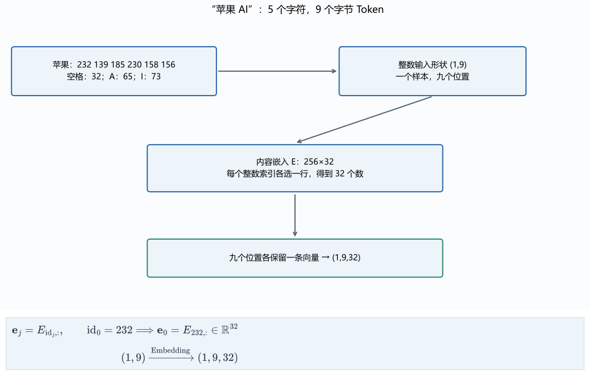

## （二）注意力与多头

### 1. 三个位置同时读取

在第三篇末尾，我们演示过拿一个查询向量去比对并读取多个历史状态。到了文本序列里，句子里的**每一个位置**都需要结合上下文来更新自己的表示，如果一个位置一个位置地挨个去查，效率太低了；我们干脆把所有位置的查询按行排成一张矩阵，靠一次矩阵乘法把全部位置之间的匹配分数同时算出来。

为了能用纸笔把每一个数字从头核对到尾，我们先拿一个只有 $T=3$ 个位置、每个位置 $d=2$ 个特征的极简输入矩阵 $X$ 来试手：

$$
X=\begin{bmatrix}1&0\\0&1\\1&1\end{bmatrix}.
$$

矩阵的第 $i$ 行就是位置 $i$ 的输入向量（行号沿用代码习惯从 $0$ 开始数）。我们准备三张可训练的投影矩阵 $W_Q, W_K, W_V$，把输入 $X$ 分别投射成查询（Query）、键（Key）和值（Value）三张矩阵：

$$
Q=XW_Q,\qquad K=XW_K,\qquad V=XW_V.
$$

设输入宽度为 $d$，查询和键的宽度为 $d_k$，值的宽度为 $d_v$，这几张矩阵在整套流水线里的形状与分工一目了然：

| 对象 | 形状 | 运算中的作用 |
| --- | --- | --- |
| $X$ | $(T,d)$ | 每行一个位置的输入表示 |
| $W_Q,W_K$ | $(d,d_k)$ | 把输入映射到可做点积的两个空间 |
| $W_V$ | $(d,d_v)$ | 形成被加权读取的内容 |
| $Q,K$ | $(T,d_k)$ | 各行分别用于发出查询和匹配查询 |
| $V$ | $(T,d_v)$ | 各位置提供的值向量 |
| $S,A$ | $(T,T)$ | 位置之间的分数与读取权重 |
| $O$ | $(T,d_v)$ | 各查询读取得到的结果 |

别被“查询、键、值”这三个拟人化的名字唬住：它们说明的仅仅是各自在矩阵乘法里的分工职责，并不是我们人为给哪张矩阵规定了某种语法规则。它们到底提取哪些特征、怎么区分不同位置，完全要靠后面的损失函数和梯度下降一步步逼出来。

为了看清最纯粹的位置交互，我们先暂取三张投影矩阵全为二维单位矩阵 $I_2$，于是 $Q=K=V=X$（注意：虽然此时三者的数值一模一样，但在自动微分的计算图上它们走的是三条独立的分支，待会儿算反向传播时可得按三路分别计算）。

现在让每个查询去和所有的键做点积：位置 $0$ 的查询 $(1,0)$ 分别与三个位置的键做点积，算出 $(1, 0, 1)$；把三个位置的结果按行叠起来，正好就是矩阵乘法 $QK^\mathsf T$：

$$
QK^\mathsf T=
\begin{bmatrix}
1&0&1\\
0&1&1\\
1&1&2
\end{bmatrix}.
$$

这里的第 $(i,j)$ 项代表“查询位置 $i$ 去读键位置 $j$”的原始匹配分。但在把它送进下一步之前，还得解决一个尺度隐患：随着特征宽度 $d_k$ 增加，点积是由 $d_k$ 项乘积加起来的；假定查询和键的各个分量相互独立、均值为零且方差为一，那么 $d_k$ 项相加之后，点积总和的方差就会跟着膨胀到 $d_k$。为了不让分数随着特征变宽而失控暴涨，我们将点积统一除以 $\sqrt{d_k}$，把这组假设下的分数方差重新拉回到一。这就得到了**缩放点积分数矩阵 $S$**（本例中 $d_k=2$，故除以 $\sqrt2$）：

$$
S=\frac{QK^\mathsf T}{\sqrt{d_k}}
=\frac{1}{\sqrt2}
\begin{bmatrix}
1&0&1\\0&1&1\\1&1&2
\end{bmatrix}.
$$

### 2. 分数变成读取比例

算出来的分数矩阵 $S$ 里可能有负数，每一行加起来也不等于一，还没法直接拿来当“从各个位置各读百分之几”的分配比例。于是我们沿着每个查询的键位置轴（也就是**按行**）做一次 Softmax 归一化：

$$
A_{ij}=\frac{\exp(S_{ij})}{\sum_{r=0}^{T-1}\exp(S_{ir})}.
$$

看清分母的求和方式：固定当前查询行 $i$ 不动，让下标 $r$ 把这一行里全部 $T$ 个键位置的指数加起来。自然指数保证了每一项都为正数，再除以同行总和，每一行的权重加起来就严格等于一了。

我们亲手算一下位置 $0$（第 $0$ 行）：它的缩放分数是 $(1/\sqrt2,\ 0,\ 1/\sqrt2)$。取指数后，头尾两项 $\exp(1/\sqrt2)\approx 2.028115$，中间一项 $\exp(0)=1$，三项加起来的分母约为 $5.056230$，于是位置 $0$ 对三个位置的读取比例为：

$$
A_{0,:}
=\frac{(2.028115,1,2.028115)}{5.056230}
\approx(0.401112,0.197776,0.401112).
$$

对三行分别按同样规则算完，就得到了完整的读取权重矩阵 $A$：

$$
A\approx
\begin{bmatrix}
0.401112&0.197776&0.401112\\
0.197776&0.401112&0.401112\\
0.248255&0.248255&0.503490
\end{bmatrix}.
$$

拿到了读取比例 $A$，最后一步就是按这个比例把三个位置的值向量 $V$ 加权合成最终输出：

$$
O=AV.
$$

把位置 $0$ 的两个输出坐标按矩阵乘法拆开写，其实就是拿第 $0$ 行的三个权重去组合 $V$ 的三行：

$$
\begin{aligned}
O_{00}&=0.401112\times1+0.197776\times0+0.401112\times1
      \approx0.802224,\\
O_{01}&=0.401112\times0+0.197776\times1+0.401112\times1
      \approx0.598888.
\end{aligned}
$$

三行全部算完，最终的注意力输出矩阵 $O$ 为：

$$
O\approx
\begin{bmatrix}
0.802224&0.598888\\
0.598888&0.802224\\
0.751745&0.751745
\end{bmatrix}.
$$

你看，$O$ 里的每一行通常不再是原矩阵里的某一行，而是把多个位置的值向量按相关性揉合在一起的新表示。原始 [Transformer 注意力定义](https://arxiv.org/html/1706.03762v7#S3.SS2)正是通过这套缩放点积公式，把两类参数的作用清晰地拆开了：**$Q$ 和 $K$ 负责算出读取比例，$V$ 负责提供按这些比例真正读回来的内容。**

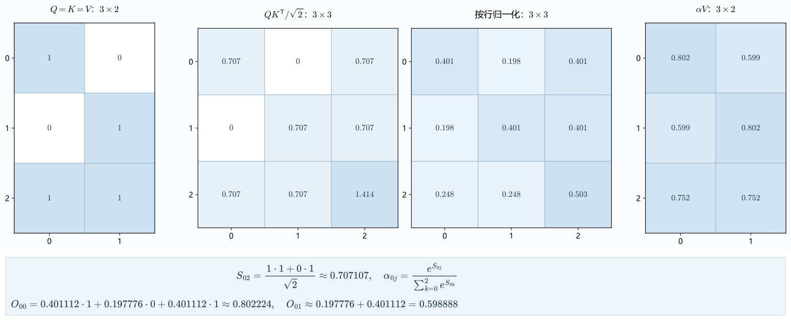

### 3. Softmax 的数值与导数

把 Softmax 写进代码并投入训练之前，必须先解决两个硬核问题：一是前向计算怎么防止指数爆炸，二是反向传播怎么对它求导。

先看前向防溢出。如果在计算机里直接算 $\exp(1000)$，当场就会超出常见浮点数的表示上限变成无穷大。但仔细观察 Softmax 分式就会发现，它只关心同行各项指数之间的相对比值。如果我们把同一行的每个分数都先减去同一个常数 $c$：

$$
\frac{\exp(s_j-c)}{\sum_r\exp(s_r-c)}
=\frac{\exp(s_j)\exp(-c)}{\exp(-c)\sum_r\exp(s_r)}
=\frac{\exp(s_j)}{\sum_r\exp(s_r)}.
$$

分子分母提取出的公因子 $\exp(-c)$ 直接约掉，最终比值分毫不差！在工程实现里，我们固定取 $c=\max_r s_r$（即这一行的最大分数），减去它之后，整行最大的指数项变成了 $\exp(0)=1$，其余项全是不超过一的正数，指数计算的范围就被稳稳控制住了（当然，这个恒等变换的前提是输入的原始分数本身是有限值；如果前面的矩阵乘法已经算出了 `NaN` 或无穷大，就得去产生它的源头运算处排查）。

再看反向求导：**当微调某一行里的第 $k$ 个分数 $s_k$ 时，这一行算出来的各个权重 $a_j$ 会怎么跟着变？**
设这一行的分数为 $s_j$，权重为 $a_j = e^{s_j}/Z$，其中共同分母记为 $Z=\sum_r e^{s_r}$。对 $s_k$ 求偏导时，注意分子和分母都可能随 $s_k$ 变化。用商的求导法则一步写出：

$$
\frac{\partial a_j}{\partial s_k}
=\frac{\mathbf1[j=k]e^{s_j}Z-e^{s_j}e^{s_k}}{Z^2}
=a_j\bigl(\mathbf1[j=k]-a_k\bigr).
$$

这里的 $\mathbf1[j=k]$ 是指示函数：当条件成立（对自身分数求导，$j=k$）时取 $1$，导数为 $a_j(1-a_j)$；当条件不成立（对同行其他位置的分数求导，$j\neq k$）时取 $0$，导数为 $-a_ja_k$。这个负号直观地揭示了 Softmax 的内部竞争：调高某一项的分数，不仅会提高它自己的权重，还会通过撑大共同分母 $Z$ 同步压低同行所有其他项的权重。

有了单项导数，整行的损失梯度就能写得非常简洁。假设上游已经传回了损失对这一行各个权重的梯度 $g_j=\partial\ell/\partial a_j$，根据链式法则把整行所有 $a_j$ 受到的影响累加起来：

$$
\frac{\partial\ell}{\partial s_k}
=\sum_j g_j a_j(\mathbf1[j=k]-a_k)
=a_k\left(g_k-\sum_j a_jg_j\right).
$$

你看最后这个括号有多妙：只需要**先算出这一行上游梯度的加权平均值 $\sum_j a_jg_j$，再从每个 $g_k$ 里减去这个平均值，最后乘上各自的权重 $a_k$** 就行了。而且算出来的这一行分数梯度全部加起来（$\sum_k \partial\ell/\partial s_k$）永远等于零——这正好在代数上印证了“把整行分数同时平移一个常数 $c$ 不会改变 Softmax 输出”的性质。

### 4. 注意力的反向传播

现在我们拿刚才算出的输出矩阵 $O$，亲手检验一遍注意力的完整反向传播。假设任务只要求位置 $0$ 的第一个输出坐标 $O_{00}$ 越接近 $1$ 越好，把损失函数设为：

$$
\ell=\frac12(O_{00}-1)^2.
$$

前面已经算出 $O_{00}\approx0.802224$，代入得损失 $\ell\approx0.019558$，损失对 $O_{00}$ 的起始导数为：

$$
\frac{\partial\ell}{\partial O_{00}}=O_{00}-1\approx-0.197776.
$$

因为 $O$ 里的其余五个元素没有直接参与这项损失，它们的上游梯度全为零。把全部输出梯度排成与 $O$ 同形的 $3\times 2$ 矩阵 $G$（只有左上角 $G_{00}\approx-0.197776$ 非零）。顺着 $O=AV$ 的乘积往回退，梯度立刻分流到值矩阵 $V$ 和权重矩阵 $A$：

$$
\frac{\partial\ell}{\partial V}=A^\mathsf TG,\qquad
\frac{\partial\ell}{\partial A}=GV^\mathsf T.
$$

前一个式子按“各个查询分别读了多少比例的这个值”来累加 $V$ 的梯度；后一个式子则检查“改动某个读取比例会乘上哪个值坐标”。在第 $0$ 行里，三个位置的值向量第一坐标分别是 $(1,0,1)$，乘上 $G_{00}$ 后，第 $0$ 行权重的上游梯度约为：

$$
\frac{\partial\ell}{\partial A_{0,:}}
=(-0.197776,0,-0.197776).
$$

把这个结果代入上一小节刚推导的 Softmax 导数公式：先算加权平均，再相减乘回 $A_{0,:}$，立刻算出打分矩阵第 $0$ 行的梯度（其余两行全为零）：

$$
D_{0,:}
=\frac{\partial\ell}{\partial S_{0,:}}
\approx(-0.015690,0.031379,-0.015690).
$$

核对一下这组数字：三项加起来正好等于零。而且方向极其合理：位置 $0$ 和位置 $2$ 的值向量第一列是 $1$（能帮 $O_{00}$ 往目标 $1$ 靠拢），所以它俩分数的梯度是负数，做梯度下降（减去负梯度）时就会**调高**它俩的匹配分；而位置 $1$ 的第一列是 $0$（多读它只会拉低 $O_{00}$），所以它拿到的是正梯度 $+0.031379$，梯度下降时会**压低**位置 $0$ 对位置 $1$ 的读取比例。

接着从分数梯度 $D$ 继续退回 $S=QK^\mathsf T/\sqrt2$：

$$
\frac{\partial\ell}{\partial Q}=\frac{DK}{\sqrt2},\qquad
\frac{\partial\ell}{\partial K}=\frac{D^\mathsf TQ}{\sqrt2}.
$$

如果前面带有一般投影矩阵 $Q=XW_Q$，那么投影权重的梯度就是 $\partial\ell/\partial W_Q=X^\mathsf T(\partial\ell/\partial Q)$（$W_K,W_V$ 同理）。而最底层的输入矩阵 $X$ 因为在开头同时给 $Q, K, V$ 供了货，根据链式法则，**输入 $X$ 的总梯度必须把三条路径传回来的梯度全部加起来**：

$$
\frac{\partial\ell}{\partial X}
=\frac{\partial\ell}{\partial Q}W_Q^\mathsf T
+\frac{\partial\ell}{\partial K}W_K^\mathsf T
+\frac{\partial\ell}{\partial V}W_V^\mathsf T.
$$

在本例中三个投影矩阵都是单位阵，把三路梯度直接相加，得到输入 $X$ 的最终梯度约为：

$$
\frac{\partial\ell}{\partial X}\approx
\begin{bmatrix}
-0.112613&0.011094\\
-0.016927&0\\
-0.090424&0
\end{bmatrix}.
$$

盯住这张结果矩阵看一个极其关键的事实：**虽然损失函数只直接读取了第 $0$ 个输出位置，但第 $1$ 行和第 $2$ 行的输入向量依然收到了非零梯度！** 原因很简单——它们在注意力计算中参与了键的匹配和值的提供。注意力机制的学习路径正是由这些跨位置的实际依赖交织而成的，绝不是给每个位置各算一份互不相干的独立误差。

在配套代码 `language_foundations.attention_backward` 中，我们用纯 NumPy 手写了上面的链式法则，并同时与 PyTorch 自动微分和中心差分做了对账：手算梯度与自动微分完全一致，与中心差分的最大偏差仅约为 $1.52\times10^{-11}$。

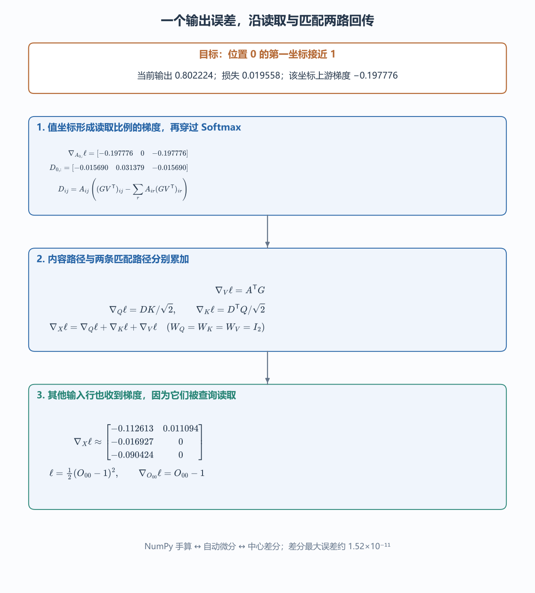

### 5. 多头与特征轴

刚才我们只算了一张 $(T, T)$ 的权重矩阵 $A$，这意味着一个位置上的所有特征都只能按同一套比例去合并上下文。如果把特征通道分成几个并行的小组，让每组各自拥有一套独立的查询、键和值，算完各自不同的读取比例后再拼回一起，模型就能同时从上下文里抓取多种不同维度的关联——这就是**多头注意力（Multi-Head Attention）**。

写多头代码时，最容易搞混的是“到底把哪条轴拆开了”。我们拿总宽度 $d=4$、头数 $h=2$（每头宽度 $d_h=d/h=2$）、共三个位置的某个投影结果来看：

$$
\begin{bmatrix}
0&1&2&3\\
4&5&6&7\\
8&9&10&11
\end{bmatrix}.
$$

拆成两个头时，**切开的是横着的特征轴，绝不是竖着的位置轴**：头 $0$ 读取每一行的前两个特征，拿到三个位置的 $(0,1),(4,5),(8,9)$；头 $1$ 读取每一行的后两个特征，拿到三个位置的 $(2,3),(6,7),(10,11)$。每个头手里依然握着完整的三个序列位置，千万不能错把前两个位置分给头 $0$、最后一个位置分给头 $1$。

在 PyTorch 里，这步拆头与拼头直接牵涉到底层内存的步幅（Stride）布局：

~~~python
import torch

x = torch.arange(12).reshape(1, 3, 4)  # 批次 1、位置 3、总特征 4。
split = x.view(1, 3, 2, 2)  # 将最后一轴拆为“头、每头特征”。
heads = split.transpose(1, 2)  # 调成 (批次、头、位置、每头特征)。
print(heads.shape, heads.stride())  # (1,2,3,2)，stride 为 (12,2,4,1)。
print(heads.is_contiguous())  # False：当前轴顺序与底层连续排列不同。
restored = heads.transpose(1, 2).contiguous().view(1, 3, 4)
assert torch.equal(x, restored)  # 合并特征后，位置和各个数都恢复。
~~~

看清这几行代码在内存里干了什么：
[`view`](https://docs.pytorch.org/docs/stable/generated/torch.Tensor.view.html) 要求新形状与当前的内存步幅相容；而 `transpose(1, 2)` 把“头轴”和“位置轴”对调成 `(批次, 头, 位置, 每头特征)` 时，并没有真的去搬动底层内存里的那 12 个数字，只是改了读取步幅 `stride()` 为 `(12, 2, 4, 1)`（意思是跨一个头只需在内存里跳 2 格，而同头内跨一个位置反而要跳 4 格），所以此时 `heads.is_contiguous()` 变成了 `False`。等各头算完 $(T, T)$ 的注意力、再次 `transpose(1, 2)` 换回位置轴后，要想用 `view(1, 3, 4)` 把两个头的特征重新合并回长度为 4 的一轴，就必须先调一次 `contiguous()` 把底层数据按当前轴顺序排成连续存储（`reshape` 虽然也能一行写完，但它在不连续时会隐式触发复制，不能把它当成永远只改视图的零开销操作）。

各头的输出拼回 $(B, T, d)$ 之后，最后还要右乘一张输出投影矩阵 $W_O\in\mathbb R^{d\times d}$，让不同头各自读回来的特征充分混合。在 `TinyLM` 中，$d=32, h=2, d_h=16$，这两组并行的读取关系各自拥有独立的查询与键，而不是先算一遍注意力再把结果复制两份。

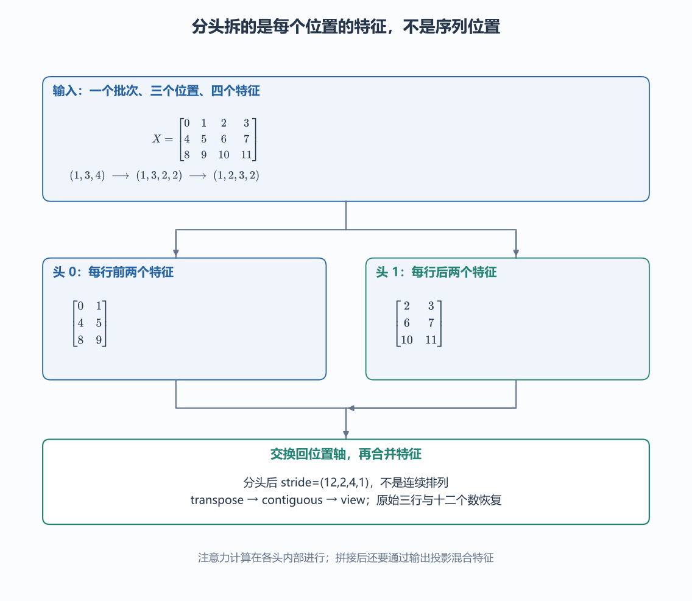

## （三）位置与可见视野

### 1. 置换等变性

把句子里的各个词查表变成矩阵的不同行、再送进上一节的全可见自注意力之后，模型是不是就已经知道谁排在前面、谁排在后面了呢？
并没有！如果不额外加入位置信息，上一节写的全可见自注意力根本不在乎某一行排在第几号座位——你把 `read notes` 和 `notes read` 换个行顺序喂进去，它算出来的每一行向量数值连分毫都不会变。

我们可以用置换矩阵把这件事写成严格可检验的代数式。设 $P$ 是一个重排矩阵行顺序的**置换矩阵**（满足 $P^\mathsf TP=PP^\mathsf T=I$）。把输入矩阵的行顺序打乱成 $X'=PX$，而投影矩阵 $W_Q,W_K,W_V$ 保持不变，那么新的查询、键、值也只是跟着换了行：

$$
Q'=PQ,\qquad K'=PK,\qquad V'=PV.
$$

代入缩放点积分数矩阵：

$$
S'=\frac{(PQ)(PK)^\mathsf T}{\sqrt{d_k}}
=P\frac{QK^\mathsf T}{\sqrt{d_k}}P^\mathsf T
=PSP^\mathsf T.
$$

左边的 $P$ 交换了查询行，右边的 $P^\mathsf T$ 则把同一批键按完全相同的次序重新编了列号。因为 Softmax 是对每一行的全部键求和，键的列排列顺序怎么换都不会改变这一行的分母总和，所以归一化后的权重矩阵同样满足：

$$
A'=\operatorname{softmax}_{\rm row}(PSP^\mathsf T)
=PAP^\mathsf T.
$$

最后右乘新的值矩阵 $V'=PV$，中间的 $P^\mathsf TP=I$ 直接消掉：

$$
O'=A'V'=PAP^\mathsf TPV=PAV=PO.
$$

看这个结果 $O'=PO$：**输入矩阵怎么换序，输出矩阵就跟着做一模一样的换序，每一行算出来的内容本身纹丝不动！** 这个性质叫做**置换等变（Permutation Equivariance）**——注意它叫“等变”，不是“输出完全不变”；只有当你最后把所有输出行加起来求平均（Mean Pooling）时，行次序的调换才会在求和中彻底消失。这也从根子上解释了，为什么单靠词袋求平均或者不加位置编码的纯注意力，会分不清动作与对象的词序先后。

还要看清这个证明成立的边界：它使用的是**不带固定位置项、也不带固定因果掩码**的全可见注意力。如果加了掩码，除非掩码矩阵也跟着输入一起做相同的行列置换（$M'=PMP^\mathsf T$），否则一旦保留原来的下三角因果掩码不动而只交换输入行，原本排在句尾能看全句的词被换到了句首只能看自己，可读关系变了，输出自然也就不同了。

### 2. 绝对位置表

要想打破上面的置换等变性、让模型认出词的先后座位，最直接的办法就是给每一个座位号单独配一条可训练的向量。设模型最多支持 $C$ 个位置，我们建一张形状为 $P_{\rm pos}\in\mathbb R^{C\times d}$ 的位置表。记第 $t$ 个座位读取的位置向量为 $\mathbf p_t$，进入第一个网络块之前的初始表示就变成内容向量与位置向量直接相加：

$$
\mathbf h_t^{(0)}=E[a_t,:]+\mathbf p_t.
$$

这里的上标 $(0)$ 代表进入第 $0$ 层网络块之前的表示，不是求幂运算。两个向量的宽度都是 $d$，按元素相加后形状不变。加上这张位置表之后，哪怕是同一个字节，放在位置 $0$ 时加的是 $\mathbf p_0$，放在位置 $1$ 时加的是 $\mathbf p_1$，送进注意力层的初始向量就不再相同了。

注意这里换序时的绑定规则：当我们把文本里的两个 Token 对调顺序时，是词的内容向量 $E[a_t,:]$ 换了座位，而座位号向量 $\mathbf p_0, \mathbf p_1$ 依然焊死在第 $0$ 行和第 $1$ 行不动（绝不是把位置表也跟着文字一起搬家）。配套代码 `language_details.position_trace` 正是这样固定位置表来对比换序前后的输出，验证了固定位置项如何打破置换等变。

`TinyLM` 准备了 $C=24$ 行可训练位置向量，因此合法的位置编号只有 $0$ 到 $23$。一旦输入长度超过 24，程序不可能凭空去表里查出第 24 行的参数——要么改变模型的位置方案，要么只能截取不超过 24 项的窗口送进去。

### 3. RoPE 的相对位置项

绝对位置表虽然直观，但它给每个座位发的是死板的绝对门牌号；而在语言里，两个词之间“隔了几个位置（相对间隔 $j-i$）”往往比它们各自排在第几号绝对座位更关键。有没有办法不靠加号硬拼，而是让查询和键在做点积的时候，**自动消掉共同的绝对位置起点，只把相对间隔 $j-i$ 留下来**？

**[RoPE（旋转位置编码）](https://arxiv.org/html/2104.09864v5#S3.SS2)** 靠二维平面旋转做到了这一点。先看只有两个分量的列向量，逆时针旋转角度 $\phi$（用弧度计）的旋转矩阵是：

$$
R(\phi)=
\begin{bmatrix}
\cos\phi&-\sin\phi\\
\sin\phi&\cos\phi
\end{bmatrix}.
$$

设每往后走一个位置，旋转角就增加 $\theta$。于是排在位置 $i$ 的查询向量旋转 $i\theta$ 角，排在位置 $j$ 的键向量旋转 $j\theta$ 角。现在拿旋转后的查询和键做点积：

$$
\begin{aligned}
\bigl(R(i\theta)\mathbf q\bigr)^\mathsf T
\bigl(R(j\theta)\mathbf k\bigr)
&=\mathbf q^\mathsf TR(i\theta)^\mathsf TR(j\theta)\mathbf k\\
&=\mathbf q^\mathsf TR((j-i)\theta)\mathbf k.
\end{aligned}
$$

看第二行化简的依据：旋转矩阵的转置 $R(i\theta)^\mathsf T$ 正好等于往反方向旋转 $i\theta$ 角，再接着正转 $j\theta$ 角，两次连续旋转的角度直接相加，合起来正好就是旋转了 $(j-i)\theta$！**给每个向量单独施加的是绝对位置的旋转，但只要两向量一做点积，共同的位置起点就从旋转因子里彻底消掉了，只留下相对距离 $j-i$！**

我们取步进角 $\theta=\pi/2$（每走一步转 $90^\circ$）来核对两组具体数字：
先让 $\mathbf q=\mathbf k=(1,0)^\mathsf T$。在位置对 $(0,1)$ 中，旋转后的两向量分别指向右方 $(1,0)$ 和上方 $(0,1)$，点积为零；把它们一起平移一格到位置对 $(1,2)$，两向量分别指向上方 $(0,1)$ 和左方 $(-1,0)$，点积依然为零。下图追踪的正是这两组平移向量的方向变化：

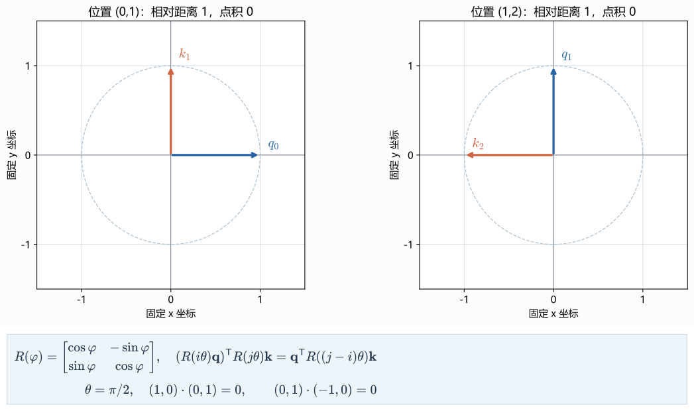

为了避免只看到垂直向量的零值巧合，我们再把键换成 $\mathbf k=(1,1)^\mathsf T$ 算一次非零点积：

| 位置对 | 旋转后查询 | 旋转后键 | 点积 |
| --- | --- | --- | ---: |
| $(0,1)$ | $(1,0)$ | $(-1,1)$ | $-1$ |
| $(1,2)$ | $(0,1)$ | $(-1,-1)$ | $-1$ |

看表格最后一列：平移之后，虽然查询和键各自指向的方向全变了，但因为它们的相对转角没变，点积稳稳保持为 $-1$。当然，这里消掉的只是旋转因子里的共同起点，查询和键本身的内容向量以及后面要讲的可见视野范围依然照常参与计算。

当实际的注意力头宽度是大于 2 的偶数 $d_h$ 时，只需把这 $d_h$ 个分量两两配成二维平面，给第 $r$ 对分量（$r=0,\ldots,d_h/2-1$）分配一组由快到慢的角频率（例如原始论文取 $\theta_r=10000^{-2r/d_h}$），让不同分量对以不同速度随位置旋转即可。训练与推理必须锁死同一套配对方式和频率表（本章的 `TinyLM` 主模型仍保留上一小节的 24 行绝对位置表作为固定训练基线，RoPE 旋转则作为独立对照模块供精确核验）。

### 4. 因果掩码

位置顺序有了，但在训练自回归生成模型时还有一道防作弊的关卡：训练时一整句标准答案已经完整放进输入矩阵里了，如果位置 $0$ 在预测下一项时能直接读取位置 $1$ 的键和值，它就能从答案所在的位置直接把标准答案抄过来，这样的训练到了真正需要盲猜下一项的生成阶段就会彻底废掉。

为此，必须规定查询位置 $i$ 只允许读取它自己以及排在它前面的键位置 $j$（即满足 $j\le i$）。我们在原始分数矩阵 $S$ 上叠加一张**加性因果掩码矩阵 $M$**，把所有处于未来的位置（$j>i$）填成 $-\infty$，然后再按行做 Softmax：

$$
M_{ij}=
\begin{cases}
0,&j\le i,\\
-\infty,&j>i.
\end{cases}
\qquad
A=\operatorname{softmax}_{\rm row}(S+M).
$$

被填成 $-\infty$ 的未来分数在取指数后变成 $\exp(-\infty)=0$，既不产生分子，也不进入分母。对于三个位置的序列，掩码矩阵 $M$ 长这样：

$$
M=
\begin{bmatrix}
0&-\infty&-\infty\\
0&0&-\infty\\
0&0&0
\end{bmatrix}.
$$

把这张掩码加到第二节手算的 $X$ 样本上，看看读取权重怎么变：
位置 $0$（第 $0$ 行）后面的两项全被封死，只能读自己，权重变成 $(1,0,0)$；位置 $1$（第 $1$ 行）允许读前两个位置，对剩下的两个分数 $(0, 1/\sqrt2)$ 重新求指数并除以新分母 $1+\exp(1/\sqrt2)\approx 3.028115$，归一化权重变为：

$$
A_{1,:}\approx(0.330238,0.669762,0).
$$

注意这里绝不能偷懒把原来未屏蔽时的第三项权重直接抹成零就收工——因为少了一项之后，前两项共享的分母变小了，前两项的权重比例必须重新归一化！乘上值矩阵 $V$ 后，经过因果掩码的输出矩阵变为：

$$
O_{\rm causal}\approx
\begin{bmatrix}
1&0\\
0.330238&0.669762\\
0.751745&0.751745
\end{bmatrix}.
$$

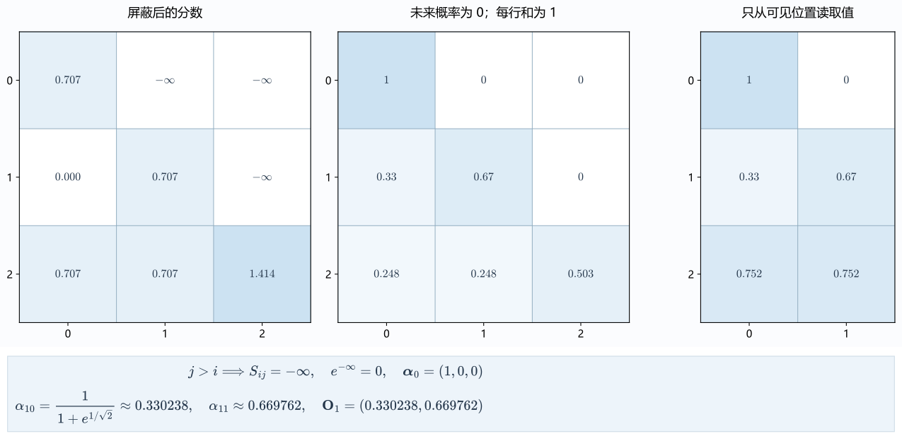

注意掩码矩阵的上三角方向对应着“哪些键处于未来”，方向不能弄反；而且每一行有效查询里至少要留一个允许读取的键——如果把整行全设成 $-\infty$，前面讲的 Softmax 减去行最大值就会撞上无效减法而算出 `NaN`。

## （四）网络块与模型架构

### 1. 同一位置的特征缩放

注意力层把上下文各个位置的信息加权读回来之后，不同特征通道上的数值尺度可能会拉开很大差距。为了稳住后续层的运算尺度，**LayerNorm（层归一化）**在**同一个位置内部**，沿着它的 $d$ 个特征分量计算均值 $\mu$ 与方差 $v$，标准化之后再乘上可训练的缩放参数 $\gamma_r$、加上平移参数 $\beta_r$：

$$
\mu=\frac1d\sum_{r=1}^{d}x_r,\qquad
v=\frac1d\sum_{r=1}^{d}(x_r-\mu)^2,
$$

$$
\operatorname{LN}(\mathbf x)_r
=\gamma_r\frac{x_r-\mu}{\sqrt{v+\varepsilon}}+\beta_r.
$$

这里的方差把当前位置的 $d$ 个特征看作一个整体，直接除以 $d$；$\varepsilon>0$ 用来防止分母为零；而 $\gamma_r,\beta_r$ 是模型的可训练参数，通过反向传播更新，不能跟单条输入临时算出来的统计量 $\mu,v$ 混为一谈。

拿四维向量 $\mathbf x=(1,2,3,4)$ 手算一遍：均值为 $2.5$，减去均值去中心化得到 $(-1.5,-0.5,0.5,1.5)$，四项平方和为 $5$，所以方差 $v=5/4=1.25$。在初始参数 $\gamma_r=1,\beta_r=0,\varepsilon=10^{-5}$ 下，归一化输出约为：

$$
(-1.341635,-0.447212,0.447212,1.341635).
$$

面对形状为 $(B,T,d)$ 的三维输入张量，[`nn.LayerNorm(d)`](https://docs.pytorch.org/docs/stable/generated/torch.nn.LayerNorm.html) 会分别对每个批次、每个位置的最后一条特征轴独立计算均值和方差，绝不会把整个批次里所有 Token 的数值混在一锅里求平均。这也是为什么谈论归一化时必须指明“沿着哪条轴做归一化”。

### 2. 残差的直接路径

如果每一层网络都把前一层的输出彻底替换掉，那么连“保留上一层已经提取好的有用特征”这件事，都得靠新层的参数从头学起。**残差连接（Residual Connection）**直接把子层的输入 $\mathbf x$ 绕过子层，加回到子层的处理结果 $F(\mathbf x)$ 上（要求两路宽度同为 $d$）：

$$
\mathbf h=\mathbf x+F(\mathbf x).
$$

这样一来，子层 $F(\mathbf x)$ 只需要学习在原有表示的基础上做多少增减修正。先看标量形式下的链式求导：

$$
\frac{dh}{dx}=1+F'(x).
$$

式子前面的常数 $1$ 来自直接相加的 $x$，意味着上游误差有一条不经过子层内部权重连乘的直通路径。但这里必须纠正一个常见的误解：**这个 $1$ 并不是总导数的绝对下界！** 举个极简的反例：假如子层刚好是 $F(x)=-x$，那么相加后 $h=0$，总导数就是 $1-1=0$（见练习 `04-07`）。

写成向量形式，设 $J_F$ 为子层 $F$ 的雅可比（Jacobian）矩阵，其第 $(r,s)$ 项为 $\partial F_r/\partial x_s$，则总雅可比矩阵与反向传播梯度为：

$$
J_{\mathbf h}=I+J_F,\qquad
\nabla_{\mathbf x}\ell=(I+J_F)^\mathsf T\nabla_{\mathbf h}\ell.
$$

反向传播时，直通路径的单位阵 $I$ 与子层路径的 $J_F^\mathsf T$ 相加汇合，共同决定输入 $\mathbf x$ 的更新方向。

### 3. 前馈层与 GELU

注意力层负责按内容混合不同位置的信息；紧随其后的**前馈层（FFN）**则负责在**每个位置自己内部**重新组合特征，所有序列位置共享同一套两层线性变换与激活函数：

$$
F_{\rm ff}(\mathbf h)
=\operatorname{GELU}(\mathbf hW_1+\mathbf b_1)W_2+\mathbf b_2.
$$

按行向量右乘约定，$W_1\in\mathbb R^{d\times d_{\rm ff}}$ 先把每个位置的特征从 $d$ 维扩宽到 $d_{\rm ff}$ 维，经过非线性激活函数 **GELU** 后，再由 $W_2\in\mathbb R^{d_{\rm ff}\times d}$ 映回 $d$ 维，位置轴 $T$ 在这两步里保持不变。

要是中间不加非线性函数，两次矩阵连乘合起来还是一次线性变换。这里使用的 **GELU** 定义为输入 $x$ 乘以标准正态分布的累积概率 $\Phi(x)$：

$$
\operatorname{GELU}(x)=x\Phi(x),
\qquad \Phi(x)=P(Z\le x),\quad Z\sim\mathcal N(0,1).
$$

当输入为正数且越来越大时，通过比例 $\Phi(x)$ 逐渐接近一；当输入为负数时，输出受到平滑抑制，但在零点附近不像 ReLU 那样生硬地一刀切死归零（例如 $\operatorname{GELU}(1)\approx0.841345$，$\operatorname{GELU}(-1)\approx-0.158655$）。在 `TinyLM` 中，$d=32, d_{\rm ff}=64$；注意 PyTorch 的 `nn.Linear(32, 64)` 内部把权重按 `(输出, 输入)` 存成 `(64, 32)`，计算时正好对应公式里的右乘 $W_1$。

### 4. Pre-LN Transformer 块

现在把多头注意力、前馈层和两条残差路径串起来，把 LayerNorm 放在每个子层的入口之前，就组装成了一个完整的 **Pre-LN Transformer 块**：

$$
\begin{aligned}
H&=X+\operatorname{Attention}(\operatorname{LN}_1(X)),\\
Z&=H+\operatorname{FFN}(\operatorname{LN}_2(H)).
\end{aligned}
$$

写代码时千万留神第二行加号左边的那个变量：**加回主路的是第一条残差合并后的 $H$，绝不是归一化之后的 $\operatorname{LN}_2(H)$**！如果顺手把 $H$ 覆盖成了归一化后的结果再往后加，残差直通路径就被归一化层给截断了。

在 `TinyLM` 中，一个批次的输入从查表开始到算出词表分数，张量形状沿下表一步步流转：

| 运算 | 输出形状 |
| --- | --- |
| 内容嵌入加位置向量 | $(B,T,32)$ |
| 第一层 LayerNorm、Q/K/V 投影 | $(B,T,32)$，三路分别保存 |
| 分为两个头 | $(B,2,T,16)$ |
| 查询乘转置键 | $(B,2,T,T)$ |
| 每头加权值、拼回位置轴 | $(B,T,32)$ |
| 输出投影与第一条残差 | $(B,T,32)$ |
| 第二层 LayerNorm、前馈第一层 | $(B,T,64)$ |
| GELU、前馈第二层与第二条残差 | $(B,T,32)$ |
| 词表输出层 | $(B,T,256)$ |

最后一层线性层把每个位置的 32 个特征映射到 256 个候选字节的原始分数。这组未归一化的任意实数分数称为 **logits**，之后沿着长度为 256 的词表轴做 Softmax，就能拿到预测下一字节的概率分布。

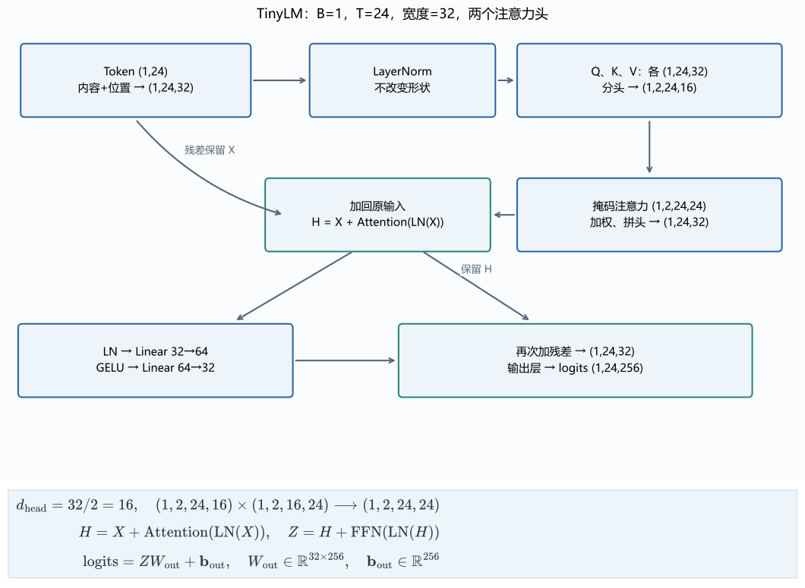

### 5. 三种架构的视野

同样是上面这套 Transformer 运算积木，根据任务需不需要读取另一段源序列、允许双向看还是只准往前看，在工程上衍生出了三种经典架构（设源序列长度为 $T_s$，目标序列长度为 $T_q$）：

| 架构 | 自注意力视野 | 输入与输出任务 |
| --- | --- | --- |
| Encoder-only | 输入各位置双向可见 | 对一段已有输入提取表示，再做分类、检索或逐位置预测 |
| Decoder-only | 当前目标位置只读其前缀 | 把条件与已有输出放进一条序列，逐项生成 |
| Encoder–Decoder | 源端双向；目标端因果；目标另读源端 | 先编码完整源输入，再逐项生成目标序列 |

在第三种 Encoder–Decoder 结构里，目标侧除了做带因果掩码的自注意力，每一层还会多加一个**交叉注意力（Cross-Attention）**子层：设源端编码好的表示为 $X_s\in\mathbb R^{T_s\times d_s}$，目标侧当前表示为 $X_q\in\mathbb R^{T_q\times d_q}$，则查询由目标侧发出，键和值由源端提供：

$$
Q=X_qW_Q,\qquad K=X_sW_K,\qquad V=X_sW_V.
$$

此时 $W_Q$ 形状为 $(d_q,d_k)$，$W_K$ 为 $(d_s,d_k)$，$W_V$ 为 $(d_s,d_v)$，算出来的匹配分数矩阵形状是 $(T_q,T_s)$——它不必是方阵，因为译文的长度 $T_q$ 和原文的长度 $T_s$ 本来就不必相等。拿机器翻译来说，原文在生成开始前已经完整摆在那里了，所以译文的每一个位置都可以大大方方地读取整句原文的表示；但译文自己内部的自注意力依然得遵守因果掩码，不能偷看还没翻出来的后文（参见 [Transformer 原论文第 3.1 节](https://arxiv.org/html/1706.03762v7#S3.SS1)）。

本章的 `TinyLM` 以及如今主流的大语言模型均采用精简统一的 **Decoder-only** 结构：不单设源端编码器，把提示词条件与已生成的回答统统排进同一条因果序列里，靠下一字节预测走通训练与生成。

把“可见视野”画成行列网格：每一行表示发出查询的位置 $i$，每一列表示准备读取的位置 $j$。蓝格表示允许读取，灰格表示屏蔽。Encoder-only 的方阵全部开放；Decoder-only 只开放主对角线及其下方。Encoder–Decoder 同时保留源端的双向方阵、目标端的因果方阵，以及目标读取源端的长方阵。图里的格子只回答“能不能看”，实际“看多少”仍由匹配分数与 Softmax 决定。

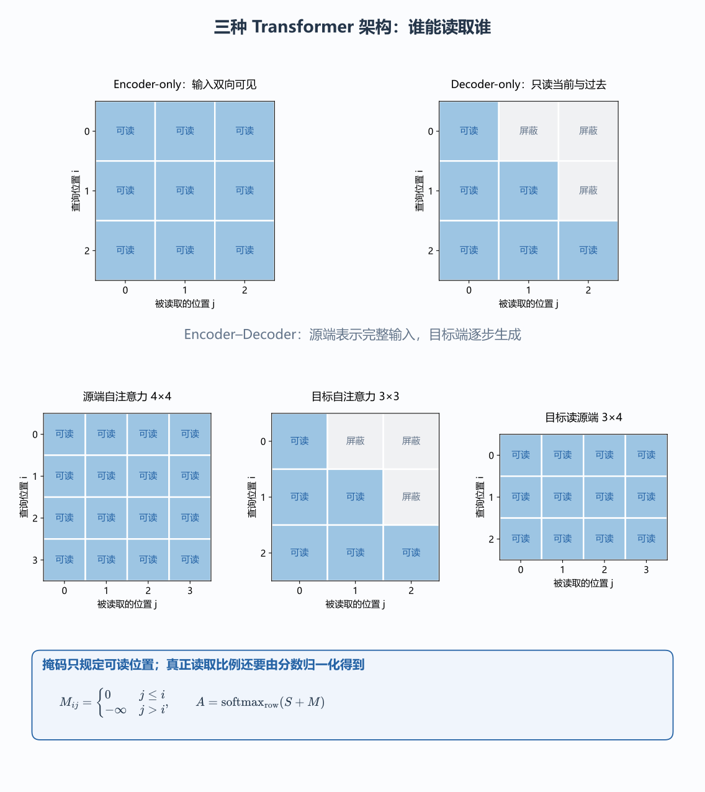

## （五）自回归训练

### 1. 输入与目标错开一位

模型前向跑完吐出了形状为 $(B,T,V)$ 的 logits 张量，代表 $T$ 个位置各自给出了一份下一字节预测分数。拿什么当标准答案来监督它？

取长度为 4 的字节序列 `abcd`（整数编号 `97, 98, 99, 100`）。我们取前三项 `abc` 作为模型输入，取后三项 `bcd` 作为监督目标——**输入与目标长度相等，但目标整体往后错开一位**：

| 模型位置 | 该位置的输入 | 允许读取的前缀 | 监督的下一项 |
| --- | --- | --- | --- |
| 0 | a | a | b |
| 1 | b | ab | c |
| 2 | c | abc | d |

~~~python
import torch

ids = torch.tensor([[97, 98, 99, 100]], dtype=torch.long)
inputs = ids[:, :-1]  # [a,b,c]：最后一项没有再下一项，故不作为输入。
targets = ids[:, 1:]  # [b,c,d]：每个输入位置对应后一项。
print(inputs.tolist(), targets.tolist())
~~~

看清这里的训练逻辑：在训练位置 $1$ 预测 `c` 时，不管模型刚才在位置 $0$ 有没有猜对 `b`，我们喂给位置 $1$ 的前缀都是千真万确的真实历史 `ab`。这种在训练阶段每一位置都直接用真实前项作条件的做法，叫做 **Teacher Forcing**。因为有第三节的下三角因果掩码把关，虽然 `abc` 是放在一张矩阵里同时送进去算的，但位置 $0$ 根本读不到位置 $1,2$ 的内容，位置 $1$ 也读不到位置 $2$，所以一次前向就能并行算完这三个不同长度前缀的预测任务。

但到了没有标准答案的**自由生成阶段**，情况就不同了：模型从 `a` 出发先选出一项，万一选歪了挑出个 `x`，下一轮送进模型的前缀就实打实变成了 `ax`，不能再偷偷拿标准答案里的 `ab` 当历史了。训练与自由生成的前缀来源不同，一旦半路选错，误差就会顺着生成前缀继续往后传。

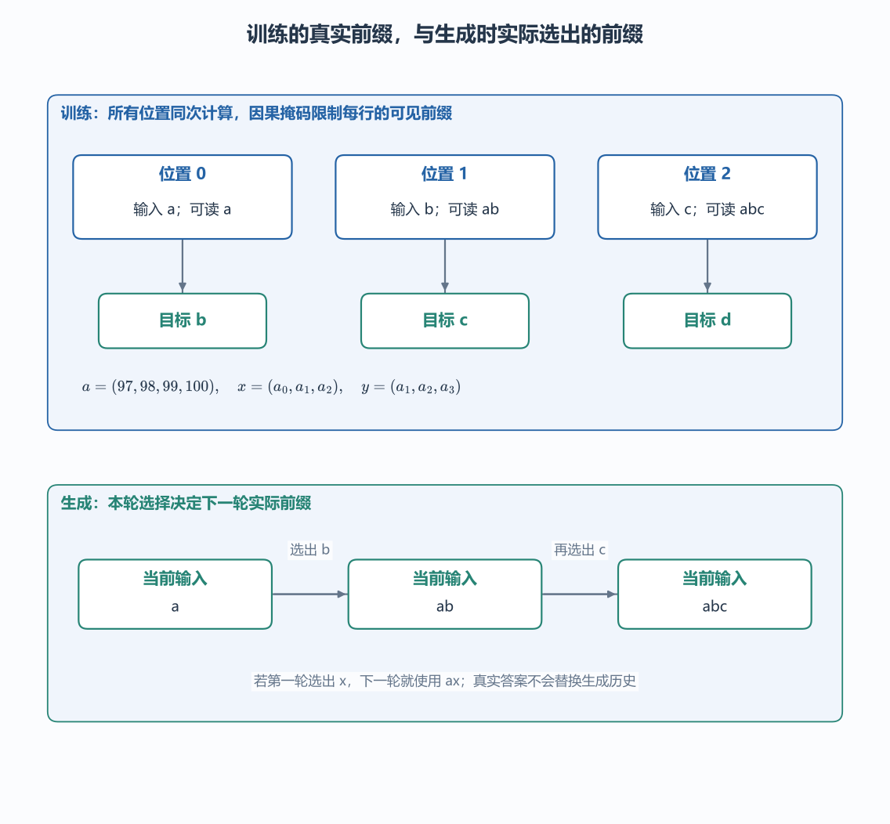

### 2. 交叉熵从概率中产生

盯住某一个预测位置：模型输出了词表各候选的原始分数 $\mathbf z=(z_0,\ldots,z_{V-1})$，真实下一字节的编号是 $y$。经过 Softmax 得到各候选概率 $p_k = e^{z_k}/\sum_{r=0}^{V-1}e^{z_r}$ 后，训练希望正确候选的概率 $p_y$ 越大越好；取负对数后，就把概率的提升转成了损失 $\ell$ 的下降：

$$
\ell=-\log p_y
=-z_y+\log\left(\sum_r e^{z_r}\right).
$$

把式子拆成右边这两项，求损失对任意候选分数 $z_k$ 的偏导数就一目了然了：前一项 $-z_y$ 只读取正确候选的分数，后一项则通过共同分母牵涉所有候选。分别对 $z_k$ 求导：

$$
\begin{aligned}
\frac{\partial(-z_y)}{\partial z_k}&=-\mathbf1[k=y],\\
\frac{\partial}{\partial z_k}\log\left(\sum_r e^{z_r}\right)
&=\frac{e^{z_k}}{\sum_r e^{z_r}}=p_k.
\end{aligned}
$$

两项相加，立刻得到多分类交叉熵对 logits 的梯度公式：

$$
\frac{\partial\ell}{\partial z_k}=p_k-\mathbf1[k=y].
$$

拿三个候选验证一下：设当前预测概率为 $\mathbf p=(0.6,0.2,0.2)$，正确编号是中间那项 $y=1$。此时损失为 $-\log0.2=\log5\approx1.609438$，三个候选分数的梯度直接相减即得：

$$
(0.6,-0.8,0.2).
$$

做梯度下降时，正确候选拿到负梯度 $-0.8$，分数被往上推；另外两个错误候选拿到正梯度 $+0.6$ 和 $+0.2$，分数被同时往下压。注意这不是只对最后抽中的某一个字节做单独奖惩，而是通过共同分母把整份词表分布里所有候选的竞争关系一并更新了。

在代码里调用 [`nn.functional.cross_entropy`](https://docs.pytorch.org/docs/stable/generated/torch.nn.CrossEntropyLoss.html) 时，直接把未归一化的 `logits` 传进去即可，函数内部会自动做数值稳定的对数概率计算；千万别先自己在外面做一遍 Softmax 再把概率当 logits 送进去，那样等于套了两重指数归一化，训练的目标函数就全乱了。若一个批次里共有 $M$ 个有效预测位置（不含被忽略的 Padding 位置），总损失取平均值 $J=\frac1M\sum_{n=1}^M\ell_n$，每个位置反传的梯度也会相应乘上 $1/M$（在本章等长无 Padding 的窗口下，$M=BT$）。

### 3. 序列概率与逐位置损失

为什么把各个位置的单步交叉熵加起来，就能代表整条序列的生成好坏？
给定起始项 $a_0$，后面整条序列 $a_1,\ldots,a_T$ 的联合生成概率，按条件概率链式法则可以拆成各步条件概率的连乘积：

$$
P(a_1,\ldots,a_T\mid a_0)
=\prod_{t=0}^{T-1}P(a_{t+1}\mid a_0,\ldots,a_t).
$$

对这个连乘积取负对数，乘号 $\prod$ 当场变成加号 $\sum$：

$$
-\log P(a_1,\ldots,a_T\mid a_0)
=\sum_{t=0}^{T-1}-\log P(a_{t+1}\mid a_0,\ldots,a_t).
$$

等号右边正是沿着真实前缀计算的各个位置的交叉熵之和！这就把“逐位置分类监督”和“整句序列概率建模”严丝合缝地统一成了同一个数学目标（当长序列超出模型最大窗口 $C=24$ 时，式中的条件前缀也相应截断为最近 24 项）。

### 4. 一次实际参数更新

现在把交叉熵损失接回 [`modern_ai/language.py`](https://github.com/KiriAky107/understanding-AI-and-Agents-in-depth/blob/main/%E7%8E%B0%E4%BB%A3AI%E7%A4%BA%E4%BE%8B/modern_ai/language.py)（代码包内：`现代AI示例/modern_ai/language.py`） 里的 `TinyLM`。固定随机种子 `17`，用 `read notes.\n` 的十二个字节切出十一个错位输入—目标对，跑完一次完整的梯度下降更新：

~~~python
import torch
from modern_ai.language import TinyLM

torch.manual_seed(17)  # 固定初始参数，便于复查同一轮更新。
model = TinyLM()
ids = torch.tensor([list(b"read notes.\n")], dtype=torch.long)
inputs, targets = ids[:, :-1], ids[:, 1:]  # 形状均为 (1,11)。

optimizer = torch.optim.SGD(model.parameters(), lr=0.01)
optimizer.zero_grad(set_to_none=True)  # 清掉上一轮梯度；参数仍保留。
logits = model(inputs)  # (1,11,256)：每个输入位置预测下一字节。
loss = torch.nn.functional.cross_entropy(
    logits.reshape(-1, 256), targets.reshape(-1)
)  # 把批次、位置合为 11 个分类样本，保留词表轴。
loss.backward()  # 从损失沿计算图累加每个可训练参数的梯度。
before = loss.item()
embedding_gradient = model.embedding.weight.grad.norm().item()
optimizer.step()  # theta ← theta - 0.01 × gradient，真正修改参数。

with torch.no_grad():  # 检查更新结果时不再构造反向计算图。
    after = torch.nn.functional.cross_entropy(
        model(inputs).reshape(-1, 256), targets.reshape(-1)
    ).item()
print(before, after, embedding_gradient)
# 约 5.866626、5.801437、0.184362。
~~~

经过这一步更新，十一个位置的平均损失从约 $5.866626$ 降到了 $5.801437$。嵌入表、位置表、LayerNorm、注意力投影、前馈层和输出层全都收到了梯度（其中输入首字节 `r` 的编号为 `114`，嵌入表第 114 行参数在这一步的改变量范数约为 $0.000604$）。

这段代码把训练与推理的界限划得清清楚楚：`backward()` 负责顺着计算图算出梯度，`optimizer.step()` 才真正动手修改参数数值；如果在平时对话推理时只跑前向而不调用 `backward()` 和 `step()`，哪怕你在聊天框里纠正了它一万句，模型权重也连一个比特都不会变。同时也要区分 `model.eval()` 和 `torch.no_grad()` 的职责：前者用于切换 Dropout/BatchNorm 等层的训练与评估行为，后者则专门关掉自动微分图的构建以节省内存，两件事不能混为一谈。

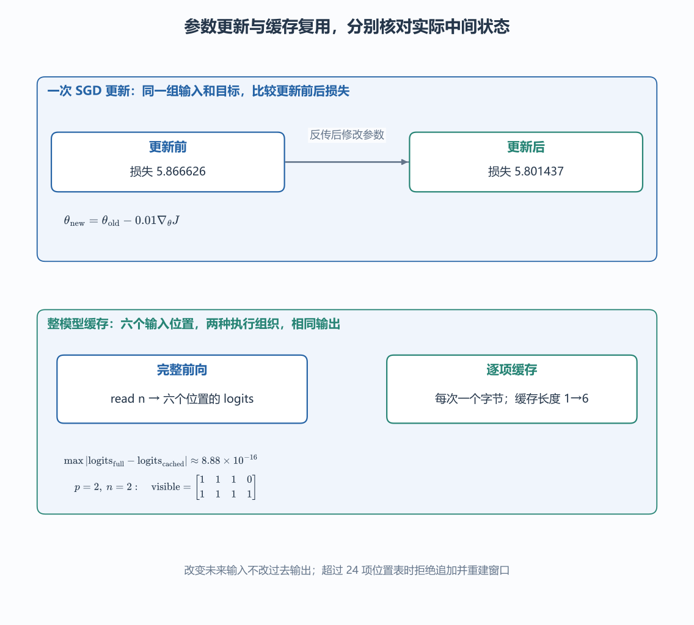

### 5. 参数与形状账单

一个模型的参数总数完全由各层权重的形状决定。在 `TinyLM` 的实现中，Q/K/V 联合投影与注意力输出投影不带偏置，两个前馈线性层与词表输出层带偏置，内容嵌入与末端输出层各自保存独立权重，逐项清点如下：

| 参数组 | 元素数量 |
| --- | ---: |
| 内容嵌入 $256\times32$ | 8,192 |
| 位置表 $24\times32$ | 768 |
| 两个 LayerNorm 的缩放与平移 $2\times(32+32)$ | 128 |
| Q/K/V 联合投影 $32\times96$ | 3,072 |
| 注意力输出投影 $32\times32$ | 1,024 |
| 前馈第一层 $32\times64+64$ | 2,112 |
| 前馈第二层 $64\times32+32$ | 2,080 |
| 词表输出层 $32\times256+256$ | 8,448 |
| 合计 | **25,824** |

生成时每多吐出一个 Token，增加的只是临时激活与键值缓存，表里的这 25,824 个可训练参数不会多出一个；训练时参数张量的形状也始终锁死，改变的只是这 25,824 个浮点数的具体数值。

### 6. 多轮训练与优化器

单步 SGD 只能看清局部的参数挪动。在完整训练函数 `train_language` 中，我们把下面四句短语重复拼接十六次作为训练语料：

~~~text
read notes.
write plan.
learn math.
check code.
~~~

固定随机种子 `17`，每轮随机抽取八个长度为 24 的错位窗口，使用 **[AdamW](https://github.com/pytorch/pytorch/blob/v2.6.0/torch/optim/adamw.py)** 优化器连续执行 140 次更新。

AdamW 之所以比普通 SGD 收敛更稳，是因为它不仅看当前这一步的梯度，还为每个参数分量单独记下了梯度的历史账本。用 $u$ 表示优化器的更新步数（以免与句中位置 $t$ 混淆），记第 $u$ 步算出的梯度为 $g_u$，一阶动量 $m_u$ 和二阶动量 $v_u$ 按指数滑动平均逐元素更新：

$$
m_u=\beta_1m_{u-1}+(1-\beta_1)g_u,\qquad
v_u=\beta_2v_{u-1}+(1-\beta_2)g_u^2.
$$

$m_u$ 用来平滑梯度的前进方向，$v_u$ 则平滑梯度的平方幅度，让历史上波动剧烈的参数分量在更新时除以较大的分母把步子收小。因为初始历史 $m_0,v_0$ 全为零，刚起步时数值会偏小，需要除以 $1-\beta^u$ 做偏差修正：

$$
\widehat m_u=\frac{m_u}{1-\beta_1^u},\qquad
\widehat v_u=\frac{v_u}{1-\beta_2^u}.
$$

设学习率为 $\eta$、权重衰减系数为 $\lambda$，AdamW 的单步更新公式为：

$$
\theta_u=(1-\eta\lambda)\theta_{u-1}
-\eta\frac{\widehat m_u}{\sqrt{\widehat v_u}+\varepsilon}.
$$

右边第一项直接按比例对参数做权重衰减，第二项则用平滑后的梯度除以历史波动尺度。在学习率 $\eta=0.008$ 及 PyTorch 默认参数（$\beta_1=0.9,\beta_2=0.999,\varepsilon=10^{-8},\lambda=0.01$）下跑完 140 轮，首批训练损失约为 $5.997660$，末批降到了约 $0.122897$。但请保持警惕：这两个漂亮的数字来自模型反反复复背诵了 140 遍的训练集，绝不能单凭它就宣布模型已经掌握了未见过的词语组合。

### 7. 熟悉短句与重组泛化

为了检验模型到底学到了什么，我们拿出一份**把训练集里见过的单词拆开重新组合**的验证文本：

~~~text
read plan.
write notes.
check math.
~~~

注意：这里的每个单词在训练集里都出现过，唯独动宾搭配换了。在这 35 个验证目标位置上逐项评估，平均交叉熵损失一下子升到了约 $2.702913$！而且首次贪心选择分歧就出现在位置 5：读完前缀 `read ` 后，验证集真实下一字节是 `plan.` 的首字母 `p`，而模型却顽固地倾向于选 `n`（一心想背诵训练集里的 `read notes.`）。

如果扩充训练语料里的搭配多样性，能不能改善它对未见组合的泛化？我们在 `language.combination_experiment`（对应练习 `04-05`）中做了一次严格的对照实验：先单独锁死一份两种配置都绝不参与训练的**共同保留集**（共 47 个目标位置）：

~~~text
read code.
write math.
learn notes.
check plan.
~~~

第一组只训练原本的四种短句；第二组把刚才那三种新搭配（`read plan`、`write notes`、`check math`）也加进训练集，凑成七种搭配。在模型结构、随机种子、更新次数完全相同的条件下，对比它们在这 47 个共同保留目标上的表现：

| 训练配置 | 共同保留集平均损失 | 首个分歧 |
| --- | ---: | --- |
| 原四种组合 | 2.624320 | `read ` 后应为 `c`，选为 `n` |
| 扩充为七种组合 | 1.481624 | `read ` 后应为 `c`，选为 `p` |

看这张表揭示的真实图景：扩充训练搭配后，模型不再死守“一个动词只能配唯一一个宾语”，共同保留集上的平均概率损失从 $2.624320$ 显著降到了 $1.481624$；但在做非黑即白的最高分贪心选择时，`read ` 后面依然没选对未见过的 `c`（`code.`），而是选了刚在扩充语料里见过的 `p`（`plan.`）。实验记录必须同时留下“概率分布的改善”和“依然存在的贪心失败”，而不能一看到损失下降就夸大其词地说模型“已经学会了逻辑推理”。

## （六）解码与 KV Cache

### 1. 从分布中选择下一项

训练阶段模型一次吐出一整张 $(B,T,V)$ 的 logits 张量，而在实际续写时，我们每次只需要取出当前前缀**最后一个位置**的那一行分数 $\mathbf z$。引入温度系数 $\tau>0$，在选择前先对分数做缩放归一化：

$$
p_k(\tau)=\frac{\exp(z_k/\tau)}{\sum_r\exp(z_r/\tau)}.
$$

拿三个候选分数 $(\log4,\log2,\log1)$ 算一遍：当 $\tau=1$ 时，指数比例是 $4:2:1$，概率分布为 $(4/7,2/7,1/7)$；如果把温度降到 $\tau=0.5$，相当于把分数乘以二，指数比例变成平方关系 $16:4:1$：

$$
\mathbf p(0.5)=\left(\frac{16}{21},\frac4{21},\frac1{21}\right).
$$

原本排名第一的候选占比被进一步放大；反之，把温度升到 $\tau=2$，比例变成 $2:\sqrt2:1$，分布变得更平缓。注意：只要在相同的正温度下，所有有限 logits 之间的大小名次绝不会颠倒，改变的只是名次之间的概率差距。**贪心选择**直接取最高分编号（程序里直接调 `argmax`，不能把 $\tau=0$ 代进公式做除零运算）；**随机采样**则按算出的概率分布抽签。

为了防止抽签时抽中排在尾巴上的低概率乱码，还可以在采样前截断候选池（仍以 $\tau=1$ 时的 $(4/7,2/7,1/7)$ 为例）：
* **Top-$k$** 在排序后只保留最高的 $k$ 项，其余清零后重新归一化：取 Top-$2$ 保留前两项，重归一化后得到 $(2/3,1/3,0)$。
* **[Top-$p$（核采样）](https://arxiv.org/abs/1904.09751)** 按概率从高到低累加，保留累计概率**首次达到或跨过阈值 $p$** 的最短前缀：取 $p=0.7$，第一项 $4/7\approx0.571429$ 还没到阈值，加上第二项后达到 $6/7\approx0.857143\ge 0.7$，于是把跨过阈值的第二项也保留下来，重归一化后同样得到 $(2/3,1/3,0)$。

把三个候选暂记为 A、B、C，柱高就是它们下一次被抽中的概率。上排沿用同一组分数，只改变温度：三根柱子的高低顺序不变，差距随温度改变。下排先回到 $\tau=1$ 的分布，再分别做 Top-$2$ 与阈值为 $0.7$ 的 Top-$p$。右下角累计概率表明：A 一项还不够，加入 B 才跨过阈值，因此 B 也必须保留。最后将剩余概率重新归一化，才得到供实际抽样使用的 $(2/3,1/3,0)$。

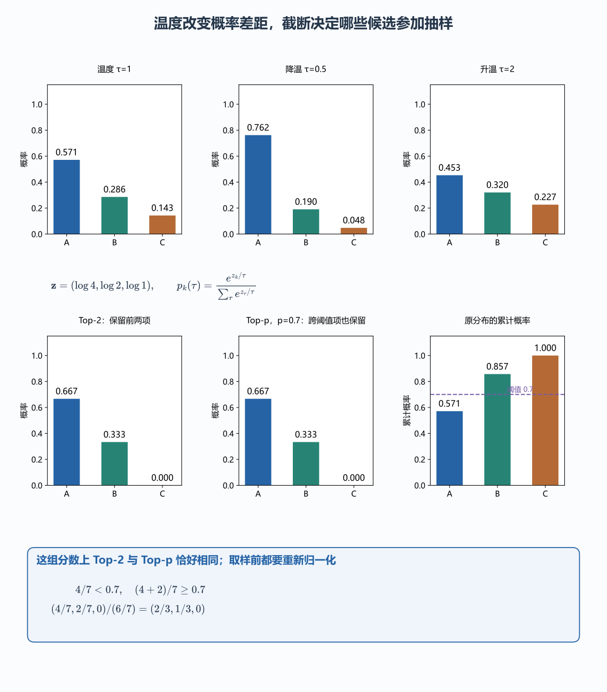

### 2. 选择、追加与再次前向

把选词动作放进循环里，一次完整生成的步骤就是：编码当前前缀 $\rightarrow$ 算最后位置分数 $\rightarrow$ 选出下一项编号 $\rightarrow$ 追加到输入末尾 $\rightarrow$ 开始下一轮前向计算：

~~~python
import torch
from modern_ai.language import train_language

model, training = train_language(return_model=True)  # 在唯一环境训练现有 TinyLM。
model.eval()
ids = torch.tensor([list(b"read ")], dtype=torch.long)
generator = torch.Generator().manual_seed(17)  # 固定本次采样的随机源。

with torch.no_grad():
    for _ in range(12):  # 外部规定最多生成十二个新字节。
        prefix = ids[:, -model.context:]  # 超长时按现有模型规则重建最近窗口。
        logits = model(prefix)[:, -1, :]  # 只读当前最后位置的一行分数。
        probabilities = (logits / 0.8).softmax(dim=-1)
        next_id = torch.multinomial(probabilities, 1, generator=generator)
        ids = torch.cat([ids, next_id], dim=1)  # 沿位置轴追加，形状增加一列。
print(bytes(ids[0].tolist()).decode("utf-8", errors="replace"))
~~~

这里 `multinomial` 抽出的 `next_id` 形状为 `(1,1)`，`torch.cat` 沿着位置轴（`dim=1`）把它接在 `ids` 末尾。因为第一轮从 `read ` 抽中了 `n`，第二轮送进模型的前缀就变成了 `read n`，必须根据这个新前缀重新计算下一轮分布，绝不能拿着第一轮的旧分布连抽两次。

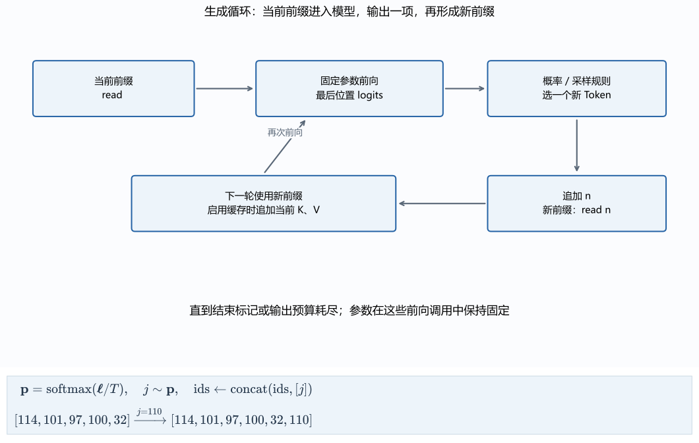

### 3. 历史键值的复用

盯着上面的生成循环看，你会发现一笔巨大的算力浪费：第一轮送进 `read `（5 个字节），第二轮送进 `read n`（6 个字节），第三轮送进 `read no`（7 个字节）……前面早就已经算过一遍的 `read `，在每一轮循环里都被迫从头重算了一遍嵌入查表、LayerNorm 和 Q/K/V 投影！

为什么旧位置其实根本不用重算？因为有**因果掩码**兜底：排在前面的旧位置永远只读它自己和更早的位置，你在句子末尾新追加了什么字节，丝毫不会改变旧位置当时能看到的前缀，因而也绝不会改变旧位置在各层算出来的键（K）和值（V）！

只要模型参数、原有前缀和位置编码约定不变，我们就可以把各层已经算出来的旧键和旧值存进缓存里——这就是 **KV Cache**。对于每一层、每个键值头，分别保存两块张量：

$$
K_{\rm cache}\in\mathbb R^{B\times h_{\rm kv}\times T_{\rm past}\times d_k},
\qquad
V_{\rm cache}\in\mathbb R^{B\times h_{\rm kv}\times T_{\rm past}\times d_v}.
$$

其中 $T_{\rm past}$ 是已经处理完的历史位置数，$h_{\rm kv}$ 是键值头数。启用缓存之后，生成过程就自然分成了两个阶段：第一轮处理完整初始前缀称为 **prefill（预填充）**，一口气算出初始前缀全部位置的 K/V 填入缓存；随后的单步生成称为 **decode（增量解码）**，每次只把上一轮新选出的那一个 Token 送进模型，算出它自己的查询、键和值，把新 K/V 追加到缓存末尾，再让这个新查询去读取整条已保存的键值序列：

| 调用 | 当前输入给模型的内容 | 调用前缓存位置数 | 调用后缓存位置数 |
| --- | --- | ---: | ---: |
| prefill | read 后跟一个空格 | 0 | 5 |
| decode，已选出 n | 只送 n | 5 | 6 |
| decode，随后选出 o | 只送 o | 6 | 7 |

注意：开启缓存后，第二轮只准送新字节 `n`，千万不能又把完整的 `read n` 送进去，否则前五个位置会在缓存里被重复存两遍；而且缓存里存的是各层的 K/V 投影张量（旧查询 Q 不需要存，因为旧位置不再发起新查询），不是把原文字符串换个变量名存起来。

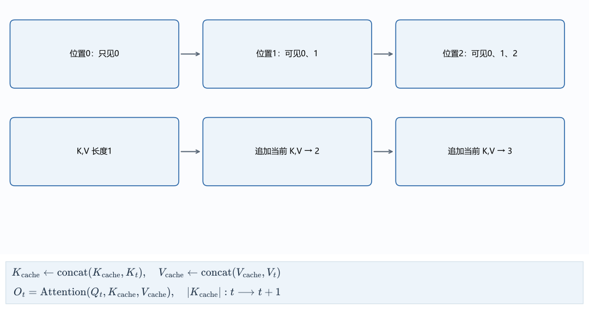

### 4. 缓存后的因果坐标

如果开启缓存后，某次调用新送入的块不止一个 Token（设调用前已缓存的历史长度为 $p$，本次新送入块的长度为 $n$），此时的因果掩码该怎么写？

必须把局部行号换算回**全局序列坐标系**：新块里的第 $i$ 行查询（局部下标 $i=0,\ldots,n-1$），它在整条完整序列里的全局位置是 **$p+i$**；而拼接后所有键的全局位置是 $j=0,\ldots,p+n-1$。因此，因果可见条件必须写成：

$$
j\le p+i.
$$

举个例子：假设缓存里已有 $p=2$ 个位置，接着一次新输入 $n=2$ 个位置。第一行新查询处在全局位置 2，可以读键 0、1、2；第二行新查询处在全局位置 3，可以读键 0、1、2、3：

$$
\text{visible}=
\begin{bmatrix}
1&1&1&0\\
1&1&1&1
\end{bmatrix}.
$$

要是写代码时漏掉了历史偏移 $p$，直接写成 $j\le i$，第一行就变成只能读键 0，第二行只能读键 0、1——程序不会报形状错误，却把历史位置 1 和当前新位置自己全给错误屏蔽掉了！

~~~python
import torch

p, n = 2, 2
key_positions = torch.arange(p + n)[None, :]  # (1,4)，列出所有键的全局位置。
query_positions = p + torch.arange(n)[:, None]  # (2,1)，新查询的全局位置。
visible = key_positions <= query_positions  # 广播得到 (2,4)。
print(visible.int().tolist())  # [[1,1,1,0],[1,1,1,1]]。
~~~

同理，查绝对位置表时新块也必须从下标 $p$ 开始往后取，用 RoPE 时也要按全局位置 $(p+i)$ 旋转，且绝不能把缓存里已经旋转过的旧键再拿出来重复转一次。

### 5. 整模型缓存对照

在 `TinyLM.forward_cached(tokens, past)` 中，我们用同一套权重实现了带缓存的前向路径。为了检验它与完整前向是否严格等价，我们切到双精度 `double()` 下对比一次送入六个字节 `read n` 与逐字节分六步缓存调用的输出差异：

~~~python
import torch
from modern_ai.language import TinyLM

torch.manual_seed(17)
model = TinyLM().double().eval()  # 双精度减少对照中的舍入差。
ids = torch.tensor([list(b"read n")], dtype=torch.long)

with torch.no_grad():
    full = model(ids)  # 完整处理六个位置，输出 (1,6,256)。
    cache, pieces = None, []
    for index in range(ids.shape[1]):
        logits, cache, weights = model.forward_cached(
            ids[:, index:index + 1], cache
        )  # 每次处理一个位置，模型仍有完整的历史键值可读。
        pieces.append(logits)
    incremental = torch.cat(pieces, dim=1)
    error = (full - incremental).abs().max().item()
print(error)  # 约 8.88e-16；六份输出与完整前向一致。
~~~

两边算出的六份输出最大绝对差仅为 $8.88\times10^{-16}$；先缓存两个位置、再一次成块输入两个新位置，最大差也仅为 $5.55\times10^{-16}$。而在 `language_details.cache_failure`（练习 `04-03`）中，一旦故意漏掉历史偏移 $p$，从第 1 个位置起就会立刻抓出与正确结果的数值分歧。

### 6. 缓存的内存账单

设模型共有 $L$ 层，每层有 $h_{\rm kv}$ 个键值头，键宽和值宽均为 $d_h$，批次大小为 $B$，当前缓存了 $T$ 个位置，则 KV Cache 保存的浮点数总个数为：

$$
N_{\rm KV}=2BTLh_{\rm kv}d_h.
$$

前面的因子 $2$ 分别对应 K 和 V。拿当前 `TinyLM`（$B=1,T=24,L=1,h_{\rm kv}=2,d_h=16$）代入：

$$
N_{\rm KV}=2\times1\times24\times1\times2\times16=1536.
$$

用四字节的 `float32` 存储，刚好占 $6144$ 字节（即 $6\text{ KiB}$）。

为了在大模型长上下文下给这项缓存瘦身，[**GQA（分组查询注意力）**](https://arxiv.org/abs/2305.13245) 让多个查询头共享同一组键值头（例如总宽 32、设四个查询头每头宽 8，但只保留两组键值头，24 项缓存直接减半为 $768$ 个元素、$3072$ 字节）；[**MQA（多查询注意力）**](https://arxiv.org/abs/1911.02150) 则进一步把键值头数压到 $h_{\rm kv}=1$。在计算量上，完整重算长度 $T$ 的序列包含约随 $Td^2$ 增长的投影/前馈运算和随 $T^2d$ 增长的注意力运算；开启缓存后，单步新位置的自身投影仍随 $d^2$ 增长，而读取 $T$ 个历史键值的运算则降为随 $Td$ 线性增长。

### 7. 前缀、位置与窗口裁剪

最后记住 KV Cache 安全复用的铁律：**模型权重未变、已缓存的 Token 前缀未变、各位置的位置编码与可见规则未变**。一旦修改了开头的系统提示词、替换了历史 Token 或更新了模型权重，旧缓存就立即作废。

当序列长度撞上窗口上限时，还会遇到滑动裁剪问题：`TinyLM` 的位置表只有 24 行，当缓存已满 24 项、再来第 25 项时，`forward_cached` 会直接报错拒绝（绝不会偷偷给第 25 项塞回位置 0）。而在不带缓存的生成循环里，程序截取最近 24 项作为一个新窗口重新从位置 0 开始编码——由于留下来的每个 Token 都换了新的绝对座位号，且删掉最早的上下文也会改变深层表示，所以不能简单地把旧缓存的第一项切掉就接着用，必须对裁剪后的新窗口重新计算并建立缓存。

## （七）运行与练习

所有入口都在 `现代AI示例` 目录，使用该目录已有的唯一虚拟环境：

~~~powershell
# 字节合并、注意力手算/反传、分头、位置、单步更新与整模型缓存。
.\.venv\Scripts\python.exe -B -m modern_ai.language_foundations

# 原有完整训练入口，以及固定保留组合的训练对照。
.\.venv\Scripts\python.exe -B -m modern_ai.language_foundations --train
.\.venv\Scripts\python.exe -B -m modern_ai.solutions 04-05

# 逐题查看独立计算结果。
.\.venv\Scripts\python.exe -B -m modern_ai.solutions 04-06
.\.venv\Scripts\python.exe -B -m modern_ai.solutions 04-07
.\.venv\Scripts\python.exe -B -m modern_ai.solutions 04-08
~~~

| 题号 | 要求 | 任务 |
| --- | --- | --- |
| 04-01 | **必做** | 区分字符、字节、编号和嵌入轴，并说明换词表后哪些对象必须同步改变 |
| 04-02 | **必做** | 对同一分数矩阵施加因果掩码，重算每行分母和输出 |
| 04-03 | **必做** | 比较完整计算、正确缓存和错误历史偏移，定位首次分歧 |
| 04-05 | **必做** | 固定保留组合，比较两种训练语料的概率损失与首个选择错误 |
| 04-06 | **拓展选做** | 只给一个输出坐标设目标，沿 V 与 Q/K 两路求导，核对三行输入梯度 |
| 04-07 | **拓展选做** | 用反例检查残差梯度下界，并验证置换等变成立的条件 |
| 04-08 | **拓展选做** | 对整个 TinyLM 验证逐项缓存与成块追加，解释超限窗口为何要重建 |

分析与参考结果见练习题解（代码包内：`docs/练习题解.md`）。逐项数值见第四篇计算记录（代码包内：`docs/第四篇逐步计算.json`），训练与共同保留集见训练对照（代码包内：`docs/第四篇训练复验.json`）。