# 五、后训练、微调与部署

[TOC]

## （一）指令微调与回答监督

### 1. 从续写材料到回答问题

在第四篇里，我们的微型语言模型 `TinyLM` 反反复复读了上百遍 `read notes.`，只要在开头给它几个字母，它就能顺着这套早已烂熟于心的统计惯性，把后半句稳稳当当地补齐。但是，如果我们现在把一个刚刚完成大规模预训练的基座模型直接拿出来当问答助手用，给它递上一句提示：`问题：1+1 等于几？`，它会怎么往下接呢？

这完全取决于它在预训练语料里见过什么样的文本排版。如果它在语料里见过很多带答案的辅导书，它固然有可能乖乖接上 `答案：2`；但如果它在语料里读过更多没有附答案的期末考试卷或者习题集目录，它就完全可能以为当前任务是“继续往下编考题”，于是顺手在后面接上一句 `问题：1+2 等于几？`，甚至一连串列出十道算术题来。

这就是预训练基座模型与实际应用需求之间那道绕不过去的鸿沟。预训练阶段只干了一件事——教会模型顺着互联网原始文本的统计分布做“下一项续写”；而在真实的应用场景里，用户需要的却不是一个漫无目的接着话茬往下编词的续写机器，而是一个能够听懂指令、按照指定的角色、格式与任务约束去完成回答的助手。

怎样把一个只会顺着语料惯性续写的基座模型，改造成有问必答的助手？最直接的做法，就是由人工（或更强的教师模型）先整理出一批高质量的“任务要求—理想示范回答”配对样本，然后拿这批示范样本继续更新已有模型的权重——这个过程就叫做**监督微调**（Supervised Fine-Tuning，简称 SFT）。当年 [InstructGPT](https://arxiv.org/abs/2203.02155) 正是把这种示范微调、随后的成对回答偏好收集以及奖励驱动的强化学习更新串联起来，确立了现代大语言模型标准的后训练（Post-training）三阶段流水线。

从底层矩阵运算来看，SFT 并没有另起炉灶去修改第四篇的 Transformer 网络结构：它的前向传播依然走因果自注意力，输入与目标依然错开一位，损失函数也依然是大家熟悉的交叉熵。真正发生变化的是训练数据里蕴含的监督意图。在现实任务中，同一道问题往往允许多种不同字句的合格示范回答，并不要求全天下只有唯一一种标准写法；但反过来说，交叉熵损失是极其诚实甚至机械的——如果数据团队整理出来的示范回答总喜欢在开头先摆一段空洞的客套话（比如“这是一个非常深刻且有意义的问题……”），那么这段客套话里的每一个字节，也同样会作为监督目标进入损失函数，成为模型被要求努力推高概率的对象。你在示范数据里喂给它什么认为值得模仿的内容，损失函数就会一五一十地逼着参数去记住什么。

为了看清一条示范问答究竟是怎么在模型内部变成错位标签、又是怎么一步步产生梯度的，我们先不急着上长篇大论，而是拿一条只有七个字节、可以用纸笔逐字节核对到底的极简记录来解剖：

~~~text
Q:a
A:b
~~~

在程序里，这条记录对应的 UTF-8 字节串是 `b"Q:a\nA:b"`，一共包含七个字节。其中开头的提问提示部分 `Q:a\nA:` 占了六个字节，末尾的示范回答 `b` 只占一个字节（这里的字母 `a` 和 `b` 只是用来精准对账的实验符号）。在这条样本上，我们对模型提出的要求非常明确：把前六个字节 `Q:a\nA:` 当作已知的上下文提问条件，专心去推高最后一个回答字节 `b` 的生成概率。

### 2. 移位目标与损失掩码

把上面这七个字节按顺序记为 $s_0, s_1, \ldots, s_6$。按照第四篇第五节讲过的 Teacher Forcing 自回归训练规则，送进模型前向计算的输入序列取前六项 $s_0,\ldots,s_5$（即 `Q:a\nA:`），而正常情况下的监督目标则是往左错开一位的后六项 $s_1,\ldots,s_6$（即 `:a\nA:b`），让每个查询位置各自预测紧跟在它后面的下一项。

但到了 SFT 阶段，一个关键的差异出现了：前面的 `Q:a\nA:` 是用户递进来的提问条件，千人千面，我们根本不需要逼着模型去背诵“用户会提什么问题”或者“冒号后面为什么跟着字母 `a`”；我们唯一关心、也唯一需要考核模型的，是当模型完整读完提示 `Q:a\nA:` 之后，能不能在后面准确地写出回答 `b`。

因此，在构造传给交叉熵损失函数的目标标签时，我们需要引入一张**损失掩码（Loss Mask）**：把凡是用来预测提示词字节的位置统统填成特殊忽略标记 `-100`，只把真正用来预测回答字节的目标保留下来。把这六个查询位置逐一列成表格，你会看到一个极其重要、却让无数初学者在写代码时栽跟头的细节：

| 查询位置 $t$ | 该位置送入的输入字节 $s_t$ | 正常错位后的下一字节目标 $s_{t+1}$ | 只监督回答时的掩码后标签 |
| ---: | --- | --- | --- |
| 0 | `Q` | `:` | `-100`（忽略，不计入损失） |
| 1 | `:` | `a` | `-100`（忽略，不计入损失） |
| 2 | `a` | `\n` | `-100`（忽略，不计入损失） |
| 3 | `\n` | `A` | `-100`（忽略，不计入损失） |
| 4 | `A` | `:` | `-100`（忽略，不计入损失） |
| 5 | `:` | `b` | `98`（有效目标，即回答字节 `b`） |

请死死盯住这张表的最后一行：**真正负责预测回答第一个字节 `b`（ASCII 编号 `98`）的，并不是回答字节 `b` 自己所在的输入位置，而是提示词最后一个字节 `:` 所在的查询位置（位置 $t=5$）！**

为什么会这样？因为自回归模型在每个位置预测的是“下一项”。当输入走完 `Q`、`:`、`a`、`\n`、`A`，直到第 5 号位置读入提示词末尾的冒号 `:` 时，这一行算出来的词表分布就已经是在预测紧随其后的回答首字节 `b` 了！如果程序员在写数据预处理代码时，先在未移位的原始拼接串里找出“哪些下标属于回答”，然后不加思索地把这个下标掩码直接扣到已经往左错开了一位的目标序列上，就会把位置 $5$ 误当成提示词给屏蔽掉，从而恰好漏掉了整段回答最关键的第一个字！

我们可以把这个有效查询位置的区间写成清清楚楚的代数不等式：设提示部分的长度为 $P$，回答部分的长度为 $R$，拼起来的完整记录总长为 $P+R$。做完左移一位的错位切分后，输入序列与目标序列的长度都是 $P+R-1$。此时，真正负责预测那 $R$ 个回答字节的有效查询位置下标 $t$（从 $0$ 开始计数），严格满足：

$$
P-1\le t\le P+R-2.
$$

拿我们的样本验算一下：提示 `Q:a\nA:` 长 $P=6$，回答 `b` 长 $R=1$，代入不等式得到 $6-1 \le t \le 6+1-2$，即 $5\le t\le 5$，全场只有 $t=5$ 这唯一一个有效查询位置；如果把示范回答改成两个字节（比如 `bc`，即 $R=2$），代入不等式就得到 $5\le t\le 6$，有效查询位置就变成提示末项 $t=5$（负责在读完 `:` 后预测 `b`）和回答首项 $t=6$（负责在读入 `b` 后预测 `c`）共两个位置，绝不是只监督最后一项。

我们用指示变量 $m_t\in\{0,1\}$ 来标记查询位置 $t$ 是否被选为有效回答目标（有效取 $1$，填了 `-100` 被忽略的位置取 $0$），并记参数为 $\theta$ 的模型在查询位置 $t$ 赋给真实下一字节 $s_{t+1}$ 的预测概率为 $p_{\theta,t}(s_{t+1})$。那么，只监督回答部分的 SFT 损失函数就写为：

$$
L_{\rm SFT}
=-\frac{1}{M}\sum_t m_t\log p_{\theta,t}(s_{t+1}),
\qquad M=\sum_t m_t.
$$

式中的分母 $M$ 统计的是当前批次里所有满足 $m_t=1$ 的有效回答 Token 总数。别小看这个分母 $M$，它背后涉及一个影响训练行为的工程口径选择：当一个训练批次里同时混着一条 200 字的长回答和一条 2 个字的短回答时，如果像上面公式这样把整個批次所有有效 Token 的损失加起来除以总个数 $M$（称为 Token-level 平均），那么 200 字的长回答贡献了 200 个求和项，在批次总梯度里占据的权重就是短回答的 100 倍；而另一种做法则是先在每条样本内部除以各自的回答长度求平均、然后再对样本条数求平均（称为 Sample-level 平均），强制让长回答和短回答在批次里平分秋色。这两种归一化对应着截然不同的数据加权方式，代码实现与实验报告必须从头到尾锁死同一种口径。

在本篇的配套实现中，我们统一采用第一种（Token-level 平均），直接调用 PyTorch 的 `cross_entropy(..., ignore_index=-100)`，它会在内部自动跳过所有标签为 `-100` 的位置，并严格按剩余有效目标的个数 $M$ 求平均。这里还要守住两条代码红线：
第一，特殊标记 `-100` **只能出现在传给损失函数的目标张量 `labels` 里**，送进模型做前向查表的输入张量 `inputs` 必须依然是 $0\sim 255$ 之间的合法词表编号——要是错把 `-100` 塞进了 `inputs`，`nn.Embedding` 查表时就会因为负索引错位或越界而崩溃；
第二，如果某条训练样本的提示词太长，在按窗口上限（如 24 字节）截断时把排在后面的回答部分删得一干二净，就会导致整批数据的有效目标数 $M=0$。此时分母为零，损失函数会吐出 `NaN` 并在一步更新内污染全模型的所有权重！因此，构建批次的程序一旦检测到 $M=0$，必须当场抛出异常拒绝该批次，绝不能把没有有效监督目标的空批次放进优化器。

此外，虽然“只对回答部分计算损失”是当前最常用的指令微调方案，但[TRL 的 SFT 接口文档](https://huggingface.co/docs/trl/sft_trainer#train-on-completion-only)也明确区分了“全序列监督”、“仅回答部分监督（Completion-only）”与“多轮助手消息监督”。到了多轮对话微调中，一段样本里包含多次用户提问与多次助手回答，预处理程序必须根据消息角色结构把每一轮助手的回答区间逐段标记为有效目标，而不能偷懒只靠搜索最后一个 `A:` 字符串去猜边界。

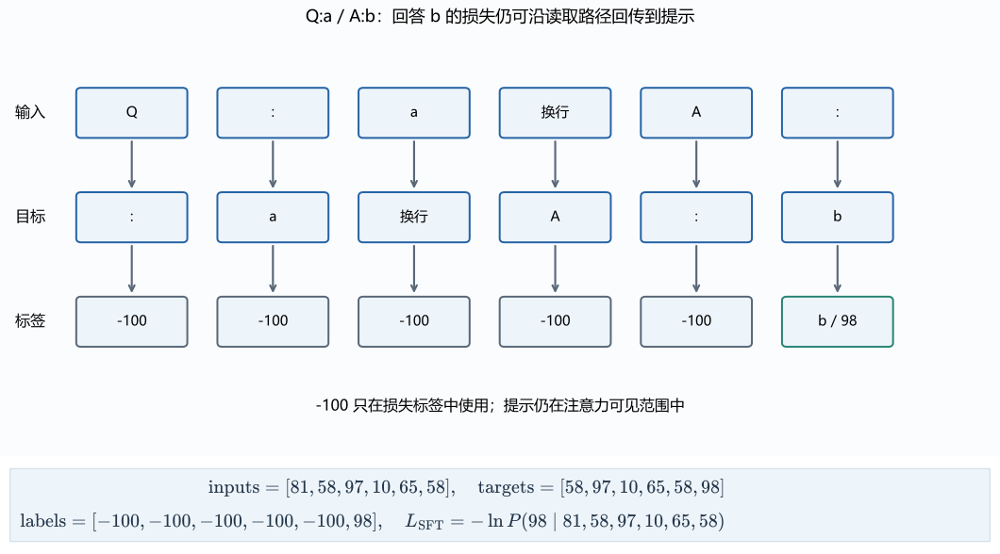

### 3. 从标签构造到一次反传

在配套代码 [`modern_ai/posttraining.py`](https://github.com/KiriAky107/understanding-AI-and-Agents-in-depth/blob/main/%E7%8E%B0%E4%BB%A3AI%E7%A4%BA%E4%BE%8B/modern_ai/posttraining.py)（代码包内：`现代AI示例/modern_ai/posttraining.py`） 中，`answer_batch` 函数专门负责接收一组“（字节提示，字节回答）”配对列表：它先把提示和回答拼成完整字节串，切出错开一位的 `inputs` 和 `targets`，再把每个样本里下标小于 `len(prompt) - 1` 的目标位置统一改写为 `-100`（当批次内多条样本长短不一时，统一在序列尾部补齐，并将补齐位置的目标也设为 `-100`；得益于第四篇的下三角因果掩码，排在前面的有效查询位置根本看不见尾部的补齐项，因此长短样本同批训练不会相互干扰）。

现在，我们把 `(b"Q:a\nA:", b"b")` 送进双精度的 `TinyLM`，跑完一次前向与反向传播，并调用 `logits.retain_grad()` 把输出层分数的直接梯度拦截下来打印看看：

~~~python
import torch
from modern_ai.language import TinyLM
from modern_ai.posttraining import answer_batch, answer_loss

torch.manual_seed(17)  # 固定参数初值，便于核对同一组梯度。
model = TinyLM().double()
inputs, labels = answer_batch([(b"Q:a\nA:", b"b")])
logits = model(inputs)  # (1,6,256)，六个位置各给出一行词表分数。
logits.retain_grad()  # logits 不是叶子参数，显式保留它的直接梯度。

loss = answer_loss(logits, labels)
loss.backward()
print(labels.tolist())  # [[-100, -100, -100, -100, -100, 98]]
print(logits.grad.norm(dim=-1).tolist())  # 前五行均为 0.0，最后一行非零。
~~~

为什么要显式调用 `logits.retain_grad()`？因为在 PyTorch 的自动微分图里，`logits` 是前向算出来的中间张量而非模型的叶子权重参数（Leaf Parameter），默认情况下反传一过就会把它的梯度缓冲区释放掉以节省内存。保留下来之后，我们用 `.norm(dim=-1)` 把每个位置那 256 个候选字节上的梯度向量浓缩成一个二范数长度。

看打印出来的结果：`labels` 的前五项全是 `-100`，只有最后一项是 `98`；与此同时，`logits.grad` 的前五行范数全都是分毫不差的 `0.0`，只有最后一行（位置 5）拿到了非零梯度 `1.004821`！这在代数上完全符合我们在第四篇推导过的交叉熵梯度公式加上掩码开关 $m_t$ 后的结果：

$$
\frac{\partial L_{\rm SFT}}{\partial z_{t,k}}
=\frac{m_t}{M}
\left(p_{t,k}-\mathbf1[k=s_{t+1}]\right).
$$

在 $m_t=0$ 的前五个位置上，乘以零直接斩断了这五行输出分数 $z_{t,k}$ 对损失的直接贡献。

但是，看到前五行的 `logits` 梯度全为零，很多人脑子里会立刻蹦出一个看似顺理成章、实则大错特错的推论：“既然前五个提示词位置把损失全屏蔽了、连 `logits` 梯度都是零，那是不是意味着在 SFT 训练时，模型根本不会去调整它对提示词 `Q:a\nA:` 的内部表示，前面五个位置在整张计算图里都彻底陪跑了？”

### 4. 提示位置也会收到梯度

上面那个推论之所以错，是因为它忘了神经网络中间还夹着一层**让不同位置互相读取信息的自注意力（Self-Attention）**！

回想一下，位置 5 上的那个冒号 `:` 是凭什么猜出后面该接 `b` 还是接 `d` 的？冒号自己长得一模一样，它之所以能区分不同的问题，全靠在自注意力层里发出查询 $\mathbf q_5$，回头去读取了前面位置 $0$ 到位置 $4$（特别是位置 2 上的问题字母 `a`）的键（$K$）和值（$V$）！

设注意力层的加权输出为 $O=AV$。哪怕从顶层损失传给注意力输出矩阵 $O$ 的上游梯度矩阵 $G = \partial L/\partial O$ 只有最后一行（第 5 行）非零、前五行全都是零，当我们顺着第四篇第二节亲手推导过的反向传播公式，穿过 $O=AV$ 往回退一步到值矩阵 $V$ 时：

$$
\frac{\partial L}{\partial V}=A^{\mathsf T}G.
$$

请看这个矩阵乘法 $A^{\mathsf T}G$：矩阵 $G$ 的第 5 行非零，而注意力权重矩阵第 5 行的各个元素 $A_{5,0}, A_{5,1}, \ldots, A_{5,5}$ 全都是严格大于零的正数（因为 Softmax 指数恒正，且位置 5 对前面所有历史位置均可见）！当拿 $A$ 的第 5 列（转置后的行）去乘 $G$ 的第 5 行时，**末行这唯一一份非零的回答预测误差，当场就被按注意力读取比例 $A_{5,j}$ 分摊到了前面每一个提示位置的值向量 $\mathbf v_j$ 上，并且同时顺着打分矩阵 $S$ 分摊到了前面每一个提示位置的键向量 $\mathbf k_j$ 上！**

换句话说，在 Transformer 的计算图里，**“某个位置在输出层有没有挂直接的监督标签（`logits` 梯度是否为零）”**，与**“该位置的底层输入表示有没有作为上下文条件参与有效回答的计算、并收到反向传播梯度”**，完全是两码事！

为了让你亲眼看到这份顺着注意力桥梁传回提示词位置的梯度，我们在同一随机种子、CPU 双精度的 `TinyLM` 中，通过注册前向钩子（Forward Hook）单独截获内容嵌入层 `model.embedding` 刚刚查表吐出来的那个形状为 `(1, 6, 32)` 的中间激活张量（注意：这里特意观测每次查表输出的独立激活张量，而不是直接看 `embedding.weight` 参数矩阵的梯度，因为冒号 `:` 在位置 1 和位置 5 出现了两次，看参数表会把两个位置的梯度混加在同一行里；看激活张量则能把六个位置分得清清楚楚）：

| 输入位置下标 $t$ | 该位置的输入字符 | 顶层 `logits` 的直接梯度范数 | 底层内容嵌入激活向量的梯度范数 |
| ---: | --- | ---: | ---: |
| 0 | `Q` | `0.000000` | `0.018729` |
| 1 | `:` | `0.000000` | `0.024446` |
| 2 | `a` | `0.000000` | `0.030733` |
| 3 | `\n` | `0.000000` | `0.018425` |
| 4 | `A` | `0.000000` | `0.022018` |
| 5 | `:` | `1.004821` | `0.598108` |

在这次前向计算中，回答损失约为 $6.570596$。对照表格左右两列数字，计算图的真相一目了然：
* 在顶层 `logits` 一列，前五个提示词位置的梯度范数确实是铁板钉钉的 `0`——模型不需要为“没猜中提示词的下一个字”受罚；
* 但在底层内容嵌入激活一列，前五个提示词位置的梯度范数**全部实打实地大于零**！尤其是位置 $2$（里面装的正是决定答案是 `b` 还是 `d` 的核心问题字母 `a`），它在提示词里拿到了最高的激活梯度 `0.030733`！因为模型要想在位置 5 把回答 `b` 预测准，就必须通过反向传播去调整位置 2 上字母 `a` 的嵌入表示和键、值投影，让位置 5 的查询能更清晰地从位置 2 读出“当前问的是 `a`”这一关键信息。

在配套函数 `sft_gradient` 中，我们在读取完这组激活梯度后立即调用 `handle.remove()` 拆除了前向钩子，确保不在模型里残留任何临时观测状态。通过这次实验，我们也把大模型工程里常被笼统混称为“屏蔽”的三种操作彻底厘清了边界：
1. **因果掩码（Causal Mask，$-\infty$）**：作用在注意力打分矩阵上，限制的是**前向传播时当前位置允许往哪看**；
2. **损失掩码（Loss Mask，`-100`）**：作用在交叉熵损失入口处，限制的是**哪些输出位置的预测误差计入总账**（不阻断被读取位置的内部表示接收反传梯度）；
3. **参数冻结（Freeze，`requires_grad_(False)`）**：作用在权重张量属性上，限制的是**反向传播时不给哪些权重参数累加梯度、优化器不更新哪些权重**。

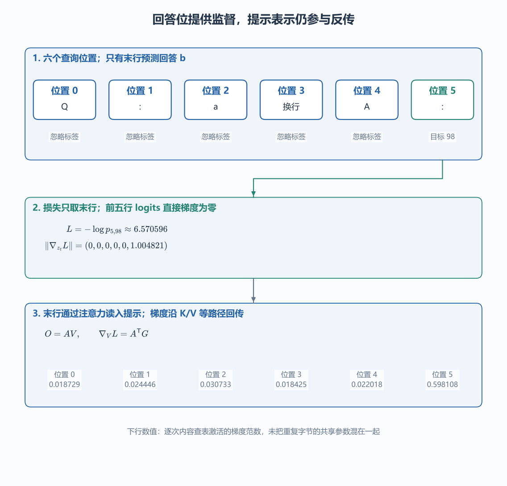

### 5. 两条示范：记忆与泛化

看清了单步梯度的来龙去脉，我们接着拿第四篇跑完 140 步预训练的 `TinyLM` 当作基座，给它准备三条结构完全一致的问答记录：

| 提示（Prompt） | 理想示范回答 | 在本次实验中的用途 |
| --- | --- | --- |
| `Q:a\nA:` | `b` | 投入 SFT 微调训练 |
| `Q:c\nA:` | `d` | 投入 SFT 微调训练 |
| `Q:e\nA:` | `f` | **独立保留检查，绝不进入参数更新** |

在人类眼里，这三条记录背后的规律再简单不过了：“问哪个小写字母，就回答它在字母表里的下一个字母（`a->b`、`c->d`、`e->f`）”。现在我们放开 `TinyLM` 的全部参数，用 AdamW 优化器（学习率设为 $0.01$）对前两条示范记录连续执行 60 步 SFT 更新，看看模型到底学到了什么。

在这 60 步训练中，前两条训练目标的平均交叉熵损失从最初的约 $8.715630$ 一路猛降，到第 60 步时，在当前 `float32` 单精度浮点数下打印出来的损失已经显示为 `0.0`！拿 `Q:a\nA:` 和 `Q:c\nA:` 去测贪心生成，模型的最高分预测百发百中地吐出了 `b` 和 `d`（顺带说明一句：这里打印出 `0.0` 是因为模型赋给正确字节 `b` 和 `d` 的 Softmax 概率在 `float32` 有限尾数精度下已经舍入到了 `1.0`，取负对数 $-\log(1.0)=0$，并不代表其余 255 个字节的概率在数学实数意义下真变成了绝对的零，因为指数函数 $e^z$ 永远大于零）。

如果只看训练集上的表现，这简直是一场满分的微调。但是，当我们把那条从未参与更新的保留记录 `Q:e\nA:` 送进微调后的模型时，残酷的真相露出来了：
在微调开始前，基座模型在 `Q:e\nA:` 上预测真实目标 `f` 的初始损失约为 $9.481778$；而在经历了 60 步全参数 SFT 之后，这道保留题上的损失非但没有下降，反而**一路暴涨到了 $43.094700$**！如果让微调后的模型对着 `Q:e\nA:` 做最高分贪心选择，它根本不会选 `f`，而是毫不犹豫地给出了它刚刚死记硬背下来的 `d`！

为什么会这样？因为在只有两条示范样本的强力更新下，模型根本没有、也不可能从两条记录里归纳出什么“字母表顺序加一”的符号规则；它找到的最省力的降损失捷径，就是一看到 `Q:...\nA:` 这种问答格式，就把输出层的概率死死押在 `b` 和 `d` 这两个字节上，同时把包括 `f` 在内的所有其他字节的分数往深渊里狠踩！不仅如此，经过这 60 步全参数大改之后，如果你再去测它原本在第四篇学会的 `read notes.` 短语续写，原有的续写分布也同样受到了冲击。

这组由 `tiny_adaptation` 实测跑出来的数字（从 `9.48` 恶化到 `43.09`）给我们立下了一条贯穿后训练始终的铁律：**在几个示范样本上把 SFT 损失训到零，只证明模型记住了这几条示范本身；它既不代表模型学会了未见样本上的泛化规则，也不代表模型完好保留了基座原有的通用能力。任何后训练改动，都必须同时拿未参与更新的新任务保留集与旧任务回归集做双向验收。**

## （二）成对偏好与 DPO

### 1. 从示范文本到回答比较

在上一节的 SFT 里，我们要求数据标注者直接写出一份“标准示范回答”。但在很多真实场景里——比如写一段总结报告、解释一个复杂概念或者权衡两套代码重构方案——往往很难规定哪一种写法是唯一正确的“标准答案”；相反，如果让模型先生成两份不同的回答，让人（或者自动评测程序）放在一起比一比“哪一份写得更好、哪一份写得更差”，做这道二选一的判断题就要容易得多，也可靠得多。

我们用 $x$ 表示提示词，$y^+$ 表示在当前对比中胜出的好回答（Chosen），$y^-$ 表示落败被拒的差回答（Rejected）。这样一条三元组 $(x, y^+, y^-)$ 就构成了一条**成对偏好样本**。请注意这条数据所承载的真实信息边界：它仅仅声明“在当前给定的评价准则下，对于提示 $x$ 而言，回答 $y^+$ 优于回答 $y^-$”，并不意味着 $y^+$ 就是完美无缺的终极真理。偏好标签可以来自人工对比打分，也可以来自单元测试或规则校验器；采集偏好时的评判标准、标注员倾向以及遇到难分高下的平局如何处理，全都直接决定了这批数据会把模型往哪个方向引。

要把“$y^+$ 比 $y^-$ 好”这种相对比较信号放进神经网络做梯度下降，第一步同样是先算出参数为 $\theta$ 的模型策略 $\pi_\theta(y\mid x)$ 生成整段回答 $y$（设包含 $R$ 个 Token）的**序列联合对数概率** $\ell_\theta(x,y)$。根据第四篇讲过的条件概率链式法则，整段回答的联合对数概率等于回答中每个位置条件对数概率的总和：

$$
\ell_\theta(x,y)
=\log\pi_\theta(y\mid x)
=\sum_{u=0}^{R-1}
\log\pi_\theta(y_u\mid x,y_{<u}).
$$

在代码实现中，我们把提示 $x$ 和回答 $y$ 拼起来跑一次 Teacher Forcing 前向传播，先对回答所在各个位置的词表分数执行数值稳定的 `log_softmax`（直接一步算出对数概率，避免先算极小的 Softmax 概率下溢成 `0.0` 后再取对数爆出 `-inf`），接着用 `gather` 沿着词表轴精准抽出真实回答字节编号对应的那一项对数概率，最后把整段回答所有位置的对数概率**加起来求和**。

这里必须特别提醒一个极易混淆的细节：**DPO 里的 $\ell_\theta(x,y)$ 是对回答位置直接求和（Sum），而上一节 SFT 的损失是除以有效长度 $M$ 求平均（Mean）！** 千万不能图省事直接把 SFT 函数算出来的平均损失加个负号当成 $\ell_\theta(x,y)$ 用——因为一旦胜出回答 $y^+$ 和落败回答 $y^-$ 一长一短，按各自长度求平均就会强行抹平长短序列在真实联合概率上的量级差异，彻底篡改了 DPO 推导所依赖的概率公理（此外，如果词表里有专门的回答结束符参与训练，也必须按统一规则计入和式，而提示词位置与尾部的 Padding 补齐位则必须严格排除在外）。

### 2. 相对参考策略的提升

有了胜出回答的对数概率 $\ell_\theta(x,y^+)$ 和落败回答的对数概率 $\ell_\theta(x,y^-)$，能不能直接拿它俩之差 $\ell_\theta(x,y^+) - \ell_\theta(x,y^-)$ 去最大化呢？
如果真这么干，训练不出几十步就会酿成灾难：模型为了无限制拉大这个差值，很快就会把整座词表的概率分布撕扯得支离破碎，要么陷入极端重复的乱码，要么彻底背离原本在预训练和 SFT 阶段学到的正常语言习惯。

为了给模型的参数更新套上一根既允许它按偏好改进、又不准它忘本跑偏的缰绳，**[直接偏好优化（Direct Preference Optimization，简称 DPO）](https://arxiv.org/html/2305.18290v2)** 在训练全程保留了一份完全冻结、参数锁死不动的**参考策略（Reference Policy）$\pi_{\rm ref}$**——在工程上，通常直接把刚刚做完 SFT 的那个起点模型复制一份并设为 `requires_grad_(False)` 来充当 $\pi_{\rm ref}$。

在每一步 DPO 训练中，我们把同一条偏好样本 $(x, y^+, y^-)$ 同时喂给正在更新的当前策略 $\pi_\theta$ 和冻结的参考策略 $\pi_{\rm ref}$，先分别算出胜出回答与落败回答**相对于参考起点的对数概率提升量** $a^+$ 与 $a^-$：

$$
a^+=\ell_\theta(x,y^+)-\ell_{\rm ref}(x,y^+),\qquad
a^-=\ell_\theta(x,y^-)-\ell_{\rm ref}(x,y^-).
$$

看这两个式子的物理意义：$a^+ = \log\frac{\pi_\theta(y^+\mid x)}{\pi_{\rm ref}(y^+\mid x)}$ 测量的是“比起微调起点，当前模型给好回答涨了多少对数概率”；而 $a^-$ 测量的则是“比起微调起点，当前模型给差回答涨（或跌）了多少对数概率”。单看其中一个数字还不足以反映偏好倾向，只有把这两个相对变化量再做一次减法（$a^+ - a^-$），并乘上正的尺度超参数 $\beta>0$，才真正刻画了当前更新相对于参考起点对这次成对偏好的净倾向程度 $\Delta$：

$$
\Delta=\beta(a^+-a^-),\qquad \beta>0.
$$

这里的 $\beta$ 既是衡量相对提升差的缩放标尺，也是下一小节我们将要推导的 KL 散度正则化约束系数（注意：在固定同一对概率变化时，调大 $\beta$ 会直接放大 $\Delta$ 的数值；但经过多步优化后模型最终会偏离参考分布多远，还受到数据分布与梯度饱和的共同作用，不能脱离具体训练过程把它机械地背诵成“$\beta$ 越大模型就一定偏离越大”）。

拿到了相对提升差 $\Delta$，我们直接用第二篇讲过的 Sigmoid 函数 $\sigma(\Delta)=\frac{1}{1+e^{-\Delta}}$ 把它映射成“好回答 $y^+$ 在本次对比中胜出”的预测概率。既然人类标注已经宣布标签为“$y^+$ 获胜（即目标概率为 1）”，对其取负自然对数，就得到了极其干净的 DPO 二元交叉熵损失：

$$
L_{\rm DPO}=-\log\sigma(\Delta)
=\log(1+e^{-\Delta}).
$$

在代码实现中，直接调用 `-F.logsigmoid(delta)` 就能在内部完成数值稳定的对数计算，彻底避开当 $\Delta$ 为绝对值很大的负数时直接算 $\exp(-\Delta)$ 引发的浮点上溢；而参考策略 $\pi_{\rm ref}$ 的前向计算则全程包裹在 `with torch.no_grad():` 下，只提供冷冰冰的基准读数，绝不为它建立反向计算图或消耗半点梯度显存。

### 3. 损失的导数与一次更新手算

当 $L_{\rm DPO}$ 对模型参数做反向传播时，梯度到底长什么样？我们顺着链式法则一步步把导数拆开。
首先求损失 $L=-\log\sigma(\Delta)$ 对中间标量 $\Delta$ 的导数。利用第二篇早已熟知的 Sigmoid 求导公式 $\sigma'(\Delta)=\sigma(\Delta)(1-\sigma(\Delta))$，分子分母里的 $\sigma(\Delta)$ 当场约掉：

$$
\frac{\partial L}{\partial\Delta}
=-\frac{\sigma'(\Delta)}{\sigma(\Delta)}
=-\frac{\sigma(\Delta)(1-\sigma(\Delta))}{\sigma(\Delta)}
=\sigma(\Delta)-1.
$$

接着，因为 $\Delta = \beta(\ell_\theta^+ - \ell_{\rm ref}^+ - \ell_\theta^- + \ell_{\rm ref}^-)$，其中参考模型的两项 $\ell_{\rm ref}^+, \ell_{\rm ref}^-$ 是不随 $\theta$ 变化的常数，所以把导数继续往回传到当前模型的胜出对数概率 $\ell_\theta^+$ 和落败对数概率 $\ell_\theta^-$ 上，正好是一正一负：

$$
\frac{\partial L}{\partial\ell_\theta^+}
=\beta(\sigma(\Delta)-1),\qquad
\frac{\partial L}{\partial\ell_\theta^-}
=-\beta(\sigma(\Delta)-1).
$$

由于胜出回答和落败回答是由同一个模型 $\pi_\theta$ 算出来的，它们共享全部权重参数 $\theta$。把两条分支传回来的梯度加在一起，就得到了 DPO 对模型参数 $\theta$ 的总梯度公式：

$$
\nabla_\theta L
=-\beta(1-\sigma(\Delta))
\left(\nabla_\theta\ell_\theta^+
-\nabla_\theta\ell_\theta^-\right).
$$

仔细端详这个总梯度公式，它的每一项都在讲道理：
括号里面的 $\nabla_\theta\ell_\theta^+ - \nabla_\theta\ell_\theta^-$ 指明了参数移动的方向——执行梯度下降（$\theta \leftarrow \theta - \eta\nabla_\theta L$，消去前面的负号）时，参数会朝着**推高胜出回答对数概率 $\ell_\theta^+$、同时压低落败回答对数概率 $\ell_\theta^-$** 的合成方向前进；
而括号外面的标量系数 $\beta(1-\sigma(\Delta))$ 则充当了自动调节力道的自适应权重——当模型在某条偏好样本上还分不清好坏、甚至错误地觉得差回答概率更高时，$\Delta \le 0$，$\sigma(\Delta)$ 很小，于是 $1-\sigma(\Delta)$ 就接近于 $1$，优化器会铆足了劲对这条样本施加重锤更新；反过来，一旦模型在这条样本上已经把好回答的优势拉得足够大（$\Delta \gg 0$，$\sigma(\Delta)\to 1$），权重 $1-\sigma(\Delta)$ 就会自动趋近于 $0$，防止模型在同一条已经学会的样本上过度死磕！

我们拿一组只有三个候选的具体数字，亲手算完一步完整的 DPO 更新，看看参数和概率到底是怎么变的。
假设在某个提示下，一共有“胜出回答 $+$”、“落败回答 $-$”和“其他回答 $o$”三个候选：
* 冻结的参考分布为 $\mathbf q = (0.2,\ 0.2,\ 0.6)$（起步时好差两份回答的概率都是 $0.2$）；
* 当前正在训练的模型分布为 $\mathbf p = (0.4,\ 0.1,\ 0.5)$，尺度超参数取 $\beta=0.5$。

第一步，先算相对提升差 $\Delta$ 与拟合概率 $\sigma(\Delta)$：

$$
\Delta=\frac12
\left(\log\frac{0.4}{0.2}-\log\frac{0.1}{0.2}\right)
=\frac12\bigl(\log2 - (-\log2)\bigr)
=\log2,
\qquad
\sigma(\Delta)=\frac{1}{1+e^{-\log2}}=\frac{1}{1+0.5}=\frac23.
$$

第二步，算当前 DPO 损失与对 $\Delta$ 的导数：

$$
L=-\log\frac23\approx0.405465,\qquad
\frac{\partial L}{\partial\Delta}=\frac23-1=-\frac13.
$$

第三步，乘上 $\beta=0.5$，得到损失对胜出、落败序列对数概率的偏导数分别为 $\frac{\partial L}{\partial\ell_\theta^+}=-\frac16$ 和 $\frac{\partial L}{\partial\ell_\theta^-}=+\frac16$。
如果这三个候选的概率直接由三个原始分数 logits $(z_+, z_-, z_o)$ 经过一次 Softmax 归一化得到（记共同分母为 $Z = e^{z_+}+e^{z_-}+e^{z_o}$），请注意看一个极其漂亮的代数消元：

$$
\log p_+-\log p_-
=(z_+-\log Z)-(z_--\log Z)=z_+-z_-.
$$

因为胜出和落败两项处于同一个提示下的同一份归一化分布里，它们各自对数概率里的共同分母项 $-\log Z$ 在相减时**一分不差地完全抵消了**！因此，$\Delta$ 里面根本不含第三项 $z_o$，损失对三个 logits $(z_+, z_-, z_o)$ 的梯度直接就是干净利落的：

$$
\nabla_{\mathbf z}L = \left(-\frac16,\ +\frac16,\ 0\right).
$$

现在，取学习率 $\eta=0.5$ 执行一步梯度下降更新（$\mathbf z_{\rm new} = \mathbf z - 0.5\nabla_{\mathbf z}L$，即把 $z_+$ 加上 $1/12$、把 $z_-$ 减去 $1/12$、$z_o$ 保持原样不动），再重新做一次 Softmax 归一化，更新后的新概率分布与新损失变为：

$$
\mathbf p_{\rm new}\approx(0.423428,\ 0.089606,\ 0.486966),
\qquad L_{\rm new}\approx0.378452.
$$

请仔细端详这组算出来的数字，它挑明了两个在分析后训练时极容易被忽视的真相：
第一，看第三个候选“其他回答 $o$”：虽然它在 logits 上的梯度严格等于 `0`（它的参数 $z_o$ 连半点都没改），但在更新后的新概率分布里，它的概率还是从原本的 $0.5$ 降到了 $0.486966$！为什么？因为 $z_+$ 的上涨幅度压过了 $z_-$ 的下跌幅度，撑大了 Softmax 的共同分母 $Z$，从而间接挤压了同池子里其他所有候选的概率份额。同理，在多步自回归语言模型里，由于不同回答共享前面的前缀与底层参数，且每一步都受词表归一化分母的约束，DPO 梯度在数学上严格保证的是**沿着扩大相对对数概率差（$a^+-a^-$）的方向移动**，而绝不能草率地翻译成“每一步更新都必然让胜出回答的绝对概率单调上升”。
第二，如果训练刚刚开始，当前模型就是从参考模型直接复制过来的（即 $\pi_\theta = \pi_{\rm ref}$），此时 $a^+=0, a^-=0 \implies \Delta=0$，模型还能不能算出梯度开始训练？完全可以！因为当 $\Delta=0$ 时，起始损失为 $-\log\sigma(0) = \log 2 \approx 0.693147$，此时导数 $\sigma(0)-1 = 0.5 - 1 = -0.5 \neq 0$！两个模型数值相同只会让相对提升差从零起步，绝不会让梯度消失为零：

~~~python
import torch
from torch.nn import functional as F

z = torch.tensor([.4, .1, .5], dtype=torch.float64).log().requires_grad_()
reference = torch.tensor([.2, .2, .6], dtype=torch.float64).log()
logp = z.log_softmax(-1)
delta = .5 * ((logp[0] - reference[0]) - (logp[1] - reference[1]))
loss = -F.logsigmoid(delta)
loss.backward()
with torch.no_grad():
    updated = z - .5 * z.grad  # 减去损失梯度，而非最大化损失。
print(z.grad.tolist())
print(updated.softmax(-1).tolist())
~~~

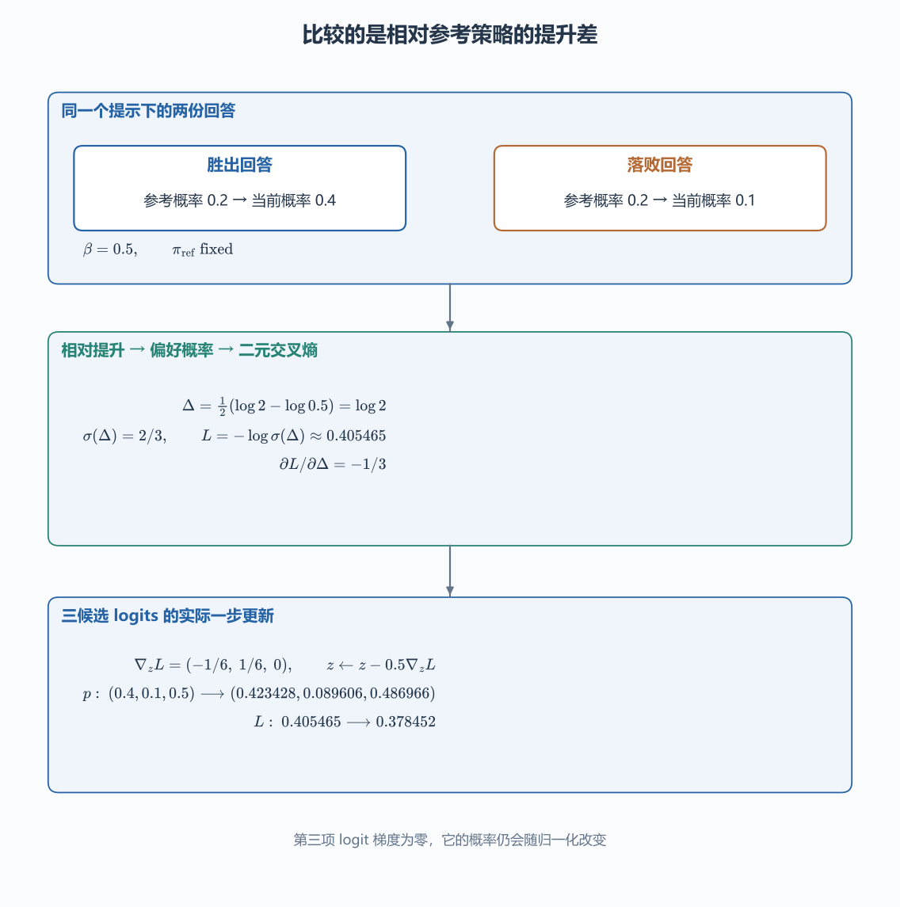

### 4. 从 KL 约束到偏好概率

初学 DPO 的人往往会觉得奇怪：传统的强化学习对齐（RLHF）明明需要先拿成对偏好数据训练一个专门给回答打分的奖励模型（Reward Model），然后再拿这个奖励模型去跑复杂的 PPO 采样更新；为什么 DPO 仅仅靠上面那个对数概率差 $\Delta$，就把显式的奖励模型和强化学习采样全给省掉了？

这绝不是拍脑袋凑出来的经验公式，而是从一个**带 KL 散度正则约束的期望奖励最大化问题**严密推导出来的闭合解（参见 [DPO 原论文附录 A](https://arxiv.org/html/2305.18290v2#A1)）。我们不妨亲手把这条推导链从头走一遍。

先固定提示词 $x$，把所有可能的回答临时看作一个有限集合。假设每一个回答 $y$ 都有一个潜藏的真实奖励值 $r_y$，且冻结的参考策略赋给它的概率为 $q_y>0$。在强化学习阶段，我们的目标是寻找一组新的回答概率分布 $\{p_y\}$，既让期望奖励 $\sum_y p_y r_y$ 尽可能高，又用系数为 $\beta>0$ 的 KL 散度惩罚它偏离参考分布 $q_y$ 的行为，同时满足所有回答的概率加起来等于 $1$：

$$
\max_{\{p_y\}}\left[
\sum_y p_y r_y-\beta\sum_y p_y\log\frac{p_y}{q_y}
\right],
\qquad \sum_y p_y=1.
$$

为了求解这个带等式约束的极值问题，我们引入拉格朗日乘子 $\lambda$，把约束条件 $\sum_y p_y - 1 = 0$ 并入目标，构造拉格朗日函数 $\mathcal J$：

$$
\mathcal J
=\sum_y p_y r_y
-\beta\sum_y p_y\log\frac{p_y}{q_y}
+\lambda\left(\sum_y p_y-1\right).
$$

现在，拿 $\mathcal J$ 对任意一个回答的概率变量 $p_y$ 求偏导数（注意利用乘积求导法则：$(p_y\log\frac{p_y}{q_y})' = 1\cdot\log\frac{p_y}{q_y} + p_y\cdot\frac{1}{p_y} = \log\frac{p_y}{q_y} + 1$），并令偏导数等于零：

$$
\frac{\partial\mathcal J}{\partial p_y}
=r_y-\beta\left(\log\frac{p_y}{q_y}+1\right)+\lambda=0.
$$

怎么确认这个导数为零的驻点一定是最大值而不是最小值或鞍点？只需再求一次二阶偏导数：在每一个正概率 $p_y>0$ 处，对自身的二阶偏导数为 $\frac{\partial^2\mathcal J}{\partial p_y^2} = -\frac{\beta}{p_y} < 0$，且不同回答概率之间的交叉二阶偏导数全为零。这证明海森（Hessian）矩阵是严格负定的，目标函数在总和为 $1$ 的可行概率单纯形上是严格凹函数，因此上面这个一阶驻点方程解出来的就是**唯一的全局最大值点 $p_y^*$**！

我们把上面的一阶方程移项整理：$\log\frac{p_y^*}{q_y} = \frac{r_y}{\beta} + \frac{\lambda}{\beta} - 1$，两边同时取指数后得到 $p_y^* = q_y e^{r_y/\beta}\cdot e^{\lambda/\beta - 1}$。由于后面那个因子 $e^{\lambda/\beta - 1}$ 跟具体是哪个回答 $y$ 无关，只负责让所有 $p_y^*$ 加起来等于 $1$，我们把它改写为归一化配分函数（Partition Function）$Z(x)$ 的倒数，就得到了最优策略分布 $p_y^*$ 与奖励 $r_y$ 之间的精确关系：

$$
p_y^*=\frac{q_y e^{r_y/\beta}}{Z(x)},
\qquad
Z(x)=\sum_y q_y e^{r_y/\beta}.
$$

如果正着看上面这个式子，要想算出 $p_y^*$，就得先遍历全宇宙所有可能的回答去求分母 $Z(x)$，这在大模型词表空间里是根本算不出来的。但 DPO 的作者做了一步极漂亮的逆向操作——**把等式倒过来，用最优分布 $p_y^*$ 和参考分布 $q_y$ 来反解奖励值 $r_y$**：

$$
r_y=\beta\log\frac{p_y^*}{q_y}+\beta\log Z(x).
$$

你看，任何一套奖励函数 $r_y$，都可以唯一地表示为“它所诱导出的最优策略 $p_y^*$ 与参考策略 $q_y$ 的对数概率比”，再加上一个只与提示词 $x$ 有关的常数项 $\beta\log Z(x)$！

接下来，把它代入衡量成对偏好胜率的 Bradley–Terry 模型：对于同一个提示 $x$ 下的两份回答 $y^+$ 和 $y^-$，人类偏好标注判 $y^+$ 获胜的概率，取决于两份回答的**真实奖励之差**经过 Sigmoid 映射后的值，即 $P(y^+\succ y^-\mid x) = \sigma(r_+ - r_-)$。当我们把刚才反解出来的 $r_+$ 和 $r_-$ 代入做减法时，奇迹发生了：

$$
r_+ - r_-
=\left[\beta\log\frac{p_+^*}{q_+}+\beta\log Z(x)\right]
-\left[\beta\log\frac{p_-^*}{q_-}+\beta\log Z(x)\right]
=\beta\left(\log\frac{p_+^*}{q_+}-\log\frac{p_-^*}{q_-}\right).
$$

因为两份回答属于同一个提示 $x$，那个原本根本没法算出来的棘手配分函数项 $\beta\log Z(x)$，**在一加一减之间抵消得干干净净**！最后，我们直接用正在训练的语言模型策略 $\pi_\theta$ 去参数化代替式中的 $p^*$，用冻结的 $\pi_{\rm ref}$ 代替 $q$，右边不就一字不差地变成了第 2 小节定义的 $\Delta = \beta(a^+ - a^-)$ 吗！

看懂了这条包含“KL 正则优化目标 $\rightarrow$ 最优策略反解奖励 $\rightarrow$ Bradley–Terry 成对相减消去 $Z(x)$”三步条件的推导链，你就彻底明白了 DPO 的底牌：它并不是抛弃了奖励与强化学习，而是利用成对比较抵消归一化分母的性质，把原本需要分两阶段近似求解的强化学习问题，直接转化成了固定偏好数据集上的精确可导损失（参见[作者开源参考实现](https://github.com/eric-mitchell/direct-preference-optimization)）。

### 5. TinyLM 的偏好更新

我们回到 `TinyLM` 上验证这段过程：以第一节刚完成 60 步 SFT 的模型为起点，先复制并冻结一份作为参考策略 $\pi_{\rm ref}$；接着针对提示 `Q:a\nA:` 录入偏好对“`b` 胜于 `c`”，针对提示 `Q:c\nA:` 录入偏好对“`d` 胜于 `e`”。取 $\beta=0.5$，用 SGD（学习率 $0.005$）更新当前模型 30 步。

实测记录清晰地展现了每一步的变化：由于起步时当前模型与参考模型完全相同（$\Delta=0$），第 1 批更新前的起始损失正好是 $\log 2 \approx 0.693147$；到第 30 批更新前，损失一路降到了约 $0.008828$，而参考模型的全部参数逐项保持原样未变。

但如果我们把两条样本上“胜出回答与落败回答各自的序列对数概率 $(\ell_\theta^+, \ell_\theta^-)$”在更新前后的数值调出来对比，就会发现一个非常值得深思的现象：
* 第一条样本（`b` 胜于 `c`）的对数概率，从更新前的约 $(0,\ -48.087173)$ 变成了更新后的 $(0,\ -57.432655)$；
* 第二条样本（`d` 胜于 `e`）的对数概率，从更新前的约 $(0,\ -44.705318)$ 变成了更新后的 $(0,\ -54.413372)$。

为什么胜出回答 `b` 和 `d` 的对数概率从头到尾都停在 `0` 纹丝不动，而 DPO 损失却能从 `0.693` 降到 `0.0088`？
原因很简单：前面的 60 步 SFT 已经把胜出回答 `b` 和 `d` 的预测概率推到了 `float32` 浮点精度的上限（概率约为 $1$，对数概率显示为 $0$），已经涨无可涨了；于是 DPO 为了继续拉大相对提升差 $\Delta = \beta(a^+ - a^-)$，就把全部火力都倾斜到了减号后面的 $a^-$ 上——拼命把被拒绝的落败字节 `c` 和 `e` 的对数概率从 `-48`、`-44` 继续往 `-57`、`-54` 的深渊里狠踩！

这组实测数据给我们上了一堂生动的工程课：**在训练日志里看到 DPO 偏好损失一路丝滑下降，绝对不能直接拿来充当“模型学到了更多业务知识”或者“好回答的生成质量又提高了”的证据**——它完全可能只是在保持好回答不变甚至略有波动的同时，拼命压低那几个特定负样本的概率。后训练效果究竟如何，永远要回到具体生成出来的文本、偏好评判标准以及未参与训练的独立评测任务上去核验。

## （三）奖励、轨迹与 PPO

### 1. 从回答评分到动作轨迹

在 SFT 中，我们喂给模型的是事先写好的示范文本；在 DPO 中，我们喂给模型的是事先配好对的静态回答。但这两种方式都有一个共同的局限：模型从头到尾都只是在被动地给现成的文本算概率，从来没有在训练循环里**自己动手把整段话写出来、去撞一撞外部世界的真实反馈**。

而在数学解题、代码生成或工具调用任务中，我们手里往往握着一个确定性的自动裁判（比如跑一遍单元测试、用编译器检查语法、或者核对最终方程的数值解）。这时候，最直接的训练思路就是：让当前模型自己下场采样生成一段完整的回答，把它交给外部裁判拿到一个奖励分数，然后根据这次真实的试错结果反过来更新模型参数——这就是基于动作轨迹的强化学习后训练（以 **[PPO，近端策略优化](https://arxiv.org/abs/1707.06347)** 为代表）。

把第四篇的自回归文本生成放进强化学习的语言体系里，每一个概念都能严丝合缝地对上号：
在生成的第 $t$ 步，用户给定的初始提示词加上模型此前已经生成出来的文本前缀，合在一起就是当前的**状态（State）$s_t$**；模型从词表里挑出来的下一个 Token 编号，就是这一步执行的**动作（Action）$a_t$**；而第四篇模型在前向计算最后一行输出的词表条件概率分布，就是当前的**策略（Policy）$\pi_\theta(a_t\mid s_t)$**。每当选出一个动作 $a_t$ 并把它追加到前缀末尾，系统就确定性地转移到了下一个状态 $s_{t+1}$。从初始提示 $s_0$ 出发，一步步选词直到触发结束条件到达终止状态 $s_T$，这整条过程就构成了一条**轨迹（Trajectory）$\tau$**：

$$
\tau=(s_0,a_0,r_0,s_1,a_1,r_1,\ldots,s_T).
$$

式中的 $r_t$ 是执行完动作 $a_t$ 后拿到的即时奖励。在语言模型任务里，无论是用人工偏好训出来的奖励模型（Reward Model），还是检查代码能不能跑通的测试脚本，通常都要等模型把整段话全部写完，才在最后一步 $r_{T-1}$ 给出一个总评分数，而前面中间各个步骤的即时奖励 $r_0, r_1, \ldots, r_{T-2}$ 通常全都是零。

既然只有最后一步才发总分，前面第 $t$ 步选出的那个字到底该分到多少功劳或责任？我们引入折扣因子 $\gamma\in[0,1]$ 来控制未来奖励折算回当前的权重，定义从位置 $t$ 开始往后累积的**折扣回报（Return）$G_t$**：

$$
G_t=\sum_{u=t}^{T-1}\gamma^{u-t}r_u.
$$

拿一条只有三步动作的极简轨迹来算：假设三步拿到的即时奖励分别是 $(0, 0, 1)$（前两步没分，最后一步拿了满分 $1$），如果取折扣因子 $\gamma=0.9$，那么从后往前算，第三步（$t=2$）的回报是 $1$，第二步（$t=1$）隔了一步打九折变成 $0.9\times 1 = 0.9$，第一步（$t=0$）隔了两步变成 $0.9^2\times 1 = 0.81$，三步的回报向量就是 $(0.81, 0.9, 1)$。越早做出的动作距离最终结果越远，吃的折扣就越多；如果任务只看重最终整段回答的对错、不希望因为句子长就给开头的字打折，直接取 $\gamma=1$ 即可。

在动手推导更新公式之前，必须先把三个概念在物理上彻底分清：**奖励（Reward）**是由外部评价规则算出来的一个冷冰冰的数字（比如单元测试通过给 `1`、失败给 `0`）；**概率（Probability）**是由当前模型前向传播算出来的分布；而**梯度（Gradient）**则是必须通过一个可微的目标函数把概率和奖励连接起来之后，对模型参数求导才能得到的东西。外部裁判给出一个数字 `1`，绝不会自动变成模型里某张权重矩阵的改变量。

三种后训练方式可以沿“这次更新拿到了什么反馈”并排比较。对同一个“$2+3$ 等于几”的提示，SFT 可以直接拿回答“5”作示范，DPO 可以拿“5 胜于 6”这对比较作偏好，而 PPO 路径要让策略采样，再让评价规则给这次生成评分。图中刻意把反馈对象与参数更新分开：示范、比较和奖励都要先进入相应的训练目标，反向传播才会产生参数梯度。仅仅把裁判分数写进日志，不会自动改变下一次生成所用的权重。

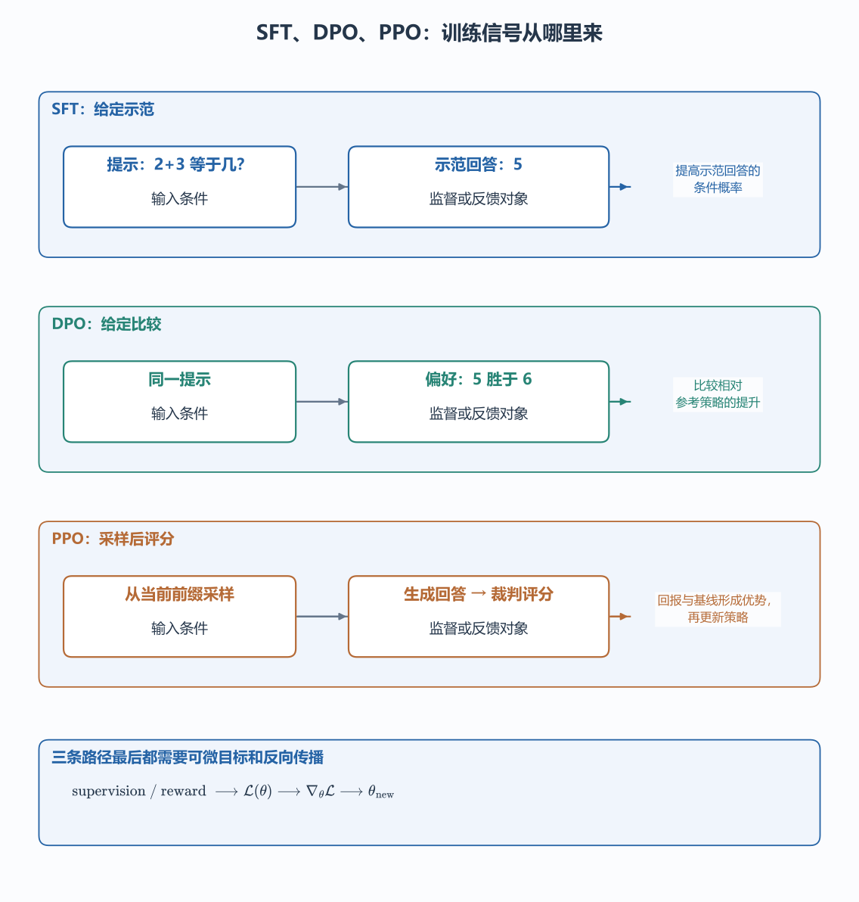

### 2. 价值基线与优势估计

光算出每一步的回报 $G_t$，还不足以直接拿来指导参数更新。为什么？设想模型面对两道难度天差地别的题目：第一道是极简单的常识题，模型平时闭着眼睛答十次有九次都能拿满分，这次某条采样拿了 $0.8$ 分，其实算发挥失常；第二道是极难的竞赛题，模型平时十次有九次都得零分，这次某条采样居然拿到了 $0.8$ 分，这属于千载难逢的超常发挥！如果你只看绝对回报 $G_t$ 的大小，这两次采样拿的都是 $0.8$ 分，毫无区别。

为了让模型分清“这一步动作带来的回报，到底是高于平时的平均预期、还是低于平均预期”，我们引入一个参数为 $\phi$ 的**价值函数（Value Function）$V_\phi(s_t)$**，专门用来预测从当前状态 $s_t$ 出发，按当前策略往下走平均能拿到多少期望回报（在工程实现上，$V_\phi$ 可以是一个独立的网络，也可以在语言模型主干的最后一层隐藏表示上另接一个输出宽度为 $1$ 的线性标量头）。

有了这个预测平均水平的价值基线 $V_\phi(s_t)$，我们拿本次采样实际拿到的回报 $G_t$ 减去预测基线 $V_\phi(s_t)$，算出来的差值就叫做**优势估计（Advantage Estimate）$\widehat A_t$**：

$$
\widehat A_t=G_t-V_\phi(s_t).
$$

优势 $\widehat A_t > 0$ 说明这一步动作的实际结果好于当前预期，应当提高它的概率；$\widehat A_t < 0$ 则说明差于预期，应当压低它的概率。对刚才那条回报为 $(0.81, 0.9, 1)$ 的三步轨迹，假设价值函数对这三个状态给出的预测基线分别是 $(0.4, 0.5, 0.6)$，按位相减立刻得到三步的优势估计：

$$
\widehat{\mathbf A}=(0.81-0.4,\ 0.9-0.5,\ 1-0.6)
=(0.41,0.4,0.4).
$$

现在解决最核心的数学问题：**外部裁判给出的评分是没有导数的，怎么把它和模型的参数梯度接上头？为什么减去一个状态价值基线不会把梯度方向搞偏？**
我们先在一个动作就结束的单步任务上，把这条连接通道完整推导出来。设在固定状态下，选出动作 $a$ 能拿到的外部评分为 $R(a)$，那么当前策略 $\pi_\theta$ 能拿到的期望总评分就是 $J(\theta)=\sum_a \pi_\theta(a) R(a)$。因为外部评分规则 $R(a)$ 不含模型参数 $\theta$，求导算子 $\nabla_\theta$ 直接作用在概率 $\pi_\theta(a)$ 上；利用微积分里复合对数求导的恒等变换 $\nabla_\theta\log\pi_\theta(a) = \frac{\nabla_\theta\pi_\theta(a)}{\pi_\theta(a)}$（即 $\nabla_\theta\pi_\theta(a) = \pi_\theta(a)\nabla_\theta\log\pi_\theta(a)$），期望得分的梯度瞬间化为：

$$
\nabla_\theta J
=\sum_a\nabla_\theta\pi_\theta(a)R(a)
=\sum_a\pi_\theta(a)R(a)\nabla_\theta\log\pi_\theta(a).
$$

请看等号最右边：$\sum_a \pi_\theta(a)[\cdots]$ 正好就是按当前策略分布抽样动作 $a$ 求数学期望的定义！也就是说，我们根本不需要把词表里所有可能的回答全穷举出来求和，只需要按当前策略采样出动作 $a$，拿它拿到的外部得分 $R(a)$ 去乘以该动作的对数概率梯度 $\nabla_\theta\log\pi_\theta(a)$，就能无偏地估计出提升期望奖励的梯度方向！

更妙的是，如果在外部得分 $R(a)$ 里减去任意一个只依赖当前状态、不随本步所选动作 $a$ 改变的基线常数 $b$（比如价值函数的预测值 $V(s)$），减掉的这一项对期望梯度的贡献是多少？我们把它单独拎出来算一算：

$$
\sum_a\pi_\theta(a)b\nabla_\theta\log\pi_\theta(a)
=b\sum_a\nabla_\theta\pi_\theta(a)
=b\nabla_\theta\left(\sum_a\pi_\theta(a)\right)
=b\nabla_\theta 1=0.
$$

因为无论参数 $\theta$ 怎么改，所有候选动作的概率加起来永远等于常数 $1$，而常数 $1$ 的导数严格等于 $0$！这就从数学上铁板钉钉地证明了：**在得分里减去同状态的价值基线，期望梯度的方向分毫不变，却能把奖励的共同偏移消掉，让抽样梯度不再忽大忽小剧烈抖动。** 推广到多步轨迹时，整条轨迹的概率是各步动作条件概率的连乘积，取对数后变成各步对数概率之和，回报与优势估计承担的正是把后续结果分配回当前动作的信用分配（Credit Assignment）职责。

至于那个用来提供基线的价值函数 $V_\phi(s_t)$ 自己怎么学习？直接把本次采样算出来的真实回报 $G_t$ 当作回归标签，最小化均方误差损失即可（设本批次共有 $N$ 个有效动作步）：

$$
L_V=\frac{1}{2N}\sum_t\left(V_\phi(s_t)-G_t\right)^2.
$$

注意在写代码时有一条严格的隔离纪律：当用优势 $\widehat A_t$ 去更新策略参数 $\theta$ 时，已经算出来的 $\widehat A_t$ 必须用 `.detach()` 剥离计算图、当作固定不变的常数权重处理，绝不能允许策略损失的梯度顺着 $\widehat A_t = G_t - V_\phi(s_t)$ 倒流回去修改价值函数 $\phi$——否则模型就会学会通过恶意调高价值基线来伪造负优势，靠自欺欺人来降低损失！

在实际的 PPO 工业级实现中，如果完全等到整条长轨迹结束才用真实回报 $G_t$ 减 $V_\phi(s_t)$，中间跨越几十上百步累积起来的随机波动依然很大；如果只用走一步的即时奖励加下一步价值预测 $r_t + \gamma V_\phi(s_{t+1})$ 减 $V_\phi(s_t)$，又容易受价值函数初期不准的偏差影响。为了在这两头之间自由调节，PPO 普遍采用**广义优势估计（Generalized Advantage Estimation，简称 GAE）**。

它的算账步骤分为两步：
第一步，先算出每一个位置 $t$ 的**单步时序差分残差（TD Residual）$\delta_t$**：

$$
\delta_t=r_t+\gamma V_\phi(s_{t+1})-V_\phi(s_t).
$$

（注意边界处理：如果 $s_{t+1}$ 是整段回答正常结束的真实终止状态，它后面不再有任何后续奖励，因此真实终止状态的后继价值固定为 $V_\phi(s_T)=0$；但如果只是因为达到了采样最大长度而被半路截断、任务本身并未真正完结，则应当保留末状态的价值估计读数作为引导。）

第二步，引入平滑衰减系数 $\lambda\in[0,1]$（注意它专门用来控制多步残差的混合比例，与前面给奖励打折的 $\gamma$ 各司其职），把从第 $t$ 步往后的所有单步残差按 $(\gamma\lambda)^l$ 加权累加起来：

$$
\widehat A_t^{\rm GAE}
=\sum_{l=0}^{T-1-t}(\gamma\lambda)^l\delta_{t+l}.
$$

我们拿刚才那条三步轨迹的数字（即时奖励 $r=(0,0,1)$，价值预测 $V=(0.4,0.5,0.6)$，末状态真实终止 $V(s_3)=0$，$\gamma=0.9$），再取 $\lambda=0.8$（于是每往后一步的组合衰减因子为 $\gamma\lambda = 0.9\times 0.8 = 0.72$），亲手把 GAE 的每一个数算出来：
* 先算三步的单步残差 $\boldsymbol\delta$：
  $\delta_0 = 0 + 0.9\times 0.5 - 0.4 = 0.05$；
  $\delta_1 = 0 + 0.9\times 0.6 - 0.5 = 0.04$；
  $\delta_2 = 1 + 0.9\times 0 - 0.6 = 0.4$；
* 再从最后一步往前递推累加 $\widehat{\mathbf A}^{\rm GAE}$（利用递推式 $\widehat A_t^{\rm GAE} = \delta_t + \gamma\lambda\widehat A_{t+1}^{\rm GAE}$）：
  最后一步（$t=2$）：就是 $\delta_2 = 0.4$；
  倒数第二步（$t=1$）：$\delta_1 + 0.72\times 0.4 = 0.04 + 0.288 = 0.328$；
  第一步（$t=0$）：$\delta_0 + 0.72\times 0.328 = 0.05 + 0.23616 = 0.28616$：

$$
\boldsymbol\delta=(0.05,0.04,0.4),\qquad
\widehat{\mathbf A}^{\rm GAE}=(0.28616,0.328,0.4).
$$

你可以顺手检验一个极端情况：如果把 $\lambda$ 设成 $1$（且末状态后继价值为零），把 $\delta_t$ 展开相加时，中间所有的 $\gamma V_\phi(s_{t+1})$ 和下一项的 $-\gamma V_\phi(s_{t+1})$ 刚好首尾相消，整串 GAE 公式就一字不差地退化回了我们开头写的 $G_t - V_\phi(s_t)$！

### 3. 旧策略、当前策略与参考策略

在自回归语言模型里，让模型一个字一个字地往外采样生成一批轨迹，是整个强化学习流程中最耗时的步骤。如果辛辛苦苦采样出一批轨迹，只做一步梯度下降就把这批数据扔掉重新采样，算力利用率就太低了；我们自然希望**采样一次轨迹，能拿着这批数据连续跑好几轮（Epochs）梯度更新**。

但这样一来，从第二轮更新开始，正在被优化器修改的**当前策略 $\pi_\theta$** 就已经不再是当初生出这批轨迹的那个策略了。为了能用当时采样出来的旧轨迹继续评估当前策略的更新方向，我们在采样开始前先固定一份当时的策略快照，称为**旧策略（Old Policy）$\pi_{\rm old}$**，并把它在采样时赋给每个所选动作的对数概率 $\log\pi_{\rm old}(a_t\mid s_t)$ 存下来。在随后的多轮梯度更新中，当前策略 $\pi_\theta$ 重新计算同一批动作的对数概率，与存下来的旧对数概率相减并取指数，构成**概率比（Probability Ratio）$\rho_t(\theta)$**：

$$
\rho_t(\theta)=
\frac{\pi_\theta(a_t\mid s_t)}
{\pi_{\rm old}(a_t\mid s_t)}
=\exp\left(\log\pi_\theta(a_t\mid s_t)
-\log\pi_{\rm old}(a_t\mid s_t)\right).
$$

为什么要构造这个比值 $\rho_t(\theta)$？因为在固定状态 $s$ 下，利用重要性采样（Importance Sampling）恒等式，我们可以把对当前策略 $\pi_\theta$ 的期望改写成对旧策略 $\pi_{\rm old}$ 采样分布的期望：

$$
\sum_a\pi_\theta(a\mid s)A(s,a)
=\sum_a\pi_{\rm old}(a\mid s)
\frac{\pi_\theta(a\mid s)}{\pi_{\rm old}(a\mid s)}A(s,a).
$$

看清代码实现里的一条死规矩：**在针对同一批采样轨迹进行多轮更新的整个期间，分母上的 $\pi_{\rm old}$ 必须死死固定在采样那一刻的数值上，绝对不能每做一步梯度下降就把分母也刷新成最新的 $\pi_\theta$！** 如果你每更新一步就把分母改成跟分子一样的当前策略，那么比值 $\rho_t$ 每次都会在起跑线上被重置回 $1$，模型就彻底失去了“相对于本次采样起点，我已经把概率改出去多远了”的刹车标尺。

如果再算上我们在 DPO 里见过的、用来防止模型在成百上千步训练后彻底偏离初始语言能力的**参考策略 $\pi_{\rm ref}$**，在大模型 PPO 训练现场就会同时出现三份策略，它们固定不变的时间跨度与职责必须严格区分：

| 策略对象 | 何时固定不变 | 在 PPO 后训练中的核心职责 |
| --- | --- | --- |
| **当前策略 $\pi_\theta$** | 不固定，每走一步梯度更新都会改变 | 实时计算当前动作概率并接收反向传播梯度 |
| **旧策略 $\pi_{\rm old}$** | 在**当前这一批采样及其随后的几轮更新期间**固定；下一批重新采样时刷新 | 提供采样当时的基准动作概率，充当概率比 $\rho_t(\theta)$ 的分母 |
| **参考策略 $\pi_{\rm ref}$** | 在**整个强化学习阶段**从头到尾锁死在初始 SFT 模型上，永不刷新 | 充当全局 KL 散度正则项的锚点，抑制模型长期跑偏或钻空子失语 |

把三份策略沿时间排开，能直接检查分母是否被错误刷新。下图固定同一个状态 $s$ 和动作 $a$，用一组示意概率表示两批采样之间的变化：当前概率从 $0.5$ 变成 $0.6$、$0.7$，批次 A 的旧概率仍为 $0.5$，因此概率比依次为 $1$、$1.2$、$1.4$。开始批次 B 时，旧策略才刷新到此时的当前策略，起点比值回到 $1$；参考策略依然保留初始概率 $0.5$。这些数用于追踪刷新时机，并非某次训练的测量结果。

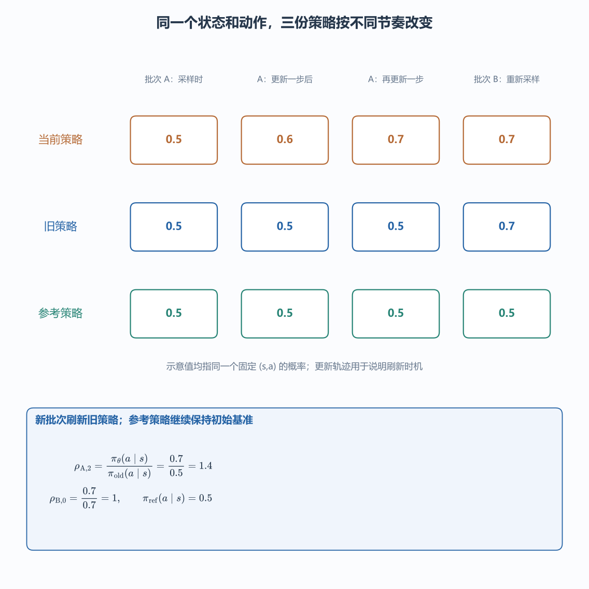

### 4. 正负优势与双向截断

有了概率比 $\rho_t(\theta)$ 和优势估计 $\widehat A_t$，最朴素的代理目标就是直接最大化它们的乘积 $\rho_t\widehat A_t$：当优势 $\widehat A_t > 0$ 时推高比值 $\rho_t$，当优势 $\widehat A_t < 0$ 时压低比值 $\rho_t$。
但正如前面所担心的，在同一批旧数据上连跑好几步更新时，如果不加任何护栏，优化器很容易把某个正优势动作的概率比 $\rho_t$ 推到五倍、十倍，或者把某个负优势动作的概率比一把踩到零。一旦新旧策略差距拉得太大，刚才那个建立在“新旧策略还比较接近”前提下的局部代理评估就会彻底失效，导致模型一步迈大而全盘崩溃。

为了给步子装上限位器，**[PPO-Clip](https://arxiv.org/abs/1707.06347)** 把单步代理目标改成了“未截断项”与“截断后项”两者的**最小值**（设截断半径为 $\varepsilon>0$，通常取 $\varepsilon=0.2$；对批次求平均后最大化，若用梯度下降优化器则最小化相反数 $-\frac1N\sum_t g_t$）：

$$
g_t(\theta)=\min\left(
\rho_t\widehat A_t,\ 
\operatorname{clip}(\rho_t,1-\varepsilon,1+\varepsilon)
\widehat A_t
\right).
$$

首先看清代码结构：`clip` 函数只出现在目标函数的第二条计算分支里，用来构造保守的损失曲线，**并没有去直接修改或截断模型前向输出的概率分布本身**。

其次，为什么要把未截断项和截断项放在一起取**最小值 $\min$**（而不是直接对 $\rho_t$ 套一个 `clip` 就完事）？这是整个 PPO 公式最精妙的地方——取 $\min$ 相当于是按“悲观下界”算账，它能同时在**正优势的上端**和**负优势的下端**精准踩下刹车，而在越界跑反时依然保留往回拉的梯度！我们取 $\varepsilon=0.2$（即区间 $[0.8, 1.2]$），把正负两种优势拆开来看：

**第一种情况：当优势为正（如 $\widehat A_t = +1$）时**，我们希望调高这个好动作的概率（让 $\rho$ 往大于 $1$ 的方向涨）。代入公式，在 $\rho>0$ 上取 $\min(\rho,\ \operatorname{clip}(\rho, 0.8, 1.2))$，分段写出来就是：

$$
g_+(\rho)=
\begin{cases}
\rho,&\rho\le1.2,\\
1.2,&\rho>1.2.
\end{cases}
$$

* 当 $\rho$ 已经涨过了上限 $1.2$（比如涨到了 $1.5$），未截断项是 $1.5$，截断分支是 $1.2$，取 $\min$ 后目标函数被死死按在天花板 $1.2$ 上变成了一条水平线！此时对 $\rho$ 的导数变成了 $0$，继续盲目拔高这项概率不再带来一分钱的额外代理收益，成功刹住了车；
* 但反过来，如果因为同批次其他样本梯度的牵连，导致这个好动作的概率比反而误跌到了 $0.6$（$<0.8$），请注意看：未截断项是 $0.6$，截断分支是 $0.8$，**取 $\min(0.6, 0.8)$ 选中的是未截断的 $0.6$**！因此在 $\rho=0.6$ 处目标函数并没有变平，导数依然是 $+1$，优化器会立刻发力把这个好动作的概率往回拉！（要是当初不取 $\min$ 而是无脑直接用 `clip` 分支，那么在 $\rho=0.6$ 处也会变平失去梯度，好动作跌下去了就再也拉不回来了！）

**第二种情况：当优势为负（如 $\widehat A_t = -1$）时**，这是个差动作，我们希望压低它的概率（让 $\rho$ 往小于 $1$ 的方向降）。注意：因为乘上了负数 $-1$，原本比大小的方向彻底颠倒了！取 $\min(-\rho,\ -\operatorname{clip}(\rho, 0.8, 1.2))$，分段写出来是：

$$
g_-(\rho)=
\begin{cases}
-0.8,&\rho<0.8,\\
-\rho,&\rho\ge0.8.
\end{cases}
$$

* 当差动作的概率已经被压到了下限 $0.8$ 倍以下（比如压到了 $0.6$），未截断项是 $-0.6$，截断分支是 $-0.8$，取 $\min(-0.6, -0.8)$ 选中的是更小的常数 $-0.8$！目标函数在下端变平，导数归零，不再给把差动作往死里踩提供额外收益；
* 但如果这个差动作的概率比非但没降、反而逆势涨到了 $1.5$，此时未截断项是 $-1.5$，截断分支是 $-1.2$，**取 $\min(-1.5, -1.2)$ 选中的是未截断的 $-1.5$**！导数依然保持为 $-1$，优化器照样保留全额纠正力道把它往下压！

把这四个典型点列在一张表里核对（代码实跑结果完全一致）：

| 优势 $\widehat A_t$ | 概率比 $\rho_t$ | 未截断项 $\rho_t\widehat A_t$ | 截断分支 $\operatorname{clip}(\rho_t)\widehat A_t$ | 取最小值后的目标 $g_t$ | 目标对 $\rho_t$ 的导数 |
| ---: | ---: | ---: | ---: | ---: | ---: |
| $+1$ | $0.6$ | $0.6$ | $0.8$ | $0.6$ | $+1$（好动作误跌，保留拉回梯度） |
| $+1$ | $1.5$ | $1.5$ | $1.2$ | $1.2$ | $0$（好动作已超上限，封顶刹车） |
| $-1$ | $0.6$ | $-0.6$ | $-0.8$ | $-0.8$ | $0$（差动作已破下限，触底刹车） |
| $-1$ | $1.5$ | $-1.5$ | $-1.2$ | $-1.5$ | $-1$（差动作逆势上涨，保留打压梯度） |

~~~python
import torch

for advantage in [1., -1.]:
    for number in [.6, 1., 1.5]:
        ratio = torch.tensor(number, requires_grad=True)
        first = ratio * advantage
        second = ratio.clamp(.8, 1.2) * advantage
        objective = torch.minimum(first, second)
        objective.backward()
        print(advantage, number, objective.item(), ratio.grad.item())
~~~

你看，正优势曲线的平坦端在右上方（$\rho>1.2$），负优势曲线的平坦端在左下方（$\rho<0.8$）；如果只画正优势一边的图，就会漏掉负优势下限刹车的另一半机制（参见 [Spinning Up 的 PPO 拆解](https://spinningup.openai.com/en/latest/algorithms/ppo.html)）。还要注意一点：单看某一个动作在 $\rho=1.5$ 处导数归零了，并不代表整批更新完它的概率比就绝对锁死在 $[0.8, 1.2]$ 之内——因为神经网络的参数是所有状态和动作共享的，同批次里其他未饱和动作产生的梯度依然会连带修改共享参数。

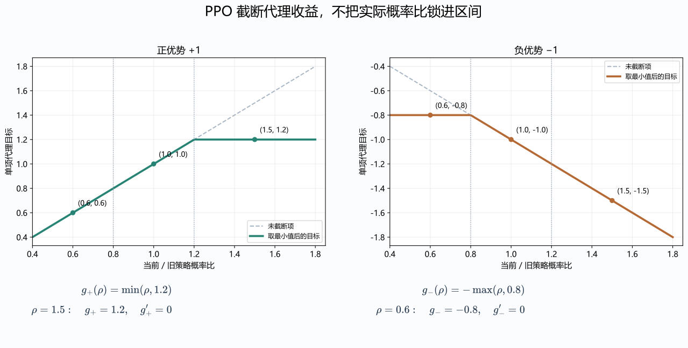

### 5. 一次 PPO 更新

为了不让 PPO 只停留在静态公式代入上，配套代码中的 `ppo_bandit` 跑通了一个包含真实采样、奖励获取、价值基线回归、旧策略快照与多轮截断更新的完整闭环：
设单个状态下有两个候选动作（动作 0 奖励为 $1$，动作 1 奖励为 $0$），策略由两个可训练 logits 归一化得到，价值函数由一个可训练标量表示。每一批先按当时的旧策略实打实抽样 64 个动作，存下当时的旧对数概率与实际拿到的奖励，用“实际奖励减去采样时的价值预测”算出优势；接着拿着这同一批 64 条样本连续执行 4 轮 PPO 截断更新（策略用 SGD 学习率 $0.4$，价值用 SGD 学习率 $0.2$），更新完 4 轮后才刷新旧策略进入下一批采样。为了同时观察参考策略约束，损失里还加入了对初始均匀分布 $\pi_{\rm ref}=(0.5, 0.5)$ 的精确 KL 散度惩罚项：

$$
L_\pi=-\frac1N\sum_tg_t
+\kappa D_{\rm KL}(\pi_\theta\Vert\pi_{\rm ref}),
\qquad\kappa=0.02.
$$

固定随机种子 `17` 连续跑完 20 个采样批次后，正确动作 0 的选择概率从最初的 $0.5$ 稳步提升到了约 $0.976260$，动作 1 降到了约 $0.023740$，价值函数的预测值也同步逼近了真实期望回报。当把这套闭环放大到语言模型时，只需把状态换成文本前缀、把动作换成词表 Token 编号，底层的概率比与截断反传遵循的是完全相同的代数关系。

### 6. 奖励漏洞与 KL 约束

在用强化学习优化大模型时，工程上最头疼的隐患是**奖励漏洞（Reward Hacking）**——也就是模型发现了评分规则里的漏洞，靠投机取巧骗取高分。
举个例子：计算 $17\times 23$ 的正确答案是 `391`。如果编写判题器的工程师图省事，只检查模型输出的字符串里包不包含子串 `"391"`，那么模型哪怕胡乱输出一个错误的 `"3911"`，或者干脆把三位数从 `100` 到 `999` 全背写一遍，也能在这个粗糙的判题器手里骗到满分 $1$！这时候你把 PPO 训练步数加得再多，也只会让模型更熟练地利用这个漏洞；唯一能根治它的办法，是把判题器改成严格解析最终答案数值并做精确相等判断。

更不要指望加在目标函数里的 KL 散度惩罚项能替你抓出这种作弊行为。我们可以算一笔极其简单的账：假设参考策略 $\pi_{\rm ref}$ 原本给某条“钻空子作弊回答”分配的概率是 $q_{\rm hack}=0.01$（给其余正常回答分配的总概率是 $0.99$）。经过强化学习后，模型学会了钻空子，把作弊回答的概率翻了一倍推高到 $p_{\rm hack}=0.02$（其余正常回答变为 $0.98$）。我们来算一下此时新旧分布之间的 KL 散度到底有多大：

$$
D_{\rm KL}(p\Vert q)
=0.98\log\frac{0.98}{0.99}
+0.02\log\frac{0.02}{0.01}
\approx -0.009949 + 0.013863
\approx0.003914.
$$

看这个数字 `0.003914`：作弊回答的出现概率已经实打实翻了一番，但全局 KL 散度却只有千分之三点九！为什么？因为 KL 散度衡量的是整张分布的宏观偏离程度，少数几个特定投机路径的概率翻倍，在全局求和里激不起多大的水花。KL 正则项只能防止模型整体崩溃失语，要防住奖励漏洞，必须靠严密的评价规则设计、生成轨迹抽检以及未参与训练的独立评测集。

## （四）推理草稿、思维链与回答风格

### 1. 中间步骤成为下一轮输入

让语言模型计算两位数乘法 $17\times23$，一种问法是要求它紧挨着等号一步直接吐出最终结果 `391`；另一种问法则是允许（或引导）它先把拆解计算的中间草稿一步步写出来：

~~~text
17*20=340
17*3=51
340+51=391
~~~

从第四篇拆解过的底层计算图来看，这两种生成方式在模型内部到底有什么区别？
当模型不急着一步报出总和，而是先把 `17*20=340` 和 `17*3=51` 作为具体的字节 Token 一个接一个输出到序列上之后，别忘了自回归生成循环的核心动作——**每选出一个新 Token，都会立刻把它追加回下一轮前向计算的输入前缀末尾**！于是，等到模型最后去预测总和 `391` 的那几个字节时，它眼前的输入前缀里已经明明白白地摆着 `340` 和 `51` 这两组数字了；此时模型内部的自注意力层只需要通过 $QK^\mathsf T/\sqrt{d_k}$ 回头读取这两个已经落字为安的中间结果，就能把原本需要一步跨过去的复杂两位数乘法，拆解成“先分别查表做两次简单乘法、再回头读取结果做一次加法”的分步接力。

这就是**[思维链（Chain of Thought，简称 CoT）](https://arxiv.org/abs/2201.11903)** 在计算图上能够直接核验的物理机制：模型的网络层数 $L$ 并没有因为多写了几行字而在纵向变深半层，每一次单步生成走的依然是第四篇那套“前向传播 $\rightarrow$ 选出下一项 $\rightarrow$ 追加到末尾 $\rightarrow$ 再次前向”的固定循环；但是，**每多生成 $T$ 个中间步骤 Token，系统就在时间轴（序列位置轴）上多执行了 $T$ 次串行的解码前向（累计走过了随 $TL$ 增长的 Transformer 块执行次数），并且把上一轮算出来的中间状态通过输出序列变成了下一轮注意力可直接读取的显式条件**。

注意在表述这个机制时要守住实事求是的科学边界：一次单步前向内部的多层非线性变换本来也能处理一定的组合关系，网络的物理层数 $L$ 与一道数学题的“逻辑推导步数”之间并没有机械的一一对应关系；写出中间草稿确实增加了串行计算轮数和可读的中间条件，但这并不等于把模型架构在物理上加深成了 $TL$ 层，更不能单凭草稿长度就直接断言“把任意问题的计算复杂度从指数级降成了多项式级”。

### 2. 草稿、检验与计算预算

把中间推理草稿写进输出序列里，在工程上立刻会触发两本必须算清的硬账：

第一本是**上下文窗口与解码延迟的预算账**。按本书 `TinyLM` 的 UTF-8 字节词表来数，直接输出最终答案 `391` 只占区区 `3` 个字节；而如果把分步草稿 `17*20=340;17*3=51;340+51=391` 完整写出来，一共要占掉 `28` 个字节！要知道，我们第四篇训练的 `TinyLM` 位置表上限一共才 $24$ 个位置，连这一行 $28$ 字节的草稿都装不下（换成真实大模型的 BPE 子词分词器后，也同样要按实际切出的 Token 数量重新记账）。在实际部署的系统里，用户的提示词长度、模型的中间草稿长度以及最终呈现的回答长度，全都在争夺同一个有限的上下文窗口和输出预算；KV Cache 虽然能省掉历史位置的重复投影计算，却省不掉每多吐一个草稿字所必须付出的串行解码步数与越来越长的键值读取开销。万一草稿写得太啰嗦，触发了滑动窗口裁剪，把最开头的题目条件或者前半截算出来的中间结论给挤出了窗口之外，后面的推理就会当场失去依据。

第二本是**草稿自身的错误传播账**。自回归模型对它自己写出来的草稿是没有天然免疫力的：假如模型在写第二步草稿时手滑算错，写成了 `17*3=41`，那么这个错误的 `41` 一旦被追加进输入前缀，在第三步的因果注意力看来，它就是板上钉钉的已知历史条件！哪怕模型在第三步极其认真地把加法算对了（写出 `340+41=381`），最终端出来的依然是一盘错菜。中间步骤的语言叙述听起来再通顺、格式再工整，也不会让那个算错的乘积自动变成真的。

在诸如 [DeepSeek-R1](https://github.com/deepseek-ai/DeepSeek-R1) 等现代推理模型的强化学习后训练中，之所以能让模型演化出有效的长链推理、自我验算甚至半路纠错行为，靠的是把数学、代码等可严格校验任务的奖励回报实打实地接到了整条生成轨迹上，通过成千上万次策略更新强化了那些真正能导向正确结果的推演路径；至于包裹在草稿外面的 `<think>...</think>` 标签本身，它只是一段方便外围程序切分显示区域的输入输出协议约定，既不会给模型凭空增加半层算力，也绝不能代替对中间步骤与最终答案的独立核验。

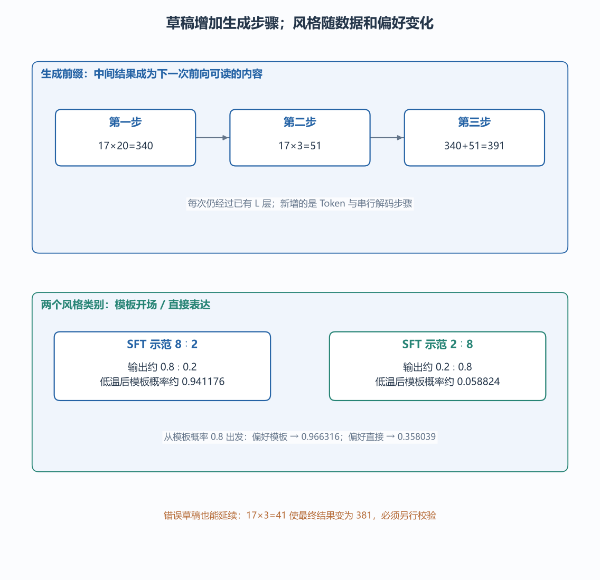

### 3. 训练信号与回答套话

除了影响解题草稿，SFT 和 DPO 这两道后训练工序还会直接塑造模型说话的腔调与行文习惯。比如平时大家用大模型写材料时，最容易撞见的就是一身浓重的“AI 套话口癖”——不管问什么问题，开头总爱先来一句“在当今快节奏的时代背景下……”，中间塞满“值得注意的是、需要指出的是”，结尾再来一句“综上所述，这不仅是一把双刃剑……”。

这种挥之不去的套话习惯，在数学上到底是怎么长进模型权重里去的？我们完全不需要去猜测什么玄学原因，只需建一个只有两个类别的极简概率模型，就能在代码里把它的形成与消除过程复现得一清二楚。

假设面对一项写作任务，开场方式只有两类：第一类是“在当今……”式的套话模板，模型赋给它的生成概率为 $p$；第二类是开门见山直接进入正文，概率为 $1-p$。如果在我们喂给模型的 SFT 训练示范样本里，带套话模板的样本占比为 $q$，直接表达的样本占比为 $1-q$，那么模型在这批示范数据上的平均交叉熵损失就是：

$$
L=-q\log p-(1-q)\log(1-p).
$$

拿损失 $L$ 对模型输出概率 $p$ 求导，并令导数等于零寻找极小值点：

$$
\frac{dL}{dp}=-\frac qp+\frac{1-q}{1-p}=0
\quad\Longrightarrow\quad p=q.
$$

（如果在模型里用一个标量 logit 分数 $z$ 通过 Sigmoid 来参数化概率 $p=\sigma(z)$，顺着链式法则乘上 $\sigma'(z)=p(1-p)$，损失对分数 $z$ 的导数就化简成了极其干净的 $\frac{dL}{dz} = p-q$！）
这个导数公式把话说透了：只要 $p \neq q$，梯度就会推着参数走，直到模型输出套话模板的概率 $p$ **精确等于训练示范数据里套话模板的占比 $q$** 为止！

我们在配套代码中直接跑一组对照实验：其他所有初始条件保持不变，第一组喂入“套话模板 8 条、直接表达 2 条（比例 $8\mathbin{:}2$，即 $q=0.8$）”，第二组反过来喂入“套话模板 2 条、直接表达 8 条（比例 $2\mathbin{:}8$，即 $q=0.2$）”，各自执行 100 步 SGD 更新。实测收敛出来的概率分布分毫不差地停在了示范比例上：

| SFT 训练示范比例（模板∶直接） | 训练后模型输出模板的概率 $p$ | 训练后直接表达的概率 $1-p$ |
| --- | ---: | ---: |
| 8∶2（$q=0.8$） | `0.799994` | `0.200006` |
| 2∶8（$q=0.2$） | `0.200006` | `0.799994` |

不仅 SFT 的示范比例会直接刻进概率，随后的 **DPO 偏好方向**同样能大幅扭转文风。我们从上面已经训成“模板概率占 $0.8$”的模型出发，把它冻结为参考策略 $\pi_{\rm ref}$：
* 如果在 DPO 成对比较中，偏好标签一贯把带套话模板的回答标为胜出（$y^+$），跑完相同步数的 DPO 更新后，模型输出套话模板的概率会被进一步从 $0.8$ 推高到约 **$0.966316$**；
* 反过来，如果偏好标签一贯把开门见山的直接回答标为胜出，完全相同的 DPO 损失函数就会把套话模板的概率从 $0.8$ 狠狠压低到约 **$0.358039$**！

这组实验说明，同一种交叉熵或 DPO 损失函数本身并没有偏爱套话的天性，它强化还是抑制某种文风，完全取决于数据里什么样本占多数、什么回答被标成了胜出（至于现实中某款商业大模型为什么在它的数据集里混入了高比例的模板套话，那是具体数据采集与评测流程的经验事实，不能单凭这个数学公式去凭空臆断某个特定外包团队的计件工资细则，那些结论需要各自独立的数据来源证据）。

### 4. 温度、约束与风格评价

除了训练阶段的数据比例与偏好方向，到了第四篇第六节讲过的**解码采样阶段**，调低采样温度 $\tau$ 又会对已经形成的风格偏好产生什么放大效应？

假设当前模型给“套话模板”和“直接表达”算出来的原始概率分别是 $(0.8, 0.2)$（即指数分数比例为 $0.8:0.2 = 4:1$）。如果应用层为了求稳，在解码时把温度系数降到了 $\tau=0.5$，由于除以 $0.5$ 等于把对数分数乘以 $2$，各项的指数比例就会直接变成平方关系：

$$
p_{\rm 模板}'=\frac{0.8^2}{0.8^2+0.2^2}
=\frac{0.64}{0.64+0.04}
=\frac{16}{17}\approx0.941176.
$$

你看，原本占 $80\%$ 的套话模板，在 $\tau=0.5$ 的低温采样下，实际被抽中的概率一下子飙升到了 $94.1\%$！但请注意，如果经过前面的数据清洗和偏好对齐，模型本身的原始分布已经扭转成了直接表达占优的 $(0.2, 0.8)$，那么同样把温度降到 $\tau=0.5$，套话模板的概率反而会被平方压制到只剩 $1/17 \approx 5.9\%$！这证明：**低温采样本身并不会凭空偏袒哪一种特定词汇，它的数学作用只是无情地放大当前概率分布里本来就已经占据优势的头号模式。**

把这几个环节串起来，当我们在实际工程中想要改造模型的回答文风时，就能清楚地分清每一招到底改在了哪一层：
1. **在提示词（Prompt）里给出具体的正反改写范例与禁用套话词表**：这改变的是本轮自回归前向计算的**上下文条件**，无需重新训练，但每轮都要占上下文预算；
2. **清洗 SFT 示范语料的文风比例、或在 DPO 中把干脆利落的回答标为胜出**：这直接修改了模型的**权重参数**，是从源头扭转先验分布；
3. **调整解码温度 $\tau$ 与 Top-$p$ 阈值**：这改变的是从当前已算出的分布里**抽取结果的方式**。
（顺带再提醒一句：如果用户只是在聊天窗口里批评了模型一句“别说套话”，而后台应用并没有把这次对话拿去跑 `backward()` 和 `step()`，那么改变的仅仅是下一轮对话拼进去的上下文前缀，模型的权重参数本身连半个浮点数都没有变。）

在验收文风改造的效果时，也不能光凭肉眼看两句觉得“顺眼了”就收工。应当固定同一批测试任务与事实要点清单，同时统计空泛开场出现率、高频连接词重复率、核心事实遗漏率、答案准确率以及回答平均长度——如果只机械地用正则删掉几个禁用词，模型可能会换一套同样啰嗦的句式继续绕圈子；反过来，如果只是一刀切地把回答字数压短，又可能把必要的推导步骤和边界条件给误删掉。只有把文风指标与事实准确性放在同一张验收表里核对，才能确认表达是不是真的变得更清晰了。

## （五）LoRA 的低秩更新

### 1. 冻结主路与增量旁路

前面三节讲的 SFT、DPO 和 PPO，解决的都是同一个问题：“怎样根据手头的监督样本（示范、偏好对或奖励轨迹）算出损失函数和参数更新的梯度方向”。但它们还没有回答另一个关乎显存与硬盘生死的工程问题：**算出了梯度之后，我们真的有必要把大模型里几十亿个参数全都放开修改一遍吗？**

如果对一个 70 亿参数的模型做全量微调（Full Fine-Tuning），不仅在训练时要为全部 70 亿参数分配梯度张量和 AdamW 的一阶、二阶历史动量缓冲区（显存开销瞬间翻好几倍），而且每当你针对一个垂直业务微调出一版新模型，就得在硬盘和显存里另存一份十几个 GB 的完整权重文件。

为了打破这个瓶颈，**[LoRA（Low-Rank Adaptation，低秩自适应）](https://arxiv.org/html/2106.09685v2)** 提出了一条极其轻巧的参数化改造思路：**把预训练基座原本的权重矩阵 $W$ 彻底冻结锁死（不求梯度、不更新），在它旁边并联一条“先降维到极窄的 $r$ 维、再升维回原输出宽度”的低秩增量旁路，训练时只更新这条旁路上的两个小矩阵！** 无论是第一节的 SFT 目标、第二节的 DPO 目标还是第三节的 PPO 目标，全都可以无缝切换到只更新这组 LoRA 旁路参数上。

我们以列向量左乘约定，写出单层线性变换的精确数学形式：设输入列向量为 $\mathbf x\in\mathbb R^d$，输出列向量为 $\mathbf y\in\mathbb R^m$，冻结的原基础权重矩阵为 $W\in\mathbb R^{m\times d}$。我们在主路 $W\mathbf x$ 旁边加上由降维矩阵 $A\in\mathbb R^{r\times d}$ 和升维矩阵 $B\in\mathbb R^{m\times r}$ 串成的旁路：

$$
\mathbf y=W\mathbf x+cB(A\mathbf x),\qquad
A\in\mathbb R^{r\times d},\quad
B\in\mathbb R^{m\times r},\quad
c=\frac{\alpha}{r}.
$$

式中的正整数 $r$ 是旁路中间层的瓶颈宽度（称为 LoRA 的秩），$\alpha$ 是人为设定的缩放超参数，$c=\alpha/r$ 则是最终乘在旁路上的缩放系数。

看清旁路 $B(A\mathbf x)$ 的两步动作：第一步先拿 $r\times d$ 的扁矩阵 $A$ 左乘 $d$ 维输入 $\mathbf x$，把它压缩成只有 $r$ 个分量的中间小向量 $\mathbf u=A\mathbf x\in\mathbb R^r$；第二步再拿这 $r$ 个分量作为组合系数，去线性组合 $m\times r$ 瘦高矩阵 $B$ 的 $r$ 个列向量，变回 $m$ 维向量加到主路输出上。

如果我们把旁路的两个矩阵直接乘起来，合成一张与原权重 $W$ 形状完全相同的增量矩阵 $\Delta W = cBA \in\mathbb R^{m\times d}$，根据线性代数的基本定理，因为矩阵乘法中间经过了一个宽度只有 $r$ 的瓶颈，这张合成增量矩阵的秩（Rank，即线性无关行或列的最大个数）必然不可能超过 $r$：

$$
\Delta W=cBA,\qquad
\operatorname{rank}(\Delta W)\le r.
$$

请注意这里的措辞是小于等于号 $\le r$（即 **$r$ 是增量矩阵秩的上界**），而不是永远严格等于 $r$——如果训练过程中矩阵 $A$ 的某两行线性相关，或者在训练刚起步把 $B$ 初始化为全零矩阵时，$\Delta W$ 的实际秩就会小于 $r$（零矩阵的秩为 $0$）。

### 2. 低秩旁路会把表示空间压扁吗？

为了把两条路径的矩阵乘法和它的几何意义看得明明白白，我们先拿一组四维变三维（$d=4, m=3$）、旁路秩取 $r=2$、$\alpha=2$（于是缩放系数 $c=2/2=1$）的具体数字手算一遍：

$$
W=\begin{bmatrix}
1&0&0&0\\0&1&0&0\\0&0&1&0
\end{bmatrix},\qquad
A=\begin{bmatrix}
1&0&1&0\\0&1&0&1
\end{bmatrix},
$$

$$
B=\begin{bmatrix}
1&0\\0&1\\1&-1
\end{bmatrix},\qquad
\mathbf x=\begin{bmatrix}1\\2\\3\\4\end{bmatrix}.
$$

先算冻结的主路 $W\mathbf x$：这里的 $W$ 直接截取输入向量的前三个坐标，算出主路输出 $(1, 2, 3)^{\mathsf T}$。
再算 LoRA 旁路：第一步先用 $A$ 把四维输入压成二维中间坐标：

$$
A\mathbf x=
\begin{bmatrix}1+3\\2+4\end{bmatrix}
=\begin{bmatrix}4\\6\end{bmatrix}.
$$

第二步，把算出来的 $4$ 和 $6$ 当作组合权重，去乘矩阵 $B$ 的第一列和第二列：

$$
B(A\mathbf x)
=4\begin{bmatrix}1\\0\\1\end{bmatrix}
+6\begin{bmatrix}0\\1\\-1\end{bmatrix}
=\begin{bmatrix}4\\6\\-2\end{bmatrix}.
$$

最后把主路 $(1,2,3)^{\mathsf T}$ 和旁路 $(4,6,-2)^{\mathsf T}$ 按元素相加，得到最终输出 $\mathbf y=(5,8,1)^{\mathsf T}$。从第二步的列向量展开式可以清楚地看到：不管四维输入 $\mathbf x$ 怎么千变万化，旁路产生的修正向量 $B(A\mathbf x)$ 永远是 $B$ 的那两列向量的线性组合，因而必然落在三维输出空间里由 $B$ 的两列所张成的二维平面内；训练矩阵 $A$ 改变的是怎么从输入里提取组合系数，而训练矩阵 $B$ 则可以旋转和调整这张二维修正平面本身在三维空间里的朝向。

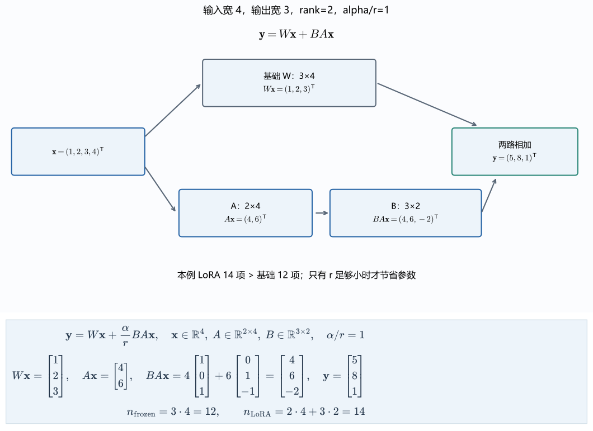

看到“旁路输出永远落在一个 $r$ 维子空间里”，很多初学者脑子里会立刻产生一个严重的误解：“既然 LoRA 的秩 $r$ 那么小（比如 $r=1$ 或 $r=8$），那给模型装上 LoRA 之后，整层网络输出的特征空间是不是就被瓶颈卡死、永久退化成只有 $r$ 维的低秩空间了？”

**完全不会！因为低秩约束 $\operatorname{rank}(\Delta W)\le r$ 仅仅施加在“本次微调新增的修正量 $\Delta W$”上，而底下垫着的原主路权重 $W$ 依然是满秩的！一张满秩矩阵加上一张低秩增量矩阵，合起来的总变换矩阵照样可以是满秩的！**

我们把这个几何关系放到二维平面上（$d=m=2$，取秩 $r=1, c=1$），用第一篇学过的基向量像与行列式（面积缩放率）算一下，一眼就能看穿两者的区别。取主路为单位矩阵 $W=I_2$，旁路取秩为 $1$ 的行向量 $A$ 与列向量 $B$：

$$
W=I_2,\qquad
A=\begin{bmatrix}1&2\end{bmatrix},\qquad
B=\begin{bmatrix}2\\1\end{bmatrix}.
$$

我们把单独的旁路增量矩阵 $\Delta W=BA$，与加上主路后的总变换矩阵 $W+\Delta W$ 并排摆在一起：

$$
\Delta W=BA=
\begin{bmatrix}2&4\\1&2\end{bmatrix},\qquad
(W+\Delta W)=
\begin{bmatrix}3&4\\1&3\end{bmatrix}.
$$

* 如果**只看增量矩阵 $\Delta W$**：它把第一条标准基向量 $(1,0)^{\mathsf T}$ 映成了 $(2,1)^{\mathsf T}$，把第二条标准基向量 $(0,1)^{\mathsf T}$ 映成了共线的 $(4,2)^{\mathsf T}$。两条基向量塌缩到了同一条直线上，整个二维单位正方形被彻底压扁成了一条面积为零的线段，行列式为 $\det(\Delta W) = 2\times 2 - 4\times 1 = 0$（秩为 $1$）；
* 但**一旦加上满秩的主路 $W=I_2$**：两条标准基向量的像就变成了不共线的 $(3,1)^{\mathsf T}$ 和 $(4,3)^{\mathsf T}$，它们照样稳稳当当地张成整个二维平面，围成的平行四边形面积（行列式）为：

$$
\det(W+\Delta W)=3\times3-4\times1=5\neq 0.
$$

你看，总矩阵 $W+\Delta W$ 的秩依然是满秩 $2$！所以千万不要把 LoRA 误解成“把模型的所有特征表示都压缩到了 $r$ 维管道里”——主干高速公路 $W$ 依然全宽畅通，LoRA 只是在主干道上叠加了 $r$ 个最关键的微调修正方向。

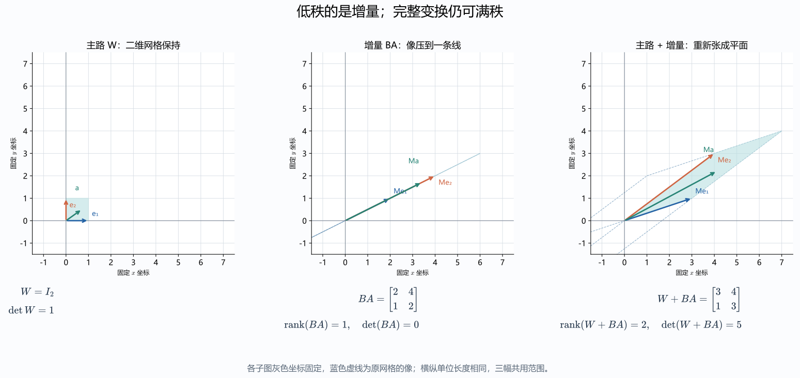

最后再来算一笔参数节省账：原权重矩阵 $W\in\mathbb R^{m\times d}$ 一共有 $md$ 个参数；而 LoRA 旁路的两个矩阵 $A\in\mathbb R^{r\times d}$ 和 $B\in\mathbb R^{m\times r}$ 合起来一共有 $rd+mr=r(d+m)$ 个参数。
请注意，在刚才我们手算的 $d=4, m=3, r=2$ 小例子里，原矩阵只有 $4\times 3 = 12$ 个参数，而旁路反而有 $2\times(4+3) = 14$ 个参数，非但没省，反而多了 2 个！只有当旁路秩 $r$ 严格满足不等式：

$$
r<\frac{md}{m+d}
$$

时，旁路的参数量才真正少于原矩阵。在实际的大语言模型里，层宽度 $d$ 和 $m$ 动辄上千甚至上万，而秩 $r$ 通常只取 $4, 8, 16$：比如当 $d=m=1024$、取 $r=8$ 时，原矩阵有 $1024\times 1024 = 1,048,576$ 个参数，而 LoRA 旁路只有 $8\times(1024+1024) = 16,384$ 个参数，需要求梯度和存优化器状态的可训练参数量直接降到了原来的 **$1/64$**！（当然，训练时冻结的原矩阵 $W$ 依然要留在显存里参与前向计算和向上游传递输入梯度，中间激活值也照常存在，所以不能把“可训练参数降为 $1/64$”直接等同于“训练总显存也降为 $1/64$”。）

### 3. 初始化与第一步梯度

装好了 LoRA 旁路，接下来准备启动第 1 步反向传播。设顶层损失对本层输出列向量 $\mathbf y$ 的上游梯度为 $\mathbf g = \partial L/\partial\mathbf y\in\mathbb R^m$，记旁路第一步算出的中间向量为 $\mathbf u = A\mathbf x\in\mathbb R^r$。顺着 $\mathbf y = W\mathbf x + cB\mathbf u$ 用矩阵链式法则求导，矩阵 $B$ 和矩阵 $A$ 收到的梯度分别是：

$$
\frac{\partial L}{\partial B}
=c\,\mathbf g\mathbf u^{\mathsf T},
\qquad
\frac{\partial L}{\partial A}
=c\,(B^{\mathsf T}\mathbf g)\mathbf x^{\mathsf T}.
$$

（检查一下形状：$\mathbf g\in\mathbb R^{m\times 1}$ 右乘 $\mathbf u^\mathsf T\in\mathbb R^{1\times r}$ 正好是 $m\times r$，与 $B$ 同形；$B^\mathsf T\mathbf g\in\mathbb R^{r\times 1}$ 右乘 $\mathbf x^\mathsf T\in\mathbb R^{1\times d}$ 正好是 $r\times d$，与 $A$ 同形。同时注意，虽然主路权重 $W$ 被冻结不更新，但假如此层前面还有其他可训练层，传给本层输入 $\mathbf x$ 的梯度 $\partial L/\partial\mathbf x = (W^\mathsf T + cA^\mathsf TB^\mathsf T)\mathbf g$ 依然包含主路的 $W^\mathsf T\mathbf g$，主路在反向传播中依然承担着往前传导误差的桥梁作用。）

现在，请死死盯住上面那两个求导公式，思考一个关乎训练生死的初始化问题：
为了让刚装上 LoRA 旁路的那一瞬间，模型的前向输出与原基座模型 100% 保持一致（不至于一上来就塞进一堆随机乱码把预训练特征搅乱），我们要求在训练起点处满足旁路增量 $\Delta W = cBA = 0$。
要想让两个矩阵乘起来等于零，一个初学者最容易拍脑袋想出来的写法是：“干脆把 $A$ 和 $B$ 全都初始化成零矩阵（$A=0$ 且 $B=0$）不就完事了吗？”

要是你真在代码里写下了 `A = zeros(), B = zeros()`，你的 LoRA 训练就当场宣告死亡了！为什么？把 $A=0, B=0$ 代进上面那两个梯度公式里看一看：
* 因为 $A=0$，所以中间激活 $\mathbf u = A\mathbf x = \mathbf 0$，代入第一式得到 $\frac{\partial L}{\partial B} = c\,\mathbf g\mathbf 0^\mathsf T = 0$；
* 因为 $B=0$，所以 $B^\mathsf T\mathbf g = \mathbf 0$，代入第二式得到 $\frac{\partial L}{\partial A} = c\,\mathbf 0\mathbf x^\mathsf T = 0$！

**当 $A$ 和 $B$ 同时为零时，它俩互为对方梯度的乘数因子，结果两个矩阵算出来的梯度全都是死气沉沉的零！** 在没有额外噪声扰动的确定性梯度下降下，无论你往后跑一万步还是一百万步，参数都会死死卡在全零鞍点上纹丝不动！

怎么破除这个互锁死局，既保证起步时 $BA=0$，又能让梯度从第 1 步就顺利跑起来？
标准做法是采用**“一零一非零”的不对称初始化**：通常让降维矩阵 $A$ 采用非零随机初始化（如高斯或均匀分布），而把升维矩阵 $B$ 初始化为全零矩阵（$B=0$）。
看看这样初始化之后，前两步更新是怎么像解连环扣一样跑起来的。我们拿一个二维手算例子把每一步的数字全摊在桌面上：

$$
W=I_2,\quad
\mathbf x=\begin{bmatrix}1\\2\end{bmatrix},\quad
A=\begin{bmatrix}1&1\end{bmatrix},\quad
B=\begin{bmatrix}0\\0\end{bmatrix},
\quad L=\frac12\|\mathbf y\|^2.
$$

* **第 1 轮前向与反传**：因为起步时 $B=0$，旁路输出为零，总输出 $\mathbf y = W\mathbf x = (1, 2)^{\mathsf T}$，与原基座完全一致；此时损失 $L = \frac12(1^2+2^2) = 2.5$，上游梯度 $\mathbf g = \mathbf y = (1, 2)^{\mathsf T}$。但因为 $A=\begin{bmatrix}1&1\end{bmatrix}$ 非零，中间激活 $u = A\mathbf x = 1+2 = 3 \neq 0$！代入梯度公式：
  $$
  \nabla_B L=\mathbf g u = \begin{bmatrix}1\\2\end{bmatrix}\times 3 =
  \begin{bmatrix}3\\6\end{bmatrix},\qquad
  \nabla_A L=(B^\mathsf T\mathbf g)\mathbf x^\mathsf T=\begin{bmatrix}0&0\end{bmatrix}.
  $$
  你看，虽然第 1 轮里 $A$ 的梯度因为乘了 $B=0$ 暂时是零，但 **$B$ 的梯度已经是实打实的 $(3, 6)^{\mathsf T}$ 了**！取学习率 $\eta=0.01$ 做完第 1 步梯度下降，$B$ 立刻离开零点更新为 $(-0.03,\ -0.06)^{\mathsf T}$，$A$ 暂时留在 $(1, 1)$；更新后的新输出变成 $(1,2)^{\mathsf T} + (-0.03,-0.06)^{\mathsf T}\times 3 = (0.91,\ 1.82)^{\mathsf T}$，损失已经从 $2.5$ 降到了 $2.07025$！
* **第 2 轮前向与反传**：现在 $B=(-0.03,\ -0.06)^{\mathsf T}$ 已经不再是零了！拿着新的上游梯度 $\mathbf g=(0.91,\ 1.82)^{\mathsf T}$ 算 $B^\mathsf T\mathbf g = -0.03\times 0.91 + (-0.06)\times 1.82 = -0.1365 \neq 0$，再右乘 $\mathbf x^\mathsf T=(1, 2)$，**矩阵 $A$ 的梯度在第 2 轮当场解锁**：
  $$
  \nabla_A L=
  \begin{bmatrix}-0.1365&-0.273\end{bmatrix}.
  $$

反过来想一想：如果我们在初始化时倒过来，令 $A=0$（全零）、而令 $B=(1, 1)^{\mathsf T}$（非零），能不能跑通呢？同样能跑通！因为起步时依然满足 $BA=0$，只不过第 1 轮反过来变成了 $B^\mathsf T\mathbf g = 1+2 = 3 \neq 0$，先算出 $\nabla_A L = (3, 6)$ 把 $A$ 推离零点，到第 2 轮再解锁 $\nabla_B L$。这证明“非零 $A$、零 $B$”并非唯一可行的数学形式，[PEFT 库的初始化选项](https://huggingface.co/docs/peft/v0.21.0/package_reference/lora#initialization)中也提供了多种变体，关键在于核对清楚所选方案的起点增量与首步梯度行为：

~~~python
import torch

x = torch.tensor([1., 2.], dtype=torch.float64)
a = torch.tensor([[1., 1.]], dtype=torch.float64, requires_grad=True)
b = torch.zeros(2, 1, dtype=torch.float64, requires_grad=True)
y = x + b @ (a @ x)  # 主路为恒等映射，旁路先压到一个坐标。
loss = y.square().sum() / 2
loss.backward()
print(a.grad.tolist(), b.grad.tolist())
with torch.no_grad():
    b -= .01 * b.grad
    updated = x + b @ (a @ x)
print(updated.tolist(), (updated.square().sum() / 2).item())
~~~

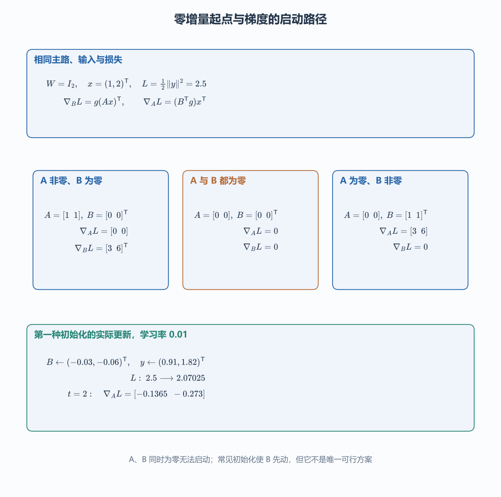

### 4. TinyLM 的可训练范围

回到我们的 `TinyLM` 代码：PyTorch 的 `nn.Linear(in_features, out_features)` 对批次行向量执行的是 `x @ weight.T`，其内部保存的 `weight` 张量形状是 `(输出宽度, 输入宽度)`。因此，[`modern_ai/language.py`](https://github.com/KiriAky107/understanding-AI-and-Agents-in-depth/blob/main/%E7%8E%B0%E4%BB%A3AI%E7%A4%BA%E4%BE%8B/modern_ai/language.py)（代码包内：`现代AI示例/modern_ai/language.py`） 里的 `LoRALinear` 封装层内部定义的 `self.a`（形状 `(r, in_features)`）和 `self.b`（形状 `(out_features, r)`），正好与上面列向量推导中的矩阵 $A$ 和 $B$ 一一对应。

我们先把 `TinyLM` 里的全部 `25,824` 个参数调用 `model.requires_grad_(False)` 统统冻结，然后只把最末端的词表输出层 `model.head`（输入宽 32，输出宽 256）替换成秩 $r=2,\ \alpha=2$ 的 `LoRALinear`：

~~~python
import torch
from modern_ai.language import TinyLM, LoRALinear

torch.manual_seed(17)
model = TinyLM()
model.requires_grad_(False)  # 先冻结所有已有参数。
model.head = LoRALinear(model.head, rank=2, alpha=2)
trainable = [(name, p.numel()) for name, p in model.named_parameters()
             if p.requires_grad]
print(trainable)  # head.a: 2*32=64；head.b: 256*2=512。
print(sum(number for _, number in trainable))  # 合计 576。
~~~

清点一下现在还开着梯度的参数：`head.a` 有 $2\times 32 = 64$ 个元素，`head.b` 有 $256\times 2 = 512$ 个元素，原输出层的权重和偏置全部锁死，全模型只剩下区区 **$576$ 个可训练参数**！（注意：如果你把 LoRA 也装到前面的注意力投影层或前馈层上，就必须按实际挂载的目标模块重新拉清单核算参数量，不能把单输出层的 576 个数字到处乱套。）

我们沿用第一节完全相同的基座和那两条 SFT 示范记录（`Q:a\nA:b` 与 `Q:c\nA:d`），只更新这 576 个 LoRA 参数（AdamW 学习率 $0.05$，执行 80 步更新）。平均回答损失同样从约 $8.715630$ 一路降到了 $0.001184$，并且逐项比对确认那 `25,824` 个冻结的基础参数连半点都没有变动。当然，和第一节的全量微调一样，这验证了 576 个低秩参数足以在当前样本上完成拟合，但并不代表它自动学会了未见过的 `Q:e\nA:f` 规则，也不代表未参与训练的旧任务分布毫发无损。

### 5. 合并与适配器存储

当 LoRA 微调结束、准备上线推理时，我们面临两种部署选择：
第一种是**权重合并（Merge）**：利用矩阵乘法对加法的分配律，直接把训练好的旁路增量 $cBA$ 加回到原基础权重矩阵 $W$ 上，合成一张新矩阵 $W'$：

$$
W'=W+cBA,\qquad
W'\mathbf x=W\mathbf x+cB(A\mathbf x).
$$

在理想的实数代数下，先算两条路径再相加，与先合成一张矩阵 $W'$ 再乘 $\mathbf x$ 是完全恒等的；但在计算机有限精度的浮点数实现里，由于矩阵乘加的先后结合次序变了，两者之间会产生极微小的浮点舍入差——在本次 `float32` 精度的 `TinyLM` 实测中，合并前后整模型输出的 logits 最大绝对差约为 $1.53\times 10^{-5}$。因此在写自动化测试验收合并功能时，应当检查数值容差（如 `torch.allclose`），而不能死板地要求每一个浮点数的二进制位完全相等。合并之后，前向推理只需要算一次原本形状的矩阵乘法，不再有任何旁路分支的额外开销。

第二种是**分离存储与动态挂载**：如果线上服务器需要用同一个 7B 基座模型同时服务十几个不同的垂直业务，合并权重就意味着要存十几份 7B 大模型；此时不如保持基座 $W$ 独立常驻显存，每个业务只单独保存它那几百 KB 到几 MB 的纯 LoRA 增量参数（`a` 和 `b`）及配置文件（记录基座版本、挂载模块名、$r$、$\alpha$ 与分词器约定）。注意在用代码保存这个轻量级适配器包时，只能筛选提取出 `head.a` 和 `head.b` 这几个增量张量；要是你不小心对整个 `LoRALinear` 封装层直接调了 `.state_dict()`，它会把里面包裹的冻结基础层权重也一并打包存进去，那就不是纯适配器包了。

## （六）参数、量化与模型文件

### 1. 参数量的逐层账单

在开源社区下载模型或阅读技术报告时，到处都能看到 `7B`、`14B`、`70B` 这样的字眼。这里的字母 `B` 代表 Billion（十亿，$10^9$），所谓 `7B` 模型，指的就是模型里所有参数张量包含的**数字元素总个数**在七十亿左右。

在核算模型资源账单时，必须先把三个经常被混在一块说的概念彻底拆开：**总参数元素个数、当前放开的可训练参数个数、以及参数存储在硬盘或显存里占用的字节数**。把参数冻结起来不更新，只是减少了可训练参数个数，那些冻结的参数元素依然一个不少地躺在模型里；把参数从 32 位浮点数改成 8 位或 4 位整数表示（量化），只是压小了每个元素占用的字节数，矩阵里的元素总个数同样不会少半个。

我们先拿第四篇的 `TinyLM`（词表大小 $V=256$、特征宽度 $d=32$、位置上限 $C=24$、一层 Pre-LN 块、前馈中间宽度 $2d=64$）来列一张分毫不差的元素总账：

| 模型组成部分 | 张量形状与元素计数算式 | 参数元素个数 |
| --- | --- | ---: |
| 1. 内容嵌入表与绝对位置嵌入表 | $256\times32+24\times32$ | 8,960 |
| 2. 注意力 Q/K/V 及输出投影（无偏置） | $3\times32^2+32^2$ | 4,096 |
| 3. 两层前馈网络（含各自偏置） | $32\times64+64+64\times32+32$ | 4,192 |
| 4. 两个 LayerNorm 层（缩放与平移） | $2\times(32+32)$ | 128 |
| 5. 末端词表输出层（含偏置） | $32\times256+256$ | 8,448 |
| **全模型参数合计** | **以上各项相加** | **25,824** |

看清代码与数字的对应关系：在 `TinyLM` 的源码实现里，注意力投影不设偏置项，第二次残差相加之后也没有再多加一层末端 LayerNorm。配套函数 `parameter_ledger` 严格按这五组实际形状相加，得出的 `25,824` 与 PyTorch 直接遍历统计的 `sum(p.numel() for p in model.parameters())`（其中 `.numel()` 返回张量内元素的总个数）一字不差。

看懂了 `25,824` 是怎么来的，当我们把这套架构放大到工业界尺寸时，怎么一眼估算出一台大模型大概有多少亿参数？
先声明所用的标准块结构：设隐藏层特征宽度为 $d$，采用常规多头注意力（Q、K、V、O 四张 $d\times d$ 方阵），两层前馈网络的中间扩宽维度采用标准的 $4d$（第一层 $d\times 4d$，第二层 $4d\times d$）。因为大矩阵的平方项远大于一维的偏置与 LayerNorm，忽略偏置与归一化后，单层 Transformer 块的参数量就是：

$$
N_{\rm attn}\approx4d^2,\qquad
N_{\rm FFN}\approx d(4d)+(4d)d=8d^2.
$$

两者相加，每一层标准块约有 $12d^2$ 个参数，于是 $L$ 层主干网络的参数量近似为：

$$
N_{\rm body}\approx12Ld^2.
$$

我们拿经典 `7B` 模型的典型尺寸（层数 $L=32$，特征宽度 $d=4096$）代进去算一算：32 层主干网络共有 $32\times 12\times 4096^2 = 6,442,450,944$ 个参数（约 $64.42$ 亿）；如果词表大小取 $V=32,000$，且首尾的内容嵌入表与末端词表输出层**不共享权重**，这两张词表大矩阵额外占用的参数量为：

$$
2Vd=2\times 32000\times 4096=262,144,000.
$$

把主干的 $64.42$ 亿和词表的 $2.62$ 亿加起来，一共是 $6,704,594,944$（约 **$6.705$ 十亿**），再加上少量的 LayerNorm 参数，这就是人们常说的 `7B` 量级模型的由来！

但千万注意：**一旦网络块的具体结构变了，上面那个 $12Ld^2$ 的近似公式就必须跟着重列，绝不能闭着眼睛乱套！** 比如：
* 如果注意力层改用了第四篇讲过的 GQA（分组查询注意力），K 和 V 的投影矩阵变窄了，注意力部分的参数就会少于 $4d^2$；
* 如果前馈层改用了带门控的 SwiGLU 结构，它里面包含上投影、门控投影和下投影**三张**大小为 $d\times m$ 的矩阵，前馈参数量变成了 $3dm$（因此很多模型为了把前馈参数量维持在 $8d^2$ 左右，会特意把中间宽度 $m$ 缩减为约 $\frac83 d$）；
* 至于我们自己的 `TinyLM`，它的前馈层中间宽度设的是 $2d$（而非 $4d$），所以它的单层主干是 $4d^2 + 4d^2 = 8d^2$，同样不服从 $12d^2$。算参数账单永远要认准真实源码里的矩阵形状，不能拿一个近似口诀替所有模型报精确数字。

### 2. 权重、状态与内存

数清了参数元素个数 $N$，接下来算它们占多少存储空间。假设每个参数用 $b$ 个二进制位（bits）保存，由于 $1\text{ 字节（Byte）}=8\text{ 位}$，光存下这 $N$ 个数字本身的**纯参数载荷**就是：

$$
S_{\rm weights}=N\frac b8\quad\text{字节}.
$$

如果我们精确取 $N=7\times10^9$（整七十亿个参数）：
* 用 32 位单精度浮点数（**FP32**，$b=32$，即 4 字节/参数）保存，纯载荷为 **$28\text{ GB}$**；
* 用 16 位半精度浮点数（**FP16** 或 **BF16**，$b=16$，即 2 字节/参数）保存，纯载荷减半为 **$14\text{ GB}$**；
* 用 8 位整数（**INT8**，$b=8$，即 1 字节/参数）保存，纯载荷为 **$7\text{ GB}$**；
* 用紧凑打包的 4 位整数（**INT4**，$b=4$，即 0.5 字节/参数）保存，纯载荷进一步缩至 **$3.5\text{ GB}$**。

在看这张字节账单时，有三个工程常识必须记牢：
第一，注意十进制单位 **GB**（$10^9$ 字节）与操作系统/显卡监控里常用的二进制单位 **GiB**（$2^{30}=1,073,741,824$ 字节）之间的换算差——$28\text{ GB}$ 换算成二进制单位大约是 $26.08\text{ GiB}$，对账时不能把两个不同单位的数字直接混着比；
第二，同样占 2 个字节（16 位），FP16 和 BF16 的内部结构截然不同：BF16 保留了和 FP32 完全相同的 8 位指数位（因而动态范围极大、不易上溢成 `inf`），但尾数精度位比 FP16 少，“占的字节数相同”绝不等于它们的数值舍入误差与防溢出能力相同；
第三，上面算的 $3.5\text{ GB}$ 仅仅是纯整数载荷。在实际落盘和加载时，还要加上量化比例尺（Scale）、零点（Zero-point）、词表与文件头开销；而在实际运行推理时，显存里除了静态权重，还必须装下随批次和序列长度增长的 **KV Cache**、前向中间激活张量以及底层算子的临时工作区（如果是训练阶段，还要额外加上梯度、AdamW 的一二阶状态甚至混合精度下的 FP32 主权重副本）。因此，看到“INT4 纯权重只有 $3.5\text{ GB}$”，只能说明权重文件能塞进一张 $4\text{ GB}$ 显存的入门显卡，绝不等于它就能在这张卡上稳定跑完长上下文推理而不爆显存。

存储对象还可以按“什么时候改变、下一步是否要继续使用”区分。权重决定模型的计算规则；训练时的梯度和 Adam 状态服务于参数更新；KV Cache 则保存当前输入前缀经过模型计算后得到的键和值。下图只截取一层、一个头和一个样本，令键宽和值宽都为 $2$：前缀由三个位置增加到四个位置，两个缓存矩阵的总元素数由 $12$ 增至 $16$，按 FP16 每元素两字节计算，就是 $24$ 字节增至 $32$ 字节。追加缓存没有增加模型参数；清空这次缓存，也没有把已经训练好的权重清零。

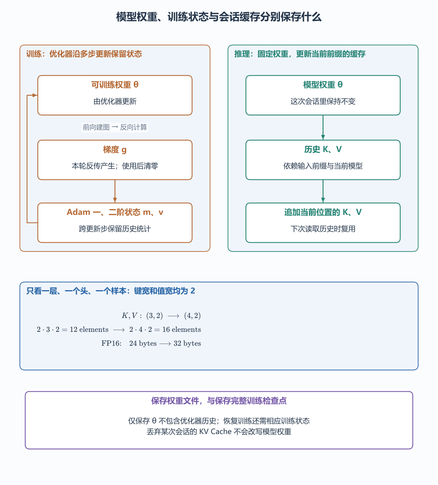

### 3. 对称量化与输出误差

什么叫**量化（Quantization）**？说到底，浮点数在计算机里虽然能表示精细的小数，但占地方又耗带宽；量化就是拿一把**刻度格数有限的整数尺子**，去近似测量并保存原来连续的浮点数权重。

我们拿一条包含四个浮点数的权重行向量 $\mathbf w=(-1,\ -0.2,\ 0.3,\ 1)$，亲手走一遍**有符号对称 INT8 量化**的全过程。
1. **选定整数码本与比例尺（Scale）$s$**：8 位有符号整数的范围原本是 $[-128, 127]$，为了保持正负完全对称且让实数 $0$ 恰好对齐到整数 $0$（无需额外存零点偏移），我们选用对称码本 $[-127, 127]$。先找出这组权重里的最大绝对值 $\max_k|w_k| = 1$，让它正好顶到最大刻度 $127$ 上，由此算出一格整数刻度对应的浮点跨度 $s$：

$$
s=\frac{\max_k|w_k|}{127}=\frac1{127},\qquad
q_k=\operatorname{clip}\left(
\operatorname{round}\frac{w_k}{s},-127,127\right),
\quad
\widehat w_k=sq_k.
$$

2. **取整存盘 $q_k$ 与反量化还原 $\widehat w_k$**：把每个原权重 $w_k$ 除以刻度跨度 $s$（即乘上 $127$），四舍五入取整（程序使用 `np.rint` 取最近整数，遇到 `.5` 平局时取最近偶数，当前样本无平局）并限制在 $[-127, 127]$ 内，就得到了真正存进文件的整数 $q_k$；等到计算需要还原时，再拿整数 $q_k$ 乘回比例尺 $s$，得到近似浮点权重 $\widehat w_k$：

| 原浮点权重 $w_k$ | 除以尺度 $w_k/s$ | 量化存盘整数 $q_k$ | 反量化还原值 $\widehat w_k=sq_k$ | 单项还原误差 $\widehat w_k-w_k$ |
| ---: | ---: | ---: | ---: | ---: |
| $-1$ | $-127.0$ | $-127$ | $-1.000000$ | $0$ |
| $-0.2$ | $-25.4$ | $-25$ | $-0.196850$ | $+0.003150$ |
| $0.3$ | $38.1$ | $38$ | $0.299213$ | $-0.000787$ |
| $1$ | $127.0$ | $127$ | $1.000000$ | $0$ |

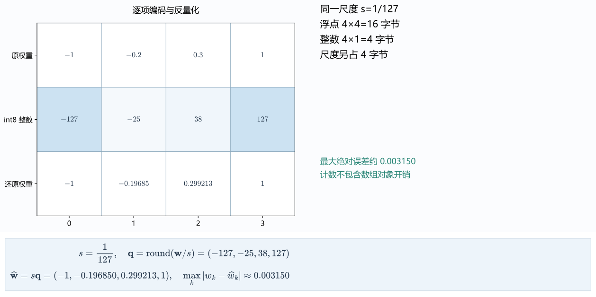

光看单个权重差了千分之几还不够直观，因为神经网络里到处都是点积运算。我们给这组权重配上一个固定的输入列向量 $\mathbf x=(1,\ 2,\ -1,\ 0.5)^{\mathsf T}$，看看量化前后的点积输出 $y=\mathbf w\mathbf x$ 到底差了多少：
* **原浮点权重的精确输出**：
  $$
  y=\mathbf w\mathbf x = (-1)\times 1 + (-0.2)\times 2 + 0.3\times(-1) + 1\times 0.5 = -1 - 0.4 - 0.3 + 0.5 = -1.2.
  $$
* **INT8 反量化权重的输出**：代入上表第四列算点积，得到 $\widehat y_8 \approx -1.192913$，与原精确值 $-1.2$ 相比，输出误差仅为 **$+0.007087$**。
* **如果继续压缩，改用对称 INT4 量化呢？** 4 位有符号对称码本只剩下区区 $[-7, 7]$ 共 15 个刻度！此时比例尺跨度一下子变粗成了 $s_4 = 1/7 \approx 0.142857$。把原权重 $(-1, -0.2, 0.3, 1)$ 除以 $1/7$（即乘以 $7$）得到 $(-7, -1.4, 2.1, 7)$，取整后存为 $(-7, -1, 2, 7)$，反量化还原回来的权重变成了：
  $$
  \widehat{\mathbf w}_4=
  \left(-1,\ -\frac17,\ \frac27,\ 1\right)
  \approx(-1,\ -0.142857,\ 0.285714,\ 1).
  $$
  拿这组粗糙的 INT4 还原权重去乘同一个输入 $\mathbf x$，算出来的输出变成了 $-1.071429$，与原值 $-1.2$ 相比，输出误差扩大到了 **$+0.128571$**！

我们还可以从数学上给这个点积误差卡出一个理论最坏上界：只要待量化的权重没有超出尺子的最大量程（即不发生越界削顶），那么在按最近整数格舍入时，任何一个权重与它最近的整数刻度之间的距离最多不会超过半格（即 $|\widehat w_k - w_k|\le s/2$）。于是根据绝对值三角不等式，点积输出误差的绝对值必然满足：

$$
|\widehat y-y|
=\left|\sum_k(\widehat w_k-w_k)x_k\right|
\le\sum_k|\widehat w_k-w_k||x_k|
\le\frac{s}{2}\sum_k|x_k|
=\frac{s}{2}\|\mathbf x\|_1.
$$

在本例中输入向量的一范数 $\|\mathbf x\|_1 = |1|+|2|+|-1|+|0.5| = 4.5$。代入公式：INT8（$s=1/127$）的理论最坏误差上界为 $\frac{1}{254}\times 4.5 \approx 0.017717$（实际误差 $0.007087$ 因为各项有正有负相互抵消了一部分，远小于这个最坏上界）；INT4（$s=1/7$）的理论最坏误差上界为 $\frac{1}{14}\times 4.5 \approx 0.321429$（实际误差 $0.128571$ 同样在界内）。
但请注意这个上界成立的前提是**没有发生越界截断（Clipping）**：假如你事先已经把比例尺锁死在了 $s=1/127$，结果后面突然冒出来一个离群的大权重 $1.8$，除以 $s$ 后变成 $228.6$，被 `clip` 硬生生削顶截断成了 $127$，反量化回来只有 $1.0$，光这一项的误差就高达 $-0.8$，早就冲破半格舍入界 $s/2$ 了（另外，如果遇到某一组权重恰好全都是零，$\max|w_k|=0$，代码里必须单独指定一个合法的默认正尺度如 $s=1$，绝不能去做 $0/0$ 的非法除法）：

~~~python
import numpy as np

w = np.array([-1., -.2, .3, 1.])
x = np.array([1., 2., -1., .5])
for limit in [127, 7]:
    scale = np.abs(w).max() / limit
    codes = np.clip(np.rint(w / scale), -limit, limit).astype(np.int8)
    restored = codes.astype(float) * scale  # 本例先还原成浮点数再做点积。
    print(codes.tolist(), float(restored @ x), float((restored - w) @ x))
~~~

### 4. 四比特打包与分组开销

计算机底层怎么在没有负号 "-" 的二进制位里表示负数？通用标准是“二进制补码（Two's Complement）”：在 4 个二进制位（一共能表示 $2^4=16$ 个状态）里，把前半截 $0\sim 7$（二进制 0000 到 0111，最高位为 0）留给非负数；把后半截 $8\sim 15$（二进制 1000 到 1111，最高位为 1）分配给负数 $-8\sim -1$，换算规则就是给负数加上模数 $16$（例如 $-7 + 16 = 9$，二进制为 1001；$-1 + 16 = 15$，二进制为 1111）。

请仔细看上面那段 Python 代码里的 `astype(np.int8)`：当 `limit = 7`（模拟 INT4 量化）时，虽然算出来的四个整数 `[-7, -1, 2, 7]` 数值都落在了 4 位整数能够表示的范围之内，但因为 NumPy 和主流编程语言并没有原生的 4 比特独立数组类型，把它们装在 `np.int8` 里时，每个数字在内存里依然占着整整 8 个二进制位（1 个字节）！

要想让四个 4 位整数在内存和硬盘里真正只占 **2 个字节**，我们必须自己动手写一段位运算打包逻辑，把**每两个 4 位整数挤进同一个字节的低四位（Low Nibble）和高四位（High Nibble）里**。

具体怎么塞进去、又怎么毫发无损地取出来？我们采用标准的 4 位二进制补码（Two's Complement）规则：非负数（$0\sim 7$）直接写成 4 位二进制原码；负数（$-8\sim -1$）则加上模数 $16$（即 $2^4$）转成 $8\sim 15$ 之间的无符号数。拿刚才的 $(-7, -1, 2, 7)$ 来转：
* $-7 + 16 = 9$，4 位二进制为 `1001`；
* $-1 + 16 = 15$，4 位二进制为 `1111`；
* $2$ 的 4 位二进制为 `0010`；
* $7$ 的 4 位二进制为 `0111`。

现在按照“前一个数放低四位、后一个数左移 4 位（`<< 4`）放高四位，再用按位或 `|` 拼成一个 8 位字节”的约定打包：

| 两项有符号整数 | 低四位（前一项） | 高四位（后一项） | 拼成的完整 8 位字节 | 对应十进制无符号字节值 |
| --- | --- | --- | --- | ---: |
| $-7,\ -1$ | `1001`（9） | `1111`（15） | `11111001` | $15\times 16 + 9 =$ **249** |
| $2,\ 7$ | `0010`（2） | `0111`（7） | `01110010` | $7\times 16 + 2 =$ **114** |

你看，原本占 16 个字节的四个 FP32 浮点数，现在实打实地变成了两个无符号字节 `[249, 114]`！等到需要解包还原时，只需对每个字节先用按位与 `byte & 15`（二进制 `00001111`）抽出低四位，再用右移 `(byte >> 4) & 15` 抽出高四位；如果抽出来的 4 位无符号整数大于等于 $8$（说明最高符号位是 $1$），就减去 $16$ 还原回负数，立刻分毫不差地恢复出 $(-7, -1, 2, 7)$！

不过，算存储总账时千万别漏了那个必须跟着整数一起存下来的**比例尺 $s$**！
在刚才只有四个权重的微型例子里，四个 FP32 原本占 $16$ 字节；如果转成四项 INT8（$4$ 字节）再配一个 FP32 比例尺（$4$ 字节），总共占 $4+4=8$ 字节；如果转成打包后的四项 INT4（$2$ 字节）再配一个 FP32 比例尺（$4$ 字节），总共占 $2+4=6$ 字节——你会发现，在小数组里，比例尺元数据占的地方比整数载荷本身还要大，根本达不到理论上的 4 倍或 8 倍压缩！

那在大模型里怎么办？如果让整张几百万元素的权重矩阵只共用唯一一个比例尺 $s$（Per-tensor Quantization），虽然比例尺开销可以忽略不计，但万一矩阵里某个角落冒出一个很大的离群值（Outlier），就会迫使整张矩阵的比例尺 $s$ 变得极大，把成千上万个正常的小权重全都挤进同一个零刻度格子里抹杀掉；反过来，如果每三四个权重就配一个比例尺，元数据又太胖了。
因此，现代大模型量化（如 GPTQ、AWQ、GGUF 等）普遍采用折中的**分组量化（Group Quantization）**：把权重沿着通道切分成固定大小的小组——比如每 **128 个 INT4 权重**分为一组，组内共享 1 个用 FP16（占 2 字节）保存的比例尺 $s$。这样一来，分摊到每一个权重头上的平均字节数就是：

$$
\frac48+\frac2{128}=0.5+0.015625=0.515625\ \text{字节}.
$$

拿这个包含分组比例尺开销的真实系数去乘七十亿参数（$7\times 10^9$），这部分权重加比例尺的实际载荷就是 $7\times 10^9\times 0.515625 \approx$ **$3.609375\text{ GB}$**，而不是只算纯整数的 $3.5\text{ GB}$（如果采用非对称量化，每组还要再多存一个零点偏移 $z$，按 $\widehat w = s(q-z)$ 还原，这部分零点元数据也同样要计入总账）。

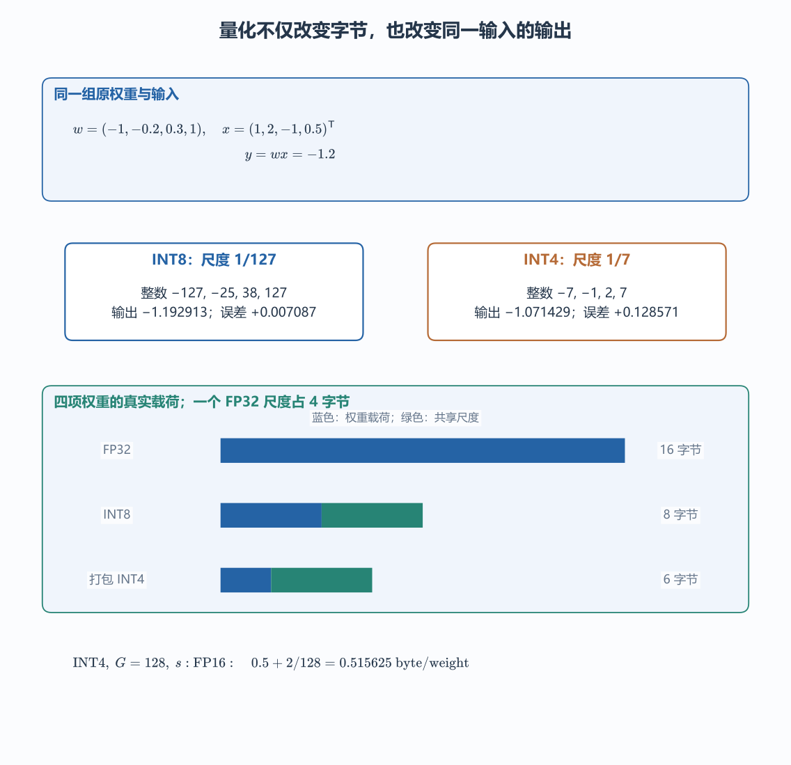

### 5. 从存储整数到实际执行

把权重压成 INT4 存进文件之后，到了显卡或 CPU 真刀真枪跑前向推理时，还要分清它到底是“只压了存储”还是“连乘法也换成了整数运算”。
一个量化方案可以只量化静态权重（Weight-only Quantization，例如常见的 W4A16：权重存为 INT4，但流经各层的激活值依然是 FP16 浮点数），也可以把权重、激活值甚至 KV Cache 全部量化。在 W4A16 模式下，硬件并不是在拿 4 位整数直接和 16 位浮点数做乘法，而是由专用算子内核把显存里的 INT4 权重读取进片上高速缓存后，按分组比例尺实时反量化还原成 FP16，再执行浮点矩阵乘加（主要省下的是把庞大权重从显存搬运到计算单元的内存带宽时间）。

同理，第五节讲的 LoRA 与本节的量化也可以组合使用（即 QLoRA 的核心思路）：把庞大的预训练基座权重 $W$ 按 INT4 分组量化并冻结锁死以节省显存，同时在旁边挂载保持高精度浮点数的 LoRA 旁路矩阵 $A, B$ 接收梯度更新。但要注意：如果你在训练结束后，想把浮点旁路增量 $cBA$ 合并回那个 INT4 量化基座里去，就必须先把量化基座反量化回浮点数、加上 $cBA$ 之后，再重新做一次整数舍入量化——这第二次量化会引入新的舍入误差，合并后的输出就不再与保留浮点旁路时的输出逐元素相等了。

因此，一份严谨的模型部署与评测报告，绝不能只笼统地写一句“我们测试了量化模型”，而必须把模型修订版本、分词器、量化位宽与分组大小、批次大小、输入与输出序列长度、KV Cache 精度、运行硬件设备以及底层推理引擎（如 `vLLM`、`llama.cpp` 或原生 PyTorch）全部列清，并分别实测首字延迟（TTFT）、解码吞吐量（Tokens/s）、峰值内存占用与固定业务集上的准确率。

### 6. 四种模型文件格式

当模型参数训练并量化完毕，准备落盘保存或分发给其他环境部署时，我们需要解决三个层层递进的问题：**第一，怎样把张量里的数字存成磁盘字节？第二，加载时怎么知道哪块张量对应网络里的哪一层？第三，拿到这些张量后，按什么算子顺序去执行前向计算？**

社区里最常打交道的四种模型文件格式——PyTorch 的 `.pt/.bin`、`.safetensors`、`.gguf` 与 `.onnx`——在这三个问题上的职责边界截然不同，绝不能一看到某个后缀名就以为“双击就能直接跑起来”：

| 模型文件格式 | 文件内部主要保存的对象 | 加载文件后，要跑起推理还需要额外核对什么 |
| --- | --- | --- |
| **PyTorch 状态字典（常用 `.pt` / `.bin`）** | 按参数名索引的张量字典（也可附带优化器与训练步数状态） | 必须提供匹配的 Python 模型类源码、配置超参数、键名映射与安全加载选项 |
| **Safetensors（`.safetensors`）** | 极简 JSON 头部（记录张量名、形状、`dtype` 与字节偏移区间）+ 纯原始张量字节流 | 模型架构代码、配置文件（`config.json`）、分词器与执行引擎 |
| **GGUF（`.gguf`）** | 架构/分词元数据 + 按块对齐打包的混合量化张量 | 所用推理引擎（如 `llama.cpp`）是否已内置实现该架构名称与对应的量化张量类型 |
| **ONNX（`.onnx`）** | **静态算子连接图（Computational Graph）** + 输入输出类型形状声明 + 初始权重张量 | 目标运行时（ONNX Runtime 等）对所用算子集版本（opset）及动态维度约束的支持情况 |

我们逐一把这四种格式的底牌掀开来看：

**1. PyTorch 状态字典（`.pt` / `.bin`）**
在 PyTorch 中，`model.state_dict()` 把模型里的可训练参数和持久化缓冲区（Buffer）按变量路径名（如 `"head.weight"`）组织成一个 Python 字典。文件里存的只是字典里的数字，根本不包含 `TinyLM` 的 `forward` 函数代码；因此在加载一份 `state_dict` 之前，你必须先在 Python 环境里用匹配的源码实例化出结构一模一样的模型对象，再把字典填进去（如果是用于断点续训的 Checkpoint 文件，里面往往还存着优化器动量状态、当前步数和随机数种子，不能把“只存纯推理权重”和“保存完整续训现场”混为一谈）。

~~~python
import io
import torch

state = {"W": torch.tensor([[1., 2.], [3., 4.]])}
buffer = io.BytesIO()  # 所有序列化字节留在内存，不创建磁盘权重文件。
torch.save(state, buffer)
buffer.seek(0)
restored = torch.load(buffer, weights_only=True)
print(torch.equal(state["W"], restored["W"]))
~~~

为什么现在安全规范反复警告“不要随便用旧版默认方式加载来路不明的 `.pt` 或 `.bin` 文件”？因为普通 PyTorch 保存容器在底层使用了 Python 内置的 `pickle` 模块来序列化对象元数据，而通用的 `pickle` 反序列化机制允许在恢复对象时自动调用任意内嵌的 Python 函数或系统命令！为了堵住这个可以执行任意恶意代码的巨大漏洞，[PyTorch 2.6 的官方序列化规范](https://docs.pytorch.org/docs/2.6/notes/serialization.html#torch-load-with-weights-only-true) 已经将 `weights_only=True` 确立为默认安全加载模式，严格限制只恢复纯粹的张量与基础数据类型，拒绝执行任何动态对象构造与外部模块导入（另外，`.pt` 和 `.bin` 只是人为取的文件扩展名，不能光看后缀判断内部格式；且 `torch.load` 也支持 `mmap=True` 参数，并非所有 PyTorch 文件都必须先在内存里完整拷贝一份）。

**2. Safetensors（`.safetensors`）**
为了从根源上彻底废掉 `pickle` 的代码执行能力、同时让大权重文件的加载速度达到极致，HuggingFace 社区推出了 **[Safetensors 公开二进制布局规范](https://github.com/safetensors/safetensors#format)**。它的文件内部结构干净得就像一张一目了然的账单：
* 文件最开头的 **8 个字节**是一个 64 位无符号小端整数 $N$，直接告诉你紧随其后的 JSON 头部占多少个字节；
* 接下来的 **$N$ 个字节**是一段纯 UTF-8 编码的 JSON 文本，里面按张量名字记录着每个张量的数据类型 `dtype`（如 `"F32"`）、形状 `shape`（如 `[2, 2]`）以及一段名为 `data_offsets` 的起止字节偏移量；
* JSON 头部结束之后紧跟着的，就是**不掺任何杂质、按顺序紧密排列的纯张量原始二进制字节流**！

举个例子，存一张 $2\times 2$ 的 FP32 矩阵（共 $4\times 4 = 16$ 个字节），JSON 头里记录的 `data_offsets` 就是 `[0, 16]`——注意这个 `[0, 16]` 是**相对于张量数据区起点（即跳过前 $8+N$ 个头部字节之后）的半开区间偏移**，而不是从文件第 0 字节算起的绝对偏移。我们在配套代码中直接用内存字节流手写解析器核对了这一头长与偏移契约。
正因为 Safetensors 里面连半行可执行的对象构造指令都没有，它天然做到了零代码执行漏洞；同时，由于张量字节在磁盘上连续对齐排放，操作系统可以直接利用内存映射（`mmap`）将磁盘文件区间挂载到进程的虚拟地址空间上，按需分页读取，省去了先把整个十几个 GB 的文件读进内存缓冲区再复制一遍的中间开销（当然，如果要把权重从主机磁盘最终搬进独立显卡的物理显存 VRAM 里，依然需要经过 PCIe 总线的数据传输与显存分配，不能把 `mmap` 夸大成“磁盘字节不用传输就直接变成了显卡里的权重”。开头 8 字节是 64 位无符号小端整数 $N$（所谓“小端序 Little-Endian”，即数字的低位字节存放在文件的低地址开头处、高位字节放在后面，这是 x86 与 ARM 处理器的原生内存字节序），用来标明紧随其后的 JSON 头字节长度。）。

**3. GGUF（`.gguf`）**
当我们在本地笔记本或台式机上使用 `llama.cpp`、Ollama 等纯 C/C++ 推理引擎跑量化大模型时，最常看到的就是 **[GGUF 格式文件](https://github.com/ggml-org/ggml/blob/master/docs/gguf.md)**。与只存张量的 Safetensors 不同，GGUF 在文件头部的键值对元数据区里，把模型的架构名称（如 `"llama"`）、层数、头数、RoPE 旋转频率、完整的分词器词表以及按特定内存对齐规则打包好的量化张量块全都装进了同一个容器里。
这里要厘清两个常见误区：第一，GGUF 容器本身并不是一个能跑任意网络结构的通用代码解释器——它能跑起来，是因为 `llama.cpp` 引擎的 C++ 源码里事先已经写好了对应架构名和对应量化张量类型的算子实现；第二，文件名里常见的 `Q4_K_M` 等标识代表的是转换器采用的一套**混合量化预设（Preset）**，在这个预设下，模型里某些敏感层（如注意力输出或部分前馈矩阵）可能会被分配为 5 位或 6 位，而其余层采用 4 位块量化，并不等于整份文件里每一个参数都一刀切地严格占 4 比特。

**4. ONNX（`.onnx`）**
前面讲的 `.pt`、`.safetensors` 和 `.gguf`，归根结底存的都是“参数数据 + 配置标签”，至于“先算哪个矩阵乘、再过哪个激活函数”的前向计算流程，全靠外部宿主程序里的模型代码来规定。而 **[ONNX（开放神经网络交换格式）的中间表示 IR](https://onnx.ai/onnx/repo-docs/IR.html)** 则走了一条不同的路：它把神经网络的前向计算过程本身导成了一张由标准算子节点（如 `MatMul`、`Add`、`Softmax`）连成的**静态计算图（Graph）**，连同初始权重张量一起保存在文件里。
注意：ONNX 是静态计算图表示，但这并不意味着它的所有输入维度都必须写死成固定常数——ONNX 的输入张量形状完全可以声明符号维度（如动态批次大小 `"batch_size"` 或动态序列长度 `"seq_len"`），图内部也支持条件分支与循环算子。不过，在把 PyTorch 模型导出为 ONNX 并交给目标硬件运行时（如 ONNX Runtime 或 TensorRT）执行时，依然必须逐项核对算子集版本（opset）以及目标后端是否完整支持图中用到的动态形状算子。

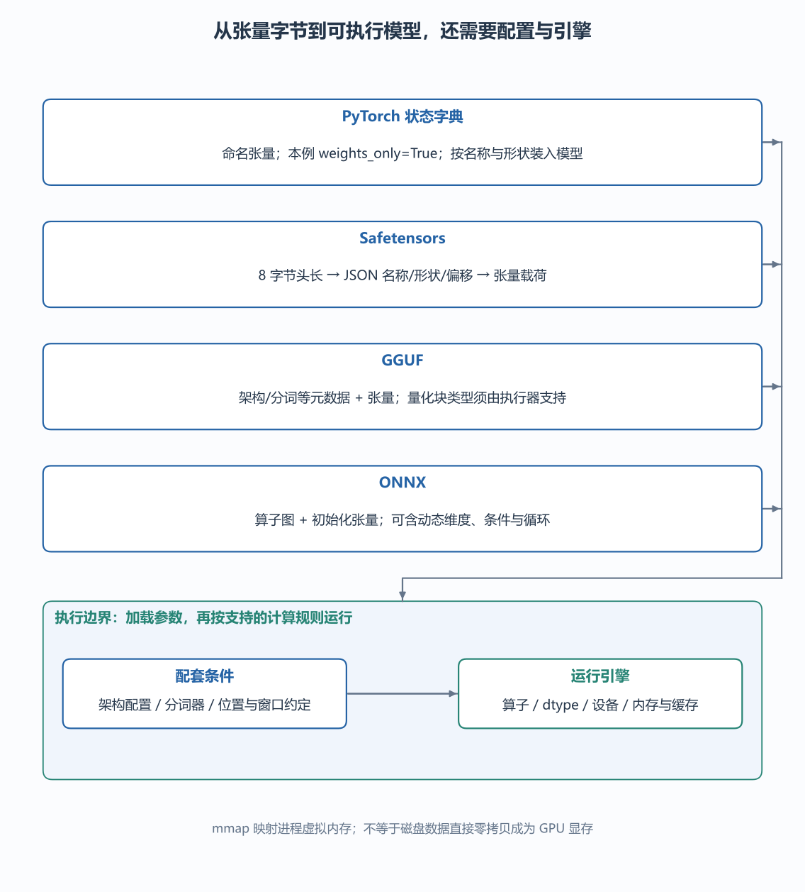

### 7. 从训练记录到部署检查

走完这一整篇从指令微调、偏好对齐、强化学习更新到低秩旁路、整数刻度量化与文件格式拆解的全流程，我们可以看到，一个模型在生产环境里到底会给出什么样的输出，是由一整条环环相扣的因果链共同决定的：
基座权重与分词器锁死了词表编号与矩阵形状的底层契约；SFT 损失掩码、DPO 成对偏好与 PPO 奖励规则决定了梯度把参数往哪个方向推；LoRA 配置决定了哪些增量矩阵放开更新；量化码本与分组尺度决定了连续浮点数以多大的舍入误差被近似保存；而模型文件格式与底层执行引擎，则决定了这些静态字节最终如何被加载还原为一次次矩阵乘加运算。

这五个环节各管一段，没有任何一步能够替另一步打保票：把 `.pt` 成功转换成了 `.safetensors` 或 `.gguf`，只说明文件容器合规，不代表模型回答没有事实幻觉；DPO 偏好损失降到了小数点后三位，可能只是把负样本踩进了深渊，不代表基座学到了新知识；把 7B 模型的权重压缩到了 $3.6\text{ GB}$ 的 INT4 文件，也不代表它在任意长窗口下跑推理都不会撑爆显存。

因此，真正经得起检验的工程交付，永远只有老老实实的三步对账：第一，核对加载前后的张量名称、形状与可训练掩码；第二，固定同一条输入，比对 LoRA 合并前后、量化前后或格式转换前后的 logits 数值误差是否落在理论界限之内；第三，在从未参与过训练与超参数挑选的独立保留任务集上，同时记录回答质量与真实的内存、延迟账单。

## （七）运行与练习

本篇所有 Python 实验入口均使用 `现代AI示例` 目录下已有的唯一 `.venv` 虚拟环境。从该目录执行以下命令即可复现正文中的全部数值：

~~~powershell
# 依次运行 SFT 标签与提示梯度、DPO 一步更新、PPO 实际采样闭环、套话风格分布、LoRA、INT8/INT4 量化与内存序列化核验。
.\.venv\Scripts\python.exe -B -m modern_ai.posttraining

# 在同一 TinyLM 基座上依次完成 SFT、DPO 训练，并与单独的 LoRA 微调分支做对照。
.\.venv\Scripts\python.exe -B -m modern_ai.posttraining --train

# 稳定题号入口，每题单独打印独立的中间推导状态与核验结果。
.\.venv\Scripts\python.exe -B -m modern_ai.solutions PT-01
.\.venv\Scripts\python.exe -B -m modern_ai.solutions PT-02
.\.venv\Scripts\python.exe -B -m modern_ai.solutions PT-03
.\.venv\Scripts\python.exe -B -m modern_ai.solutions PT-04
.\.venv\Scripts\python.exe -B -m modern_ai.solutions PT-05
.\.venv\Scripts\python.exe -B -m modern_ai.solutions PT-06
~~~

| 题号 | 要求 | 任务 |
| --- | --- | --- |
| PT-01 | **必做** | 把回答改为两个字节，重新定位有效目标；解释提示激活梯度与提示 logits 梯度的差别 |
| PT-02 | **必做** | 从序列概率和参考策略构造 DPO，求三候选梯度并核对一次更新 |
| PT-03 | **拓展选做** | 计算回报、优势和 GAE，画出正负优势目标，运行二动作策略并检查奖励漏洞 |
| PT-04 | **拓展选做** | 比较正确/错误草稿、示范风格比例、偏好方向和低温概率，区分条件变化与参数更新 |
| PT-05 | **必做** | 手算低秩旁路与两轮梯度，比较三种初始化，并解释低秩增量为何能加成满秩矩阵 |
| PT-06 | **必做** | 核算 TinyLM 参数、INT8/INT4 输出与打包字节，区分张量布局、加载和执行图 |

详细推导过程与参考解答见练习题解（代码包内：`docs/练习题解.md`）。本篇运行产生的数据、梯度、真实更新记录与资源账单均保存在实验核验（代码包内：`docs/新第五篇实验核验.json`），完整源码实现见 [posttraining.py](https://github.com/KiriAky107/understanding-AI-and-Agents-in-depth/blob/main/%E7%8E%B0%E4%BB%A3AI%E7%A4%BA%E4%BE%8B/modern_ai/posttraining.py)（代码包内：`现代AI示例/modern_ai/posttraining.py`）。
