# 六、视觉、语音与多模态

[TOC]

## （一）像素网格与视觉序列

在前两篇里，我们送进模型的输入全都是已经切分好的一串文本编号。但如果现在用户拍了一张手写数学笔记的照片交给资料助手，要求找出“图里哪一步符号写错了”，输入就不再是一串现成的字了。照片里既有文字笔画，也有分数线、箭头、颜色深浅和二维空间里的上下左右位置。同样是一小段黑色横线，放在数字前面可能是负号，架在分子和分母中间是分数线，连在两个方框之间又成了流程图箭头；如果一上来就只用一段笼统的文字描述把整张照片替换掉，这些决定意义的空间位置关系就会在第一步丢失殆尽。

计算机镜头接收到的图像，在物理上是一张按行列排开的像素数组；麦克风接收到的声音，则是一列按时间先后排开的振幅数组。要想让图片和声音也能进入前面学过的神经网络与注意力机制，我们首先得弄清楚数组里的每一个数字到底在测量什么、它的邻居排在哪条轴上，然后再决定怎样把它们重组成模型能够读取并学习的向量序列。输入的物质形态变了，组织表示的方式也必须跟着变。

### 1. 一个像素和三个通道

先从最基础的**灰度图（Grayscale Image）**看起。所谓灰度图，就是不包含任何彩色信息、只记录每个位置“有多亮或多暗”的单色图像（就像老式的黑白照片，从纯黑经过深灰、浅灰一直过渡到纯白，每一个像素只需要 1 个数字就能把明暗程度表示清楚）。设图像的高度为 $H$（竖着有多少行像素）、宽度为 $W$（横着有多少列像素），那么一张灰度图在计算机里就是一个二维实数数组 $I\in\mathbb R^{H\times W}$，其中第 $y$ 行、第 $x$ 列的元素 $I_{y,x}$ 保存着该位置像素的亮度值。注意图像坐标系的习惯：它把**左上角**作为原点 $(0,0)$，横坐标 $x$（列号）向右递增，纵坐标 $y$（行号）**向下递增**。这与我们在第一篇画函数图像时“纵轴向上递增”的笛卡尔坐标系方向相反——坐标轴朝哪边走，完全由它所描述的对象约定来决定。

到了彩色图像，光学三原色原理告诉我们，自然界绝大多数颜色都可以由红（Red）、绿（Green）、蓝（Blue）三种基础色光按不同强弱混合而成。因此，一张标准的 **RGB 彩色图**需要为同一个像素位置同时保存红、绿、蓝三个独立的亮度数字。在图像处理与神经网络中，每一种单独的颜色分量层就被称为一个**通道（Channel）**——灰度图只有“明暗”这 1 个通道（$C=1$）；RGB 彩色图则相当于把红、绿、蓝 3 张同尺寸的灰度底片叠在一起，共有 3 个通道（$C=3$）。于是彩色图里的一个像素不再是一个标量，而是一个三维向量：例如在 8 位无符号整数（取值范围 $0\sim 255$）编码下，$(255,0,0)$ 表示红光拉满、绿光和蓝光为零，合起来就是纯正的红色。在送进神经网络前，预处理代码通常会把通道值除以 $255$，变成落在 $[0,1]$ 区间里的浮点数 $(1,0,0)$——这只是把测量数值的刻度缩放了一下，像素在画面上的二维空间位置半步都没有挪动。

把同一幅小屋图并排显示成彩色与灰度，空间轮廓仍在原位，变化发生在每个像素保存的数上。下图的黑框指向同一个位置 $(x,y)=(16,6)$：彩色像素有 $(R,G,B)=(255,128,0)$ 三个分量，转换后只剩一个灰度值。采用 [Pillow 文档给出的灰度换算](https://pillow.readthedocs.io/en/stable/reference/Image.html#PIL.Image.Image.convert)，先对这里的 8 位 RGB 编码值加权，再取整：

$$
\begin{aligned}
Y&=0.299R+0.587G+0.114B\\
 &=0.299\times255+0.587\times128+0.114\times0\\
 &=151.381\longrightarrow151.
\end{aligned}
$$

图中下排的三张灰度图分别显示 R、G、B 分量大小，白色表示该通道取值大，黑色表示取值小；它们合在一起才保存完整的 RGB 信息。把三分量合成一个 $Y$ 会丢失颜色差别，再将 $Y$ 复制为 $(Y,Y,Y)$ 只能得到灰色，恢复不了原来的橙色。除以 $255$ 则是另一种操作：$(255,128,0)/255\approx(1,0.502,0)$ 仍保留三个颜色分量。

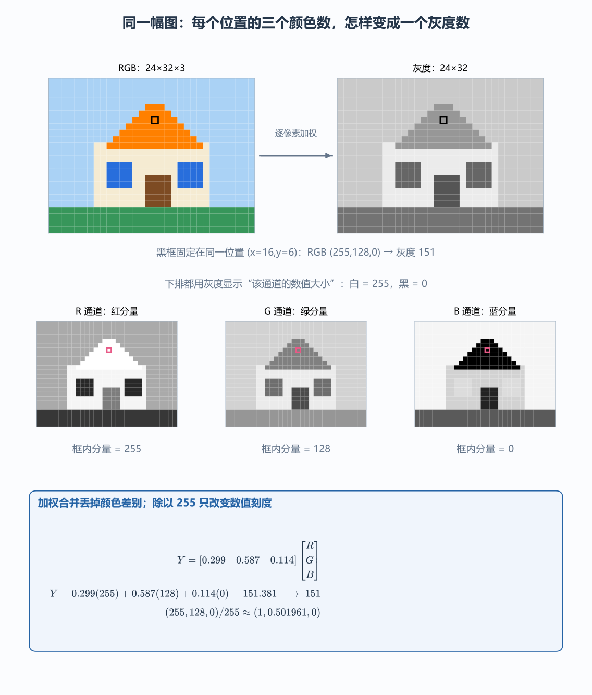

在写代码衔接不同图像库与深度学习框架时，最容易踩中的坑就是**张量轴的排列顺序**。常见的图像读取库（如 PIL 转 NumPy 或 OpenCV）读出来的数组形状通常是 `(H, W, C)`，把颜色通道轴 $C$ 放在最后；而 PyTorch 的二维卷积层 `nn.Conv2d` 要求的输入形状却是 `(B, C, H, W)`，把批次大小 $B$ 放在第 0 轴、颜色通道 $C$ 提到了高和宽的前面（顺带留神：同一个大写字母 $C$ 在图像里常代表通道数 Channels，在分类任务里常代表类别数 Classes，在第四篇还代表过窗口长度 Context，读代码时一定要看清它实际绑定的是哪条轴）。如果你把一张 `(H, W, C)` 的数组不经转置直接塞进按 `(C, H, W)` 读取的接口里，哪怕总元素个数碰巧能装下，网络眼里看到的上下左右邻接关系也已经彻底乱套了。

下面把一个 $2\times2$ 的 RGB 小图完整展开。设 $I$ 按 HWC 保存，$J$ 按 CHW 保存，则换轴的对应关系是 $J[c,y,x]=I[y,x,c]$：同一个位置、同一个颜色分量，读到的值保持相等。第 0 行、第 1 列的绿色像素，在两套索引下都读成 $(0,255,0)$。换轴没有把图像转过来，只是改变了访问数据时先指定哪条轴；给 CHW 再加一个批次轴，就得到 $(B,C,H,W)=(1,3,2,2)$。

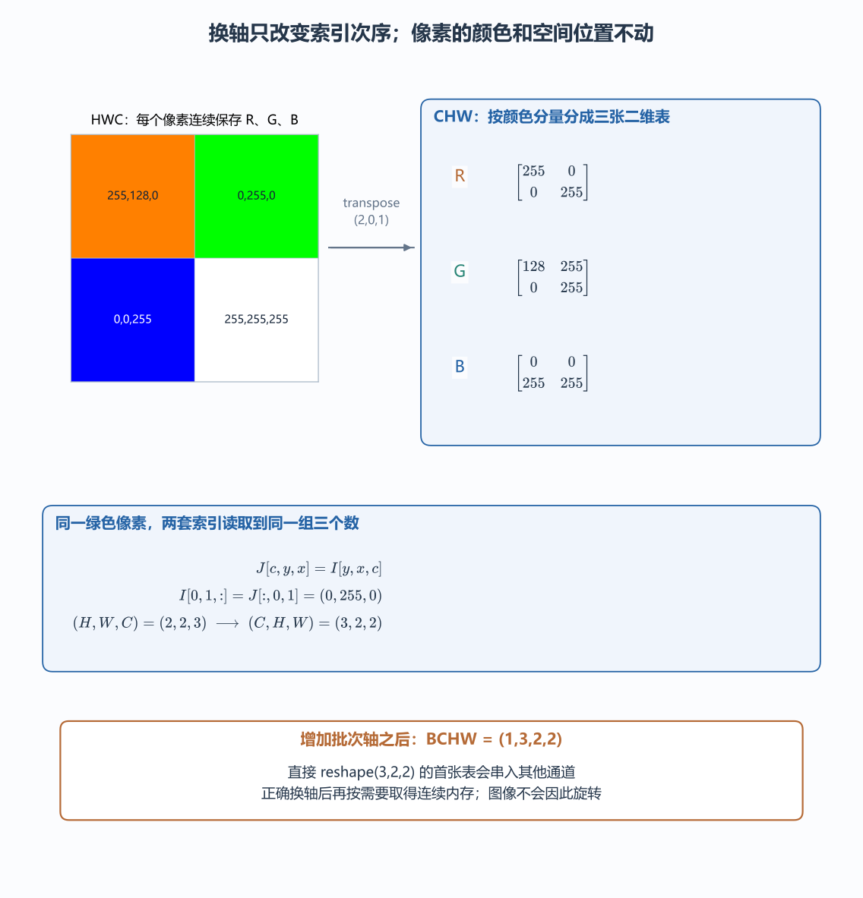

为了能用肉眼死死盯住每一个像素在切分与变形时的去向，我们构造一张 $4\times4$ 的单通道灰度图 $I$，特意让 16 个格子里的数字从 $0$ 到 $15$ 各不相同：

$$
I=\begin{bmatrix}
0&1&2&3\\
4&5&6&7\\
8&9&10&11\\
12&13&14&15
\end{bmatrix}.
$$

在这张矩阵里，从零开始数，第 $1$ 行、第 $2$ 列的元素是 $I_{1,2}=6$。请特别区分这个数字 `6` 与第四篇 Token 编号 `6` 在物理性质上的根本不同：在文字模型里，编号 `6` 只是一个用来去嵌入表里挑第 6 行的整数索引，它本身绝不参与浮点乘法；而在图像数组里，这个 `6` 就是该像素实打实的亮度测量值，马上要直接放进后面的矩阵乘法里参与线性组合！

### 2. 空间切块与序列位置

在第四篇的文字 Transformer 里，序列的每一个位置读取一个 Token 向量。现在我们要让上面那张 $4\times4$ 的二维像素网格也进入同样的 Transformer 结构，该怎么给它划分“序列位置”呢？

**[ViT（Vision Transformer）](https://arxiv.org/html/2010.11929v2)** 给出的方案干净利落：用一把网格刀，把整张二维图像切成互不重叠的正方形小方块，每一个小方块就叫做一个 **Patch（图像块）**，每个 Patch 占据序列里的一个位置！

我们在上面那张 $4\times4$ 的灰度图上，取块边长 $P=2$。横向切两刀、纵向切两刀，整张图就刚好被切成了左上、右上、左下、右下共 **4 个 Patch**。
先看左上角的第一个块，它框住的 $2\times2$ 局部像素是：

$$
\begin{bmatrix}0&1\\4&5\end{bmatrix}.
$$

为了把这个二维小方块塞进一维特征行向量里，我们按块内部“先行后列（先第一行 `0, 1`、再第二行 `4, 5`）”的次序把它展平，得到长度为 4 的行向量 $(0,1,4,5)$。用同样的规则展开其余三个块：右上块变成 $(2,3,6,7)$，左下块变成 $(8,9,12,13)$，右下块变成 $(10,11,14,15)$。最后，再按照四个块在整张图上“先块行、后块列（左上 $\to$ 右上 $\to$ 左下 $\to$ 右下）”的外部顺序，把这四个行向量上下叠成一张 $4\times4$ 的块序列矩阵 $P_{\rm patch}$：

$$
P_{\rm patch}=
\begin{bmatrix}
0&1&4&5\\
2&3&6&7\\
8&9&12&13\\
10&11&14&15
\end{bmatrix}.
$$

请仔细对比原图矩阵 $I$ 和切块后的序列矩阵 $P_{\rm patch}$：虽然它们表面上看都是 $4\times4$ 的十六个数字，但行列的物理含义已经脱胎换骨了！在 $P_{\rm patch}$ 里，**每一行代表图像上的一个二维局部区域（序列位置）**，而**每一列则严格对应这个局部区域内部固定的相对像素位置**——第 0 列永远是各个块的左上角像素（`0, 2, 8, 10`），第 3 列永远是各个块的右下角像素（`5, 7, 13, 15`）。因此，“把二维图像变成一维序列”实际上同时锁定了双重顺序：**块与块之间按什么顺序排成行**，以及**每个块内部按什么顺序展平成列**。这两重顺序共同决定了后续接上线性投影矩阵时，投影矩阵的每一行权重究竟是在读取块里的哪一个角落。

写成一般公式：当图像高度 $H$ 和宽度 $W$ 都能被块边长 $P$ 整除、且包含 $C$ 个颜色通道时，切出来的序列位置总数 $N$ 与每个位置的原始展平特征宽度 $D_{\rm patch}$ 分别为：

$$
N=\frac HP\frac WP,\qquad D_{\rm patch}=P^2C.
$$

特别注意彩色 RGB 图（$C=3$）的账单怎么算：切成 $P\times P$ 的小块后，序列位置数**依然是 $N$ 个**，绝不会因为有三个颜色通道就把序列长度变成 $3N$；那三个颜色通道是跟着块内像素一起横向展平的，使得每个位置的向量宽度从 $P^2$ 变成了 $3P^2$（例如 $P=2, C=3$ 时，每个块位置包含 $2\times 2\times 3 = 12$ 个数）。另外，如果遇到一张高为 $5$、宽为 $4$ 的图，不能被 $P=2$ 整除，直接用边长和步长都为 $2$ 的窗口去切，最底下那第 5 行像素因为凑不够一个完整块就会被直接丢弃；要想保住边缘信息，就必须在切块前明确执行补边（Padding）、缩放（Resize）或调整步长规则。

### 3. 先排轴，再合并：`permute` 与 `reshape`

在写代码实现上面这步切块时，新手最容易犯的一个致命错误，就是对着形状为 `(1, 1, 4, 4)` 的原图张量直接调一行 `image.reshape(1, 4, 4)`，以为既然形状变成了 `(批次=1, 位置=4, 特征=4)` 就万事大吉了。

为什么直接 `reshape(1, 4, 4)` 是错的？因为 `reshape` 只会顺着一维内存条里现有的排列顺序硬切！原图在内存里是按整行存的，第一行是 `(0, 1, 2, 3)`；如果你直接 `reshape(1, 4, 4)`，拿到的第 0 个位置就是横跨原图左右两半的一整条细长横线 `(0, 1, 2, 3)`，根本不是左上角那个 $2\times2$ 的方块 `(0, 1, 4, 5)`！

要在代码里把二维空间方块真正拎出来，必须先沿着高轴和宽轴分别切出局部窗口，把四维张量拆成**六条轴**，调换轴的先后次序之后，再合并成**三条轴**。我们用 PyTorch 的 `unfold` 一步步看清这六条轴是怎么变魔术的：

~~~python
import torch

image = torch.arange(16., dtype=torch.float64).reshape(1, 1, 4, 4)
blocks = image.unfold(2, 2, 2).unfold(3, 2, 2)
print(blocks.shape)  # (1, 1, 2, 2, 2, 2)
print(blocks[0, 0, 0, 0].tolist())  # [[0.0, 1.0], [4.0, 5.0]]
~~~

看第一行 `image.unfold(2, 2, 2)`：三个参数的意思是“沿着第 2 号轴（高度 $H$ 轴），以窗口大小 `2`、滑动步长 `2` 提取切片”，于是长度为 4 的高轴被拆成了 `(2 个块行, 每块内 2 行)`；紧接着 `.unfold(3, 2, 2)` 对原来的第 3 号轴（宽度 $W$ 轴）做同样的事，把宽轴拆成了 `(2 个块列, 每块内 2 列)`。由于 `unfold` 会把切出来的窗口内部维度追加在最后，此时得到的六维张量 `blocks` 的六条轴依次是：

$$
(B,\ C,\ R,\ S,\ P_y,\ P_x).
$$

在这六个字母里，$R, S$ 代表**“这是第几行、第几列的块（块间坐标）”**，而 $P_y, P_x$ 则代表**“这是块里面的第几行、第几列像素（块内坐标）”**。

接下来我们要把这六条轴压成 `(批次 B, 块位置数 N, 块内总特征 D_patch)` 三条轴。为了让合并时不串行，必须先用 `permute` 把代表块位置的 $R, S$ 调到颜色通道 $C$ 的前面，让属于同一个块的所有数据（通道 $C$、块内行 $P_y$、块内列 $P_x$）紧紧挨在最后三条轴上：

~~~python
ordered = blocks.permute(0, 2, 3, 1, 4, 5)
# 轴顺序变成 (B, R, S, C, 块内行 P_y, 块内列 P_x)。
patches = ordered.reshape(1, 4, 4)
print(patches[0].tolist())
# [[0, 1, 4, 5], [2, 3, 6, 7], [8, 9, 12, 13], [10, 11, 14, 15]]
~~~

经过 `.permute(0, 2, 3, 1, 4, 5)` 重排后，再用 `reshape(1, 4, 4)` 把相邻的 $(R, S)$ 合为长度为 $4$ 的位置轴、把相邻的 $(C, P_y, P_x)$ 合为长度为 $4$ 的块特征轴，打出来的四行数字就与我们刚才在纸上手算的 $P_{\rm patch}$ 一模一样了！

怎么证明这通切块和换轴没有把任何一个像素漏掉或放错座位？最硬核的办法就是**顺着相反的步骤把块重新拼回原图**，检查能不能无损复原：先拆回六条轴 `(B, R, S, C, P_y, P_x)`，再用 `permute(0, 3, 1, 4, 2, 5)` 把块行 $R$ 与块内行 $P_y$ 放到一起、把块列 $S$ 与块内列 $P_x$ 放到一起，最后合并回 `(1, 1, 4, 4)`：

~~~python
restored = patches.reshape(1, 2, 2, 1, 2, 2)
restored = restored.permute(0, 3, 1, 4, 2, 5).reshape(1, 1, 4, 4)
print(torch.equal(image, restored))  # True：十六个数逐项回到原位置。
~~~

`torch.equal(image, restored)` 返回 `True`，证明十六个像素逐项严丝合缝地回到了原位。这种逆向还原核验，比光看最后张量形状是不是 `(1, 4, 4)` 要可靠得多。

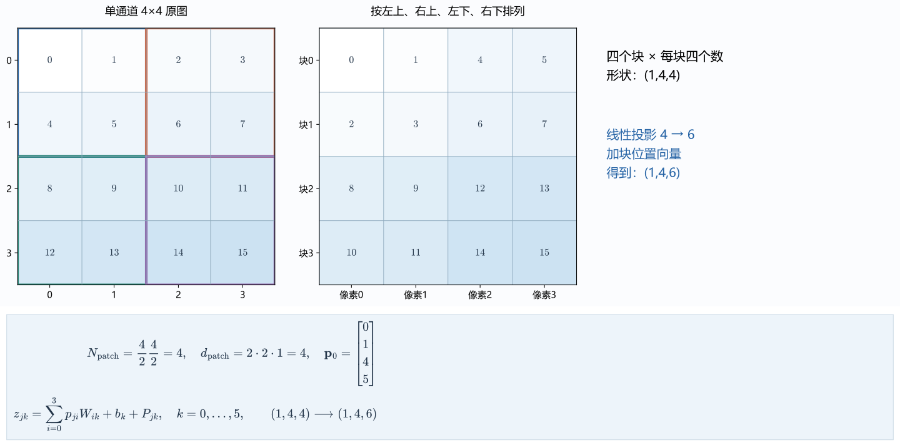

### 4. 手算一次块投影

切出了形状为 `(4, 4)` 的块序列 $P_{\rm patch}$ 后，每个块的原始宽度受分辨率和块大小支配，而后面的 Transformer 网络却要求所有位置统一为模型特征宽度 $d$。于是我们在入口处接上一层共享的线性块投影（Patch Projection）：取目标宽度 $d=6$，用同一张权重矩阵 $W_p\in\mathbb R^{4\times 6}$ 和偏置 $\mathbf b_p\in\mathbb R^6$ 作用于全部四个块：

$$
Z=P_{\rm patch}W_p+\mathbf b_p,\qquad
W_p\in\mathbb R^{4\times6},\quad \mathbf b_p\in\mathbb R^6.
$$

为了看清这层线性投影到底能从像素块里抽出什么特征，我们暂取偏置为零，并明确指定一张 $4\times 6$ 的权重矩阵 $W_p$：

$$
W_p=\begin{bmatrix}
1&0&0&0&1/4&1\\
0&1&0&0&1/4&-1\\
0&0&1&0&1/4&1\\
0&0&0&1&1/4&-1
\end{bmatrix}.
$$

看这张矩阵的六列设计得多么直观：前四列是 $4\times 4$ 单位矩阵，负责把块里的四个原始像素原样保留下来；第 5 列四个数全是 $1/4$，负责算出这个 $2\times2$ 块的**平均亮度**；第 6 列是 $(1, -1, 1, -1)^{\mathsf T}$，因为在我们的块内展开顺序里，第 0、2 项是左列像素，第 1、3 项是右列像素，所以这一列算出来的正好是**“块内左半边亮度之和减去右半边亮度之和（水平方向边缘差分）”**！

现在把左上块 $\mathbf p_0=(0,1,4,5)$ 右乘 $W_p$，第 0 行的六维视觉向量立刻手算出来：

$$
\mathbf z_0=\left(
0,1,4,5,\
\frac{0+1+4+5}{4},\
0-1+4-5
\right)
=(0,1,4,5,2.5,-2).
$$

再用同一张矩阵乘右上块 $\mathbf p_1=(2,3,6,7)$，得到 $\mathbf z_1=(2,3,6,7,4.5,-2)$。对比这两行结果：右上块整体比左上块更亮，所以它的第 5 维（平均亮度）从 $2.5$ 涨到了 $4.5$；但在每个块内部，右列像素都比左列像素恰好大 $1$，所以它俩的第 6 维（左右亮度差）全都是 $-2$！

当然，在实际训练中，$W_p$ 的权重是由损失梯度自动学出来的，并不需要我们人工去规定哪一列算均值、哪一列算边缘。而且从第一篇的线性代数视角来看，虽然这一步把 $4$ 维块向量投影成了 $6$ 维向量，但由于这 $6$ 个数全都是由原来那 $4$ 个像素线性组合出来的，线性变换的秩最多不超过 $4$——单靠把矩阵列数扩宽到 $6$，并没有凭空制造出六个独立的测量信息；真正让特征丰富起来的，是紧随其后的非线性激活、跨块的自注意力交互以及监督信号的反向更新。

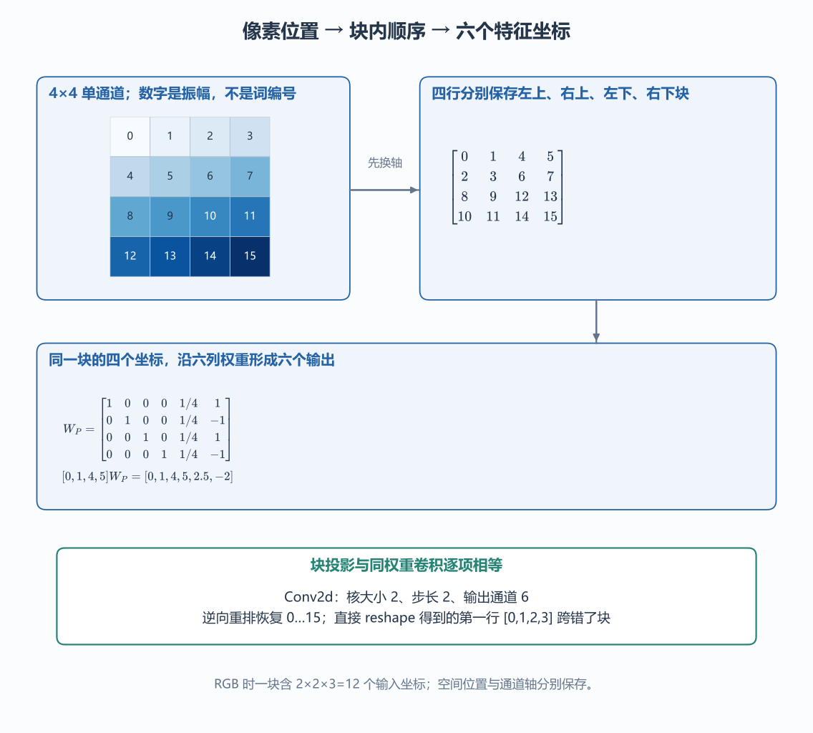

### 5. 块投影与大步长卷积

如果你回头翻一下第三篇讲过的二维卷积 `nn.Conv2d`，就会发现上面这步“先用 `unfold` 切成不重叠的 $2\times2$ 块、再右乘 $4\times 6$ 矩阵 $W_p$”，在数学上还有另一个完全等价的孪生兄弟——**卷积核大小（Kernel Size）等于 $2$、滑动步长（Stride）也等于 $2$ 的二维卷积层**！

不信你看：如果我们把刚才 $W_p$ 的第 5 列（平均亮度）按块内顺序折回 $2\times2$ 的方格，它就是一张均值滤波卷积核 $K_{\rm mean}$；把第 6 列（左右差分）折回 $2\times2$ 方格，它就是一张经典的垂直边缘检测卷积核 $K_{\rm diff}$：

$$
K_{\rm mean}=\begin{bmatrix}1/4&1/4\\1/4&1/4\end{bmatrix},
\qquad
K_{\rm diff}=\begin{bmatrix}1&-1\\1&-1\end{bmatrix}.
$$

在第三篇里，卷积核的滑动步长取 $1$，所以相邻窗口会有重叠；而在这里，把卷积核大小设为 $P=2$、滑动步长也设为 $P=2$，卷积核在 $4\times4$ 图像上每迈一步就刚好跨过一个完整的块，读取的正是那四个互不重叠的 Patch！六个卷积核各自扫过全图，产生 6 张 $2\times2$ 的特征图（形状 `(1, 6, 2, 2)`），把空间高宽展平并把通道轴换到最后，得到的 `(1, 4, 6)` 张量与刚才用 `unfold + 矩阵乘法` 算出来的结果分毫不差！在配套函数 `patch_trace` 中，我们把同一套 $W_p$ 参数写进 `nn.Conv2d(1, 6, kernel_size=2, stride=2)`，实测两边输出的最大绝对差严格为 `0.0`。这也是为什么工业界的 ViT 源码在实现入口切块投影时，几乎全都直接用一行 `Conv2d(C, d, kernel_size=P, stride=P)` 一气呵成。

### 6. 位置编码与整图汇总

经过块投影，一张图变成了 4 行 6 列的序列张量 $Z$。但正如第四篇第三节所证明的，如果不加位置信息，全可见的自注意力是置换等变的——你把图像的左上块和右下块抠下来对调，拼出来的画面早就面目全非了，可不带位置的注意力算出来的各行特征除了换个座位之外居然数值不变！

因此，ViT 同样必须给每个块位置加上位置编码。原始 ViT 论文直接准备了一张可学习的一维位置向量表 $\mathbf e_0,\ldots,\mathbf e_3$，因为四个块排成一维序列的顺序（左上、右上、左下、右下）已经事先锁死了，每个一维行号就唯一对应着图上的一个二维区域，直接按行加上去得到 $\mathbf z_i + \mathbf e_i$，就能让注意力分清每个块来自画面的哪个方位。

接下来，如果任务是给整张图片做分类（比如判断整张图是猫还是狗），4 个块位置进了 Transformer 之后吐出来的还是 4 行向量，最后拿哪一行去接分类器呢？常见做法有两种：
* **第一种是加挂可学习的 `[CLS]` 汇总向量**：在进入第一层注意力之前，先在 4 个图像块序列的最开头硬塞进一行可训练的参数向量 `[CLS]`，使序列总长度从 $4$ 变成 **$5$**。在随后的多层双向自注意力中，这第 $0$ 行的 `[CLS]` 可以自由读取后面全部 4 个图像块的信息；等到最后一层输出时，只取出第 $0$ 行 `[CLS]` 的向量送进分类头。反向传播时，分类误差会顺着 `[CLS]` 对四个块的注意力读取路径传回全图。
* **第二种是末层全局平均池化（Mean Pooling）**：不加 `[CLS]`，让 4 个块先在多层双向自注意力里充分交换局部与全局信息，最后把输出端的 4 行向量加起来求平均，再接分类头（注意：这是“先在多层注意力里交互完空间关系、最后再求平均”，跟那种“一上来把原图所有像素求个平均亮度”有着天壤之别）。

当然，只有当任务只需要一个整图总结时，我们才在最后一步把多行压成一行；如果后面的任务需要指出“物体在哪个格子里”或者要让语言模型看清局部细节，就必须把这 4 个块位置（乃至更密集的网格特征）完整保留下来往后传。

两种汇总方式的差别可以沿“输入有几行、末层取哪些行”逐步追踪。下图左路用 $Y^{\rm CLS}$ 表示包含 CLS 的末层输出，取第 0 行；右路用 $Y^{\rm pool}$ 表示四个图像位置的末层输出，对这四行逐特征求平均。两路最后都得到六维整图向量，取值由各自网络学出的表示决定。右路平均的是经过上下文交互的特征行，绝不是把输入图像直接压成一个平均像素。

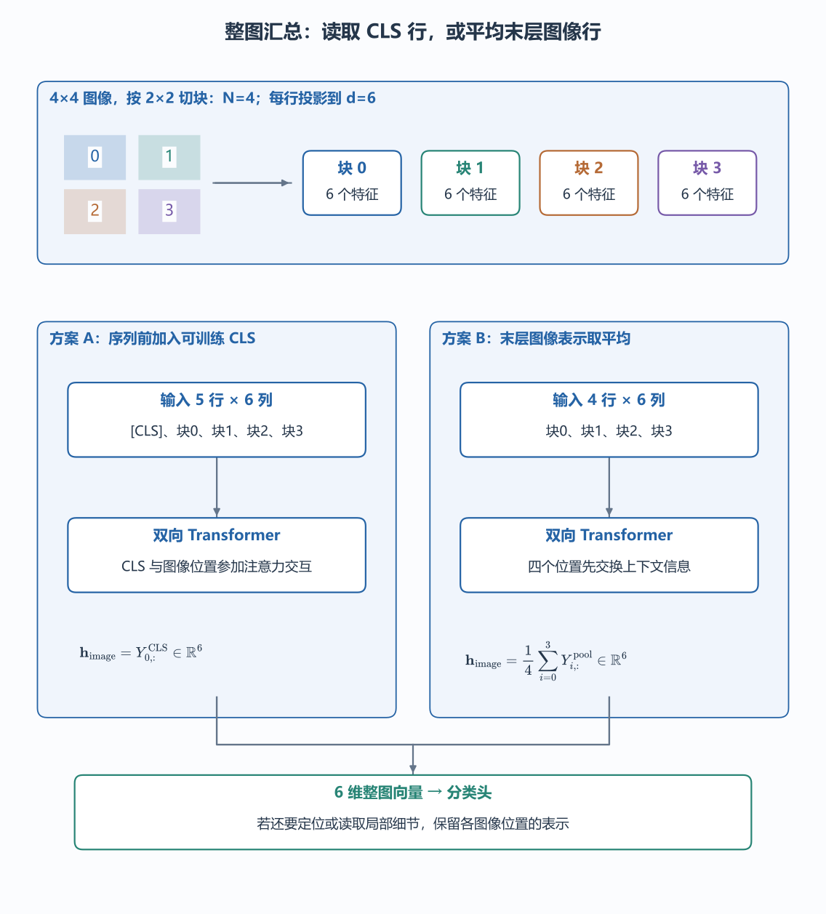

## （二）图文对齐与 CLIP

### 1. 两种表示的对应关系

现在我们手里既有了一个能把整张图片压成一条 $d$ 维向量的图像编码器 $f_\theta$，又有了一个能把一句话压成一条 $d$ 维向量的文本编码器 $g_\phi$。但请想一想：仅仅规定两边的输出向量宽度相同（比如都是二维或六维），能不能保证拿图像向量和文本向量做点积时，配对的图文就一定指向同一个方向？

绝对不能！举个极简的例子：假设图像编码器把“左条纹图”和“右条纹图”分别映成了标准基 $(1,0)$ 和 $(0,1)$；而文本编码器在单独训练时，却把文字“左条纹”和“右条纹”反过来映成了 $(0,1)$ 和 $(1,0)$。如果两边各自接一个独立的分类头，它们在各自的分类测试里都能拿满分；可一旦你把分类头拆掉，直接拿图像向量和文本向量做跨模态点积，原本配对的“左条纹图 $(1,0)$”和“左条纹字 $(0,1)$”点积居然是 $0$，而错配的点积反而是 $1$，把两对样本认得完全颠倒！因为两边各自独立训练时，特征空间的坐标轴哪怕整体旋转或镜像翻转了，只要分类头跟着一起转，单模态任务根本察觉不到。

要想让两座编码器把同一个概念映射到**同一个坐标方向**上，就必须把“哪张图对应哪句话”直接写进同一个损失函数里联合训练——这就是 **[CLIP（Contrastive Language-Image Pre-training，对比图文预训练）](https://arxiv.org/html/2103.00020v1)** 的核心思想。

设一个训练批次里装了 $N$ 对配好对的图文样本 $(I_i, T_i)$（其中 $i=0,\ldots,N-1$）。图像编码器 $f_\theta$ 和文本编码器 $g_\phi$ 先把图片和文字分别编码成宽度同为 $d$ 的向量，紧接着对每个向量**除以它自身的二范数长度**，变成单位向量 $\mathbf u_i$ 和 $\mathbf v_j$：

$$
\mathbf u_i=\frac{f_\theta(I_i)}{\|f_\theta(I_i)\|_2},
\qquad
\mathbf v_j=\frac{g_\phi(T_j)}{\|g_\phi(T_j)\|_2}.
$$

为什么要先做二范数归一化？第一篇已经讲过，两个单位向量的点积就严格等于它们夹角的余弦 $\cos\theta\in[-1,1]$。做了归一化之后，网络就没法靠投机取巧地把某个向量的模长拉大十倍来刷高点积分数了，它唯一能改变相似度的办法就是老老实实**转动向量的方向**（在代码实现里，分母通常会加上一个极小正数保护，如 `F.normalize` 的默认 $\varepsilon=10^{-12}$，防止遇到全零向量时除零崩溃）。

把批次里 $N$ 张图的单位向量按行叠成矩阵 $U\in\mathbb R^{N\times d}$，把 $N$ 句话的单位向量按行叠成矩阵 $V\in\mathbb R^{N\times d}$，再除以温度系数 $\tau>0$，一次矩阵乘法就得到了涵盖批次内所有图文两两组合的 $N\times N$ 相似度打分矩阵 $S$：

$$
S=\frac{UV^{\mathsf T}}{\tau}\in\mathbb R^{N\times N},\qquad \tau>0.
$$

在这张 $N\times N$ 方阵里，第 $i$ 行、第 $j$ 列的元素 $S_{ij}$ 度量的就是“第 $i$ 张图与第 $j$ 句话”缩放后的余弦相似度（CLIP 原论文把对数温度 $\log(1/\tau)$ 设为一个可学习的标量参数；为方便纸面精确核对，本篇手算部分固定取 $\tau=1$，训练实验固定取 $\tau=0.2$）。

### 2. 一张矩阵上的两个检索任务

假设我们在构造批次时，已经把配对的图和文按相同的顺序排齐了——也就是说，“图 $0$ 的原配是文 $0$，图 $1$ 的原配是文 $1$，……，图 $i$ 的原配就在对角线 $S_{ii}$ 上”。此时，同一张打分矩阵 $S$ 上其实同时摆放着两个互为镜像的分类检索考题：

1. **按行看（以图找文，Image-to-Text）**：第 $i$ 行有 $N$ 个分数 $(S_{i,0}, \ldots, S_{i,N-1})$，代表拿第 $i$ 张图去和批次里全部 $N$ 句话比对；这是一道 $N$ 选 $1$ 的单选题，标准答案是第 $i$ 列（$S_{ii}$），所以要沿着**每一行**做 Softmax 并计算交叉熵。
2. **按列看（以文找图，Text-to-Image）**：第 $j$ 列也有 $N$ 个分数 $(S_{0,j}, \ldots, S_{N-1,j})$，代表拿第 $j$ 句话反过来去和批次里全部 $N$ 张图比对；标准答案是第 $j$ 行（$S_{jj}$），所以要沿着**每一列**做 Softmax 并计算交叉熵。

我们先拿一个最简单的 $N=2$ 对称正交例子热个身：设两张图的单位向量和两句话的单位向量都恰好是二维标准基 $\mathbf u_0=\mathbf v_0=(1,0)$、$\mathbf u_1=\mathbf v_1=(0,1)$，取 $\tau=1$，打分矩阵就是单位阵：

$$
S=\begin{bmatrix}1&0\\0&1\end{bmatrix}.
$$

横着看第 0 行（图 0 找文）：两个候选分数为 $(1, 0)$，取指数后原配文 0 分到的概率与错配文 1 分到的概率分别为：

$$
P^{\rm row}_{00}=\frac{e^1}{e^1+e^0}=\frac{e}{e+1}\approx0.731059,
\qquad
P^{\rm row}_{01}=\frac{1}{e+1}\approx0.268941.
$$

第 1 行完全对称，原配概率也是 $e/(e+1)$。于是“以图找文”方向的平均交叉熵损失为 $-\log(e/(e+1))\approx 0.313262$（你看，虽然最高分检索已经 100% 选对了原配，但只要原配概率还没推到 $1$、与错配分差还没拉开，交叉熵损失就依然大于零，继续逼着模型拉大差距或调小温度 $\tau$）。竖着看两列，“以文找图”的损失同样是 $0.313262$。最后把两个方向的损失**加起来除以 2 求平均**，总的 CLIP 损失依然是 $0.313262$（注意是取平均 $\frac12(L_{\rm I\to T}+L_{\rm T\to I})$，不是直接相加翻倍成 $0.626523$）：

$$
L_{\rm I\to T}
=-\frac1N\sum_{i=0}^{N-1}\log\frac{e^{S_{ii}}}{\sum_{j=0}^{N-1} e^{S_{ij}}},
\qquad
L_{\rm T\to I}
=-\frac1N\sum_{j=0}^{N-1}\log\frac{e^{S_{jj}}}{\sum_{i=0}^{N-1} e^{S_{ij}}},
$$

$$
L=\frac{L_{\rm I\to T}+L_{\rm T\to I}}2.
$$

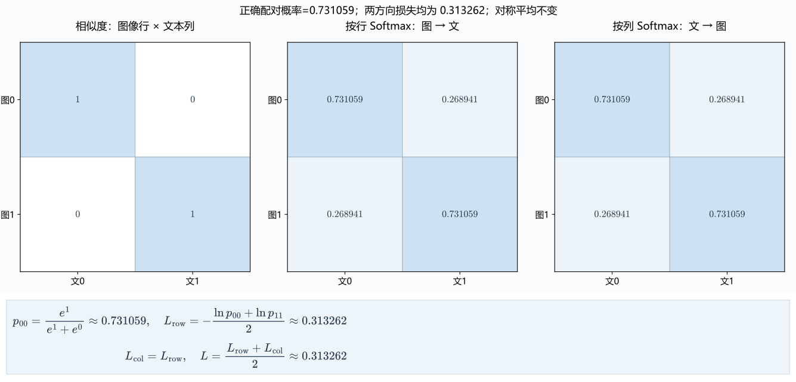

### 3. 逐行、逐列算配对损失

刚才的单位阵太对称了，很容易让人误以为“按行算的概率矩阵”和“按列算的概率矩阵”永远是一回事。现在我们故意打破对称，保持图 0、图 1 和文 0 不动，把**文 1 的单位向量往图 0 的方向偏转过去**，取 $\mathbf v_1=(0.6, 0.8)$（检查长度：$0.6^2+0.8^2=0.36+0.64=1$，依然是严格的单位向量）：

$$
\mathbf u_0=(1,0),\quad\mathbf u_1=(0,1),\qquad
\mathbf v_0=(1,0),\quad\mathbf v_1=(0.6,0.8).
$$

取 $\tau=1$，此时算出来的 $2\times2$ 打分矩阵 $S=UV^\mathsf T$ 变成了一张非对称矩阵——右上角多出了一个非零的错配高分 $0.6$：

$$
S=\begin{bmatrix}1&0.6\\0&0.8\end{bmatrix}.
$$

我们分别按行和按列把两个方向的概率和损失算出来：
* **先横着按行算（以图找文 $L_{\rm I\to T}$）**：
  第 0 行（图 0 找文），分数是 $(1,\ 0.6)$，因为错配的文 1 凑上来抢走了不少相似度，图 0 选中文 0 的原配概率从刚才的 $0.731$ 跌到了：
  $$
  P^{\rm row}_{00}
  =\frac{e^1}{e^1+e^{0.6}}
  =\frac1{1+e^{-0.4}}
  \approx0.598688.
  $$
  第 1 行（图 1 找文），分数是 $(0,\ 0.8)$，图 1 选中文 1 的原配概率为：
  $$
  P^{\rm row}_{11}
  =\frac{e^{0.8}}{e^0+e^{0.8}}
  =\frac{e^{0.8}}{1+e^{0.8}}
  \approx0.689974.
  $$
  两行取负对数求平均，横向“以图找文”损失为：
  $$
  L_{\rm I\to T}
  =-\frac{\log0.598688+\log0.689974}{2}
  \approx0.442058.
  $$
* **再竖着按列算（以文找图 $L_{\rm T\to I}$）**：
  第 0 列（文 0 找图），纵向两个分数是 $(1,\ 0)^{\mathsf T}$，文 0 选中图 0 的正确概率依然是 $P^{\rm col}_{00} = e/(e+1) \approx 0.731059$；
  第 1 列（文 1 找图），纵向两个分数是 $(0.6,\ 0.8)^{\mathsf T}$，注意分母变成了 $e^{0.6}+e^{0.8}$，文 1 选中图 1 的正确概率只有：
  $$
  P^{\rm col}_{11}
  =\frac{e^{0.8}}{e^{0.6}+e^{0.8}}
  =\frac{1}{1+e^{-0.2}}
  \approx0.549834.
  $$
  两列取负对数求平均，纵向“以文找图”损失与双向总损失分别为：
  $$
  L_{\rm T\to I}
  =-\frac{\log0.731059+\log0.549834}{2}
  \approx0.455700,\qquad
  L=\frac{0.442058+0.455700}{2}\approx0.448879.
  $$

把横向归一化得到的行概率矩阵 $P^{\rm row}$（每行之和为 $1$）与纵向归一化得到的列概率矩阵 $P^{\rm col}$（每列之和为 $1$）并排摆出来：

$$
P^{\rm row}\approx
\begin{bmatrix}
0.598688&0.401312\\
0.310026&0.689974
\end{bmatrix},
\qquad
P^{\rm col}\approx
\begin{bmatrix}
0.731059&0.450166\\
0.268941&0.549834
\end{bmatrix}.
$$

你看，同一个位置（比如左上角 $(0,0)$），在横向行竞争里分到的概率是 $0.598688$，而在纵向列竞争里分到的概率却是 $0.731059$！在写 PyTorch 代码时，第二个方向只需要把转置矩阵 `S.T` 传进同一个按行算的 `cross_entropy(S.T, labels)` 即可，既复用了整套特征，又把纵横两场竞争同时装进了计算图。

### 4. 归一化后的梯度与向量转动

现在，我们要顺着这个非对称样本把反向传播从顶层损失一直推到底层编码器的原始未归一化输出 $\mathbf f_0$，亲眼看看梯度是怎么指挥向量“原地转动方向”的。

**第一步：求总损失 $L$ 对打分矩阵 $S$ 的梯度 $G$**
根据第四篇推导的交叉熵导数“预测概率减去独热目标 $\mathbf 1[i=j]$”，横向损失 $L_{\rm I\to T}$ 对 $S_{ij}$ 的导数是 $\frac{1}{N}(P^{\rm row}_{ij} - \mathbf 1[i=j])$，纵向损失 $L_{\rm T\to I}$ 对 $S_{ij}$ 的导数是 $\frac{1}{N}(P^{\rm col}_{ij} - \mathbf 1[i=j])$。把两路加起来除以 $2$，总损失对任意位置分数 $S_{ij}$ 的梯度就是：

$$
G_{ij}=\frac{\partial L}{\partial S_{ij}}
=\frac{P^{\rm row}_{ij}+P^{\rm col}_{ij}-2\mathbf1[i=j]}{2N}.
$$

在本例中 $N=2$，分母为 $2\times 2 = 4$。把上面算好的两张概率矩阵代进去：
* 左上角正样本对角线 $(0,0)$（此处 $\mathbf 1[0=0]=1$，故减 $2$）：
  $$
  G_{00}
  =\frac{0.598688+0.731059-2}{4}
  \approx-0.167563;
  $$
* 右上角负样本错配位 $(0,1)$（此处 $\mathbf 1[0=1]=0$）：
  $$
  G_{01}
  =\frac{0.401312+0.450166}{4}
  \approx+0.212870.
  $$

四个位置全部算完，打分矩阵的梯度 $G$ 为：

$$
G\approx
\begin{bmatrix}
-0.167563&0.212870\\
0.144742&-0.190048
\end{bmatrix}.
$$

（主对角线上全是负数，梯度下降减去负数就会推高正配对分数；副对角线上全是正数，梯度下降就会压低错配分数。）

**第二步：从打分矩阵 $S=UV^\mathsf T/\tau$ 退回单位向量 $U$ 和 $V$**
按矩阵乘法求导法则：

$$
\nabla_U L=\frac{GV}{\tau},\qquad
\nabla_V L=\frac{G^{\mathsf T}U}{\tau}.
$$

我们在 $\tau=1$ 下专门看图 $0$ 的单位向量 $\mathbf u_0=(1,0)$ 收到的梯度（即 $GV$ 的第 $0$ 行）：

$$
\nabla_{\mathbf u_0}L
=G_{00}\mathbf v_0+G_{01}\mathbf v_1
=-0.167563\times(1,0) + 0.212870\times(0.6, 0.8)
\approx(-0.039842,\ +0.170296).
$$

请看第二坐标上的那个正梯度 $+0.170296$：为什么图 $0$ 本来躺在横轴 $(1,0)$ 上，梯度却在纵轴方向给出了 $+0.170296$？因为错配的文 $1$ 向量 $\mathbf v_1=(0.6, 0.8)$ 带有正的纵轴分量！为了躲开文 $1$、降低它俩之间的错配点积，梯度下降（减去正梯度）就会把图 $0$ 的向量往**负纵轴方向（往下）**拉！

**第三步：穿过二范数归一化 $\mathbf u = \mathbf f / \|\mathbf f\|_2$，退回编码器原始输出 $\mathbf f$**
这是整个推导最精彩的一环：图 $0$ 的单位向量 $\mathbf u_0$ 是由图像编码器的原始输出向量 $\mathbf f_0$ 除以它自身的长度 $r = \|\mathbf f_0\|_2$ 得到的。当梯度从 $\mathbf u$ 往回穿过这步除法传给 $\mathbf f$ 时，会发生什么几何过滤？
我们对第 $i$ 个分量 $u_i = f_i / r$ 关于第 $j$ 个原始分量 $f_j$ 用商的求导法则（注意 $\frac{\partial r}{\partial f_j} = \frac{f_j}{r}$）：

$$
\frac{\partial u_i}{\partial f_j}
=\frac{\mathbf1[i=j]\cdot r - f_i\cdot\frac{f_j}{r}}{r^2}
=\frac{\mathbf1[i=j]}{r}-\frac{f_if_j}{r^3}
=\frac{1}{r}\bigl(\mathbf1[i=j]-u_iu_j\bigr)
=\frac{(I-\mathbf u\mathbf u^{\mathsf T})_{ij}}{r}.
$$

写成向量与矩阵乘法的形式，编码器原始输出 $\mathbf f$ 收到的梯度就是：

$$
\nabla_{\mathbf f}L
=\frac{I-\mathbf u\mathbf u^{\mathsf T}}{\|\mathbf f\|_2}
\nabla_{\mathbf u}L.
$$

看到分子上那个矩阵 $I - \mathbf u\mathbf u^{\mathsf T}$ 了吗？回到第一篇的几何投影：因为 $\mathbf u$ 是单位向量，$\mathbf u\mathbf u^{\mathsf T}$ 正是**往 $\mathbf u$ 自身方向上做正交投影的投影矩阵**；那么用单位阵减去它，**$I - \mathbf u\mathbf u^{\mathsf T}$ 就是把平行于 $\mathbf u$ 的分量彻底抹零、只保留垂直于 $\mathbf u$ 的正交切向分量的投影矩阵！**

拿具体数字算一下就更直观了：假设图 $0$ 归一化前的编码器原始输出是 $\mathbf f_0=(2, 0)$（长度 $\|\mathbf f_0\|_2 = 2$，归一化后为 $\mathbf u_0=(1, 0)$）。此时外积 $\mathbf u_0\mathbf u_0^\mathsf T = \begin{bmatrix}1&0\\0&0\end{bmatrix}$，于是 $I - \mathbf u_0\mathbf u_0^\mathsf T = \begin{bmatrix}0&0\\0&1\end{bmatrix}$。把刚才算出的单位向量梯度 $\nabla_{\mathbf u_0}L\approx(-0.039842,\ 0.170296)$ 乘上去再除以长度 $2$：

$$
\nabla_{\mathbf f_0}L
=\frac{1}{2}\begin{bmatrix}0&0\\0&1\end{bmatrix}
\begin{bmatrix}-0.039842\\0.170296\end{bmatrix}
\approx(0,\ 0.085148).
$$

你看，原本在第一坐标（横轴方向）上的梯度 $-0.039842$ 被彻底消成了 **$0$**，只留下了垂直于 $(2,0)$ 的第二坐标梯度 $0.085148$！为什么横轴方向的梯度必须是零？因为 $\mathbf f_0=(2,0)$ 本来就指着横轴正方向，如果你沿着横轴把 $(2,0)$ 拉长成 $(2.1, 0)$ 或缩短成 $(1.9, 0)$，除以它自己的长度归一化之后，它依然是 $(1,0)$ 一动不动，对余弦相似度没有任何一阶影响！只有沿着垂直于当前向量的切线方向推它（改变第二坐标），才能真正转动它的方向角！第一篇学的正交投影矩阵，在这里把二范数归一化的反向传播解释得通透无比。

配套函数 `clip_trace` 同时用纯 NumPy 公式、PyTorch 自动微分和中心差分核对了这三步，手算与自动微分完全吻合，中心差分最大误差仅为 $5.74\times 10^{-11}$。

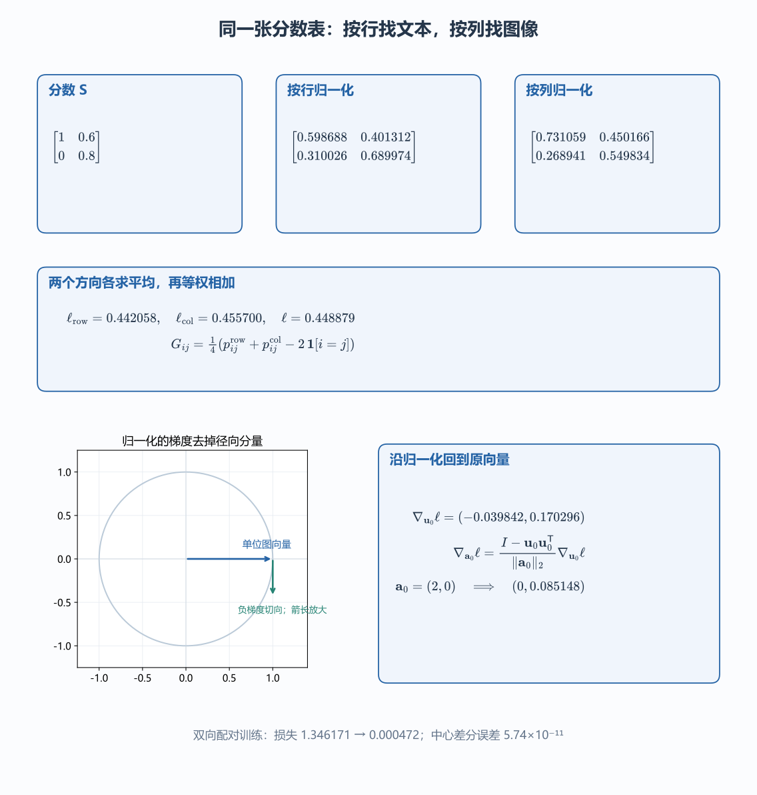

### 5. 条纹训练与灰块检验

我们用两张 $2\times2$ 的条纹图跑一次完整的 CLIP 双塔配对训练：第一张图“左列亮、右列暗”，展平为 $(1,0,1,0)$；第二张图“左列暗、右列亮”，展平为 $(0,1,0,1)$；文字端则用两个独热类别向量分别代表“左条纹”和“右条纹”。图像端和文字端各自接一个从随机种子 `17` 初始化的可训练线性层映射到二维空间，经二范数归一化后，在温度 $\tau=0.2$ 下用 Adam（学习率 $0.03$）迭代更新 100 步。

注意在这次真实训练中，我们并没有预先把二维方向写死在 $(1,0)$ 和 $(0,1)$ 上，而是让两个塔自己从随机方向在对比损失的驱动下旋转对齐。跑完 100 步后，双向平均损失从最初的约 $1.346171$ 降到了 $0.000472$，最终学出来的 $2\times2$ 打分矩阵 $S_{\rm trained}$ 为：

$$
S_{\rm trained}\approx
\begin{bmatrix}
4.758963&-2.621151\\
-3.093498&4.903786
\end{bmatrix}.
$$

看对角线上的两个正配对得分 $4.759$ 和 $4.904$：因为两个单位向量的点积最大不超过 $1$，除以温度 $\tau=0.2$ 后的理论满分天花板就是 $1/0.2 = 5.0$；现在的得分已经极其逼近 $5.0$（说明配对图文向量的夹角已经几乎重合为 $0^\circ$），而副对角线上的错配得分则被推到了 $-2.62$ 和 $-3.09$（夹角被推开成了钝角）。

训练完成后，我们拿两组新图片去检验它的泛化与边界行为：
* 先喂入两张带灰度过渡的条纹图 $(0.9, 0.1, 0.8, 0.2)$ 与 $(0.1, 0.9, 0.2, 0.8)$：模型依然稳稳地把最高分判给了对应的“左条纹”和“右条纹”；
* 接着，我们故意喂入一张四个格子全是 $0.5$ 的**纯均匀灰块 $(0.5, 0.5, 0.5, 0.5)$**：在这张图里，左右两边没有任何亮度差，根本不存在什么左条纹或右条纹！但因为双塔线性层带偏置或初始权重并不绝对对称，模型算出分数后依然会给“左条纹”打出比“右条纹”略高一点的分数。

这个纯灰块实验挑明了一条至关重要的工程边界：**CLIP 给出的余弦分数，只负责在当前给定的候选池子里排出相对高低，它本身并不包含“当前输入其实跟所有候选都不沾边”的拒答保证！** 在实际做图库检索或零样本分类时，绝不能一看某个类别拿到了最高分（`argmax`）就盲目认定图里真有这个东西，必须结合相似度绝对阈值或专门的空类/拒答机制来兜底。

### 6. 配对身份与候选顺序

在前面的训练批次里，之所以正样本刚好排在对角线 `[0, 1]` 上，纯粹是因为我们在喂数据前人为把图 0 和文 0、图 1 和文 1 按相同顺序对齐排好了。到了实际检索评测时，候选文本库的排列顺序往往跟待测图片的顺序完全不一致，这时候**配对标签必须跟着真实身份（ID）走，绝不能无脑写死 `torch.arange(N)`**！

比如在刚才训好的模型上，如果我们把候选文字列表的两列对调成 `["右条纹", "左条纹"]`，那么图 0（左条纹图）的正确列索引就变成了 `1`，图 1（右条纹图）的正确列索引就变成了 `0`。模型实际算出的最高分列索引也是 `[1, 0]`，完全正确；可要是评测代码偷懒还拿着写死的 `[0, 1]` 去核对，就会把本来 100% 算对的模型冤枉成 0 分！

更有甚者，当图片列表和文字列表经过了任意打乱（非对称排列）时，“以图找文”的正确列标签和“以文找图”的正确行标签，甚至**根本不是同一个整数列表**（它们互为逆置换）：

~~~python
image_ids = ["a", "b", "c"]
text_ids = ["c", "a", "b"]
image_to_text = [text_ids.index(identity) for identity in image_ids]
text_to_image = [image_ids.index(identity) for identity in text_ids]
print(image_to_text, text_to_image)  # [1, 2, 0] 与 [2, 0, 1]
~~~

你看，当图按 `["a", "b", "c"]` 排、文按 `["c", "a", "b"]` 排时，以图找文的正确列号是 `[1, 2, 0]`，而以文找图的正确行号却是 `[2, 0, 1]`！此外，在真实图文数据集里，同一张风景照完全可能同时符合好几句不同的描述；如果继续沿用单正样本交叉熵，就会把批次里同样正确的另一句描述当成负样本强行推开，这在多正例场景下就需要改用多标签二元分类（如 SigLIP）或按真实配对关系修正评估集合。

## （三）视觉输入与语言回答

### 1. OCR 读文字，VLM 读图像

CLIP 能帮我们算出“哪张图和哪句话最配”，但它只有一个计算余弦相似度的双塔输出头，并没有像第四篇 `TinyLM` 那样能够顺着词表一个字一个字往外写回答的语言生成头。如果用户把一张写着数学公式推导的截图交给资料助手，问它：“图里第二步移项错在了哪里？”，我们该怎么把图像接进语言生成模型里？

在工程上有两条截然不同的接入路线：
第一条路线是**外挂 OCR（光学字符识别）转写链**：先用一个专门的文字检测与识别模型，把截图里的字符识别成纯文本字符串，再把这段字符串拼进第四篇的纯文本语言模型里去问答。这条路线的最大优点是中间过程极其透明：原图切出了哪几个文字框、每个框识别成了什么字符、语言模型最后收到了什么题目，全都能一步步分开核查。但它的短板也很明显：一旦截图里的负号 `-` 因为笔画太浅被 OCR 漏掉了，语言模型收到的就是一道已经残缺变形的错题；而且像几何图形里“两条辅助线相交在哪一侧”、“箭头从哪个框指向哪个框”这类空间拓扑关系，很难靠把字符排成一行纯文本完整保留下来。

第二条路线则是构建原生的**视觉语言模型（Vision-Language Model，简称 VLM）**。以开源界经典的 **[LLaVA 架构](https://arxiv.org/html/2304.08485v2)** 为例，它不把图片先压成几个汉字了事，而是直接用一套由**“视觉编码器（Vision Encoder）+ 跨模态投影器（Projector）+ 语言模型（LLM）”**串起来的三段式结构：先用第一节的视觉编码器把图片切成一排保留了局部空间内容的块向量，经过投影器对齐宽度后，直接把这些连续的视觉向量当作前缀位置塞进语言模型的自注意力序列里，让语言模型在每一步预测下一词时都能直接回头查阅原图的局部视觉特征！（在实际系统里，这两条路线完全可以联手：让 OCR 提供精确可定位的字符锚点，同时让 VLM 保留全局与局部的几何视觉特征，互相印证核对。）

### 2. 宽度对齐与沿位置轴拼接

我们亲手把第一节算出来的视觉块特征，与第四篇的文本嵌入拼成一条完整的 VLM 输入序列，看看张量的每一条轴是怎么严丝合缝对上号的。

在第一节第 4 小节里，那张 $4\times4$ 的灰度图被切成了 4 个块，经过 $W_p$ 投影后得到了 4 行 6 列的视觉特征。加上批次轴 $B=1$ 后，视觉编码器的输出张量形状为：

$$
V_{\rm vision}\in\mathbb R^{1\times4\times6}.
$$

现在假设后面的语言模型工作在特征宽度 $d_{\rm model}=8$ 上。同一个自注意力层要求序列里所有位置的特征列数必须完全相同，6 维的视觉行向量显然没法直接和 8 维的文本行向量上下叠在一张矩阵里。为此，我们在视觉编码器和语言模型之间架起一座桥梁——**跨模态投影器（Projector）**，用一张形状为 $W_{\rm proj}\in\mathbb R^{6\times 8}$ 的矩阵（及偏置 $\mathbf b_{\rm proj}$）把每一行视觉特征从 6 维映射到 8 维：

$$
V_{\rm projected}
=V_{\rm vision}W_{\rm proj}+\mathbf b_{\rm proj},
\quad
W_{\rm proj}\in\mathbb R^{6\times8}.
$$

注意：这步投影只把最后一轴的特征宽度从 $6$ 扩成了 $8$，中间的视觉位置数依然是 $4$ 个，输出形状变为 `(1, 4, 8)`。为了能用纸笔逐项核对，我们暂取偏置为零，并把 $W_{\rm proj}$ 的前六列设为 $6\times 6$ 单位矩阵（原样保留前六个视觉特征），第 7 列设为“把前两项像素相加”，第 8 列设为“把第三、第四项像素相加”：

$$
W_{\rm proj}=
\begin{bmatrix}
1&0&0&0&0&0&1&0\\
0&1&0&0&0&0&1&0\\
0&0&1&0&0&0&0&1\\
0&0&0&1&0&0&0&1\\
0&0&0&0&1&0&0&0\\
0&0&0&0&0&1&0&0
\end{bmatrix}.
$$

拿第一节算出的左上块六维向量 $(0, 1, 4, 5, 2.5, -2)$ 右乘这张 $W_{\rm proj}$，末尾多出 $0+1=1$ 和 $4+5=9$ 两项，立刻变成八维视觉向量：

$$
(0,\ 1,\ 4,\ 5,\ 2.5,\ -2,\ 1,\ 9).
$$

与此同时，用户的文字提问前缀 `Q:` 在字节词表里占 2 个位置，经过宽度为 8 的文字嵌入表查表后，形状为 $E_{\rm text}\in\mathbb R^{1\times 2\times 8}$。
现在，`V_projected` 的形状是 `(1, 4, 8)`，`E_text` 的形状是 `(1, 2, 8)`，两者的特征宽度都是 8！我们沿着**中间的位置轴（`dim=1`）**把它们首尾拼接起来，就合成了送入语言模型 Transformer 块的联合输入序列 $X_{\rm joint}$：

$$
X_{\rm joint}
=\operatorname{concat}
(V_{\rm projected},E_{\rm text};\ {\rm dim}=1)
\in\mathbb R^{1\times6\times8}.
$$

看清拼接的轴号是 `dim=1`（位置轴）：4 个视觉位置加上 2 个文字位置，变成了总共 **6 个序列位置**，而最后的特征宽度轴依然保持为 8（千万不能错沿着末轴 `dim=2` 去拼，那样两边位置数 4 和 2 根本对不上，而且就算强行补齐了也是把特征变宽而不是延长序列前缀）：

~~~python
import torch
from modern_ai.visual_audio import patch_trace

vision = torch.tensor(patch_trace()["features"], dtype=torch.float64)[None]
extra = torch.tensor([[1.,0.], [1.,0.], [0.,1.],
                      [0.,1.], [0.,0.], [0.,0.]], dtype=torch.float64)
projector = torch.cat([torch.eye(6, dtype=torch.float64), extra], dim=1)
visual = vision @ projector
text = torch.zeros(1, 2, 8, dtype=torch.float64)
text[0, 0, 0], text[0, 1, 1] = 1, 1  # 两个文字位置的确定性嵌入。
joint = torch.cat([visual, text], dim=1)
print(visual[0, 0].tolist())  # [0.0, 1.0, 4.0, 5.0, 2.5, -2.0, 1.0, 9.0]
print(joint.shape)  # torch.Size([1, 6, 8])
~~~

这段代码清楚地展示了原生 VLM 是怎么跨过模态边界的：前四个视觉块位置根本不需要先去文字词表里找什么替代词 ID，它们直接绕过了文字的 `nn.Embedding` 查表层，以连续浮点向量的身份空降到了与文字嵌入平起平坐的 `(1, 6, 8)` 序列里；而到了模型最末端生成回答时，输出层依然只接文字词表头，在文字候选上算出概率分布。

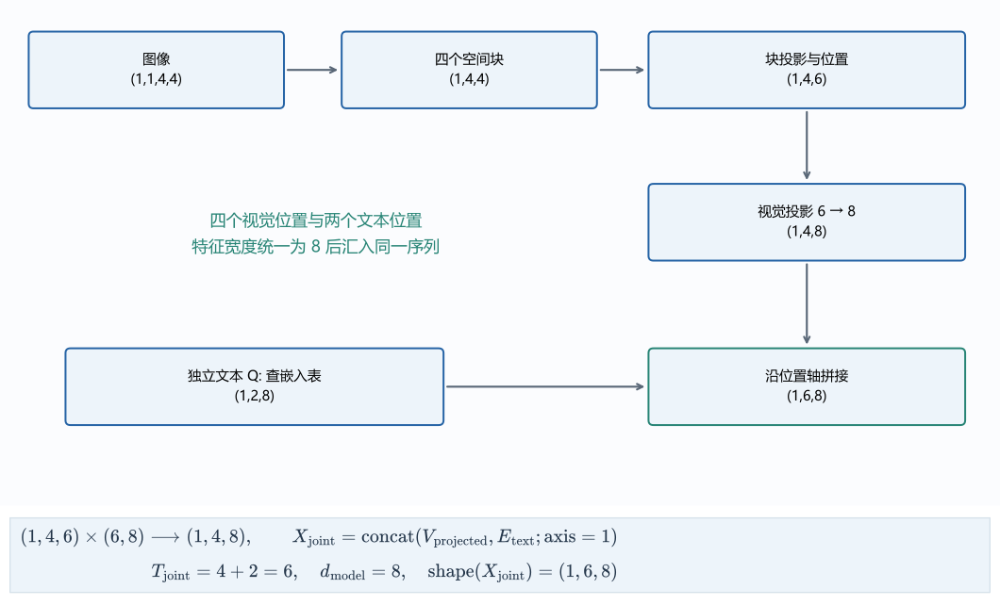

### 3. 追踪一次文字查询

在这条长度为 6 的联合序列 $X_{\rm joint}$ 里，位置 $0, 1, 2, 3$ 是四个图像块，位置 $4, 5$ 是文字提示 `Q` 和 `:`。按照第四篇的因果自注意力规则，排在最末尾的位置 $5$（冒号 `:`）在预测第一个回答字时，视野覆盖了从 $0$ 到 $5$ 的全部六个位置——它既能读前面的文字 `Q`，更能直接回头读取那四个图像块的键和值！

我们把位置 $5$ 的这次跨模态读取手算到具体数字：设注意力的查询和键宽度为 $d_k=2$。我们给定一组确定的查询投影，使得末尾位置 $5$ 发出的查询向量为 $\mathbf q_5=(1, 0)$；同时让键投影专门去读取八维输入里的第 4 号和第 5 号特征（按零起算，正好对应第一节算出来的“块平均亮度”与“块左右差分”这两项），并各乘上缩放因子 $0.1$。于是，四个图像块位置算出来的二维键向量分别为：

$$
K_{\rm vision}=
\begin{bmatrix}
0.25&-0.2\\
0.45&-0.2\\
1.05&-0.2\\
1.25&-0.2
\end{bmatrix}.
$$

而后面两行文字位置在这两个视觉特征维度上的值全为 $0$，所以两个文字位置的键向量都是 $(0, 0)$。现在拿末尾查询 $\mathbf q_5=(1,0)$ 去和全部六个位置的键做点积，再除以 $\sqrt{d_k}=\sqrt2$，立刻得到位置 $5$ 对六个位置的原始匹配分数 $\mathbf s_5$：

$$
\mathbf s_5
=\frac1{\sqrt2}(0.25,\ 0.45,\ 1.05,\ 1.25,\ 0,\ 0).
$$

（你看，因为 $\mathbf q_5=(1,0)$ 专门挑了第一坐标即平均亮度，这组参数就使得当前的文字查询把注意力重点投向了画面下方更亮的第 2、第 3 号图像块。注意这是由当前这组权重参数算出来的具体读取倾向，不能凭空假定“只要把图片拼进序列，文字查询就天然知道该看图里的哪个正确角落”，看哪里完全要靠后面的损失反传来教会它。）

对这六个分数做 Softmax 归一化，得到位置 $5$ 在四个图像块与两个文字位置上的读取权重比例：

$$
A_{5,:}\approx
(0.131292,\ 0.151237,\ 0.231160,\ 0.266275,\ 0.110018,\ 0.110018).
$$

接着看值投影（Value）：我们让值投影矩阵提取每一行八维输入的前两个特征并除以 $15$。于是左上块的值向量为 $(0, 1/15)$，右上块为 $(2/15, 3/15)$，左下块为 $(8/15, 9/15)$，右下块为 $(10/15, 11/15)$，两个文字位置的值向量则为 $(1/15, 0)$ 和 $(0, 1/15)$。拿上面的六个权重 $A_{5,j}$ 对这六个值向量做加权求和，就得到了末尾冒号位置融合了图像信息后的二维注意力输出 $\mathbf o_5$：

$$
\mathbf o_5=\sum_{j=0}^5 A_{5j}\mathbf v_j
\approx(0.328301,\ 0.380299).
$$

顺着这串数字往回看，原图 $4\times4$ 网格里的像素值，已经实打实地通过“切块投影 $\to$ 宽度对齐投影 $W_{\rm proj}$ $\to$ 键值投影 $\to$ 注意力加权读取”这一整条矩阵链条，流进了末尾文字位置的输出向量 $\mathbf o_5$ 里！

### 4. 回答损失回传到视觉投影器

有了融合后的输出 $\mathbf o_5\approx(0.328301,\ 0.380299)$，我们最后接上一个只有三个候选文字（`A`、`B`、`?`）的分类输出头，用三个列向量 $(1,0)^{\mathsf T}$、$(-1,1)^{\mathsf T}$、$(0,-1)^{\mathsf T}$ 作为输出层权重，算出三个候选的 logits 分数：

$$
\mathbf z
=(o_{5,0},\ -o_{5,0}+o_{5,1},\ -o_{5,1})
\approx(0.328301,\ 0.051998,\ -0.380299).
$$

在当前初始参数下，候选 `A` 的分数 $0.328301$ 排第一。如果训练数据的示范回答要求这里应该选第二个候选 `B`（目标索引为 `1`），那么此时的交叉熵损失约为 $1.087641$。

当我们对这个文字回答损失调用 `loss.backward()` 时，误差梯度是怎么往回走的？
它先穿过输出层改变 $\mathbf o_5$，接着顺着注意力层同时分流到值矩阵 $V$ 和读取权重 $A_{5,:}$（进而穿过 Softmax 到达键矩阵 $K_{\rm vision}$），最后顺着前四个视觉位置的键值投影，一直反传回那个负责把 6 维视觉块映射成 8 维的**跨模态投影器 $W_{\rm proj}$**！

在配套函数 `projector_trace` 中，我们冻结前面的视觉特征和后面的注意力/输出权重，只放开投影器 $W_{\rm proj}$ 接收梯度（这正是 LLaVA 第一阶段预训练对齐时的经典冻结配置）。一次反向传播算出 $W_{\rm proj}$ 的梯度二范数约为 $1.467024$；取学习率 $0.05$ 走完一步梯度下降后，再次前向计算，同一个目标 `B` 上的回答损失就从 $1.087641$ 降到了约 **$0.983141$**！而且这里和第五篇第一节的 SFT 完全相通：前四个图像块位置本身只充当回答的上下文条件，它们在输出层的标签全部设为 `-100` 忽略，但末尾文字回答位产生的预测误差，照样顺着跨位置注意力读取路径传回了视觉投影器，教会它怎样把图像特征翻译成语言模型能读懂的向量。

### 5. 图像 Token 的上下文账单

在日常使用多模态模型时，界面上往往只是挂了一个小小的图片缩略图图标，这很容易让人产生一种错觉：“传一张图片进去，应该也就占一两个 Token 的位置吧？”
只要算一算上面那套切块拼接的账单，你就知道一张高清大图在模型内部到底有多吃上下文预算了！

在我们刚才的玩具例子里，一张 $4\times4$ 的小图切成 $2\times2$ 的块，占了 $4$ 个视觉位置，加上 $2$ 个文字位置，联合前缀长度为 $6$（进入自回归生成后，这 $4$ 个视觉位置的 K 和 V 也必须一直留在 KV Cache 里占显存）。
现在换成一个真实的工业界标准配置：假设视觉编码器先把输入图片统一缩放到 $224\times224$ 分辨率，切块边长取 $P=16$，去掉 `[CLS]` 只保留全部图像块位置，那么光这一张图送进语言模型时占用的视觉 Token 位置数 $N_v$ 就是：

$$
N_v=(224/16)^2=14^2=196\text{ 个位置}.
$$

如果为了看清文档里的小字，不把原图缩回 $224$，而是直接把分辨率翻倍到 $448\times448$ 送进同一个 $P=16$ 的切块编码器，视觉位置数就会按平方关系暴涨四倍，变成 $N_v = (448/16)^2 = 28^2 =$ **$784$ 个位置**！
假设图片后面还跟着 $64$ 个文字提问 Token，我们来对比一下单头完整自注意力打分矩阵 $(N_v + 64)^2$ 的元素个数：

$$
(196+64)^2=260^2=67,600,\qquad
(784+64)^2=848^2=719,104.
$$

你看，图片的宽高分辨率仅仅翻了一倍（像素面积翻四倍），拼上 64 个文字后的联合注意力矩阵元素个数，就从 $6.76$ 万暴涨到了 **$71.91$ 万**（膨胀了约 **$10.64$ 倍**；之所以不是恰好 16 倍，是因为后面还带着固定长度为 64 的文字前缀）！对于像我们第四篇 `TinyLM` 那样位置上限只有 24 的微型模型，196 个视觉位置一进来就当场撑爆窗口上限了（现代商业 VLM 为了控制高清大图的 Token 膨胀，往往会在投影器处加入相邻 $2\times2$ 视觉块的池化合并，或者使用固定数量的查询向量去做重采样压缩，核算成本时必须顺着所用模型的实际预处理与合并代码逐一清点）。

## （四）空间定位与逐像素判断

先固定一张有两枚圆片的图，比较任务要求留下什么答案。整图分类只给“圆片”这一类别；目标检测给每个目标的类别与矩形框；语义分割给每个像素标注“背景”或“圆片”，两枚圆片使用同一个类别编号；实例分割还要把第一枚与第二枚分别保存成掩码。下图的颜色是输出标签的可视化，绿色、蓝色、橙色都不要求与圆片原本的颜色一致。

图中的原始网格高 $H=12$、宽 $W=16$。语义分割若有背景和圆片两个类别，分类分数的形状为 $(2,12,16)$，沿类别轴取最大项得到一张 $(12,16)$ 标签图；两份实例掩码的形状也可以写为 $(2,12,16)$，但第一条轴数的是两个对象。**形状相同，轴的含义可以不同**，这决定了每个位置的数字应该怎样读取。

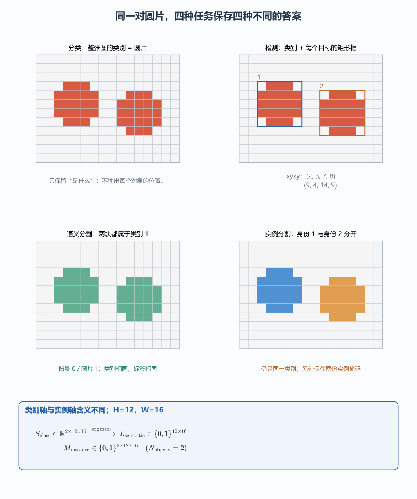

### 1. 从整图类别到矩形框

第二节的 CLIP 把整张图压成了一个全局向量，适合回答“这张图整体讲了什么”；但如果要让自动驾驶系统指出“行人在画面的哪个位置”，或者让质检系统描出“零件表面的裂纹轮廓”，光输出一个整图类别概率就完全不够用了——输出端必须把**空间坐标或像素网格**保留下来。任务目标一变，模型输出的对象结构和损失函数也必须跟着变。

先看**目标检测（Object Detection）**：它要求模型同时为图里的目标输出两部分内容——“这是什么类别（分类分数）”以及“它框在哪个矩形区域里（边界框坐标）”。光把类别猜对但框画歪了，或者框画准了但类别认错了，都不算完成检测。

在图像平面上，一个矩形边界框（Bounding Box）最标准的 `xyxy` 表示法是由四个实数组成的四元组：

$$
b=(x_1,y_1,x_2,y_2).
$$

其中 $(x_1, y_1)$ 是矩形框的**左上角坐标**，$(x_2, y_2)$ 是**右下角边界坐标**。如果我们把像素网格看作连续平面，让第 $x$ 列像素占据半开区间 $[x, x+1)$、第 $y$ 行像素占据 $[y, y+1)$，那么框 $[x_1, x_2)\times[y_1, y_2)$ 的宽度就是 $x_2-x_1$，高度就是 $y_2-y_1$，面积就是 $(x_2-x_1)(y_2-y_1)$（在这种连续边界约定下，框的右边界 $x_2$ 完全可以等于整张图的宽度 $W$，刚好表示最右边第 $W-1$ 列像素也被框在了里面）。

拿一组具体数字算一遍：设整张图的宽度 $W=100$、高度 $H=80$，有一个边界框 $b=(20, 10, 60, 50)$。它在横向上覆盖 $[20, 60)$（宽为 $60-20=40$），在纵向上覆盖 $[10, 50)$（高为 $50-10=40$）。注意：有些数据集或接口采用的是“左上角加宽高”的 `xywh` 格式，在那种格式下同一个框要写成 $(20, 10, 40, 40)$；写代码时必须先核对接口要的是 `xyxy` 还是 `xywh`，绝不能把两套数字混着传。

为了让框坐标的数值范围不受原图分辨率大小的影响，训练时常把坐标除以图像的宽高，转换成落在 $[0,1]$ 之间的**归一化坐标 $b_{\rm norm}$**：

$$
b_{\rm norm}
=\left(\frac{20}{100},\ \frac{10}{80},\
\frac{60}{100},\ \frac{50}{80}\right)
=(0.2,\ 0.125,\ 0.6,\ 0.625).
$$

千万留神分母：**两个横坐标 $x_1, x_2$ 除以的是图宽 $W=100$，而两个纵坐标 $y_1, y_2$ 除以的是图高 $H=80$**！如果粗心大意把四个数全都除以 100，纵向位置的比例就全算错了。

### 2. 缩放与翻转后的框坐标

在训练视觉模型时，数据预处理流水线经常会对输入图片做缩放（Resize）、裁剪（Crop）和水平翻转（Horizontal Flip）。一旦图片被拉伸或翻转了，**标注在图片上的真实边界框坐标也必须同步做一模一样的几何变换**——要是只把图片翻了过去、却还拿翻转前的旧框坐标去算损失，模型就会被逼着在空无一物的背景上找目标！

我们顺着刚才那张 $W=100, H=80$、框为 $b=(20, 10, 60, 50)$ 的图，连续做两步几何变换，亲手算清框坐标是怎么跟着变的：

**第一步：非等比缩放**。把 $100\times 80$ 的图片强行变成宽 $W'=200$、高 $H'=40$（即横向拉宽为原来的 $2$ 倍，纵向压扁为原来的 $1/2$）。用第一篇学过的二维对角缩放矩阵左乘框的每一个角点坐标：

$$
\begin{bmatrix}x'\\y'\end{bmatrix}
=
\begin{bmatrix}2&0\\0&1/2\end{bmatrix}
\begin{bmatrix}x\\y\end{bmatrix}.
$$

左上角 $(20, 10)$ 变成 $(40, 5)$，右下角 $(60, 50)$ 变成 $(120, 25)$，于是缩放后的新框为：

$$
b'=(40,\ 5,\ 120,\ 25).
$$

此时新框的宽变成了 $120-40=80$，高变成了 $25-5=20$，新面积为 $80\times 20 = 1600$，恰好和原面积 $40\times 40 = 1600$ 相等——这完全是因为本次缩放矩阵的行列式刚好是 $\det = 2\times(1/2) = 1$（横向放大倍数与纵向缩小倍数互为倒数），并不是任意缩放都能保持面积不变。

**第二步：水平左右翻转**。在宽度为 $W'=200$ 的新图上做左右镜像翻转。对于连续边界坐标 $x'$，翻转后的新坐标遵循 $x'' = 200 - x'$。
但这里有一个写代码时十个人有九个人会踩的坑：原本在左边的左边界 $x'_1=40$，翻过去之后跑到了右边 $200-40=160$；而原本在右边的右边界 $x'_2=120$，翻过去之后跑到了左边 $200-120=80$！**左右一翻转，原来的右边界变成了新的左边界，原来的左边界变成了新的右边界，所以减完之后必须把两头的横坐标对调交换过来**：

$$
b''=(200-120,\ 5,\ 200-40,\ 25)
=(80,\ 5,\ 160,\ 25).
$$

如果你只机械地写 `[200 - x1, y1, 200 - x2, y2]` 而不交换左右两端，就会造出一个左边界 `160` 大于右边界 `80`（宽度为 `-80`）的非法幽灵框！

还要再顺手分清一个极细微的差别：**连续边界坐标的翻转公式是 $W - x$，而离散像素数组列下标（$0$ 到 $W-1$）的翻转公式却是 $W - 1 - x$**！为什么差了一个 $1$？举个宽度 $W=6$ 的小例子就明白了：第 $0$ 列像素占据的连续区间是 $[0, 1)$，第 $1$ 列占据 $[1, 2)$，两列合起来的框区间是 $[0, 2)$。左右翻转后，原来的第 $0$ 列像素跑到了最右边第 $6-1-0 = 5$ 列（占据区间 $[5, 6)$），第 $1$ 列跑到了第 $4$ 列（占据 $[4, 5)$），两列合起来的新连续边界区间正好是 $[6-2,\ 6-0) = [4, 6)$！分清“离散像素格子的编号”与“格子左右两条边的坐标”，写图像处理代码就再也不会出现差一格的偏移 Bug。

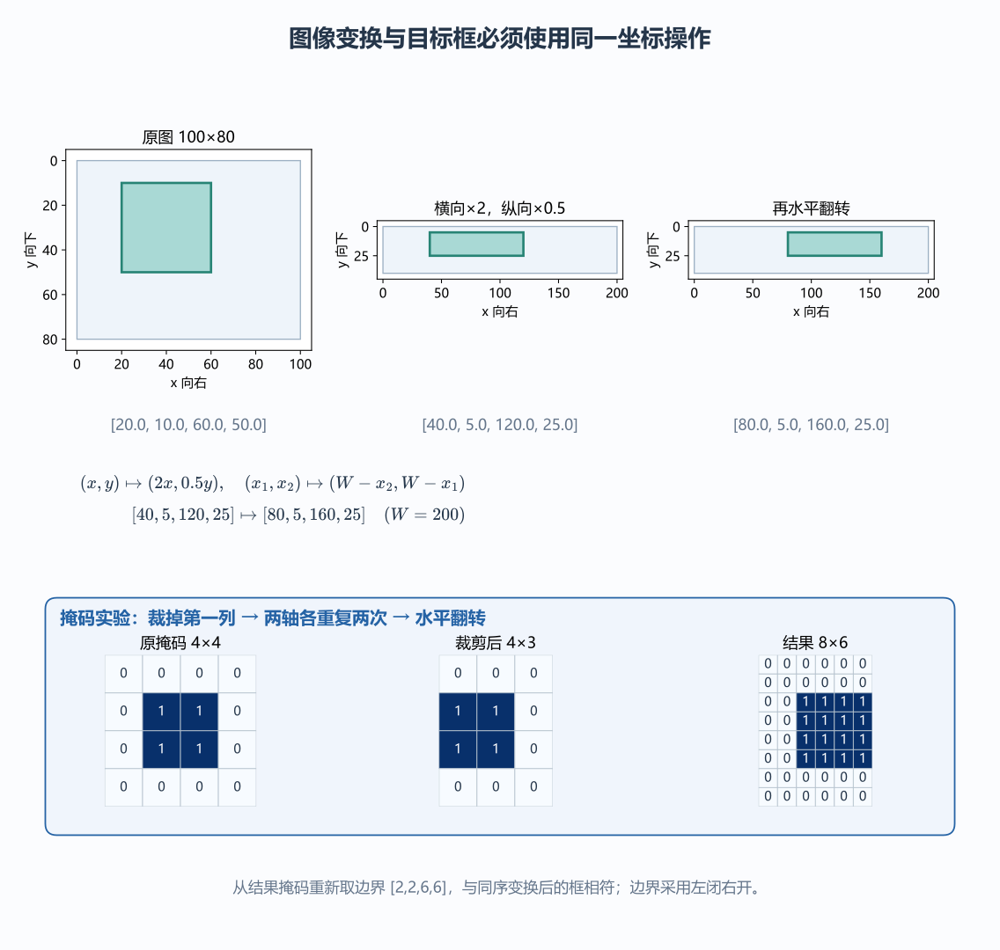

### 3. 裁剪时同步更新掩码

我们用一个 $4\times4$ 的小数组把上面这套坐标变换落实到具体像素上。在视觉任务中，我们把画面中需要识别、框出或提取的目标物体区域称为**前景（Foreground）**，把目标以外的其余环境区域称为**背景（Background）**；而一张与原图长宽相同、在每个像素位置上用 `1`（或 `True`）标出前景所在位置、用 `0`（或 `False`）标出背景位置的二维表，就叫做一张**掩码图（Mask，意为像面具一样只露出感兴趣的目标区域、遮住其余背景）**。我们在 $4\times4$ 掩码图 $M$ 里，把中间第 1、2 行和第 1、2 列设为前景 `1`：
$$
M=\begin{bmatrix}
0&0&0&0\\
0&1&1&0\\
0&1&1&0\\
0&0&0&0
\end{bmatrix}.
$$

在初始图上，这四个 `1` 占据行区间 $[1,3)$、列区间 $[1,3)$，所以初始前景框是 $(1, 1, 3, 3)$。现在我们对这张数组依次执行三步操作，同时用公式推算框的变化：
1. **裁剪（Crop）**：切掉最左边第 0 列，只保留横向列区间 $[1, 4)$、纵向行区间 $[0, 4)$。新图宽变为 $3$、高仍为 $4$；因为整张图的坐标原点往右平移了 $1$ 格，框的两个横坐标各减 $1$，变成 $(0, 1, 2, 3)$；
2. **放大（Resize）**：把每个像素沿着纵轴和横轴各重复两次（放大 2 倍），新图变成高 $8$、宽 $6$，框的四个坐标同步乘以 $2$，变成 $(0, 2, 4, 6)$；
3. **水平翻转（Flip）**：在宽度为 $6$ 的新图上左右翻转，按刚才的边界交换公式 $(6-x_2,\ y_1,\ 6-x_1,\ y_2)$，最终框变成：

$$
(6-4,\ 2,\ 6-0,\ 6)=(2,\ 2,\ 6,\ 6).
$$

现在直接跑一段 NumPy 代码，对掩码数组真刀真枪做完裁剪、重复放大与列反转，然后从最终数组里找出所有值为 `1` 的像素坐标反推边界框，看看跟我们手算的 `[2, 2, 6, 6]` 对不对得上：

~~~python
import numpy as np

mask = np.zeros((4, 4), dtype=int)
mask[1:3, 1:3] = 1
cropped = mask[:, 1:4]  # 原点向右平移一格。
resized = np.repeat(np.repeat(cropped, 2, axis=0), 2, axis=1)
flipped = resized[:, ::-1]

points = np.argwhere(flipped == 1)
box = [points[:, 1].min(), points[:, 0].min(),
       points[:, 1].max() + 1, points[:, 0].max() + 1]
print(flipped.shape, box)  # (8, 6)，[2, 2, 6, 6]
~~~

看代码最后两行：`np.argwhere` 返回的是 `(行号 y, 列号 x)`，所以取第 1 列算 $x$、第 0 列算 $y$，且最大离散像素下标加上 `1` 还原为右、下开区间边界，打印出来的正是分毫不差的 `[2, 2, 6, 6]`！

这里顺带把图像处理里常说的**分辨率（Resolution）**、**重采样（Resampling）**与**插值（Interpolation）**三个词的底牌掀开：
所谓图像的**分辨率**（如 $224\times 224$ 或 $100\times 80$），指的就是整张像素网格在横纵两个方向上划分了多少个像素格子。当我们需要把一张 $4\times 3$ 的小图放大成 $8\times 6$ 的大图，或者把大图缩小成小图时，本质上是在一张新的像素网格上重新计算每个格子的数值——这个过程统称为**重采样**。既然新网格的格子数量变了，新格子里的数字从哪来？靠已有旧像素推算新像素数值的数学规则就叫做**插值**：

* **最近邻插值（Nearest-Neighbor Interpolation）**：最简单直接的硬拷贝——新网格上的像素点离旧图里的哪个像素最近，就直接把那个旧像素的数字原封不动抄过来（就像上面代码里的 `np.repeat` 把每个格子直接重复两遍）。对保存着整数类别编号的**分割标签图（Mask）做缩放时，必须使用最近邻插值**！
* **双线性插值（Bilinear Interpolation）**：根据新位置到周围四个相邻旧像素的距离远近，按比例做加权平均算出平滑的过渡值。缩放普通彩色照片时用双线性插值能让画面过渡自然、不生锯齿；但千万不能拿它去缩放分割标签图——否则在背景 `0` 类和前景 `1` 类的交界处给你平均出一个 `0.45` 类，整数类别标签当场就被毁了！

此外，如果裁剪窗口切掉了目标物体的一半，还必须先把原边界框与裁剪窗口求交集（将框的四个坐标限制到裁剪窗口边界内）再减去窗口起点平移；要是整个物体都被切到了视野外面，就必须把这条目标标签从本图的训练目标里剔除掉。

### 4. 交并比与框定位损失

模型预测出了一个矩形框 $b_p=(40, 30, 80, 70)$，而真实标注框是 $b_g=(20, 10, 60, 50)$，怎么定量评估这两个框重合得有多准？

最通用的几何指标是**交并比（Intersection over Union，简称 IoU）**，即两框**交集区域的面积**除以两框**并集区域的面积**。
怎么算两个矩形的交集矩形 $b_\cap$？画张图一看便知：交集区域的左边界和上边界，取两个框左、上边界中的**较大值（$\max$）**；交集区域的右边界和下边界，取两个框右、下边界中的**较小值（$\min$）**：

$$
b_\cap=\bigl(\max(40,20),\ \max(30,10),\ \min(80,60),\ \min(70,50)\bigr)
=(40,\ 30,\ 60,\ 50).
$$

算出交集框为 $(40, 30, 60, 50)$，它的宽为 $60-40=20$，高为 $50-30=20$，于是交集面积 $A_\cap = 20\times 20 = 400$（注意：如果两个框根本没有挨着，算出来的右减左或下减上会是负数；写代码时宽高必须先和 $0$ 取最大值 $\max(0, x_2-x_1)$，绝不能让两个负边长负负得正乘出一个虚假的正面积！参见 [Torchvision 的 `box_iou` 接口](https://docs.pytorch.org/vision/0.21/generated/torchvision.ops.box_iou.html)）。
而预测框和真实框各自的面积都是 $40\times 40 = 1600$。根据容斥原理，并集面积等于两框面积之和减去重叠算了两次的交集面积：

$$
A_\cup=1600+1600-400=2800.
$$

相除即得交并比：

$$
\operatorname{IoU}(b_p,b_g)
=\frac{A_\cap}{A_\cup}
=\frac{400}{2800}=\frac17\approx0.142857.
$$

在训练模型回归框坐标时，可以直接把归一化坐标的逐项绝对误差之和（$L_1$ 损失）作为定位损失：

$$
L_{\rm box}
=\sum_{k=1}^4|\widehat b_k-b_k|.
$$

拿上面这两个框按 $W=100, H=80$ 归一化：真实框是 $(0.2, 0.125, 0.6, 0.625)$，预测框是 $(0.4, 0.375, 0.8, 0.875)$，四项绝对误差分别是 $(0.2,\ 0.25,\ 0.2,\ 0.25)$，加起来总误差 $L_{\rm box}=0.9$。因为当前四项预测值全都比真实值偏大，绝对值损失对四项预测坐标的导数全都是 $+1$，做梯度下降时就会把四个坐标同时往减小的方向拉，逼着预测框往左上方挪动去贴合真实框。

### 5. 语义分割：逐像素分类

矩形框只能粗略框出物体的外接长方形，像水杯把手中间的镂空背景、或者弯曲细长物体的边缘，在框里是分不开的。要想精确描出物体的轮廓，就必须把分类任务下沉到**每一个像素**上——这就是**图像分割（Image Segmentation）**。

假设画面只分“背景（类别 0）”和“前景（类别 1）”两类。对于高为 $H$、宽为 $W$ 的输入图像，分割网络输出的不再是一个向量，而是一整张保留了空间高宽的四维 logits 张量：

$$
Z\in\mathbb R^{B\times2\times H\times W}.
$$

盯住图上的某一个具体像素位置 $(y, x)$：沿着第 1 号轴（长度为 2 的类别轴）读出两个原始打分 $Z_{0,0,y,x}$（背景分）和 $Z_{0,1,y,x}$（前景分），做一次二分类 Softmax 就得到了该像素属于背景和前景的概率。注意此时真实标签图的形状只需要是 `(B, H, W)`（每个像素存一个整数 `0` 或 `1`），并不需要把标签也复制成两张图。

算一个单像素的梯度看看：假设某个真实为前景（标签 $y=1$）的像素，网络算出的两类分数为 $(0, 2)$。经过 Softmax，它被判为前景的概率是：

$$
p_1=\frac{e^2}{e^0+e^2}=\frac{e^2}{1+e^2}\approx0.880797.
$$

该像素上的交叉熵损失为 $-\log p_1 \approx 0.126928$；套用 $p_k - \mathbf 1[k=y]$，损失对背景分数和前景分数的直接梯度分别是 $+0.119203$ 和 $-0.119203$（压低背景分、推高前景分；对全图 $HW$ 个像素求平均损失时，每个像素的梯度再除以总像素数 $HW$）。

我们构造一张 $4\times6$ 的图像，左边和右边各放一个 $2\times2$ 的前景方块。在**语义分割（Semantic Segmentation）**中，所有属于同一类别的像素都标成同一个类别号 `1`：

$$
Y_{\rm semantic}=
\begin{bmatrix}
0&0&0&0&0&0\\
1&1&0&0&1&1\\
1&1&0&0&1&1\\
0&0&0&0&0&0
\end{bmatrix}.
$$

我们在配套代码中用一层最精简的 $1\times1$ 卷积 `nn.Conv2d(1, 2, kernel_size=1)` 来训练这张图（核大小为 1 意味着每个像素位置只根据自己的输入强度算出两个类别分数，全图 24 个像素共享这同一套仅含 $2\times 1 + 2 = 4$ 个参数的分类器）。固定种子 `17`，用 SGD（学习率 $0.5$）训练 120 步后，全图 24 个像素的平均交叉熵损失从 $0.635850$ 降到了 $0.042841$，前景像素预测概率达到 $(0.050382,\ 0.949618)$，逐像素取最高分还原出的分割图与 $Y_{\rm semantic}$ 100% 重合，前景交并比 $\operatorname{IoU}=1.0$。

### 6. 实例分割：分开同类物体

仔细看上面那张语义分割标签图 $Y_{\rm semantic}$：左边那个 $2\times2$ 方块标的是 `1`，右边那个 $2\times2$ 方块标的也是 `1`。如果这代表桌子上摆着两个水杯，语义分割只能告诉你“这八个像素全都是水杯”，却回答不了“图里一共有几个水杯、哪几个像素属于左边第一只杯子、哪几个像素属于右边第二只杯子”。

要想把同属一个类别的不同个体拆分开，就必须进入**实例分割（Instance Segmentation）**，为每一个独立的物体实例分配专属的身份编号：

$$
Y_{\rm instance}=
\begin{bmatrix}
0&0&0&0&0&0\\
1&1&0&0&2&2\\
1&1&0&0&2&2\\
0&0&0&0&0&0
\end{bmatrix}.
$$

看清楚这里的数字 `1` 和 `2`：它们不再是“水杯”和“碗”这两个不同的语义类别，而是同一个类别底下的“第 1 号个体”和“第 2 号个体”！换一张图，里面可能有 3 个或 5 个同类物体。实例分割系统通常为每个目标同时保存类别、边界框和专属掩码，再用实例 ID 把它们绑定在一起。为什么不能省掉实例分割、只对前面算出来的语义分割前景图做一次**连通块搜索（Connected Components Analysis，即像围棋数气吃子一样，把上下左右紧挨在一起的所有 `1` 自动归为同一块区域）**呢？因为只有当两个水杯在画面上隔开一段距离、中间被背景 `0` 隔断时，按像素是否相连才能把它们拆成两块；一旦现实照片里的两只杯子一前一后互相遮挡、或者边缘紧贴在一起，它们的像素 `1` 就会连成一整片，单纯的连通块搜索就会把两只杯子误判成一只大杯子！因此，要把粘连或遮挡的同类个体分开，必须在训练模型时就引入实例级别的标注与监督。

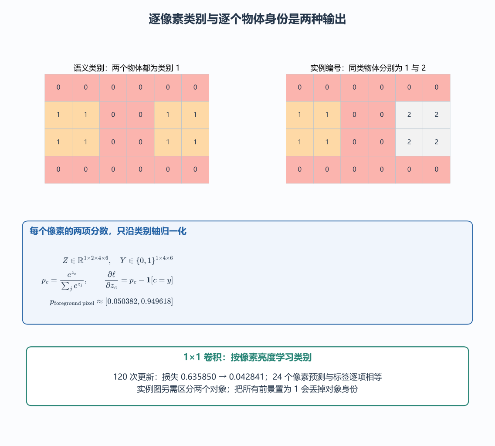

## （五）扩散的加噪、训练与采样

### 1. 从整张图的状态开始

在第四篇的文本生成里，模型采用的是“空手起家、逐个往末尾追加 Token”的自回归方式，序列长度从 $1$ 一路涨到 $T$。而在生成图像（或连续音频）时，还有另一条截然不同的状态演化路线：**从第一步起就把整张图像全部像素位置（设展平后共有 $D$ 个坐标）的数组形状固定下来，一开始里面装满纯随机高斯噪声，然后一步接一步地在原地修改这 $D$ 个坐标的数值，像擦掉毛玻璃上的雾气一样把清晰图像显现出来**——这就是**[去噪扩散概率模型（DDPM）](https://arxiv.org/html/2006.11239v2)**。

扩散模型的設計思路是“先学会怎么有规律地把好图弄脏（前向加噪过程），再训练一个神经网络学会怎么倒着把脏图擦干净（反向去噪过程）”。

在第 $t$ 步，我们取一个预设的小正数 $\beta_t\in(0,1)$，再抽取一份与原图及此前各步噪声相互独立的**标准正态噪声（也称高斯噪声）** $\mathbf z_t\sim\mathcal N(\mathbf0,I_D)$，按下面的比例把上一步的状态 $\mathbf x_{t-1}$ 与新噪声混在一起：
$$
\mathbf x_t
=\sqrt{1-\beta_t}\,\mathbf x_{t-1}
+\sqrt{\beta_t}\,\mathbf z_t,
\qquad
\mathbf z_t\sim\mathcal N(\mathbf0,I_D).
$$

这里的 $\mathcal N(\mathbf0,I_D)$ 表示 $D$ 维标准正态分布：向量里每一个坐标的平均值（均值）都是 $0$、波动幅度平方（方差）都是 $1$，呈现“中间 0 附近最密集、往正负两端对称钟形衰减”的随机分布；而单位矩阵 $I_D$ 作为协方差矩阵，则说明这 $D$ 个像素位置上的随机噪声是各自独立抽取的（第 0 号像素抽到正数还是负数，跟第 1 号像素毫无关系，彼此之间的协方差为零）。$\beta_t$ 控制这一步新掺入的噪声方差比例。

为什么前面的衰减系数非要带个根号写成 $\sqrt{1-\beta_t}$、后面的噪声系数非要写成 $\sqrt{\beta_t}$ 呢？

算一下方差就明白了：两个相互独立的随机变量相加，总方差等于各自方差之和；而给随机变量乘上常数 $c$，它的方差会变成 $c^2$ 倍！如果上一步 $\mathbf x_{t-1}$ 的某个坐标方差本来是 $1$，乘上 $\sqrt{1-\beta_t}$ 后方差变成 $1-\beta_t$；新噪声 $\mathbf z_t$ 乘上 $\sqrt{\beta_t}$ 后方差变成 $\beta_t$；两项独立相加，新状态 $\mathbf x_t$ 的方差正好是 $(1-\beta_t) + \beta_t = 1$！这两个平方根系数，正是为了让加噪过程在走完几十上百步之后，数值尺度依然稳稳保持在单位方差附近，既不会衰减成零，也不会爆炸到无穷大。

对照两种生成过程，先看“计算对象的形状怎样变化”。下图上排用 A、B、C、D 表示四个示意 Token：每次续写增加一个序列位置，已有前缀保留。下排取自配套实验同一次扩散采样的三个阶段：每一步始终是 $4\times4$ 的数组，改变的是这十六个空间位置上的值。末尾的条纹来自对固定网格的反复更新，不是从左上角开始逐格往外拼。下排统一用 $-3$ 到 $3$ 映射黑白，显示边界不改写采样数组。

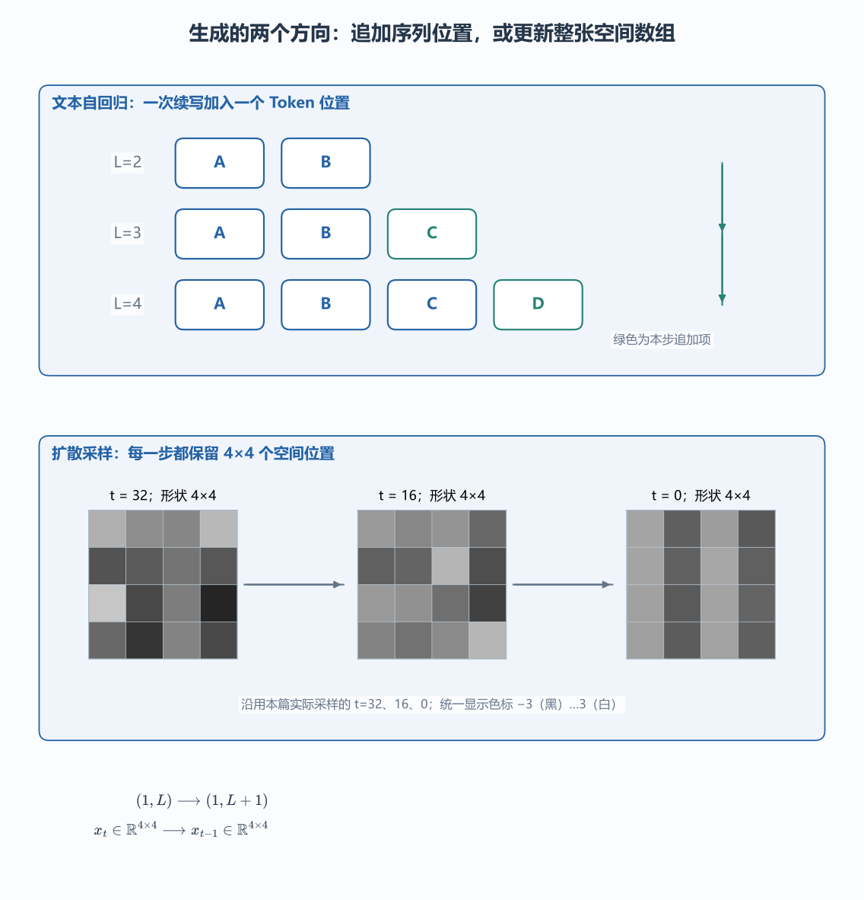

### 2. 多次加噪，一步计算

如果训练时每次想拿到第 $t=20$ 步的带噪图像，都得老老实实从 $\mathbf x_0$ 开始抽 20 次随机数、一步步递推算 20 次，那训练效率就太低了。好在线性高斯变换有一个极好的性质：**不管连续加了多少步高斯噪声，都可以合并成一步直达的闭合公式！**

我们令 $\alpha_t = 1 - \beta_t$，先拿头两步（取 $\alpha_1=0.9, \beta_1=0.1$；$\alpha_2=0.8, \beta_2=0.2$）在一个标量坐标上亲手合并一次看看：
第一步加噪为：
$$
x_1=\sqrt{0.9}\,x_0+\sqrt{0.1}\,z_1,
$$

第二步加噪为：

$$
x_2=\sqrt{0.8}\,x_1+\sqrt{0.2}\,z_2.
$$

把第一式的 $x_1$ 直接代进第二式里展开：

$$
x_2=\sqrt{0.8}\bigl(\sqrt{0.9}\,x_0+\sqrt{0.1}\,z_1\bigr)+\sqrt{0.2}\,z_2
=\sqrt{0.72}\,x_0+\sqrt{0.08}\,z_1+\sqrt{0.2}\,z_2.
$$

看后面那两项独立的高斯噪声 $\sqrt{0.08}\,z_1 + \sqrt{0.2}\,z_2$：因为 $z_1$ 和 $z_2$ 是两次独立抽取的标准正态分布，两个独立正态分布的线性组合依然是一个正态分布！它的均值是 $0+0=0$，它的总方差则是两项系数的平方和：$(\sqrt{0.08})^2 + (\sqrt{0.2})^2 = 0.08 + 0.2 = 0.28$！因此，这两项合在一起，在分布上完全等价于直接抽取**一份**新的标准正态噪声 $\epsilon\sim\mathcal N(0,1)$ 并乘上标准差 $\sqrt{0.28}$：

$$
x_2=\sqrt{0.72}\,x_0+\sqrt{0.28}\,\epsilon.
$$

你看，$x_0$ 前面的信号保留系数 $\sqrt{0.72}$ 正好来自 $\sqrt{\alpha_1\alpha_2} = \sqrt{0.9\times 0.8}$，而后面合成噪声的方差 $0.28$ 正好就是剩下的 $1 - 0.72$！如果再往下走第三步（取 $\alpha_3=0.7$），信号系数的平方就会变成 $0.9\times 0.8\times 0.7 = 0.504$，累计噪声方差就变成 $1 - 0.504 = 0.496$。

把从第 $1$ 步到第 $t$ 步的所有 $\alpha_s$ 连乘起来，记为累计信号保留率 $\bar\alpha_t$：

$$
\bar\alpha_t=\prod_{s=1}^t\alpha_s,
$$

我们就得到了从干净原图 $\mathbf x_0$ **一步跳到任意第 $t$ 步带噪图 $\mathbf x_t$** 的重参数化公式：

$$
\mathbf x_t
=\sqrt{\bar\alpha_t}\,\mathbf x_0
+\sqrt{1-\bar\alpha_t}\,\boldsymbol\epsilon,
\qquad
\boldsymbol\epsilon\sim\mathcal N(\mathbf0,I_D).
$$

有了这个公式，训练时想考网络第 $t$ 步的去噪能力，只需随机抽一个阶段编号 $t$ 和一份标准高斯噪声 $\boldsymbol\epsilon$，做一次加权相加就能直接造出 $\mathbf x_t$（注意区分两种采样组织：训练时每条样本用上式一步直达，不同 $t$ 之间是独立抽取的；而如果要画出一张图从 $t=1$ 到 $t=T$ 同一条随机轨迹上逐渐变模糊的连续动画，则必须固定每一步的增量噪声 $\mathbf z_1,\ldots,\mathbf z_T$ 按单步公式递推）。

这里还要分清两个统计口径——**给定某一张原图时的“条件方差”**与**跨整个数据集所有图片的“边际方差（总体方差）”**。
当你手头已经锁死了一张具体的原图 $\mathbf x_0$ 时，$\mathbf x_0$ 里的像素值是固定不变的常数，所有的随机波动 100% 来自新加进去的高斯噪声 $\boldsymbol\epsilon$，所以在给定 $\mathbf x_0$ 的条件下，$\mathbf x_t$ 的平均值（条件期望 $\mathbb E$）与波动范围（条件协方差 $\operatorname{Cov}$）分别为：

$$
\mathbb E[\mathbf x_t\mid\mathbf x_0]
=\sqrt{\bar\alpha_t}\,\mathbf x_0,\qquad
\operatorname{Cov}(\mathbf x_t\mid\mathbf x_0)
=(1-\bar\alpha_t)I_D.
$$

但如果反过来，不固定某一张图，而是问“从整个图片数据集里随机抽各种不同的原图 $\mathbf x_0$、再加噪成 $\mathbf x_t$，最终某个像素位置 $x_t$ 跨所有样本的总方差（即不以单张图为条件的**边际方差** $\operatorname{Var}(x_t)$）是多少？”此时原图像素 $x_0$ 本身也是随机变化的，且与新噪声独立，因此总方差等于原图方差缩放后加上噪声方差：

$$
\operatorname{Var}(x_t)
=\bar\alpha_t\operatorname{Var}(x_0)+1-\bar\alpha_t.
$$

只有当原始数据集的像素值经过预处理后本身方差刚好为 $1$（即 $\operatorname{Var}(x_0)=1$）时，这个跨数据集的总体方差才会恒等于 $\bar\alpha_t\times 1 + 1 - \bar\alpha_t = 1$；假如原始像素的方差本来是 $4$，在 $\bar\alpha_t=0.64$ 时，总体方差就是 $0.64\times 4 + 0.36 = 2.92$。

### 3. 预测噪声与反解原图

既然前向加噪 $\mathbf x_t = \sqrt{\bar\alpha_t}\,\mathbf x_0 + \sqrt{1-\bar\alpha_t}\,\boldsymbol\epsilon$ 是由我们的程序亲手算的，那么当时往里面掺了多少噪声 $\boldsymbol\epsilon$，程序心里一清二楚。于是 DDPM 给去噪神经网络 $\widehat{\boldsymbol\epsilon}_\theta(\mathbf x_t, t)$ 安排了一个极其直接的监督任务：**把带噪图 $\mathbf x_t$ 和当前的阶段编号 $t$ 一起喂给网络，让网络直接把刚才掺进去的那份标准噪声 $\boldsymbol\epsilon$ 预测出来**，用均方误差（MSE）作损失函数：

$$
L_{\rm noise}
=\frac1D\sum_{k=1}^D
(\widehat\epsilon_{\theta,k}-\epsilon_k)^2.
$$

为什么要把阶段编号 $t$ 也一并喂给网络？因为同样看到一个像素值 $x_t=0.28$，如果现在处于刚开始加噪的 $t=1$，它里面绝大部分是原图信号，只需要轻轻擦掉一点点浮尘；如果现在处于接近纯噪声的 $t=32$，它里面绝大部分都是随机噪声，需要大刀阔斧地去噪。不告诉网络当前是第几步，网络就不知道破坏程度有多深。

我们拿一个单坐标的具体数字，把“加噪 $\to$ 预测噪声 $\to$ 反解清晰值”的账算到底：
设某像素原始清晰值为 $x_0=0.8$，本次抽到的真实噪声为 $\epsilon=-0.6$，当前阶段累计保留率为 $\bar\alpha_t=0.64$。那么信号系数是 $\sqrt{0.64}=0.8$，噪声系数是 $\sqrt{1-0.64}=\sqrt{0.36}=0.6$，合成的带噪输入值为：

$$
x_t=0.8\times0.8+0.6\times(-0.6)=0.64-0.36=0.28.
$$

现在把 $x_t=0.28$ 送进网络，假设网络预测出来的噪声是 $\widehat\epsilon=-0.5$（比真实噪声 $-0.6$ 偏大了 $0.1$，单坐标噪声平方误差为 $( -0.5 - (-0.6) )^2 = 0.01$）。
知道了带噪值 $x_t=0.28$ 和网络估出的噪声 $\widehat\epsilon=-0.5$，怎么反推出网络心目中的原始清晰图估计值 $\widehat x_0$？只需把加噪公式移个项，把噪声减掉再除以信号系数即可：

$$
\widehat x_0
=\frac{x_t-\sqrt{1-\bar\alpha_t}\,\widehat\epsilon}
{\sqrt{\bar\alpha_t}}
=\frac{0.28-0.6\times(-0.5)}{0.8}
=\frac{0.58}{0.8}
=0.725.
$$

请看这个反解结果：预测噪声偏大了 $0.1$，反解出来的清晰值 $\widehat x_0=0.725$ 就比真实原图 $0.8$ 低了 $0.075$（误差比例正是 $\frac{\sqrt{1-\bar\alpha_t}}{\sqrt{\bar\alpha_t}} = \frac{0.6}{0.8} = 0.75$ 倍）。从分母上的 $\sqrt{\bar\alpha_t}$ 还能看出来：到了加噪末期，$\bar\alpha_t$ 变得非常小，分母极小就会把分子上一点点微小的噪声预测误差成倍放大！因此，在不同阶段 $t$ 上看到同样大小的噪声 MSE，绝不等于反解出来的清晰图误差也一样大。

### 4. 反向一步的后验分布

拿到了当前第 $t$ 步对清晰原图的估计 $\widehat{\mathbf x}_0$，在生成采样时，我们能不能一步直接跳回 $\widehat{\mathbf x}_0$ 收工呢？
如果当前处于满屏雪花的 $t=32$，网络凭着极其微弱的线索猜出来的 $\widehat{\mathbf x}_0$ 还是模糊粗糙的平均值，一步跳过去只会得到一团浆糊。DDPM 的做法是稳扎稳打：**只从第 $t$ 步往回退一小步到第 $t-1$ 步（算出 $\mathbf x_{t-1}$），然后把 $\mathbf x_{t-1}$ 重新送进网络去猜更准的噪声，一步步退回 $t=0$**。

那从 $x_t$ 退回 $x_{t-1}$ 的这一小步，到底该按什么比例把 $x_t$ 和清晰值 $x_0$ 混在一起，又该保留多大方差的随机性呢？这可不是凭感觉瞎凑的，而是由前向高斯加噪链通过**贝叶斯公式与二次型配方**严密推导出来的！我们亲手把这组后验系数配出来（设 $t\ge 2$，先假定真实清晰值 $x_0$ 已知）：

根据贝叶斯公式，在已知当前带噪状态 $x_t$ 和起点 $x_0$ 的条件下，前一步状态 $x_{t-1}$ 的后验概率密度正比于两项前向高斯密度的乘积：

$$
q(x_{t-1}\mid x_t,x_0)
\propto q(x_t\mid x_{t-1})\,q(x_{t-1}\mid x_0).
$$

右边第一项 $q(x_t\mid x_{t-1}) = \mathcal N(x_t;\ \sqrt{\alpha_t}\,x_{t-1},\ \beta_t)$ 来自第 1 小节的单步加噪公式；右边第二项 $q(x_{t-1}\mid x_0) = \mathcal N(x_{t-1};\ \sqrt{\bar\alpha_{t-1}}\,x_0,\ 1-\bar\alpha_{t-1})$ 来自第 2 小节的前 $t-1$ 步累计加噪公式。
把这两个高斯分布密度函数乘起来，指数部分相加。我们把待求的未知变量 $x_{t-1}$ 简记为 $u$，只看指数括号里跟 $u$ 有关的二次多项式：

$$
-\frac12\left[
\frac{(x_t-\sqrt{\alpha_t}\,u)^2}{\beta_t}
+\frac{(u-\sqrt{\bar\alpha_{t-1}}\,x_0)^2}
{1-\bar\alpha_{t-1}}
\right].
$$

把两个平方项展开，收集二次项 $u^2$ 的系数 $A$ 和一次项 $-2Bu$ 的系数 $B$：
* **先看二次项 $u^2$ 的系数 $A$**（通分后分子利用 $\alpha_t\bar\alpha_{t-1}=\bar\alpha_t$ 以及 $\alpha_t+\beta_t=1$ 化简）：
  $$
  A=\frac{\alpha_t}{\beta_t}
  +\frac1{1-\bar\alpha_{t-1}}
  =\frac{\alpha_t(1-\bar\alpha_{t-1})+\beta_t}{\beta_t(1-\bar\alpha_{t-1})}
  =\frac{\alpha_t-\bar\alpha_t+\beta_t}{\beta_t(1-\bar\alpha_{t-1})}
  =\frac{1-\bar\alpha_t}
  {\beta_t(1-\bar\alpha_{t-1})};
  $$
* **再看一次项 $-2u$ 旁边的系数 $B$**：
  $$
  B=\frac{\sqrt{\alpha_t}\,x_t}{\beta_t}
  +\frac{\sqrt{\bar\alpha_{t-1}}\,x_0}
  {1-\bar\alpha_{t-1}}.
  $$

在初等代数里，二次式 $Au^2 - 2Bu$ 配方后就是 $A(u - \frac{B}{A})^2 - \frac{B^2}{A}$。对照一维高斯分布标准形式 $-\frac{1}{2\widetilde\beta_t}(u - \widetilde\mu_t)^2$，二次项系数 $A$ 的倒数就是**后验方差 $\widetilde\beta_t = 1/A$**，而对称轴位置 $B/A$ 就是**后验均值 $\widetilde\mu_t$**：

$$
\widetilde\beta_t
=\frac1A
=\frac{\beta_t(1-\bar\alpha_{t-1})}{1-\bar\alpha_t},
$$

$$
\widetilde\mu_t
=\frac{B}{A}
=\frac{\sqrt{\bar\alpha_{t-1}}\beta_t}{1-\bar\alpha_t}x_0
+\frac{\sqrt{\alpha_t}(1-\bar\alpha_{t-1})}{1-\bar\alpha_t}x_t.
$$

你看，这一长串看似复杂的分式，原来就是把两个高斯指数加在一起做了一次中学数学的完全平方配方！

到了真正的生成推理阶段，我们手里没有真实原图 $x_0$，于是就把上一小节由网络预测噪声反解出来的清晰图估计 $\widehat x_0$ 代进上面的后验均值公式里（如果不对 $\widehat x_0$ 做额外裁剪，直接把 $\widehat x_0 = (x_t - \sqrt{1-\bar\alpha_t}\widehat\epsilon_\theta)/\sqrt{\bar\alpha_t}$ 代入上式通分合并，还能化简成常见的等价形式 $\mu_\theta(x_t,t) = \frac{1}{\sqrt{\alpha_t}}\bigl(x_t - \frac{\beta_t}{\sqrt{1-\bar\alpha_t}}\widehat\epsilon_\theta(x_t,t)\bigr)$）。算出均值 $\mu_\theta$ 后，再抽取一份标准高斯噪声 $z\sim\mathcal N(0,1)$ 乘上后验标准差 $\sqrt{\widetilde\beta_t}$，就走完了反向去噪的一步：

$$
x_{t-1}=\mu_\theta+\sqrt{\widetilde\beta_t}\,z.
$$

（当退到最后一步 $t=1\to 0$ 时，约定 $\bar\alpha_0=1$，代入方差公式得 $1-\bar\alpha_0=0 \implies \widetilde\beta_1=0$，因此最后一步直接输出均值 $\mu_\theta$，不再掺入新的随机噪声。）

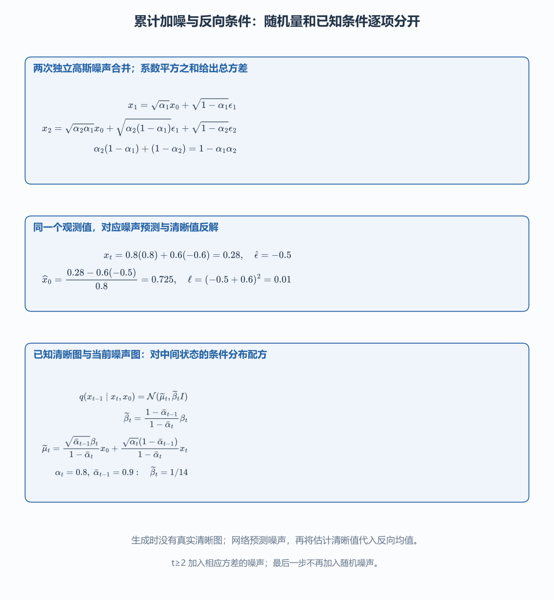

### 5. 训练一个小型去噪网络

我们拒绝只拿假数据调一次公式了事，而是在 [`diffusion_lab.py`](https://github.com/KiriAky107/understanding-AI-and-Agents-in-depth/blob/main/%E7%8E%B0%E4%BB%A3AI%E7%A4%BA%E4%BE%8B/modern_ai/diffusion_lab.py)（代码包内：`现代AI示例/modern_ai/diffusion_lab.py`） 里真刀真枪训练一个小型去噪神经网络 `TinyDenoiser`，让它学会从纯高斯雪花噪声里生成 $4\times4$ 的条纹图像。

训练数据集由两张 $4\times4$（展平为 $D=16$ 维）的正交条纹图组成，各占 $50\%$ 概率：第一张图每行都是 $(-1, 1, -1, 1)$（左暗右亮交替），第二张图每行都是 $(1, -1, 1, -1)$（左亮右暗交替）。跨这两张图统计，每个像素坐标的均值都是 $0$、方差都是 $1$，但 16 个坐标之间存在着严格的横向交替与纵向一致结构。

前向加噪链共设 $T=32$ 个阶段，$\beta_t$ 从 $\beta_1=0.02$ 线性递增到 $\beta_{32}=0.2$，到第 32 步时累计信号保留率仅剩 $\bar\alpha_{32}\approx 0.022656$，画面几乎被噪声彻底淹没。
去噪网络 `TinyDenoiser` 的结构设计得干净透明：
1. 输入是 16 维的带噪图像向量 $\mathbf x_t$ 和整数阶段编号 $t\in\{1,\ldots,32\}$；
2. 阶段编号 $t$ 先去一张 $33\times 8$ 的嵌入表里查出一条 8 维时间向量，与 16 维图像向量拼接成 $24$ 维联合向量（注意整数编号 $t$ 必须先查表变成特征向量，不能直接拿整数 $32$ 去跟像素值做加法）；
3. 接着穿过一层 $24\to 64$ 的线性层、经过平滑的 **SiLU 激活函数**（定义为 $\operatorname{SiLU}(a)=a\sigma(a)$），最后由 $64\to 16$ 的输出线性层预测出 16 个坐标上的噪声 $\widehat{\boldsymbol\epsilon}_\theta$。全网可训练参数总数为：

$$
33\times8+(24\times64+64)+(64\times16+16)=2904\text{ 个参数}.
$$

训练时固定模型初始种子为 `17`、采样随机源为 `71`，每一批随机抽取 64 张原图、64 个阶段编号 $t$ 和 64 份高斯噪声，用闭合公式一步合成 $\mathbf x_t$ 送入网络，用 Adam（学习率 $0.005$）最小化噪声 MSE 连续更新 2400 步。在独立锁死的 256 组测试样本上，噪声预测 MSE 从训练前的约 **`1.059264`** 一路降到了 **`0.054756`**（训练末批损失约为 `0.047525`）。

### 6. 裁剪范围与采样结果

噪声 MSE 降到了 `0.054`，是不是意味着顺着 32 步反向公式直接采样，就一定能生成出干净漂亮的 $[-1, 1]$ 条纹图？
我们在固定采样随机源 `717`（保证不同方案从一模一样的初始噪声 $\mathbf x_{32}$ 起步、并在每一步抽到一模一样的增量噪声 $\mathbf z_t$）下，做了一次极具启发性的对照实验。

由于训练数据里的真实清晰图像像素全部严格落在 $[-1, 1]$ 区间内，在每一步反向采样时，当我们先用预测噪声反解出清晰图估计 $\widehat{\mathbf x}_0$ 后，多加一行代码**把 $\widehat{\mathbf x}_0$ 裁剪（Clamp）回已知的合法物理范围 $[-1, 1]$ 内**，然后再代入后验均值公式算 $\mathbf x_{t-1}$：

~~~python
import torch

beta_t = torch.tensor(.2)
alpha_t = 1 - beta_t
bar_t, bar_previous = torch.tensor(.72), torch.tensor(.9)
xt, predicted_noise = torch.tensor(.28), torch.tensor(-.5)

estimated_clean = (xt - (1 - bar_t).sqrt() * predicted_noise) / bar_t.sqrt()
estimated_clean = estimated_clean.clamp(-1, 1)  # 关键一步：将反解出的清晰图估计限制在合法范围内。
mean = (bar_previous.sqrt() * beta_t / (1 - bar_t) * estimated_clean
        + alpha_t.sqrt() * (1 - bar_previous) / (1 - bar_t) * xt)
variance = beta_t * (1 - bar_previous) / (1 - bar_t)
print(estimated_clean.item(), mean.item(), variance.item())
~~~

（注意：这里 `clamp(-1, 1)` 裁剪的是反解出来的中间清晰图估计 $\widehat{\mathbf x}_0$，而带噪状态 $\mathbf x_t$ 本身因为含有高斯噪声，完全可以超出 $[-1, 1]$，千万不能错把 $\mathbf x_t$ 给裁了。）

看看加不加这行 `estimated_clean.clamp(-1, 1)`，在跑完 32 步反向生成后的天壤之别：
* **加上 `[-1, 1]` 清晰值范围约束**：32 步去噪结束后，生成的 $4\times4$ 图像与标准条纹模板的逐坐标 MSE 仅为 **`0.046951`**，条纹清晰锐利，数值稳稳落在 $\pm 1$ 附近；
* **去掉这行范围约束（直接用未裁剪公式連退 32 步）**：同一个训练好的网络、同一串随机数，最终生成出来的图虽然正负交替的条纹方向也是对的，但像素数值幅度却一路失控漂移到了 $\pm 4.4$ 左右，与标准模板的 MSE 暴涨到了 **`11.705217`**！

为什么单步噪声 MSE 只有 `0.054` 的好网络，在连续 32 步无约束迭代后幅度会漂移得这么厉害？因为反向生成是一条首尾相接的 32 步长链：在早期 $\bar\alpha_t$ 极小的时候，一点点噪声预测偏差除以 $\sqrt{\bar\alpha_t}$ 后就会让 $\widehat x_0$ 冲出 $[-1, 1]$；如果不及时用先验范围把 $\widehat x_0$ 按回来，下一步算出来的 $x_{t-1}$ 幅度就会偏大，而网络在训练时只见过正常幅度的 $x_{t-1}$，面对幅度偏大的输入预测得更不准，32 步滚雪球下来就把幅度撑爆了！这也再次告诉我们：**评估生成模型时，单步损失指标（如噪声 MSE）绝不能代替完整的多步生成采样验收**。

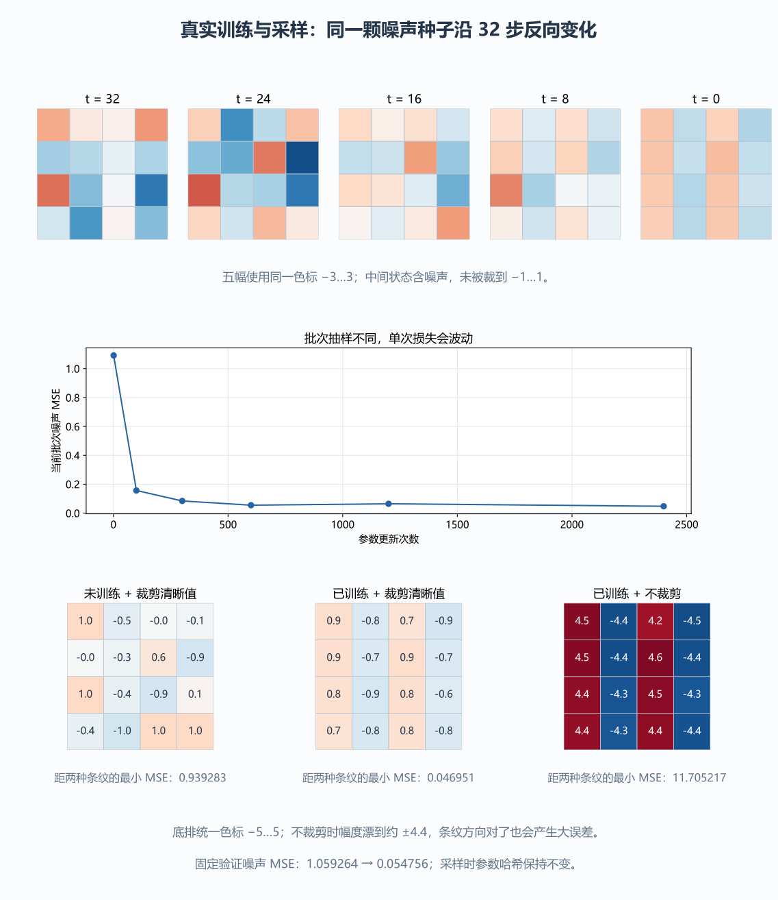

### 7. 潜在扩散：在压缩空间去噪

在高清大图上直接按原始像素跑 DDPM，状态维度 $D$ 太庞大了。**[潜在扩散模型（Latent Diffusion Model，如 Stable Diffusion 架构）](https://arxiv.org/html/2112.10752v2)** 的改进思路非常务实：先用一个预训练好的图像自编码器（VAE），把高宽缩小为原来的 $1/8$——例如把一张 `(3, 256, 256)` 的彩色大图（共 $196,608$ 个像素值）压缩成一张形状为 `(4, 32, 32)` 的潜在特征张量（Latent Tensor，仅含 $4,096$ 个浮点数，状态维度足足缩小了 $48$ 倍！）；然后把前面讲的整套 DDPM 加噪训练与多步反向去噪，原封不动地搬到这个 `(4, 32, 32)` 的小潜在张量上执行；等 32 步去噪跑完拿到干净的潜在张量后，最后调一次图像解码器把它放大还原回 `(3, 256, 256)` 的像素画面。

至于怎么让扩散模型“按用户输入的文字提示词画画（文生图）”？只需要在去噪网络内部加入我们在第四篇第四节讲过的**交叉注意力（Cross-Attention）**：文字提示词经文本编码器变成一串条件向量充当键（$K$）和值（$V$），而正在去噪的图像空间位置则发出查询（$Q$），在每一步去噪时按需读取相关的文字描述即可。

## （六）波形、频谱与声学时间轴

### 1. 振幅数组里的时间刻度

处理完二维空间里的图像，我们接着看一维时间轴上的声音。
人说话或乐器发声时引起空气压力的快速起伏，麦克风把这种声压起伏转换成电压，再由声卡按固定的时间间隔每秒钟测量 $f_s$ 次，存成一长列实数 $a[0], a[1], \ldots, a[N-1]$——这就是数字音频的**时域波形（Waveform）**。

式中的 $f_s$ 叫做**采样率（Sampling Rate，单位为赫兹 Hz，即每秒采样点数）**。有了采样率 $f_s$，数组里的第 $n$ 个下标（从 $0$ 开始数）就严格对应着物理世界里的时刻 $t_n$：

$$
t_n=\frac n{f_s}.
$$

在语音处理中最常用的采样率是 $f_s = 16,000\text{ Hz}$。这意味着相邻两个数组元素之间仅仅相隔 $1/16,000\text{ 秒} = 62.5\text{ 微秒}$！一段短短 **2 秒钟**的单声道录音，装在数组里就有整整 $N = 2\times 16,000 =$ **$32,000$ 个浮点数**（第 $0$ 个点在 $0$ 秒，最后一个点下标 $31,999$ 在 $31,999/16,000 = 1.9999375$ 秒，整段数组覆盖的总时长为 $N/f_s = 2$ 秒）。

看清音频数组与文本/图像数组的几个关键区别：
第一，常见浮点音频把振幅归一化在 $[-1, 1]$ 之间，但单个采样点的数值（比如 `a[100] = 0.35`）只代表那一微秒内振膜偏离平衡位置的瞬时位移，孤立看一个点既不知道音调有多高，也不知道说的是哪个字；
第二，如果是立体声双声道音频，数组形状会变成 `(N, 2)`，记录的是同一时刻左耳和右耳的两个振幅，通道数加倍并没有让录音时长变成 4 秒（而且如果把左右声道直接求平均转成单声道，左右相位相反的声音成分会在相加时互相抵消）；
第三，把这 32,000 个单声道采样点存成 32 位浮点数（FP32），纯数据载荷为 $32,000\times 4 = 128,000$ 字节；而在标准的 `.wav` 音频文件里，最常用的是 **16 位脉冲编码调制（16-bit PCM）**——它的原理其实跟我们在第五篇讲过的对称整数码本量化一模一样：把原本连续的声波**振幅**（Amplitude，即空气声压或麦克风振膜偏离中心静止位置的瞬时位移大小）均匀映射到 $[-32768, 32767]$ 的 16 位有符号整数格子上，每个采样点占 2 个字节，32,000 个点正好占 $64,000$ 字节（外加 44 字节的 WAV 文件头）。可见，修改存储位宽（FP32 vs. 16-bit PCM）改变的是纵向振幅刻度的精细度，而修改采样率 $f_s$ 改变的则是横向时间网格的疏密，这两个维度必须严格分开。

### 2. 周期、基频、谐波与混叠

既然单个采样点的数字只代表那一微秒振膜偏离了多少，那我们平时听到的声音“有多响”、“音调有多高（Pitch）”、“是谁的嗓音或什么乐器（音色 Timbre）”，在数组里到底对应什么？
我们先看一个最纯粹的单频正弦波（声学上称为**纯音**，就像敲响音叉发出的声音）：

$$
a[n]=A\sin\left(2\pi f_0\frac n{f_s}+\varphi\right).
$$

这个式子里有三个控制参数：
* **$A$ 是振幅（Amplitude）**：控制波峰和波谷上下摆动的幅度，决定声音听起来**有多响（音量大小）**；
* **$f_0$ 是频率（Frequency）**：代表声波在 1 秒钟内完整往复震动的周期次数（单位 Hz），决定声音听起来**音调有多高**；
* **$\varphi$ 是初相位（Initial Phase）**：记录在 $n=0$ 起始时刻波形正处于周期的哪个位置（比如 $\varphi=0$ 是从零点往上走，$\varphi=\pi/2$ 则是直接从波峰顶点开始往下走）。

取采样率 $f_s=16,000\text{ Hz}$、频率 $f_0=1000\text{ Hz}$、$A=1,\ \varphi=0$，那么每完成一个完整的正弦震动周期，正好走过 $16,000 / 1000 = 16$ 个采样点，开头几项依次为：

$$
(0,\ 0.382683,\ 0.707107,\ 0.923880,\ 1,\ldots).
$$

把振幅 $A$ 调大只会让波形上下更高，不会把“每 16 个点重复一轮”的周期变成 8 个点；只有把频率 $f_0$ 翻倍到 $2000\text{ Hz}$，每周期的点数才会缩短为 8 点。

而在自然界里，无论是人说话还是钢琴、小提琴发声，几乎都不是单一的正弦波，而是由一个频率最低的主震动——称为**基频（Fundamental Frequency，常记为 F0，它决定了我们听到的基本音高）**，同时叠加了一系列频率为基频整数倍（$2f_0, 3f_0, 4f_0, \ldots$）的高频伴随震动——称为**谐波（Harmonics，或泛音）**合成的。为什么钢琴和小提琴弹同一个中央 C（基频 $f_0$ 完全相同），我们闭着眼睛也能一耳朵听出哪个是钢琴、哪个是小提琴？就是因为它们各自携带的 $2f_0, 3f_0$ 等各次谐波的强弱比例不同！改变各次谐波的幅度配比，就会改变合成波形的细节形状，从而决定了声音独特的**音色（Timbre）**。在本章的配套实验中，我们用纯数学公式合成了一段总长 2 秒（32,000 个点）的双段测试音频：
* **前 1 秒（$0\le t < 1$）**：由 $200\text{ Hz}$ 的基频与 $400\text{ Hz}$ 的二次谐波叠加而成：
  $$
  a(t)=0.6\sin(2\pi\cdot 200t)+0.2\sin(2\pi\cdot 400t);
  $$
* **后 1 秒（$1\le t < 2$）**：基频与二次谐波整体升高到 $300\text{ Hz}$ 与 $600\text{ Hz}$（在 $t=1.0$ 秒的整周期零点处平滑衔接）。

在离散采样中，还必须遵守一条铁打的物理定律——**奈奎斯特（Nyquist）采样定理**：采样率 $f_s$ 必须严格高于信号所含最高频率的**两倍**（即最高可无损分辨的频率上限为 $f_s/2$）。如果违反了这条定律，时间网格太粗而声音震动太快，就会发生**混叠（Aliasing，即高频信号冒充成低频信号）**！
我们可以直接用三角恒等式写出一个铁证：假设采样率只有 $f_s=8000\text{ Hz}$（最高只能测到 $4000\text{ Hz}$），此时如果输入一个 $6000\text{ Hz}$ 的高频正弦波，它在第 $n$ 个采样点上的数值是：

$$
\sin\left(2\pi\frac{6000n}{8000}\right)
=\sin\left(2\pi n - 2\pi\frac{2000n}{8000}\right)
=-\sin\left(2\pi\frac{2000n}{8000}\right).
$$

你看，因为 $\sin(2\pi n - \theta) = -\sin\theta$，在每一个整数采样点 $n$ 上，$6000\text{ Hz}$ 高频波留下的采样数字，与一个反相的 **$2000\text{ Hz}$ 低频波**留下的数字一模一样、连小数点后一百位都分不出来！因此在工程上把高采样率音频降采样（Downsample）之前，必须先过一遍低通滤波器把超过新奈奎斯特频率的高频成分滤除干净（而且重采样必须真正按新时间网格重新插值计算采样点；要是只去改 WAV 文件头里的采样率数字，把 `16000` 改成 `32000`，播放器就会以两倍速在 1 秒内放完，把音调也扯高八度）。

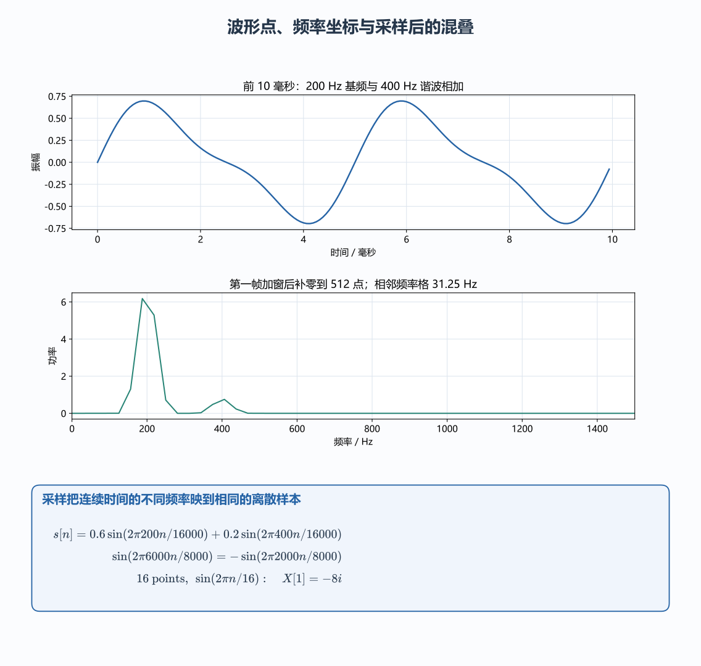

### 3. 滑窗分帧与 Hann 窗

拿到了上面那段长度为 32,000 的两秒波形数组，我们想分析里面包含哪些频率成分。如果把全部 32,000 个点一口气塞进傅里叶变换里算出一张全局频谱，虽然能看到里面有 200、300、400、600 Hz，但**时间先后信息就全丢了**——你根本分不清到底是前 1 秒响了 200 Hz、后 1 秒响了 300 Hz，还是这两组声音从头到尾一直在同时响！

为了同时保住“什么时候响（时间轴）”和“响的是什么音高（频率轴）”，语音处理的标准做法是**短时分帧（Framing）**：拿一个长度只有几十毫秒的短窗口，沿着时间轴一格一格往前滑，对每一个短窗口单独做一次频谱分析。

设每个短窗口包含 $M$ 个采样点（称为窗长 Window Length），窗口每次往前滑动的距离为 $H_{\rm hop}$ 个采样点（称为帧移 Hop Length）。那么第 $m$ 个时间帧（从 $m=0$ 开始编号）截取出来的波形片段就是：

$$
a[mH_{\rm hop}],\ a[mH_{\rm hop}+1],\ \ldots,\ a[mH_{\rm hop}+M-1].
$$

在我们的 16 kHz 实验中，取窗长 $M=400$ 个点（对应物理时长 $400 / 16,000 = 0.025\text{ 秒} = 25\text{ 毫秒}$），取帧移 $H_{\rm hop}=160$ 个点（对应每次往前挪 $160 / 16,000 = 0.01\text{ 秒} = 10\text{ 毫秒}$）。
注意算一算这 32,000 个采样点一共能切出多少个完整帧：因为相邻两个窗口之间有 $400-160=240$ 个点是重叠的，绝不能按 $32,000 / 400 = 80$ 来算！在不做首尾补边、只保留完整 $400$ 点窗口的规则下，总帧数 $T_{\rm frame}$ 的精确计算公式是：

$$
T_{\rm frame}
=1+\left\lfloor\frac{32,000-400}{160}\right\rfloor
=1+197=198\text{ 帧}.
$$

核对一下最后一帧（第 $m=197$ 帧）的位置：它从下标 $197\times 160 = 31,520$ 开始，加上 400 个点到下标 $31,919$ 结束；数组最末尾剩下的 $32,000 - 31,920 = 80$ 个采样点因为凑不够一个 400 点的完整窗口，在这套不补边规则下就被留在窗外了（不同语音库对首尾补不补零、窗口以左端点还是中心点对齐的默认选项不同，会直接导致切出来的帧数差一两帧，工程对账时必须把这几个参数显式写死）。

切出了 400 个点的短窗口后，如果直接对这生硬截断的 400 个数做傅里叶变换，由于窗口左右两端突然从有值断崖式切到零，会在频谱上引发严重的**频谱泄漏（Spectral Leakage，即能量向旁瓣扩散）**。为此，我们在做变换前，先给窗口里的每个点乘上一条中间高（接近 $1$）、两头平滑衰减到 $0$ 的钟形权重曲线——**周期型汉宁窗（Hann Window）**：

$$
w[n]=\frac12-\frac12\cos\frac{2\pi n}{M},
\qquad n=0,\ldots,M-1.
$$

### 4. STFT：正弦与余弦的两次内积

加完窗函数后，怎么算出第 $m$ 帧里含有多少频率为 $k$ 的成分？
很多初学者一看到**短时傅里叶变换（STFT）**公式里的复数符号 $\mathrm i$ 和欧拉指数 $e^{-\mathrm i\theta}$ 就犯怵。其实只要把欧拉公式 $e^{-\mathrm i\theta} = \cos\theta - \mathrm i\sin\theta$ 展开，你会惊讶地发现：**傅里叶变换在数学上根本就是我们在第一篇第一节学过的“向量内积”！**

设频率网格的总点数为 $N_{\rm fft}$。对于第 $m$ 帧加窗后的信号 $a[mH_{\rm hop}+n]w[n]$，它在第 $k$ 个频率点上的傅里叶变换系数 $X_{m,k}$ 定义为：

$$
X_{m,k}
=\sum_{n=0}^{M-1}a[mH_{\rm hop}+n]w[n]\,
e^{-\,\mathrm i2\pi kn/N_{\rm fft}}.
$$

把 $e^{-\mathrm i2\pi kn/N_{\rm fft}}$ 按欧拉公式拆成实部 $\cos$ 和虚部 $-\sin$，上面那个复数和式当场就拆成了**两个纯实数向量的内积**：

$$
\operatorname{Re}X_{m,k}
=\sum_{n=0}^{M-1} \bigl(a[mH_{\rm hop}+n]w[n]\bigr)\cos\frac{2\pi kn}{N_{\rm fft}},
\qquad
\operatorname{Im}X_{m,k}
=-\sum_{n=0}^{M-1} \bigl(a[mH_{\rm hop}+n]w[n]\bigr)\sin\frac{2\pi kn}{N_{\rm fft}}.
$$

你看！所谓求第 $k$ 个频点的傅里叶系数，不过就是准备两条标准模板向量——一条是在 $N_{\rm fft}$ 个点内震动 $k$ 个周期的**余弦波模板 $\cos(\frac{2\pi kn}{N_{\rm fft}})$**，另一条是震动 $k$ 个周期的**正弦波模板 $\sin(\frac{2\pi kn}{N_{\rm fft}})$**；然后拿你手头的这一帧声音信号，分别跟余弦模板和正弦模板做一次**内积（逐项相乘再求和）**！
第一篇早就讲过，两个向量越相似、越同起同落，内积就越大；如果这一帧声音里根本不含频率 $k$ 的震动，正负相消后内积就是零！至于为什么要同时跟余弦和正弦两个模板做内积？因为声音进窗口时的起始相位 $\varphi$ 未必刚好对齐在余弦波峰上——拿实部（余弦内积）和虚部（负正弦内积）求平方和再开根号算出**复数模长 $|X_{m,k}| = \sqrt{(\operatorname{Re}X_{m,k})^2 + (\operatorname{Im}X_{m,k})^2}$**，不管起始相位怎么偏移，都能稳稳测出该频率成分的总振幅强度！（而快速傅里叶变换 FFT，仅仅是利用三角函数对称性把这堆内积算得飞快的加速算法。）

我们拿第 2 小节那个刚好 16 个点走完一周期的正弦波 `frame = sin(2*pi*n/16)`（暂不加窗，取 $N_{\rm fft}=16$）来手算验证频点 $k=1$：
在 $k=1$ 处，模板也是 16 个点走一周期。正弦波与余弦模板 $\cos(2\pi n/16)$ 在一个完整周期内正负对称相消，内积（实部）严格为 $0$；而正弦波与它自己的正弦模板 $\sin(2\pi n/16)$ 相乘，变成 $\sum_{n=0}^{15} \sin^2(2\pi n/16) = 16\times \frac12 = 8$，添上虚部公式前面的负号，虚部就是 $-8$！于是：

$$
X_1=0 - 8\mathrm i=-8\mathrm i,\qquad |X_1|=8.
$$

~~~python
import numpy as np

frame = np.sin(2 * np.pi * np.arange(16) / 16)
spectrum = np.fft.rfft(frame)
print(spectrum[1])  # -8j（实部仅为 1e-16 级浮点舍入差）
print(np.abs(spectrum).round(6).tolist())  # [0.0, 8.0, 0.0, 0.0, 0.0, 0.0, 0.0, 0.0, 0.0]
~~~

因为输入的音频波形是纯实数，负频率系数与正频率系数互为共轭对称（模长完全相等），所以代码中直接调用实数快速傅里叶变换 `np.fft.rfft`，只保留非负频率这一半即可：当取 $N_{\rm fft}=512$ 时（刚才 $M=400$ 点的窗口末尾自动补 112 个零凑齐 512 点；注意尾部补零只是把频谱曲线上的采样网格插得更密，并没有延长那 25 毫秒的真实物理观测时间），输出的非负频点个数正好是 $512/2 + 1 =$ **$257$ 个频点**（第 $k$ 个频点对应的物理频率为 $k\cdot\frac{16000}{512} = 31.25k\text{ Hz}$）。

### 5. 从功率谱到对数梅尔频谱

对全部 198 个时间帧做完 512 点 `rfft`，取复数模长的平方再除以 $N_{\rm fft}$，就得到了形状为 `(198, 257)` 的**功率谱（Power Spectrum）矩阵 $P$**：

$$
P_{m,k}=\frac{|X_{m,k}|^2}{N_{\rm fft}}.
$$

这 257 个频点在物理赫兹（Hz）轴上是均匀分布的（每隔 $31.25\text{ Hz}$ 一个点）。但人类的耳蜗听觉有一个著名的非线性特性：人耳对低频段的变化极其敏感（$100\text{ Hz}$ 和 $200\text{ Hz}$ 听起来差了整整一个八度），而对高频段则迟钝得多（$7100\text{ Hz}$ 和 $7200\text{ Hz}$ 听起来几乎没区别）。

为了模仿人耳这种“低频分得细、高频合得粗”的感知刻度，语音系统引入了**梅尔标度（Mel Scale）**（以经典的 HTK 公式为例）：

$$
\operatorname{mel}(f)=2595\log_{10}(1+f/700).
$$

我们在梅尔刻度上均匀划分出 40 个频带（Filter Banks），再换算回物理 Hz 轴，为每个频带造一个“中心频率权重为 $1$、往左右两侧线性衰减到 $0$”的三角形滤波器。把这 40 个三角形滤波器在 257 个频点上的权重按行排成一张形状为 $B_{\rm mel}\in\mathbb R^{40\times 257}$ 的**梅尔滤波矩阵**，那么把 257 维功率谱压缩成 40 个梅尔频带能量，就又变成了一次干脆利落的矩阵乘法：

$$
E=B_{\rm mel}P^{\mathsf T},\qquad
B_{\rm mel}\in\mathbb R^{40\times257},\quad
E\in\mathbb R^{40\times198}.
$$

（比如相邻三个频点的功率是 $(1, 4, 1)$，某个三角滤波器赋给它们的权重是 $(0.5, 1, 0.5)$，这一行算出来的汇总能量就是 $0.5\times 1 + 1\times 4 + 0.5\times 1 = 5$。注意不同音频库如 [Librosa 的 `mel` 接口](https://librosa.org/doc/0.11.0/generated/librosa.filters.mel.html) 有 HTK 与 Slaney 标度、是否做三角形面积归一化等不同默认项，跨库复现时必须核对清楚。）

最后一步，因为声音能量的强弱跨度可达好几个数量级，我们对汇总后的梅尔能量取自然对数（加上 $10^{-10}$ 防止对零取对数），得到最终送入神经网络的 $(40, 198)$ **对数梅尔频谱图 $F$**：

$$
F_{j,m}=\log\max(E_{j,m},10^{-10}).
$$

请记住这步特征提取留下的一个不可逆信息缺口：从 257 个复数频点变成 40 个实数对数梅尔能量，既合并压缩了频率分辨率，又彻底扔掉了复数的**相位（Phase）信息**。单凭这张 $(40, 198)$ 的梅尔图，是无法用逆傅里叶变换唯一倒推出原始声波的——这也正是为什么在后面做语音合成时，需要专门训练一个神经网络声码器（Vocoder）来把丢失的相位与波形细节重新生成出来。

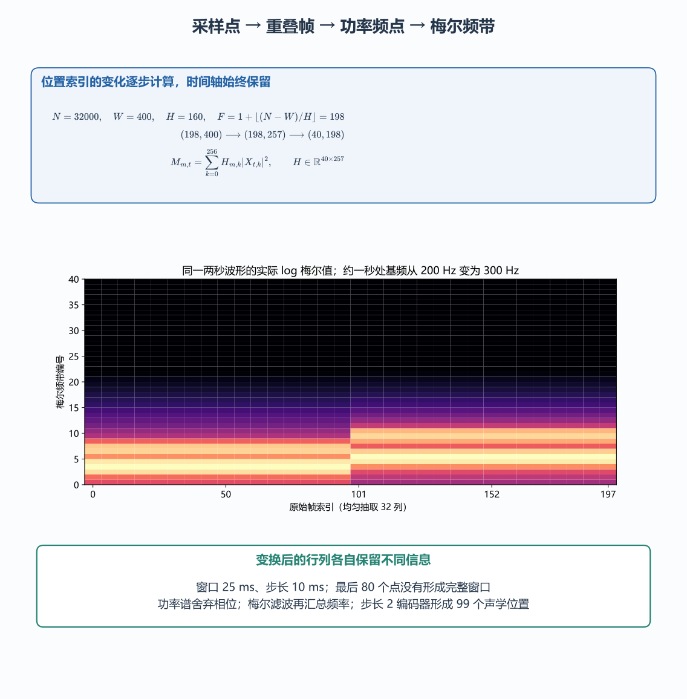

### 6. 声学帧的编码与下采样

拿到了形状为 `(40, 198)` 的对数梅尔频谱，加上批次轴后：如果送进一维卷积层，通常排成 `(1, 40, 198)`（把 40 个梅尔频带当作输入通道，沿着长度为 198 的时间轴做滑动卷积）；如果送进 Transformer 编码器，则转置成 `(1, 198, 40)`（共 198 个时间序列位置，每个位置一条 40 维的频谱向量）。

由于每 10 毫秒就有一帧（1 秒钟就有 100 个位置），直接把几百上千个声学帧全送进自注意力层既冗余又费算力。因此，语音编码器（如 Whisper 的前端）通常会在入口处先放一两层步长为 $2$ 的一维时间卷积做**时间下采样**。比如用核长为 $3$、步长为 $2$、两端各补 $1$ 格零（Padding=1）的卷积扫过 198 个时间帧，输出的时间位置数 $T'$ 为：

$$
T'=\left\lfloor\frac{198+2-3}{2}\right\rfloor+1=99\text{ 个声学位置}.
$$

现在回头算一算整条音频链路上的时间刻度变化：**同样是这 2 秒钟的声音，在原始波形里是 $32,000$ 个采样点，在短时分帧后是 $198$ 个梅尔帧（每帧跨度 10 毫秒），经过步长为 2 的卷积下采样后变成了 $99$ 个编码器声学位置（每位置跨度约 20 毫秒）**；而这 2 秒钟里人说出的文字，可能只有寥寥 3 个汉字，也可能快嘴说了 10 个字！声学位置数（99）与文字 Token 数之间根本不存在 $1\mathbin{:}1$ 的等长关系，怎样把这两条长短不一的时间轴对齐，正是下一节语音识别与语音合成要解决的核心矛盾。

### 7. 提取基频与调整音调

在进入语音识别之前，我们还得把第 2 小节埋下的另一个关键声学量——**基频（F0，即音高轨迹）**从波形里算出来，因为后面的语音转换（RVC）要靠它来控制唱歌或说话的音调高低。

怎么从一段周期波形里找出它的基频周期长度？最经典的方法是计算波形的**归一化自相关函数（Autocorrelation）**：把原始波形 $a[n]$ 与往后延迟了 $\ell$ 个采样点的它自己 $a[n+\ell]$ 做内积，并除以两段各自的二范数长度：

$$
R[\ell]
=\frac{\sum_n a[n]a[n+\ell]}
{\sqrt{\sum_n a[n]^2}\sqrt{\sum_n a[n+\ell]^2}}.
$$

道理再简单不过了：如果延迟点数 $\ell$ 恰好等于这帧声音的一个完整周期长度，那么平移后的波形就会和原波形波峰对波峰、波谷对波谷地完美重合，算出来的余弦相似度 $R[\ell]$ 就会达到最高峰 $+1$！
拿我们前 1 秒合成的那段 $200\text{ Hz}$ 基频叠加 $400\text{ Hz}$ 谐波的声音来算：在 $16,000\text{ Hz}$ 采样率下，$200\text{ Hz}$ 的一个完整周期正好是 $\ell = 16,000 / 200 =$ **$80$ 个采样点**。程序在预设的人声合理延迟区间 $\ell\in[54, 100]$（对应 $160\text{ Hz}\sim 296\text{ Hz}$）内扫描自相关，最高峰稳稳落在 $\ell=80$ 处，反解出基频 $f_0 = 16,000 / 80 = 200\text{ Hz}$！（在真实人声中，元音段有明显周期，称为**浊音 Voiced**；而像辅音 `s`、`sh` 或静音停顿段则没有周期，称为**清音 Unvoiced**，F0 提取器会把这些无周期位置的基频标为 $0$。）

一旦抽出了随时间变化的基频轨迹 F0，接下来的问题就是怎么用数学公式精确控制声音的升降调？在现代音乐与声学中，普遍采用**十二平均律**：音调每升高一个**八度**（比如从低音 `Do` 唱到高音 `Do`），声波的物理基频 $f_0$ 就恰好**翻一倍（乘以 $2$）**；而十二平均律把这一个八度的翻倍区间，按等比数列均匀切分成了 $12$ 个相等的最小音高台阶，每一个小台阶就叫做一个**半音（Semitone，对应钢琴键盘上相邻的两个键，包括白键与黑键）**。因为连乘 12 次等于 2，所以每升高 1 个半音，频率就乘以 $2^{1/12}$；升高 $k$ 个半音，只需把所有有声位置的基频数值统一乘以 $2^{k/12}$ 即可（例如升 12 个半音就是乘以 $2^{12/12}=2$，把 $200\text{ Hz}$ 变成 $400\text{ Hz}$；降调则取负数 $k$）。注意：这样修改的仅仅是音高条件，并不会自动改变说话人的声道共振特征（音色）和发音习惯。

## （七）语音识别、合成与交接

把三种语音任务按输入与输出排开，就能分清它们分别改变了什么。ASR 把语音转写成文字，TTS 把文字合成为语音；RVC 则以已有语音为输入，利用内容特征、音高轨迹和目标音色条件产生转换后的语音。级联系统“ASR → LLM → TTS”在中间经过两份文本，RVC 的转换路径则不要求先生成一份可编辑的逐字转写。

下图底部把前面出现的 $200$ Hz 基频与 $400$ Hz 谐波重新组合：只把第二项系数从 $0.2$ 改成 $0.4$，两条周期信号仍每 $5$ ms 重复一次，但周期内部的形状已经不同。这让“音高保持、音色相关的频谱结构改变”有了可以直接比较的对象。真实语音还包含随时间变化的发音内容与清浊状态，要沿各自的表示和时间轴继续处理。

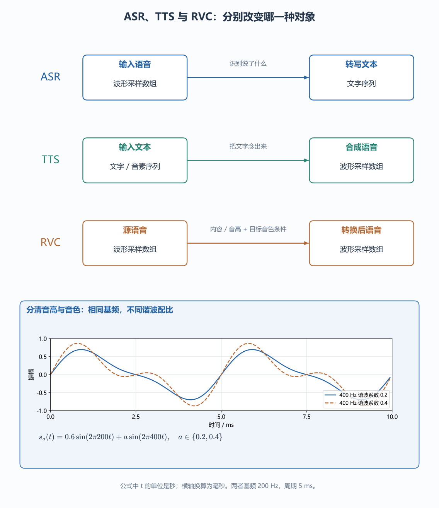

### 1. 声学位置与文字位置的对齐

现在，2 秒钟的音频经过编码器变成了 99 个声学位置向量 $A\in\mathbb R^{99\times d_a}$，我们怎样从这 99 个声学位置里识别出文字（自动语音识别，ASR）呢？
在语音处理中，常用 **F0** 来表示基频随时间帧变化的轨迹，而一段语音里并不是每一帧都有基频的。这直接源于人类发声的物理机制：
* 当我们发 `a`、`o`、`e`、`i`、`u` 等**元音（Vowels）**或部分带声辅音（如 `m`、`n`、`l`）时，喉部的**声带会发生规律的周期性震动**，这类声带震动的发音称为**浊音（Voiced，即有声段）**，在波形上呈现出明显的重复周期，因此能测出大于零的基频 F0；
* 而当我们发 `s`、`sh`、`f`、`p`、`t`、`k` 等**清辅音（Unvoiced Consonants）**或者处于说话停顿的静音段时，**声带完全不震动**，声音仅仅是由气流摩擦牙齿或嘴唇产生的随机湍流噪声（称为**清音 Unvoiced，即无周期段**）。因为清音根本没有周期性重复，F0 估计器必须把这些位置单独标记出来（通常将清音帧或静音帧的 F0 记为 `0`）。

现代语音识别解决这个不等长对齐问题，主要有两条技术路线：
第一条路线是以 **[Whisper](https://arxiv.org/abs/2212.04356)** 为代表的 **Encoder–Decoder 交叉注意力架构**（已在第四篇第四节介绍过）：声学编码器先把音频编成 99 行表示 $A\in\mathbb R^{99\times d_a}$ 充当源端；文字解码器则按已生成的 $T$ 个文字前缀发出查询 $Q\in\mathbb R^{T\times d_k}$，与声学编码产生的键 $K=AW_K\in\mathbb R^{99\times d_k}$ 和值 $V=AW_V\in\mathbb R^{99\times d_v}$ 做交叉注意力：
$$
Q\in\mathbb R^{T\times d_k},\quad
K=A W_K\in\mathbb R^{99\times d_k},\quad
V=A W_V\in\mathbb R^{99\times d_v}.
$$

算出来的交叉注意力权重矩阵形状为 $T\times 99$——每一个文字位置都可以自己按相关性比例去读取全部 99 个声学帧， completely 解耦了声学帧数与文字字数。

第二条路线则是不使用自回归解码器，直接在编码器的每一个声学帧位置上硬输出词表分布，再靠一套精妙的合并规则把长帧序列压成短文字——这就是**连接时序分类（Connectionist Temporal Classification，简称 CTC）**。

### 2. CTC：先合并重复，再删空白

假设音频有 8 个声学帧，而真实说出的单词只有三个字母 `aab`。如果让全部 8 个帧都输出字母，怎么区分一个人到底说的是拉长音的一个 `a`（`aaaa...` $\to$ `a`），还是真正连续说了两个 `a`（`aa`）呢？

[CTC 算法](https://distill.pub/2017/ctc/) 在正常字符词表之外，专门新增了一个特殊符号——**`blank`（空白/分隔符，记编号为 `0`）**，并定下了一条铁打的两步折叠合并映射 $\mathcal B(\pi)$：
* **第一步：先把路径上所有紧挨在一起的相同符号合并成一个**；
* **第二步：再把路径上所有的 `blank` 统统删掉**！

我们拿一条长度为 8 的帧级输出路径 $\pi$ 走一遍这两步，你就瞬间明白 `blank` 的妙用了：

~~~text
原始 8 帧路径:  blank,  a,  a,  blank,  a,  b,  b,  blank
~~~

1. **先执行第一步（合并相邻重复项）**：第 1、2 帧连续两个 `a` 合为一个 `a`，第 5、6 帧连续两个 `b` 合为一个 `b`，路径变成：`blank, a, blank, a, b, blank`；
2. **再执行第二步（删除所有 `blank`）**：把三个 `blank` 抽掉，最终留下的文字就是 **`aab`**！

你看，前面连续两个 `a` 因为中间没有隔着 `blank`，代表的是同一个字拖长了音，所以被合并成了一个 `a`；而它和后面那个 `a` 中间因为夹了一个 `blank` 把它俩隔开了，所以在合并时没有被吞掉，成功保留了叠词 `aa`！
千万注意：**这两步的先后次序绝对不能颠倒！** 如果你先删掉了 `blank`，上面那条路径就会先变成 `a, a, a, b, b`，然后再合并相邻重复项，就会错误地缩成 `ab`，把合法的叠词给活活吞掉了！

有了这个多对一的折叠映射 $\mathcal B$，假设编码器在每一帧 $t$ 独立给出各符号的概率分布 $p_t(c)$，那么单条帧级路径 $\pi=(\pi_0,\ldots,\pi_{T-1})$ 的概率就是各帧所选符号概率的连乘积 $P(\pi\mid{\rm audio})=\prod_t p_t(\pi_t)$；而最终生成目标文字序列 $y$ 的总概率，就是**所有经过折叠映射 $\mathcal B(\pi)$ 后等于 $y$ 的合法帧路径的概率总和**：

$$
P(y\mid{\rm audio})
=\sum_{\pi:\mathcal B(\pi)=y}\prod_t p_t(\pi_t).
$$

正因为对所有合法对齐路径求了和，训练 CTC 时我们只需要提供整句录音对应的文字稿 $y$，根本不需要雇人去一帧一帧标注每个字是从第几毫秒开始、到第几毫秒结束的！

### 3. 三帧样本的路径枚举

为了把上面那个求和符号 $\sum_{\pi:\mathcal B(\pi)=y}$ 算得底朝天，我们拿一个只有 $T=3$ 个时间帧、每帧只有 3 个候选符号（按列依次为 `blank`、`a`、`b`）的概率矩阵 $P$ 来手算：

$$
P=\begin{bmatrix}
0.2&0.7&0.1\\
0.6&0.3&0.1\\
0.2&0.2&0.6
\end{bmatrix}.
$$

假设这段三帧录音的真实目标文字只有一个单字符 $y = \mathtt{a}$。
三帧、每帧 3 种选择，一共有 $3^3 = 27$ 条可能路径。在这 27 条路径里，哪些路径遵循“先合重复、再删 `blank`”后能恰好得到单字符 `a` 呢？一共只有下面 **6 条合法路径**（注意像 **`a, blank, a`** 这条路径，因为中间被 `blank` 隔开了，折叠后会变成两个字 **`aa`**，绝不能算进单字符 `a` 的合法路径里！而任何包含 `b` 的路径也全部出局）：

| 合法帧级路径 $\pi$ | 三帧概率相乘算式 | 该路径概率 $P(\pi)$ |
| --- | --- | ---: |
| `blank, blank, a` | $0.2\times0.6\times0.2$ | `0.024` |
| `blank, a, blank` | $0.2\times0.3\times0.2$ | `0.012` |
| `blank, a, a` | $0.2\times0.3\times0.2$ | `0.012` |
| `a, blank, blank` | $0.7\times0.6\times0.2$ | `0.084` |
| `a, a, blank` | $0.7\times0.3\times0.2$ | `0.042` |
| `a, a, a` | $0.7\times0.3\times0.2$ | `0.042` |
| **目标 `y = "a"` 的总概率** | **以上 6 条合法路径相加** | **`0.216`** |

把这 6 条合法路径的概率加起来，目标文字 `a` 的总概率就是 $P(y=\mathtt{a}\mid{\rm audio}) = 0.216$，取负自然对数即得 CTC 损失：

$$
L_{\rm CTC}=-\log0.216\approx1.532477.
$$

顺带看一眼这时的贪心解码结果：如果你在上面那张 $3\times 3$ 概率矩阵 $P$ 上逐帧挑最大概率的符号，第 0 帧选 `a`（$0.7$），第 1 帧选 `blank`（$0.6$），第 2 帧选 `b`（$0.6$），拼成 `a, blank, b`，折叠后输出的是 **`ab`**（错把最后一帧认成了 `b`）。因此训练时就是要靠最小化 $L_{\rm CTC}\approx 1.532477$，把那 6 条合法路径的概率总和往上推。

### 4. 前向递推与后验梯度

当音频有几百帧时，$3^T$ 条路径根本没法靠枚举求和。为此，CTC 把目标字符 `a` 前后插上空白，展开成三个状态序列 `(blank, a, blank)`（下标 $s=0, 1, 2$），用前向动态规划变量 $\alpha_{t,s}$ 记录“走到第 $t$ 帧且停在状态 $s$ 的所有合法前缀路径概率之和”：
* **第 0 帧（$t=0$）**：只能从状态 $0$（起始 `blank`）或状态 $1$（字符 `a`）起步，不能凭空跳到末尾状态 $2$：
  $$
  \alpha_0=(0.2,\ 0.7,\ 0).
  $$
* **第 1 帧（$t=1$）**：状态 $0$ 只能从上一帧的状态 $0$ 留任（$0.2\times 0.6$）；状态 $1$ 可以从状态 $0$ 或状态 $1$ 转移过来（$(0.2+0.7)\times 0.3$）；状态 $2$（末尾 `blank`）只能从上一帧的状态 $1$（已经发出过 `a`）走过来（$0.7\times 0.6$）：
  $$
  \alpha_1=
  \bigl(0.2\times0.6,\ (0.2+0.7)\times0.3,\ 0.7\times0.6\bigr)
  =(0.12,\ 0.27,\ 0.42).
  $$
* **第 2 帧（$t=2$）**：继续按同样的前驱累加规则往前推一步：
  $$
  \alpha_2=
  \bigl(0.12\times 0.2,\ (0.12+0.27)\times0.2,\
  (0.27+0.42)\times0.2\bigr)
  =(0.024,\ 0.078,\ 0.138).
  $$

走完最后一帧，合法路径要么停在状态 $1$（字符 `a`），要么停在状态 $2$（末尾 `blank`），把这两项加起来：$0.078 + 0.138 =$ **`0.216`**，与刚才枚举 6 条路径相加的结果分毫不差！

更精彩的是 **CTC 的反向传播梯度**：既然没有人为规定哪一帧必须是 `a`、哪一帧必须是 `blank`，损失函数怎么给每一帧的 logits $z_{t,c}$ 算梯度？
我们对 $L = -\log P(y) = -\log\sum_{\pi:\mathcal B(\pi)=y} P(\pi)$ 关于第 $t$ 帧符号 $c$ 的原始分数 $z_{t,c}$ 求偏导数：

$$
\frac{\partial L}{\partial z_{t,c}}
=-\frac{1}{P(y)}\sum_{\pi:\mathcal B(\pi)=y}\frac{\partial P(\pi)}{\partial z_{t,c}}
=-\sum_{\pi:\mathcal B(\pi)=y}
\frac{P(\pi)}{P(y)}
\frac{\partial\log P(\pi)}{\partial z_{t,c}}.
$$

对于单条确定路径 $\pi$，$\log P(\pi) = \sum_u \log p_u(\pi_u)$，它对 $z_{t,c}$ 的导数就是我们熟知的 $\mathbf 1[\pi_t=c] - p_t(c)$。把它代回上式，按每条合法路径占目标总概率的比重 $\frac{P(\pi)}{P(y)}$ 加权求和，记第 $t$ 帧在所有合法路径中由符号 $c$ 承担的**后验责任比例**为 $\gamma_t(c) = \sum_{\pi:\mathcal B(\pi)=y, \pi_t=c}\frac{P(\pi)}{P(y)}$（显然 $\sum_c \gamma_t(c) = 1$），那么 CTC 对第 $t$ 帧 logits 的梯度就化简成了极其眼熟的形式：

$$
\frac{\partial L}{\partial z_{t,c}}=p_t(c)-\gamma_t(c).
$$

你看，它依然是**“预测概率减去目标”**！只不过在没有逐帧硬标签时，那个目标 $\gamma_t(c)$ 变成了由全体合法路径按各自概率投票分摊出来的**软后验目标**！
拿第 0 帧的字符 `a` 算一下：在上一小节表格的 6 条合法路径中，第 0 帧选了 `a` 的是后三条路径（概率分别为 $0.084, 0.042, 0.042$），占总概率 $0.216$ 的比例为：

$$
\gamma_0(a)=\frac{0.084+0.042+0.042}{0.216}
=\frac{0.168}{0.216}=\frac79\approx0.777778.
$$

于是第 0 帧字符 `a` 的 logit 梯度就是 $p_0(a) - \gamma_0(a) = 0.7 - 7/9 \approx -0.077778$；而字符 `b` 因为没出现在任何一条合法路径里，$\gamma_0(b)=0$，它的梯度就是 $0.1 - 0 = +0.1$。配套函数 `ctc_trace` 同时核对了枚举求和、三状态动态规划与 PyTorch 原生 `nn.CTCLoss`，三者的损失与 logits 梯度完全一致。

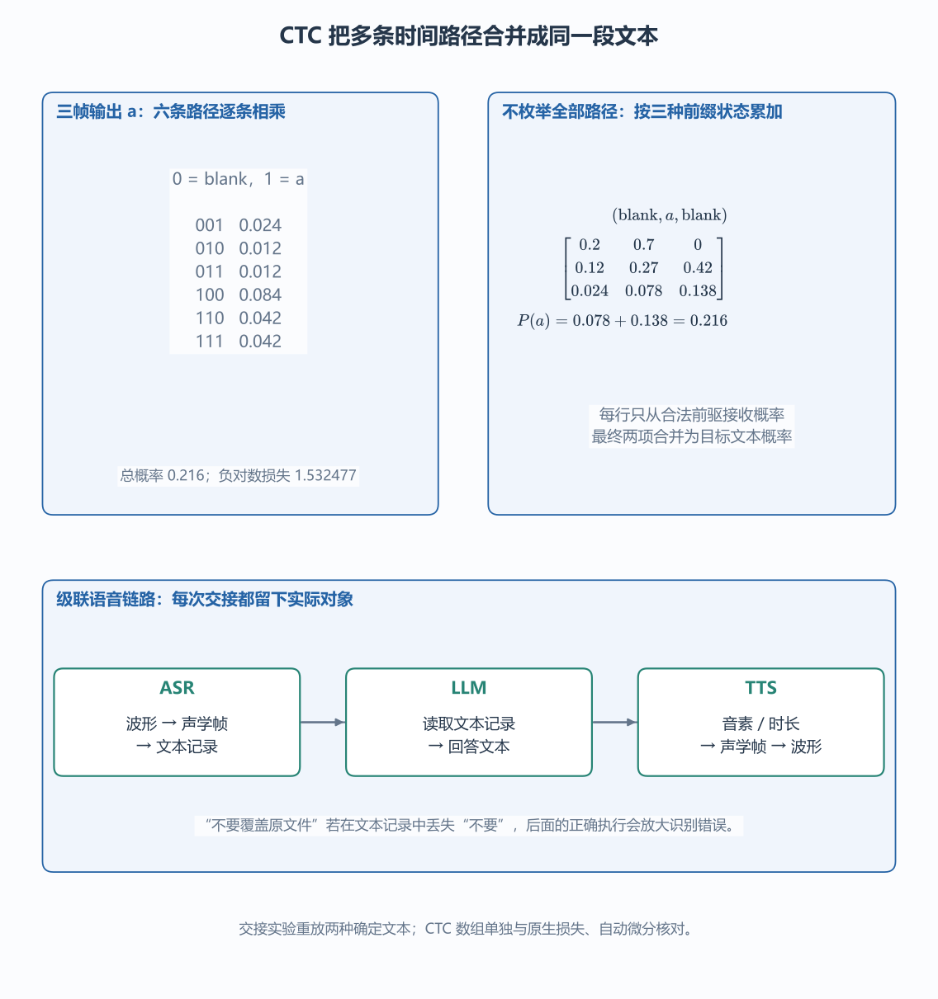

### 5. TTS：让文字沿时间展开

反过来，**语音合成（Text-to-Speech，简称 TTS）**要把短短几个文字变成每秒一万六千个点的连续声波，面临的是相反的一对多扩展矛盾。
首先，前端必须解决多音字与符号读法（比如“银行”里的“行”读 `hang2`，“行走”里的“行”读 `xing2`），把模糊的文字转成明确代表发音的**音素（Phoneme）序列**。
解决了多音字和符号读法之后，文字就被转换成了真正代表最小发音动作单元的序列——**音素（Phoneme，比如汉语拼音拆开的声母 `zh`、韵母 `ang`，或英语音标里的单个元音/辅音符号）**。
接着，怎么把只有寥寥几个音素位置的序列，拉长成持续几百帧的声学序列？一种显式的做法是训练一个时长预测模块，预测每个音素应当持续多少个声学帧：例如用两个音素 `a`、`i` 的特征向量 $(1,0.2)$ 和 $(0.1,1)$，若预测出它们分别持续 `3` 帧和 `2` 帧，按帧数重复展开后就变成了 $5$ 行声学序列：

$$
A_{\rm expanded}=
\begin{bmatrix}
1&0.2\\
1&0.2\\
1&0.2\\
0.1&1\\
0.1&1
\end{bmatrix}.
$$

文字端的两个音素位置就这样变成了声学端的五个时间帧位置。展开后的表示继续通过网络预测出每一帧的对数梅尔频谱，最后交给整条语音生成链的最后一棒——**声码器（Vocoder，即“声学编码解码器”的简称，专门负责把梅尔频谱或抽象声学特征还原成每秒上万个采样点的时域声波数组）**。[Tacotron 2](https://arxiv.org/abs/1712.05884) 就确立了这种“先从文字生成梅尔谱、再由声码器从梅尔谱生成波形”的经典两阶段架构。回想第六节第 5 小节讲过的：40 维对数梅尔频谱不仅合并了频率细节，还彻底丢掉了复数傅里叶变换的相位信息；声码器所承担的硬核任务，正是根据梅尔频谱条件以及在海量真实录音中学到的声波规律，把丢失的相位与高频采样点重新合成出来。

### 6. 沿中间文本追查语音错误

在实际工程中，很多语音助手采用的是 **`ASR（语音转文字） → LLM（语言模型问答/调工具） → TTS（文字转语音）`** 的三级级联流水线。
在这条流水线里，排查故障最核心的工程纪律就是：**必须把每一棒交接时的中间文本对象完完整整地记录下来！**

设想用户对着麦克风喊了一句：“**不要覆盖原文件！**”。结果最后助手不仅把原文件给覆盖了，还用甜美的合成语音回答：“已经为您覆盖了原文件。”
如果你只存了最开头的用户录音和最末尾的合成语音，你根本无从判断是谁闯的祸；而一旦把中间交接文本打出来核对（见 `speech_chain` 对照实验），故障现场就一目了然：原来是第一棒 ASR 在噪音干扰下漏掉了开头的否定词，把转写文本输出成了 `"覆盖原文件"`！后面的语言模型和工具只是忠实地执行了收到手的错误转写。把音频片段标识、ASR 原始转写、改写后文本、LLM 实际输入与输出逐棒留痕，是级联多模态系统不可或缺的防线。

## （八）语音转换与特征检索

### 1. 从生成一句话到转换一段声音

在上一节的 TTS 里，输入是一串干巴巴的文字，说话的快慢、停顿和抑扬顿挫全得靠模型从零猜出来。但在**语音转换（Voice Conversion，或 AI 翻唱）**任务里，我们手里已经有一段原唱或原说话人的真实录音了——我们希望完整保留原录音里的歌词咬字内容、快慢节奏与旋律音高起伏，只把嗓音音色换成目标人物的音色。

以开源社区广泛使用的 **RVC（Retrieval-based Voice Conversion，检索式语音转换）** 为例，它是怎样把我们已经学过的表示提取、基频估计与向量近邻检索组装在一起的？
它的主干链路分为三路汇合：
1. 第一路把源音频送入预训练语音特征编码器（**[HuBERT](https://arxiv.org/abs/2106.07447)** / ContentVec），提取出按时间帧排列的连续语音内容表示；
2. 第二路提取源音频的基频轨迹 **F0**（并根据需要做升降调平移），提供音高条件；
3. 第三路（也是 RVC 最核心的一步）：拿第一步抽出来的每一帧源内容向量，去目标说话人预先建好的特征向量库里做 **Top-$k$ 近邻检索**，把找回来的目标说话人真实特征与源特征按比例融合，最后连同 F0 和说话人 ID 一起送入声码器生成目标波形！

注意一个科学事实：人们常在科普里说“HuBERT 已经把说话内容和说话人音色彻底解耦分开了”，但从数学上看，HuBERT 的预训练目标是遮盖部分音频帧去预测离散聚类标签，这个目标并没有给出“输出向量里 100% 不残留半点原说话人音色”的代数恒等保证；恰恰是因为单靠编码器还可能漏出原说话人的音色口音，RVC 才在中间专门加上了向目标音色库做近邻检索融合这一步！

### 2. RVC 的源码版本与张量约定

为了不拿道听途说的二手伪代码充数，我们直接锁定 [RVC 官方仓库的固定提交版本](https://github.com/RVC-Project/Retrieval-based-Voice-Conversion-WebUI/tree/81eed5e8f68b6bed1789f682fe78cdd324495afc)（Commit SHA 为 `81eed5e8f68b6bed1789f682fe78cdd324495afc`），顺着该版本的 `infer/hubert.py` 与 `infer/vc/pipeline.py` 逐行核对真实代码里的张量形状与算式。

首先看特征维度契约：在该源码中，RVC 区分 `v1` 和 `v2` 两种特征配置——`v1` 提取 HuBERT 第 9 层输出并经过 `final_proj` 投影，每帧特征宽度为 **$256$**；`v2` 则直接提取最后第 12 层的隐藏表示，每帧特征宽度为 **$768$**。
假设一段源音频经过 HuBERT 提取出了 $T_c$ 个时间帧，那么在 `v2` 配置下，内容张量的形状就是 `(1, T_c, 768)`；而事先用目标歌手干声建好的 FAISS 检索库矩阵，形状则是 `(N_bank, 768)`（其中 `N_bank` 是库里保存的目标歌手历史总帧数，每一行是一帧 768 维的编码向量，而不是一段能直接播放的声波）。
正如我们在第一篇和第五篇反复强调的，查询向量与索引库向量不仅宽度必须同为 256 或 768，而且**必须出自同一个版本的编码器权重与同一套预处理**——要是拿 `v2` 模型抽出的 768 维查询去查另一个不同预训练模型建的 768 维库，坐标轴含义早就牛头不对马嘴了。

### 3. 八近邻的距离与权重手算

现在打开该版本源码的 [`infer/vc/pipeline.py` 第 186 行附近](https://github.com/RVC-Project/Retrieval-based-Voice-Conversion-WebUI/blob/81eed5e8f68b6bed1789f682fe78cdd324495afc/infer/vc/pipeline.py#L186)，看看它是怎么检索并加权合并邻居向量的。源码里连续写了这样几步：
1. 调用 `score, ix = index.search(npy, k=8)`，为每一帧查询向量找出距离最近的 **8 个邻居**；
2. 紧接着计算权重：`weight = np.square(1 / score)`，再除以同行权重总和归一化；
3. 用归一化权重对 8 个邻居向量加权求和。

请死死盯住第二步那句看似平淡无奇的 `np.square(1 / score)`！这里藏着一个不查底层文档绝对算不对的细节：**FAISS 的 L2 索引调用 `index.search` 返回的那个 `score`，到底是什么距离？**
查阅 [FAISS 官方的距离度量文档](https://github.com/facebookresearch/faiss/wiki/MetricType-and-distances) 就会发现：为了省去开根号的开销，FAISS 的 `METRIC_L2` 返回的 `score` 本身就已经是**欧氏距离的平方（Squared Euclidean Distance）**了！记第 $j$ 个邻居返回的数值为 $d_j$：

$$
d_j=\|\mathbf q-\mathbf z_j\|_2^2.
$$

而 RVC 源码拿到这个已经平方过的 $d_j$ 之后，又对它的倒数执行了一次 `np.square(1 / score)`！这意味着，源码实际赋给第 $j$ 个邻居的未归一化权重 $\widetilde w_j$，是**平方距离倒数的平方——也就是欧氏距离的负四次方（$\|\mathbf q-\mathbf z_j\|_2^{-4}$）**：

$$
\widetilde w_j=\frac1{d_j^2}=\frac{1}{\|\mathbf q-\mathbf z_j\|_2^4},\qquad
w_j=\frac{\widetilde w_j}{\sum_{l=0}^{k-1}\widetilde w_l},
\qquad
\mathbf r=\sum_{j=0}^{k-1}w_j\mathbf z_j.
$$

如果你没看清 FAISS 返回的是平方距离，在纸上手算时只拿欧氏距离求了二次方倒数，算出来的邻居贡献比例就会跟真实程序差出十万八千里！

我们拿一个包含 $k=2$ 个二维邻居的极简例子，亲手算一遍这个负四次方加权有多么剧烈：
设当前帧的查询向量为 $\mathbf q=(0.2, 0)$，检索库里的两个邻居向量分别是 $\mathbf z_0=(0, 0)$ 和 $\mathbf z_1=(1, 0)$。
1. 先算 FAISS 返回的**平方欧氏距离** $d_0, d_1$：
   $$
   d_0=(0.2-0)^2 + 0^2 = 0.04,\qquad
   d_1=(0.2-1)^2 + 0^2 = (-0.8)^2 = 0.64.
   $$
   （你看，按普通欧氏距离看，$\mathbf q$ 到 $\mathbf z_0$ 的距离是 $0.2$，到 $\mathbf z_1$ 的距离是 $0.8$，只差了 $4$ 倍；平方之后变成 $0.04$ 和 $0.64$，差了 $16$ 倍。）
2. 再按源码 `np.square(1 / score)` 把倒数再平方一次，两个邻居的权重之比直接变成了 $16^2 =$ **$256$ 倍**：
   $$
   \frac{\widetilde w_0}{\widetilde w_1}
   =\left(\frac{d_1}{d_0}\right)^2
   =\left(\frac{0.64}{0.04}\right)^2
   =16^2=256.
   $$
3. 归一化后，两个邻居分到的权重与检索汇总向量 $\mathbf r$ 为：
   $$
   (w_0,w_1)=\left(\frac{256}{257},\ \frac1{257}\right),
   \qquad
   \mathbf r=\frac{256}{257}(0,0)+\frac{1}{257}(1,0)
   =\left(\frac1{257},0\right)
   \approx(0.003891,0).
   $$

由于负四次方的急剧衰减，距离近 4 倍的头号邻居 $\mathbf z_0$ 一口气拿走了 $256/257 \approx 99.61\%$ 的绝对主导权重，而较远的 $\mathbf z_1$ 只留下了 $1/257 \approx 0.39\%$ 的微弱贡献。

### 4. 检索率融合与零距离处理

算出了目标音色库的检索汇总向量 $\mathbf r$ 后，源码并没有把原查询向量 $\mathbf q$ 彻底扔掉，而是用用户设置的检索特征占比参数 `index_rate`（记为 $\lambda\in[0,1]$）对两者做线性插值混合：

$$
\mathbf f_{\rm mixed}
=\lambda\mathbf r+(1-\lambda)\mathbf q.
$$

取常见的 $\lambda=0.75$ 代入上面的例子，混合后的最终特征向量为：

$$
\mathbf f_{\rm mixed}
=0.75\times(0.003891,0)+0.25\times(0.2,0)
\approx(0.052918,0).
$$

当 $\lambda=0$ 时完全不用检索库、100% 保留源内容向量 $\mathbf q$；当 $\lambda=1$ 时则 100% 替换成目标库向量 $\mathbf r$（调大 $\lambda$ 能更强力地抹除源说话人残余音色、贴近目标音色，但如果目标库语料覆盖不全，设得太高也容易把源音频里细微的咬字区别给磨平）。

~~~python
from modern_ai.visual_audio import retrieve_features

bank = [[0., 0.], [1., 0.]]
result = retrieve_features([.2, 0.], bank, k=2, rate=.75)
print(result["squared_distances"])  # [0.04, 0.64]
print(result["weights"])            # [0.996109, 0.003891]
print(result["retrieved"], result["mixed"])
~~~

顺着上面的 `1 / score` 公式往下想，一个优秀的系统工程师马上会警觉到一个数值边界：**万一查询向量 $\mathbf q$ 恰好跟库里的某一行 $\mathbf z_j$ 完全相等（比如拿训练集自己的干声进去测转换），此时平方距离 $d_j = 0$，直接算 `1 / 0` 不就当场爆出无穷大 `inf`，接着在归一化 `inf / inf` 时变成满屏 `NaN` 了吗？**
没错！固定版原仓库代码里直接写了 `1 / score` 而未做零距离防护；我们在配套实现 `retrieve_features` 中专门补上了这个边界检查：一旦检测到存在 $d_j=0$ 的精确零距离邻居，就直接把权重均分给所有零距离邻居、其余非零距离邻居权重归零，既核对了正常情况下的原版算式，又把除零隐患单独拎出来做了工程示范。

### 5. 内容帧与音高帧的时间对齐

做完特征检索融合之后，如果你继续往下读 `pipeline.py` 的第 201 行，会看到一段初看令人一头雾水的张量操作：
代码先把混合后的内容特征 `feats`（形状为 `(B, T_c, D)`）调用 `.permute(0, 2, 1)` 换成了 `(B, D, T_c)`，接着调了一行 **`F.interpolate(feats, scale_factor=2)` 把长度放大了两倍**，然后再 `.permute(0, 2, 1)` 换回 `(B, 2*T_c, D)`！

为什么要把好不容易算出来的内容特征在时间轴上用最近邻插值（`F.interpolate` 默认模式）硬生生复制翻倍呢？
先看这步操作在数组上干了什么。假设原本有 3 帧二维内容特征 $F$：

$$
F=\begin{bmatrix}
0.1&0.2\\
0.3&0.4\\
0.5&0.6
\end{bmatrix},
$$

先转置把时间轴放到最后一维、按最近邻放大 2 倍再转回来，每一行都被原地重复了两次，变成了 6 帧：

$$
F'=\begin{bmatrix}
0.1&0.2\\0.1&0.2\\
0.3&0.4\\0.3&0.4\\
0.5&0.6\\0.5&0.6
\end{bmatrix}.
$$

（顺带一提：之所以要先 `.permute(0, 2, 1)` 再调 `F.interpolate`，是因为 PyTorch 的一维插值函数固定把**最后一条轴**当作待缩放的空间/时间轴；如果不换轴直接对 `(B, T_c, D)` 调 `scale_factor=2`，它就会荒唐地把每帧的特征维度 $D=768$ 复制成 $1536$，而时间帧数 $T_c$ 反而没变！）

那到底为什么要把内容时间轴 $T_c$ 放大两倍变成 $2T_c$ 呢？答案就在**HuBERT 编码器与 F0 音高提取器两者的时间步长（帧移）不一致**上！
HuBERT 模型内部的卷积下采样步长是 $320$ 个采样点（在 16 kHz 下即每 **20 毫秒**产出一帧内容向量）；而第二路 F0 基频提取器配置的步长却是 `window=160` 个采样点（在 16 kHz 下即每 **10 毫秒**产出一帧音高值）！
10 毫秒一帧的音高序列，长度刚好是 20 毫秒一帧的内容序列的**两倍**！为了让内容特征和音高特征在送入生成器 `net_g.infer` 之前能夠逐帧一格对一格地对齐，源码才必须先把 20 毫秒一帧的内容特征插值放大两倍，变成同样 10 毫秒一帧的时间网格（随后再根据实际有效长度 `p_len` 做尾部截断对齐）。这再次印证了多模态工程的一条核心准则：**看到两个张量长度能凑上还不算完，必须顺着采样率和步长算清每一帧代表物理世界的哪一毫秒，才能明白为什么要插值、为什么要裁剪。**

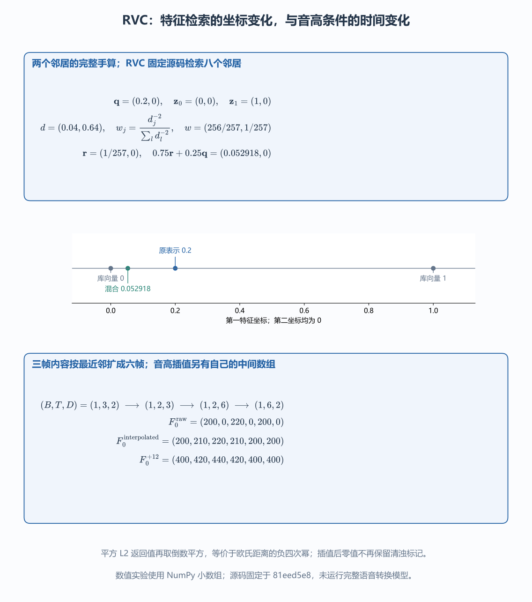

### 6. 音高插值与清音保护

在固定提交版本的 `pipeline.py` 里，沿着 F0 音高分支往下读，还能抓出一个只有逐行读源码才能发现的微妙细节。
在第六节第 7 小节我们讲过，F0 提取器在遇到没有周期震动的清辅音或停顿段时，会把那些帧的基频标为 **`0`**。照理说，`f0 > 0` 代表有声的浊音帧，`f0 == 0` 代表无声的清音帧。

但在该版源码的音高后处理函数里，程序为了算出平滑的连续音高曲线，**先把原始 F0 数组里所有等于 `0` 的无声位置，用它左右两边相邻的非零频率做了线性插值填补**，然后才去做半音升降调平移！
我们拿一段 6 帧的原始 F0 序列手算一下这个过程：

$$
\text{原始 F0}=(200,\ 0,\ 220,\ 0,\ 200,\ 0).
$$

在这 6 帧里，第 1、3、5 号位置原本是 `0`，原始有声标记为 `(真, 假, 真, 假, 真, 假)`。经过源码的零值线性插值后：
* 第 1 号位置夹在 $200$ 和 $220$ 中间，被插成了平均值 $210$；
* 第 3 号位置夹在 $220$ 和 $200$ 中间，也被插成了 $210$；
* 最末尾的第 5 号位置因为右边没有有声邻居了，直接沿用左边的末端值 $200$ 延伸出去。整条序列变成了全正数：

$$
\text{插值后 F0}=(200,\ 210,\ 220,\ 210,\ 200,\ 200).
$$

如果接着执行升高 12 个半音（乘以 $2$），它就变成：

$$
(400,\ 420,\ 440,\ 420,\ 400,\ 400).
$$

请注意这步插值带来的连锁反应：插值完成之后，原本为 `0` 的清音位置全都被填上了大于 `1` 的正频率（如 $210$ 或 $420$）！而在源码随后的清辅音保护（`protect`）逻辑里，有一处分支试图通过检查连续音高数组 `pitchf < 1`（或 `pitchf > 0`）来判断哪些帧是清辅音、从而混入原始未检索特征加以保护——可如果传给那个分支的 `pitchf` 已经是刚才把零全部插成正数之后的数组，那么 `pitchf < 1` 就永远不会命中那几个原本是零的清音帧了！

我们在配套代码中把插值前的原始清浊标记、插值变调后的 F0 数组以及不同判定顺序下的保护掩码全部保留了下来。这生动地说明：**分析一个真实开源系统的行为，绝不能只听参数名叫 `protect` 就望文生义地以为它一定按理想定义工作，必须顺着源码里数组的实际修改次序一路追踪到底。**

### 7. 模型参数与转换状态

最后，把 RVC 语音转换放回全书的“参数 vs. 状态”账本里做个总结：
在准备阶段，目标歌手的检索特征库（`.index` 文件）与训练好的声码器权重（`.pth` 文件）就已经固定落盘了；当用户上传一段干声执行一次翻唱转换时，实时变化的是输入的音频波形、抽出的内容帧序列 $F$、每次去索引库捞出来的 8 个近邻组合 $\mathbf r$、提取并变调后的 F0 序列以及最终合成的输出声波——这整套过程纯粹是前向推理与外部向量检索，**模型的任何权重参数都不会因为你转换了一首歌而发生半点改变**。

往目标索引库里多塞几段目标歌手的新干声特征，改变的是检索步骤能查到的外部参考材料；而拿新干声去接着训练声码器，改变的则是生成器网络本身的权重参数。把表示提取、FAISS 负四次方近邻检索、时间帧率插值对齐与条件声码器这四个环节拆开核对，任何发音含糊、跑调或音色漏气的问题，都能精准定位到具体的责任环节上。

## （九）运行与练习

从 `现代AI示例` 目录使用已有的唯一虚拟环境运行。基础入口输出各阶段数组、形状、损失和梯度；训练入口再执行条纹配对、像素分类与微型扩散，不下载模型或保存训练权重。

~~~powershell
.\.venv\Scripts\python.exe -B -m modern_ai.visual_audio
.\.venv\Scripts\python.exe -B -m modern_ai.visual_audio --train

.\.venv\Scripts\python.exe -B -m modern_ai.solutions MM-01
.\.venv\Scripts\python.exe -B -m modern_ai.solutions MM-02
.\.venv\Scripts\python.exe -B -m modern_ai.solutions MM-03
.\.venv\Scripts\python.exe -B -m modern_ai.solutions MM-04
.\.venv\Scripts\python.exe -B -m modern_ai.solutions MM-05
.\.venv\Scripts\python.exe -B -m modern_ai.solutions MM-06
.\.venv\Scripts\python.exe -B -m modern_ai.solutions MM-07
.\.venv\Scripts\python.exe -B -m modern_ai.solutions MM-08
~~~

| 题号 | 要求 | 计算与检查 |
| --- | --- | --- |
| MM-01 | **必做** | 从空间索引追踪切块，逆向恢复图像，再核对线性块投影与同参数卷积 |
| MM-02 | **必做** | 手算不对称图文分数的双向损失，沿归一化求原特征梯度，并随候选顺序修改配对索引 |
| MM-03 | **必做** | 算出八维视觉前缀中的一次读取，核对投影梯度、位置拼接与分辨率账单 |
| MM-04 | **必做** | 对框与掩码执行同一组裁剪、缩放、翻转，求 IoU，并区分类别与实例身份 |
| MM-05 | **拓展选做** | 从两步加噪推到累计式，完成高斯条件配方，比较实际反向采样与范围处理 |
| MM-06 | **必做** | 从采样率算时间、窗口、频点与梅尔矩阵，检查混叠及音高周期 |
| MM-07 | **拓展选做** | 枚举 CTC 路径并用动态规划与原生损失复核，展开音素时长，追踪交接文本 |
| MM-08 | **拓展选做** | 逐项算平方距离、邻居权重和混合值，检查零距离、内容帧插值与原始 F0 标记 |

原题号 `04-04` 作为**拓展选做**继续保留，可运行既有 Patch、双塔与视觉拼接实验。各题分析见[练习题解](https://github.com/KiriAky107/understanding-AI-and-Agents-in-depth/blob/main/docs/%E7%BB%83%E4%B9%A0%E9%A2%98%E8%A7%A3.md)（代码包内：`docs/练习题解.md`），完整数值与训练结果见新第六篇实验核验（代码包内：`docs/新第六篇实验核验.json`），固定版本与行号见 RVC 源码核对（代码包内：`docs/RVC源码核对.json`）。

[visual_audio.py](https://github.com/KiriAky107/understanding-AI-and-Agents-in-depth/blob/main/%E7%8E%B0%E4%BB%A3AI%E7%A4%BA%E4%BE%8B/modern_ai/visual_audio.py)（代码包内：`现代AI示例/modern_ai/visual_audio.py`）把图像、空间和声音的计算按职责拆开；[diffusion_lab.py](https://github.com/KiriAky107/understanding-AI-and-Agents-in-depth/blob/main/%E7%8E%B0%E4%BB%A3AI%E7%A4%BA%E4%BE%8B/modern_ai/diffusion_lab.py)（代码包内：`现代AI示例/modern_ai/diffusion_lab.py`）保存加噪、去噪网络、训练与采样的完整实现。正文中的连续代码片段按出现顺序执行，能保留前一段已经解释过的中间对象。
