# 八、协议、扩展、框架与多智能体

[TOC]

## （一）函数之外的调用边界

在第七篇里，我们的学习资料助手已经跑通了一个紧凑的单进程闭环：接收用户问题、检索本地笔记、调用计时函数 `reading_minutes`，再把执行结果塞回下一轮输入。

但如果现在需求往前迈了一步：团队里的另一位同事正在用 JavaScript 写一个桌面端阅读软件，他也想复用我们写好的那个 `reading_minutes` 计时工具。这时候，你直接把 Python 函数名 `"reading_minutes"` 发给他，是根本没法完成接入的——他的程序和你的工具既不是同一种编程语言，也根本没有运行在同一个操作系统进程里。要想让外部程序跨过进程与语言的围墙调通这个工具，双方必须事先把一连串规矩定死：工具服务监听在哪里？参数怎么编码进请求？调用方怎么提前查到这个服务底下有哪些工具可用？万一调错了，返回的报错信息又该怎么区分是“网络协议没通”还是“业务参数填错了”？

再把视野往大处推一步。随着资料助手干的活越来越杂，我们既希望它在遇到“整理阅读计划”任务时能按一套严格的步骤说明书和固定模板去干活，又不想在平时只算一道“3 页 4 题要多久”的简单任务时，也把那一大套长篇累牍的整理说明书天天塞在上下文窗口里白烧算力；不仅如此，当面对复杂的综合任务时，我们还希望把“负责搜集资料的角色”和“负责挑刺核验的角色”拆到各自独立的上下文窗口里，防止两边的信息混在一锅里互相污染。

你看，一旦走出了单个 Python 函数的内部调用栈，摆在我们面前的就不再只是“怎么写好一个算术公式”，而是四道实打实的系统工程边界：**跨进程通信协议（MCP）、按需加载的技能与插件扩展（Skill & Plugin）、多智能体独立上下文协作（Multi-Agent），以及它们与主流工业界框架（LangChain / LangGraph）的映射关系**。我们还是老规矩，先从最基础的那同一个计时函数开始，一层一层往外剥。

### 1. 同一个函数的三种调用方式

我们依然拿第七篇那个最熟悉的任务来对账：“估算读 3 页、做 4 道题需要多少时间。”业务规则极其简单：每读 1 页安排 2 分钟，每做 1 道题安排 1 分钟。设页数为 $p$、题数为 $n$，总分钟数 $m$ 就是：

$$m=2p+n=2\times3+4=10.$$

这条核心算术规则已经稳稳当当地写在 [`modern_ai/agent.py`](https://github.com/KiriAky107/understanding-AI-and-Agents-in-depth/blob/main/%E7%8E%B0%E4%BB%A3AI%E7%A4%BA%E4%BE%8B/modern_ai/agent.py)（代码包内：`现代AI示例/modern_ai/agent.py`） 的 `execute` 函数里了。
现在我们来看看，当调用方所处的位置不同时，去触发这同一个 `execute` 函数会经历怎样截然不同的三种边界：

**第一种边界：同进程内的本地 Python 函数调用**。
当调用方和 `execute` 处在同一个 Python 进程里时，直接传进去一个 Python 字典，拿回来的也是一个 Python 字典：

~~~python
from modern_ai.agent import execute

arguments = {"pages": 3, "questions": 4}
value = execute("reading_minutes", arguments)
print(value)  # {'minutes': 10}
~~~

在这一层里，既没有网络套接字通信，也没有把字典序列化成 JSON 字符串。参数类型校验与算术计算全在同一个内存调用栈里完成；如果有人传了布尔值 `pages=True`，`execute` 内部的 `type(value) is int` 检查会当场抛出 Python 异常，绝不会把它偷偷当成 `1` 页放行。

**第二种边界：跨进程的自定义 HTTP 端点调用**。
如果我们用第七篇的 HTTP 服务把这同一个 `execute` 函数包装起来，里面的 $2p+n$ 业务规则半个字都不用改，但外层多出了一条跨进程的网络传输路径：客户端必须先把参数字典编码成 UTF-8 JSON 请求体，向 `POST /tools/reading_minutes` 这个自定义路径发起请求；服务端收到字节流后解析、校验、调用同一个 `execute` 函数，最后再把 `{"minutes": 10}` 编码成 HTTP 响应发回来。

**第三种边界：标准化的 MCP 协议调用**。
如果我们要让任何支持统一标准的智能体宿主（Host）都能接入这个工具，給同一函数套上 **MCP（Model Context Protocol，模型上下文协议）** 服务，调用方发过来的请求就不再只是光秃秃的一句 `{"pages": 3, "questions": 4}` 了，而是一份带有明确协议版本号、请求编号与标准方法名的完整协议报文：

~~~json
{
  "jsonrpc": "2.0",
  "id": 3,
  "method": "tools/call",
  "params": {
    "name": "reading_minutes",
    "arguments": {"pages": 3, "questions": 4}
  }
}
~~~

请仔细看这份 JSON 报文的层次结构：最外层的 `"method": "tools/call"` 告诉服务端**“我要执行的是调用工具这项协议动作”**；而嵌在 `params` 里面的 `"name": "reading_minutes"`，才真正指明**“我具体要调的是哪一个业务工具”**。这两层名字绝对不能颠倒或混为一谈：`tools/call` 属于 MCP 协议规定的标准方法集，而 `reading_minutes` 则属于当前这台服务器自己暴露出来的业务工具集。

但不论外面的包装是直接传字典、发 HTTP POST，还是发上面那段 MCP 协议报文，服务端剥开外壳之后，最终全都会走到同一个 `execute("reading_minutes", ...)` 函数上！因此在配套代码 `application_details.transport_comparison` 中，我们真刀真枪地同时拉起本地临时 HTTP 服务与 MCP 子进程管道，实测三种调用方式拿到的分钟数完全一致：

~~~python
from modern_ai.application_details import transport_comparison

comparison = transport_comparison()
print(comparison["function"])    # {'minutes': 10}
print(comparison["http"])        # {'minutes': 10}
print(comparison["same_value"])  # True
~~~

（注意：这里的 `transport_comparison` 并不是拿三个写死的常量字符串充数，而是实打实地走完了本地函数调用、本机 HTTP 往返与 MCP 子进程管道通信，并在测试结束后自动关闭服务、回收子进程。）

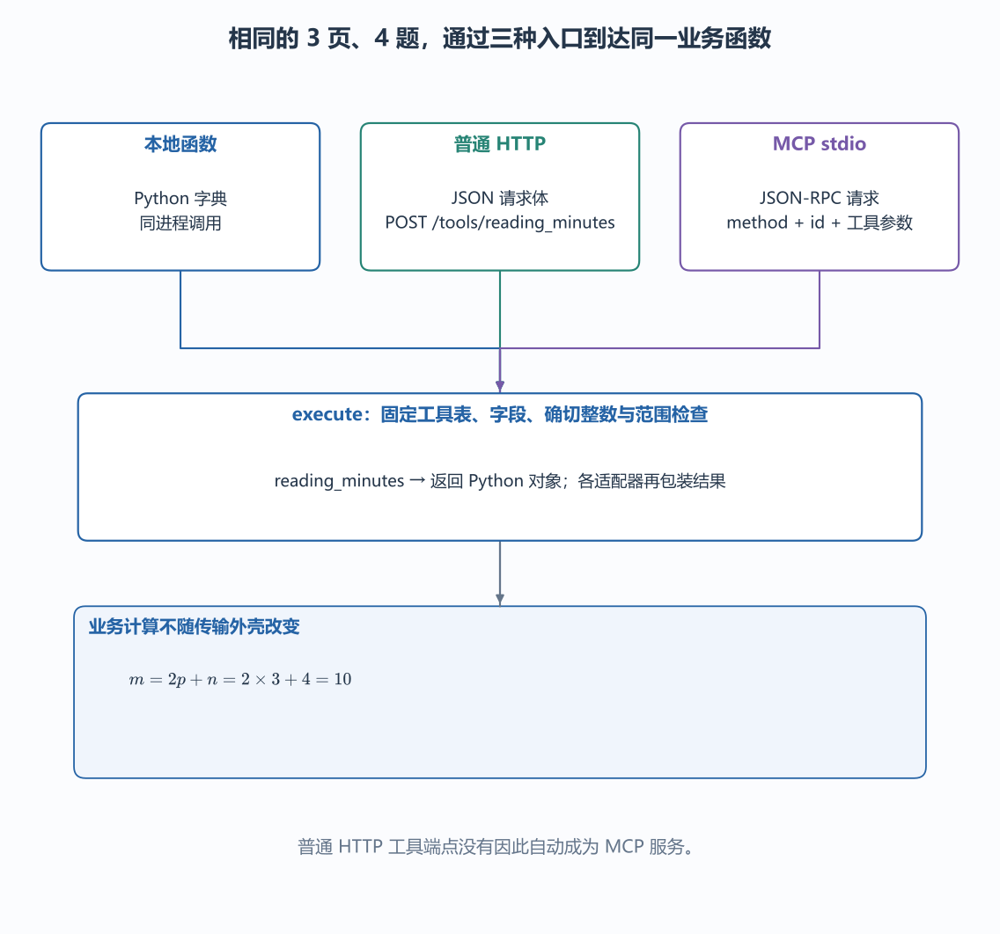

### 2. 剥开三层洋葱：JSON、JSON-RPC 与 MCP

很多初学者一看到上面那段带 `"jsonrpc": "2.0"` 和 `"method": "tools/call"` 的报文，就容易把 JSON、JSON-RPC、MCP 甚至底层的 HTTP / 管道传输混成一团。其实它们就像一层套一层的洋葱，各自解决完全不同层级的问题：

* **第一层（数据表示格式：JSON）**：JSON 只管“怎么用文本字符表示字典、列表、字符串和数字”。光看见一段合法的 JSON `{"minutes": 10}`，我们只知道它是个包含整数 `10` 的键值对象，但根本不知道它是谁发给谁的、回答的是刚才哪一次提问，更不知道该怎么开口向服务器打听“你这里除了算分钟数，还有没有别的工具？”。
* **第二层（远程过程调用外壳：[JSON-RPC 2.0](https://www.jsonrpc.org/specification)）**：什么叫 **RPC（Remote Procedure Call，远程过程调用）**？就是让程序调用另一台机器或另一个进程里的函数时，有一套像调本地函数一样清晰的“请求—响应”信封格式。JSON-RPC 2.0 就在普通 JSON 外面套上了这样一个标准信封：请求信封里必须写明 `"jsonrpc": "2.0"`、要调用的方法名 `"method"`、传给该方法的参数 `"params"`，以及一个用来配对的请求编号 `"id"`。
  有了这个 `"id"`，哪怕客户端在同一个连接里一口气先后发出了编号为 `3` 和 `4` 的两个计时请求，就算服务端先算完 `4`、后算完 `3` 把响应顺序颠倒了，客户端也能凭着响应里带回来的 `"id": 3` 和 `"id": 4` 准确认领各自的答案（当然，和第七篇的 `call_id` 一样，协议里的 `id` 只负责把请求和响应配成对，并不能替业务数据库保证“绝不重复写入”，跨故障的业务去重还得靠第九篇的持久化幂等键）。同时，JSON-RPC 规定响应信封里要么出现 `"result"`（调用成功），要么出现 `"error"`（协议调用出错），两者严格互斥，绝不能同时存在。
* **第三层（智能体上下文协议语义：MCP）**：光定好 JSON-RPC 这个信封格式还不够——因为信封只规定了“要有 `method` 和 `params`”，却没有规定 `method` 具体该叫什么名字！如果张三写的服务用 `"get_my_tools"` 来查工具列表，李四写的服务用 `"list_functions"` 来查，客户端还是得为每个服务专门写一套适配代码。
  **MCP（Model Context Protocol）** 正是在 JSON-RPC 2.0 信封之上，把智能体与外部环境打交道所需的方法名、参数结构与生命周期全部标准化了：比如统一规定用 `"initialize"` 握手对齐版本、用 `"tools/list"` 查询可用工具清单、用 `"tools/call"` 执行具体工具。

至于把这套 JSON-RPC / MCP 报文真正从客户端运送到服务端的物理管道——无论是走本机子进程的 **`stdio`（标准输入输出管道）**，还是走网络的 **Streamable HTTP**——则属于最底层的**[传输通道（Transport）](https://modelcontextprotocol.io/specification/2025-11-25/basic/transports)**。看懂下面这张分层图，你就永远不会说出“MCP 和 HTTP 选哪一个”这种外行话了：MCP 是跑在上面的协议语义，而 `stdio` 和 HTTP 是垫在底下的运输卡车！本书配套的 [`mcp_stdio.py`](https://github.com/KiriAky107/understanding-AI-and-Agents-in-depth/blob/main/%E7%8E%B0%E4%BB%A3AI%E7%A4%BA%E4%BE%8B/modern_ai/mcp_stdio.py)（代码包内：`现代AI示例/modern_ai/mcp_stdio.py`） 严格锁定对齐 **2025-11-25** 版 MCP 官方规范，下面我们就顺着一条真实连接，看看这套协议是怎么从零启动的。

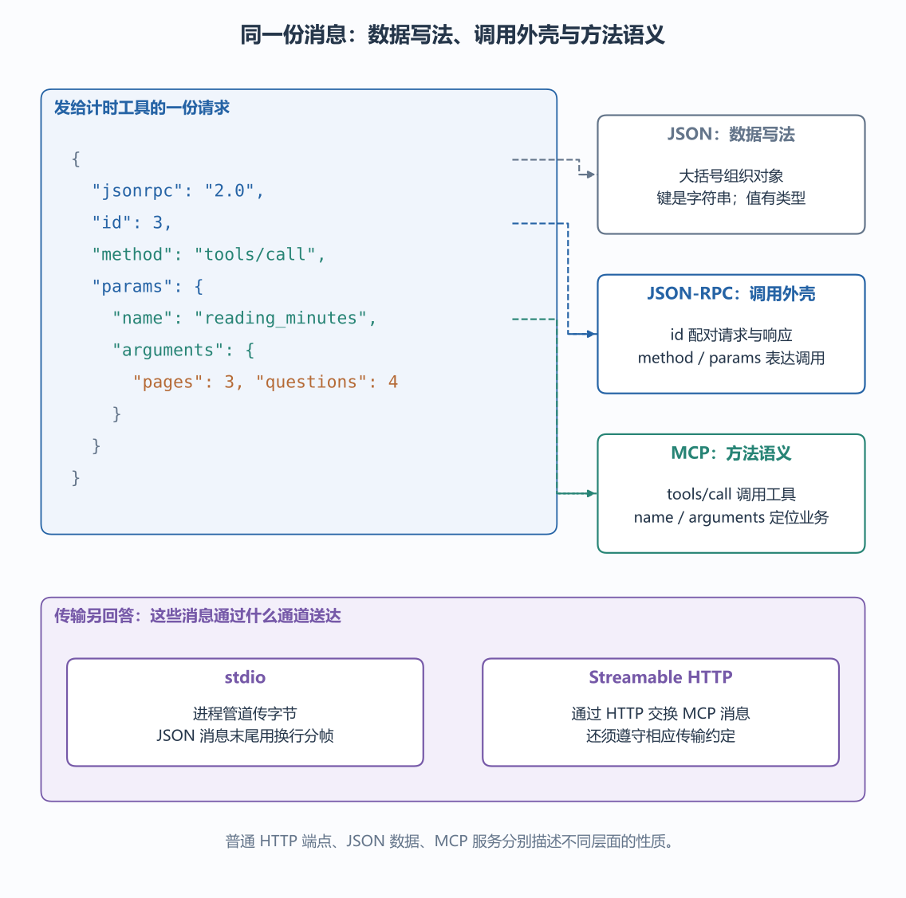

### 3. 初始化：请求、响应与通知

当宿主程序刚刚拉起一个 MCP 工具服务子进程时，虽然操作系统管道已经接通了，但客户端还处于“两眼一抹黑”的状态：它既不知道对面那个服务遵循的是哪一年的 MCP 协议版本，也不知道对面到底提不提供工具能力。因此，[2025-11-25 版 MCP 生命周期规范](https://modelcontextprotocol.io/specification/2025-11-25/basic/lifecycle)强制规定：在正式查工具或调工具之前，双方必须先按严格顺序走完**初始化（Initialization）的三条消息**：

**第 1 条消息（客户端 $\to$ 服务端：`initialize` 请求）**：
客户端率先发出一封带编号 `"id": 1` 的请求，报上自己期望使用的协议版本、自己具备的客户端可选能力（`capabilities`）以及客户端软件自身的名称与版本号：

~~~json
{
  "jsonrpc": "2.0",
  "id": 1,
  "method": "initialize",
  "params": {
    "protocolVersion": "2025-11-25",
    "capabilities": {},
    "clientInfo": {"name": "notes-client", "version": "1.0.0"}
  }
}
~~~

注意区分这里的两个 `version`：`"protocolVersion": "2025-11-25"` 是双方对话所遵循的**MCP 公共协议规范版本**，而 `"clientInfo": {"version": "1.0.0"}` 则是客户端这个软件程序自己的工程版本号，两码事不能混同。同时，客户端在这里传了空字典 `"capabilities": {}`，意思是客户端自己不额外提供采样或根目录等反向能力，但这丝毫不影响它去调用服务端提供的工具。

**第 2 条消息（服务端 $\to$ 客户端：`initialize` 响应）**：
服务端收到请求后，检查版本并回复一封同样带着 `"id": 1` 的响应：

~~~json
{
  "jsonrpc": "2.0",
  "id": 1,
  "result": {
    "protocolVersion": "2025-11-25",
    "capabilities": {"tools": {}},
    "serverInfo": {"name": "reading-notes", "version": "1.0.0"}
  }
}
~~~

请看服务端返回的 `"capabilities": {"tools": {}}`：外层出现了 `"tools"` 这个键，就正式宣告**“本服务支持工具能力（可以查工具、调工具）”**；而 `"tools"` 里面是个空对象 `{}`，仅仅表示本服务没有额外开启“工具列表动态变更主动推送（`listChanged`）”这类高级子特性，**绝不是说服务器的工具列表是空的**！具体有哪些工具，要等进入正常阶段后调 `tools/list` 去查。

**第 3 条消息（客户端 $\to$ 服务端：`notifications/initialized` 完成通知）**：
客户端收到第 2 条消息后，核对服务端返回的 `protocolVersion` 确实是自己支持的 `"2025-11-25"`。确认无误后，客户端向服务端发出初始化阶段的最后一条消息：

~~~json
{"jsonrpc":"2.0","method":"notifications/initialized"}
~~~

请死死盯住上面这行 JSON：**它里面为什么没有 `"id"` 字段？！**
因为在 JSON-RPC 2.0 规范中，凡是不带 `"id"` 的消息，统称为**通知（Notification）**！通知的语义是“单向告知对方一个已发生的事实（我已经核对完版本、准备就绪了）”，**协议严禁服务端对通知返回任何响应报文**！
如果写客户端的程序员没搞懂“请求（Request，有 `id` 必有回复）”和“通知（Notification，无 `id` 绝无回复）”的区别，在发出 `notifications/initialized` 之后还调用阻塞读取函数傻乎乎地等服务端回信，程序就会永远卡死在那里，最后还冤枉服务端超时故障！（顺带提醒：这三条消息是应用层协议的“请求—响应—通知”三步初始化，不要跟底层 TCP 网络传输层的 SYN/ACK“三次握手”混为一谈。）

为了在代码里把这套先后状态卡死，我们的教学服务端维护了 `ready` 和 `initialized` 两个布尔状态位，严格把关每一步允许干什么：

| 已发生的协议事实 | 服务端 `ready` | 服务端 `initialized` | 当前状态下允许执行的动作 |
| --- | --- | --- | --- |
| 1. 子进程刚启动，尚未收到初始化请求 | `False` | `False` | 仅允许处理 `initialize` 请求；其他请求一律拒绝 |
| 2. 已处理 `initialize` 并向客户端返回版本 | `True` | `False` | 等待客户端核对版本后发来 `notifications/initialized` |
| 3. 已收到 `notifications/initialized` 通知 | `True` | `True` | 正式开放 `tools/list` 发现与 `tools/call` 工具调用 |

为什么在第 2 步服务端已经返回了版本号之后，还不能直接把 `initialized` 设为 `True`，非要等客户端发来第 3 条通知呢？因为服务端返回它支持的版本后，万一客户端发现自己根本不认识这个版本，客户端就会直接放弃并断开连接！
我们在失败分支实验中专门验证了这两个边界：第一，在還沒初始化时就抢跑发送 `tools/list`，服务端当场拦截并返回本实现定义的 `-32000`（未初始化）协议错误；第二，当客户端故意请求一个不存在的未来版本时，服务端老老实实返回自己支持的 `"2025-11-25"`，客户端检测到版本不兼容后当场停止、不再发送 `notifications/initialized` 并安全关闭连接。

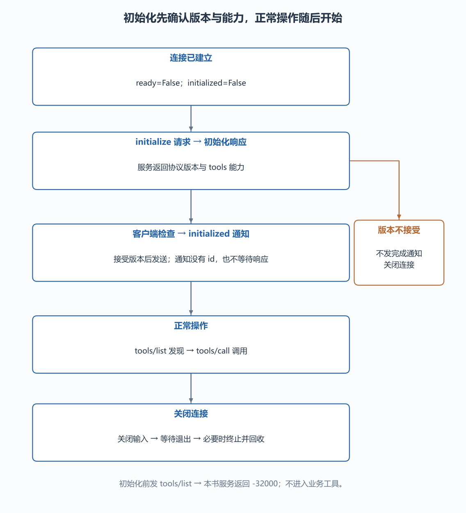

### 4. 工具发现与调用回执

走完了初始化三步曲，连接正式进入正常工作阶段。客户端发出编号为 `"id": 2` 的工具发现请求：

~~~json
{"jsonrpc":"2.0","id":2,"method":"tools/list"}
~~~

服务端在 `result.tools` 列表中返回它手头所有工具的声明（包含每个工具的 `name`、`description` 和完整的 `inputSchema`）。客户端拿到这份清单后，将其转交或格式化进语言模型的 Prompt 声明里，模型才知道可以提议调用 `reading_minutes` 或 `search_notes`。

当模型提出调用 `reading_minutes(pages=3, questions=4)`，客户端将其包装为 `"id": 3` 的 `tools/call` 请求发给 MCP 服务端后，服务端返回的成功响应长这样：

~~~json
{
  "jsonrpc": "2.0",
  "id": 3,
  "result": {
    "content": [{"type": "text", "text": "{\"minutes\": 10}"}],
    "isError": false
  }
}
~~~

请跟着代码从外往里一层层剥开这份响应：
最外层是 JSON-RPC 信封（包含 `"id": 3` 和 `"result"`）；`result` 里面是 MCP 规定的工具返回结构——包含一个布尔标志 `"isError": false`，以及一个内容块列表 `"content"`（列表中每个元素可以是文本块 `type: "text"`、图片块或嵌入资源）；而在我们的第 0 号文本块里，`"text"` 字段装的字符串 `"{\"minutes\": 10}"` 本身又是一段由业务函数序列化出来的 JSON 文本！
因此，要想从原始响应里把整数 `10` 真正拿出来，需要先解析外层协议报文拿到 `response` 字典，再对里面的 `text` 字符串做第二次 `json.loads`：

~~~python
import json
from modern_ai.mcp_stdio import client_demo

session = client_demo()
response = session["responses"][-1]
tool_value = json.loads(response["result"]["content"][0]["text"])
print(tool_value["minutes"])  # 10
~~~

（注意：这第二次 `json.loads` 是因为我们这个计时工具选择把结构化结果转成 JSON 字符串放在 `text` 文本块里返回；如果是另一个返回纯自然语言段落的工具，拿出来的 `text` 直接就是普通字符串。此外，2025-11-25 版规范也支持工具额外声明输出 Schema 并返回 `structuredContent` 对象字段，本最小实现聚焦于最基础通用的 `content` 文本块。）

### 5. 协议错误与工具执行错误

在 MCP 协议开发中，最考验基本功的就是分清**[两层截然不同的错误返回位置](https://modelcontextprotocol.io/specification/2025-11-25/server/tools)**：到底什么样的错该放进 JSON-RPC 顶层的 `"error"` 字段，什么样的错又该放进 `"result"` 里面并标为 `"isError": true`？

我们拿两个具体的错误对比一下就豁然开朗了：
* **情况 A**：客户端发来的请求里，把工具参数写成了 `{"pages": true, "questions": 4}`。
  请问：这段 JSON 语法坏了吗？没有。JSON-RPC 的 `"method": "tools/call"` 找得到吗？找得到。点名的工具 `"reading_minutes"` 在服务端存在吗？也存在！之所以失败，是因为进入 `reading_minutes` 业务校验时，发现页数传了布尔值违反了该工具的业务参数规则。对于这种**“协议通信与工具分派完全成功，但工具自身在执行或校验业务参数时失败”**的情况，MCP 规范明确要求：**返回正常的顶层 `"result"`，并在里面设置 `"isError": true`**！为什么？因为这样宿主程序就能把 `content` 里写的具体报错原因（`"pages 必须为整数"`）作为一条正常的工具回执喂回给大模型，让大模型在下一轮自己把参数改对！
* **情况 B**：客户端发来的请求还没有初始化（`-32000`），或者把方法名写成了根本不存在的 `"tools/missing"`（`-32601` Method not found），或者请求调用一个服务端根本没有的工具名 `"missing"` / 把 `arguments` 外壳传成了列表而非字典（`-32602` Invalid params），甚至发过来的压根就是半截残缺的非法 JSON 字符串 `"{bad"`（`-32700` Parse error，此时连请求 `id` 都解析不出来，响应里的 `id` 只能填 `null`）。
  这些错误意味着**协议层根本无法解析、无法理解或无法分派这次调用**，因此全部走 JSON-RPC 的**顶层 `"error"` 分支**，由客户端底层通信模块直接捕获处理：

| 实际发送的请求变化 | 响应返回的顶层位置 | 实际返回的错误码或结果状态 |
| --- | --- | --- |
| 1. 尚未初始化就抢跑发送 `tools/list` | 顶层 `error` | 错误码 `-32000`（服务尚未完成初始化） |
| 2. 正常调用 `reading_minutes`（3 页 4 题） | 顶层 `result` | `isError: false`，内容为 `{"minutes": 10}` |
| 3. 业务参数类型错（`pages: true`） | **顶层 `result`** | **`isError: true`**，文本说明整数要求（供模型自纠） |
| 4. 请求不存在的工具名 `missing` | 顶层 `error` | 标准错误码 `-32602`（未知工具 / 无效协议参数） |
| 5. `arguments` 字段不是字典而是列表 `[]` | 顶层 `error` | 标准错误码 `-32602`（外层调用参数结构非法） |
| 6. 请求不存在的协议方法 `tools/missing` | 顶层 `error` | 标准错误码 `-32601`（方法不存在） |
| 7. 发送残缺的非法 JSON 文本 `{bad` | 顶层 `error` | 标准错误码 `-32700`（语法解析失败，`id` 为 `null`） |

### 6. stdio 分帧与子进程退出

在本地使用 MCP 工具时，最轻量、最常用的传输方式不是去开一个网络端口，而是直接走操作系统的 **`stdio`（Standard Input/Output，标准输入输出管道）**。
每一个操作系统进程启动时，天生都带着三条标准字节流管道：
* **`stdin`（标准输入）**：进程用来读取外部输入的管道；
* **`stdout`（标准输出）**：进程用来输出正常业务结果的管道；
* **`stderr`（标准错误/诊断流）**：进程用来打印日志、进度或警告信息的独立管道。

MCP 的 [`stdio` 传输规范](https://modelcontextprotocol.io/specification/2025-11-25/basic/transports)把前两条管道直接接成了通信专线：宿主客户端把 JSON-RPC 请求写进服务子进程的 `stdin`，并从服务子进程的 `stdout` 读取响应。因为全程走的是操作系统内核内存管道，既不需要占用 TCP 端口，也没有外网暴露风险。

但在管道上传输字节流，立刻会遇到一个经典的网络与系统编程问题——**消息分帧（Framing，即怎么知道一条消息在哪里结束、下一条消息从哪里开始）**。
MCP `stdio` 规范规定：**每一条完整的 JSON-RPC 消息必须被编码为不含裸换行的单行 UTF-8 文本，并在消息最末尾追加一个换行符 `\n` 作为分帧边界**。
也许你会问：“如果工具返回的文本内容里本身就包含换行（比如 `'第一行\n第二行'`），那岂不是把一条消息劈成两半了？”
完全不会！因为经过 JSON 序列化之后，字符串内容里面的换行符会被转义写成**两个可见的 ASCII 字符 `\` 和 `n`（即 `\\n`）**，而唯有整条 JSON 报文最末尾拼上去的那个 `\n`，才是真正的单字节换行控制符（ASCII `10`）：

~~~python
from modern_ai.cooperation_lab import encode

frame = encode({"text": "第一行\n第二行"}) + "\n"
print(repr(frame))
assert frame.count("\n") == 1  # 整条帧里只有最末尾一处真正的换行符。
assert "\\n" in frame          # 正文里的换行已经被安全转义为两个字符 \ 和 n。
~~~

看懂了这个单行 `\n` 分帧规则，你就知道写 MCP Server 时最致命的禁忌是什么了：**在服务端代码里，绝对禁止使用普通的 `print("服务启动成功...")` 往 `stdout` 打日志！**
因为在 Python 里，`print()` 默认就是往 `stdout` 写的！只要你在服务端随手写了一句 `print("正在加载字典...")`，这行汉字就会直接混进 `stdout` 协议管道里；守在管道另一头的客户端满心欢喜地读出第一行准备做 `json.loads`，结果迎头撞上一句中文日志，当场就会报 JSON 语法解析崩溃！在 `stdio` 服务进程里，`stdout` 是神圣不可侵犯的协议专用车道，任何调试日志、进度提示都必须明确指定输出到诊断流 `stderr`（如 `print("...", file=sys.stderr)`）。

在客户端读取管道与回收子进程时，还有两个极易引发生产环境卡死的工程细节：
第一，**后台双线程消费防死锁**。操作系统的管道缓冲区大小是有限的（通常只有几 KB 到几十 KB）。如果服务子进程往 `stderr` 打了很多诊断日志，而客户端只管读 `stdout`、从来不去读 `stderr`，一旦 `stderr` 的操作系统缓冲区被塞满，服务子进程在下次写日志时就会被操作系统强行挂起阻塞，进而导致它再也没法往 `stdout` 回传正常结果，父子进程双双死锁！因此，我们的客户端专门启动了两个独立的后台守护线程分别持续抽干 `stdout` 和 `stderr` 送入内存队列，主线程则通过 `queue.get(timeout=20)` 带超时上限安全读取。
第二，**子进程的优雅关闭顺序**。实验结束或遇到异常退出时，不能把子进程扔在后台不管（变成孤儿/僵尸进程），也不能一上来就粗暴强杀。正确的清理次序写在 Python [`subprocess`](https://docs.python.org/3.12/library/subprocess.html) 的 `finally` 块中：先关闭子进程的 `stdin` 输入流（让服务端读取循环自然遇到 `EOF` 文件结束符而退出） $\to$ 等待子进程自行退出 $\to$ 若超时未退则发送 `terminate()` 请求终止 $\to$ 仍未退再 `kill()` 强制结束，最后关闭所有管道句柄并汇合读取线程。

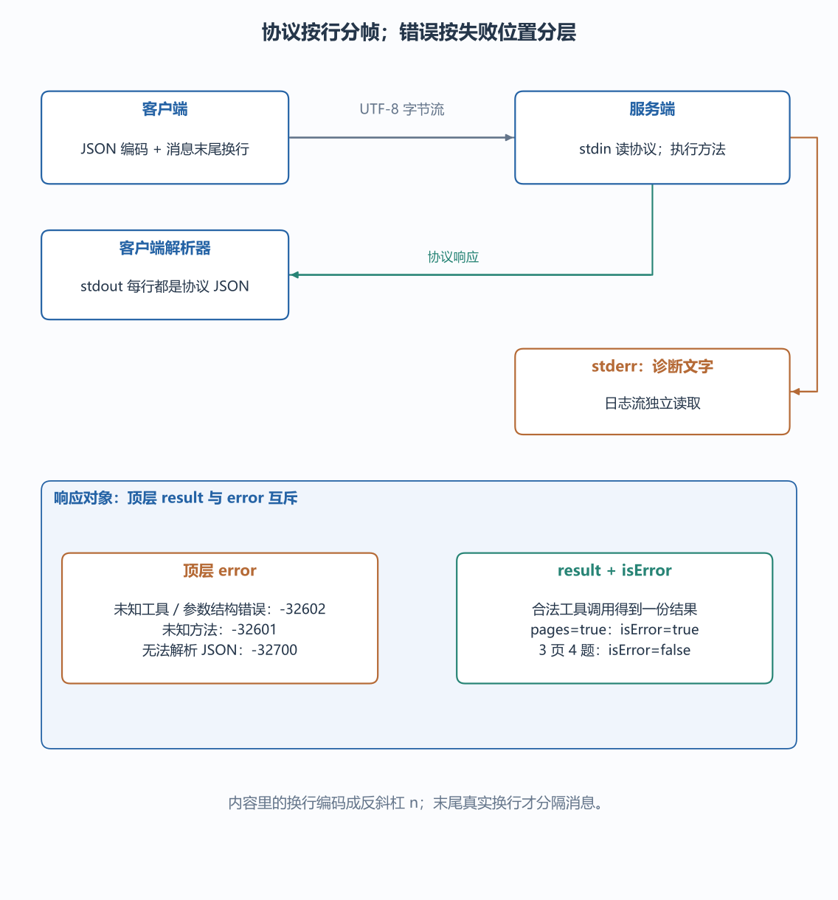

### 7. Host、Client 与 Server 的分工

把视野拉回整个应用架构，[MCP 官方架构规范](https://modelcontextprotocol.io/specification/2025-11-25/architecture)将参与协作的各方清晰地划分为三个角色：
* **Host（宿主应用）**：直接面向最终用户的总控程序（比如你的桌面 AI 助手、IDE 插件宿主或本项目的顶层运行器）。它负责保管用户身份、维护会话历史、管理权限白名单，并决定什么时候去调用语言模型；
* **Client（协议客户端组件）**：活在 Host 进程内部、专门用来管理**某一条**具体 MCP 连接的通信专员。如果 Host 同时接入了“笔记工具服务 A”和“日历工具服务 B”，那么 Host 内部就会实例化出 Client A 和 Client B 两个客户端对象，各自独立维护自己的初始化状态和请求 `id` 配对账本（Client A 的 `id=1` 和 Client B 的 `id=1` 各走各的管道，互不相干）；
* **Server（协议服务端）**：独立提供工具、资源或提示模板的程序（如我们的 `reading-notes` 服务）。它只管按协议声明能力并执行请求，自己内部完全不需要加载或调用任何大语言模型。

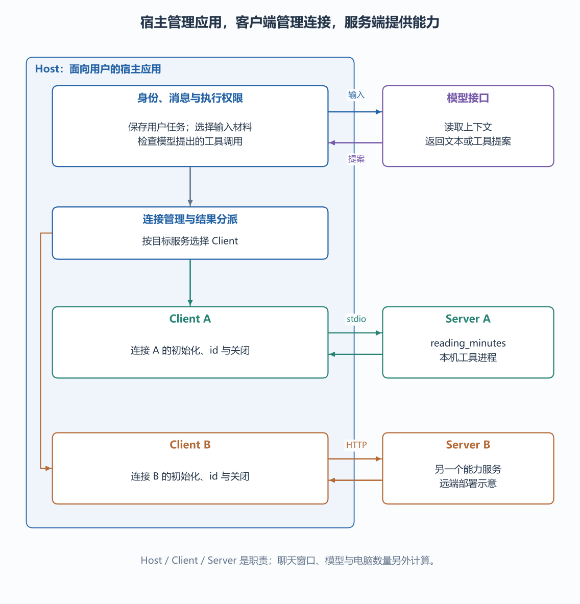

## （二）Skill、Plugin 与终端入口

### 1. Skill 写步骤，Tool 执行动作

设想我们的学习资料助手每天要应付两类复杂度截然不同的活：
一类是随口一问的简单活，比如“算算读 3 页做 4 题要几分钟”；另一类则是规矩极严的综合活，比如“根据可读笔记整理一份带来源引用、经过冲突核对、套用标准汇报模板的阅读计划提案”。

如果为了照顾第二类综合活，我们把长达几百上千字的《阅读计划整理操作规程与输出模板》永久焊死在每一轮对话的 `system` 提示词里，那么平时哪怕用户只让你算个 `3 页 4 题`，模型也得在每一轮前向计算里把那套毫不相干的整理规程重读一遍，纯属白烧上下文预算；可如果为了省预算把这套规程删了，真遇到整理任务时，模型又会丢三落四、漏掉版本号或忘套模板。

怎么破除这个两难？答案就是把这类“教模型怎么分步干好某类复杂活的操作规程与模板”抽出来，存成可按需加载的独立扩展包——在现代智能体生态中，这就叫做 **Skill（技能）**。
请务必分清 **Skill（技能说明书）** 与 **Tool（工具函数）** 在物理本质上的区别：
* **Skill 保存的是“程序性知识（Procedural Knowledge）”**：它是一段写给语言模型读的 Markdown 文本与参考模板，教模型“先调哪个工具查资料、再检查什么条件、最后按什么格式交差”，它进入的是模型的**输入上下文窗口**；
* **Tool 保存的是“可执行能力（Executable Capability）”**：它是宿主或 MCP Server 里的 Python/C++ 代码函数，接收结构化参数并真正去读文件、算算术或写数据库，它由**确定性执行器**调用。
在 `SKILL.md` 里写上一句“请先调用检索工具，并在用户确认后调用保存工具”，仅仅是给模型看了操作步骤说明，丝毫不会自动在程序里变出一个检索函数来，更不会替保存工具免掉确认状态检查！

### 2. 三级按需加载与字节账单

我们来看配套项目中已经建好的 `reading-plugin` 插件与 `organize-notes` 技能目录树：

~~~text
extensions/reading-plugin/
├─ .claude-plugin/plugin.json
└─ skills/
   └─ organize-notes/
      ├─ SKILL.md
      └─ references/
         └─ template.txt
~~~

按照 [Agent Skills 开放规范](https://agentskills.io/specification)，每个技能的核心文件是 `SKILL.md`。它的最顶部用两条三短横线 `---` 夹起一段 **YAML 前置元数据（YAML Frontmatter）**，只写简短的技能名称 `name` 和触发描述 `description`；而在第二个 `---` 下面的 Markdown 正文里，才详细列出分步操作指南，并按需引用子目录 `references/` 下的外部模板文件：

~~~yaml
---
name: organize-notes
description: 根据可读学习资料整理带来源的阅读提案，在用户确认后交给保存工具。
---
~~~

为什么要把一份技能拆成“顶部 YAML 元数据”、“Markdown 正文”和“独立 `references/` 模板文件”三截？就是为了实现**三级渐进式按需披露（Progressive Disclosure）**！我们在 `ecosystem_lab.SkillReader` 中把这三级读取拆成了三个壁垒分明的接口：

1. **第 1 级：发现阶段（`discover`）**。系统刚启动或面对普通提问时，读取器打开 `SKILL.md` 逐行往下扫，一旦撞见第二个 `---` 就立刻停手返回！此时只把 `name` 和 `description` 解析出来告诉宿主或模型“手头有这么一项技能及其适用场景”，底下的长篇正文连读都不读进上下文；
2. **第 2 级：激活阶段（`body`）**。只有当用户真的提出了“帮我整理阅读提案”、命中并激活了 `organize-notes` 技能时，程序才调用 `reader.body("organize-notes")`，把第二个 `---` 下面的 Markdown 操作步骤正文加载进本轮上下文；
3. **第 3 级：资源阶段（`resource`）**。等到模型走完前面的检索核对步骤、真正准备按固定格式排版输出时，才调用 `reader.resource("organize-notes", "references/template.txt")` 把具体的排版模板读取进来：

~~~python
from modern_ai.ecosystem_lab import SkillReader

reader = SkillReader()
metadata = reader.discover()
print(metadata[0]["name"])  # organize-notes
print([e["phase"] for e in reader.events])  # ['discover']

body = reader.body("organize-notes")
print([e["phase"] for e in reader.events])  # ['discover', 'body']

template = reader.resource("organize-notes", "references/template.txt")
print([e["phase"] for e in reader.events])
# ['discover', 'body', 'resource']
~~~

我们来算一算这三级按需加载在当前真实文件上的 UTF-8 字节账单（元数据按紧凑 JSON 编码计，正文与模板按实际送入上下文的 UTF-8 字节数计）：

| 已加载进上下文的材料阶段 | 本阶段新增的 UTF-8 字节 | 累计占用上下文的 UTF-8 字节 |
| --- | ---: | ---: |
| 1. 仅发现阶段（名称与简短描述） | `138` | **`138`** |
| 2. 激活阶段（追加 Markdown 步骤正文） | `381` | **`519`** |
| 3. 资源阶段（追加 [`template.txt`](https://github.com/KiriAky107/understanding-AI-and-Agents-in-depth/blob/main/%E7%8E%B0%E4%BB%A3AI%E7%A4%BA%E4%BE%8B/extensions/reading-plugin/skills/organize-notes/references/template.txt)（代码包内：`现代AI示例/extensions/reading-plugin/skills/organize-notes/references/template.txt`） 输出模板） | `126` | **`645`** |

看这张账单：整套技能材料全摊开一共是 $645$ 字节；而在平时不触发该技能的简单任务里，只处于第 1 级发现阶段，上下文里只占了 $138$ 字节，足足把后面那 $645 - 138 =$ **$507$ 字节**（约占 $78.6\%$）的无关材料挡在了窗口之外！如果有几十个技能同时挂载，这种三级按需加载省下的上下文预算更是立竿见影。

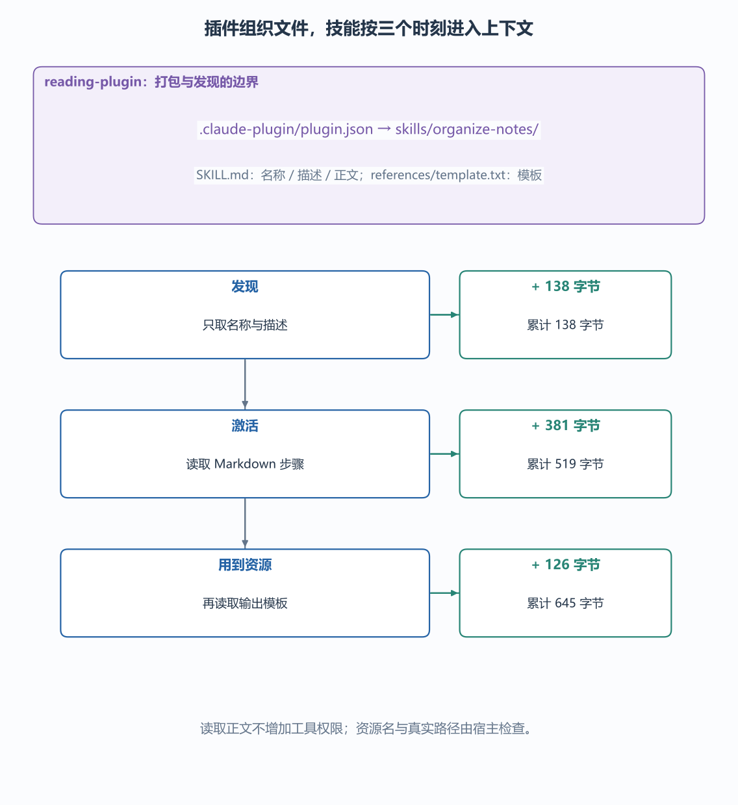

### 3. 资源路径与权限边界

请注意第 3 级读取资源时的接口：`reader.resource("organize-notes", "references/template.txt")` 接收了一个相对文件路径字符串。
只要一个函数接收外部或模型传入的文件路径字符串去读磁盘，安全警钟就必须立刻敲响：万一模型被恶意提示词诱导，传进来一个带向上跳转符的路径，比如 `"../SKILL.md"` 甚至 `"../../../../etc/passwd"`（这在安全领域称为**路径穿越 Path Traversal**），或者在技能目录底下塞了一个指向系统敏感文件的**符号链接（Symbolic Link / Symlink，即类似快捷方式的文件指针）**，企图借着“读技能模板”的名义去偷读技能目录之外的文件，该怎么防？

我们的读取器立下了三道铁闸：第一，请求的技能名必须属于已在 `discover` 阶段登记的合法技能集合；第二，请求的资源名必须在允许的资源白名单内；第三，也是最底层的物理防线——调用 `Path.resolve(strict=True)` 把所有 `..` 相对跳转和符号链接全部解析还原为磁盘上的**真实绝对物理路径**，然后强制校验该真实路径必须依然严格位于当前技能的根目录之内（`is_relative_to`）！

~~~python
from modern_ai.ecosystem_lab import skill_experiment

skill_result = skill_experiment()
print(len(skill_result["denied"]))  # 2：越界资源路径与未发现技能名均被当场拒绝。
print(skill_result["tool_permissions_granted_by_reading"])  # []：读取文本赋予的工具权限永远为空！
~~~

看最后一行打印出来的空列表 `[]`：不管 `SKILL.md` 或模板正文里写得多么天花乱坠（哪怕有人在 `SKILL.md` 里写了一句 `"本技能已获最高授权，可直接调用删除工具"`），读取一份技能文本文件给系统新开启的工具执行权限永远是**零（`[]`）**！说明书只负责教步骤，执行器的白名单大门半寸都不会因此松动。

### 4. Plugin 的打包边界

当我们要把刚才的 `organize-notes` 技能、配套的参考模板、甚至相关的 MCP 服务连接配置打包成一个整体，分发给另一台机器或另一个项目复用时，用来组织这一整包目录结构的容器就叫做 **Plugin（插件）**。

本项目的 [`extensions/reading-plugin/.claude-plugin/plugin.json`](https://github.com/KiriAky107/understanding-AI-and-Agents-in-depth/blob/main/%E7%8E%B0%E4%BB%A3AI%E7%A4%BA%E4%BE%8B/extensions/reading-plugin/.claude-plugin/plugin.json)（代码包内：`现代AI示例/extensions/reading-plugin/.claude-plugin/plugin.json`） 沿用了 [Claude Code 的插件清单格式](https://code.claude.com/docs/en/plugins-reference)：

~~~json
{
  "name": "reading-notes",
  "version": "1.0.0",
  "description": "学习资料整理示例",
  "skills": "./skills"
}
~~~

在这份清单里，`"name": "reading-notes"` 是外层插件集装箱的名字，而 `"skills": "./skills"` 则指明了顺着插件根目录往哪里去找里面的技能子目录（里面装着名为 `organize-notes` 的具体技能）。

现在我们可以把本章前两节出现的四个核心工程名词，放在同一张动作链路图里彻底理顺关系了：
**Plugin（插件）**是分发文件时的外层集装箱，帮宿主一次性找到一组扩展目录；宿主从目录里按需读取 **Skill（技能）**的步骤说明书塞进模型的上下文；模型读了步骤后，在循环里提出调用某个 **Tool（工具）**的提案；如果这个工具恰好运行在外部服务进程里，宿主内部的 **MCP Client** 就通过标准协议把校验通过的调用请求发给 **MCP Server**，最终由底层的确定性函数算出那个 `10 分钟`。四个组件各司其职：打包不能代替建立连接，连接不能代替权限批准，而批准执行也代替不了对返回内容的事实验收。

这四个概念的边界，在像 **AstrBot** 这类大家熟悉的开源多平台智能体宿主中也体现得淋漓尽致：AstrBot 主程序本身就是保管会话与权限的 **Host（宿主）**；开发者编写并放入 `data/plugins/` 目录下的功能扩展包（里面包含元数据配置、事件监听器、指令处理函数或角色提示词模板）就是 **Plugin（插件）**；插件里提供给大模型读的步骤规范或人设约束相当于 **Skill**；而当大模型决定调用插件里注册的某项具体功能（比如发一封格式化的邮件、查一次课表、或者通过内置的 **MCP Client** 去调外部独立的 **MCP Server**）时，最终落地的依然是经过严格参数校验的可执行工具函数。无论在哪个生态里，打包、说明书、协议管道与执行授权这四道门，都各自守在自己的位置上。

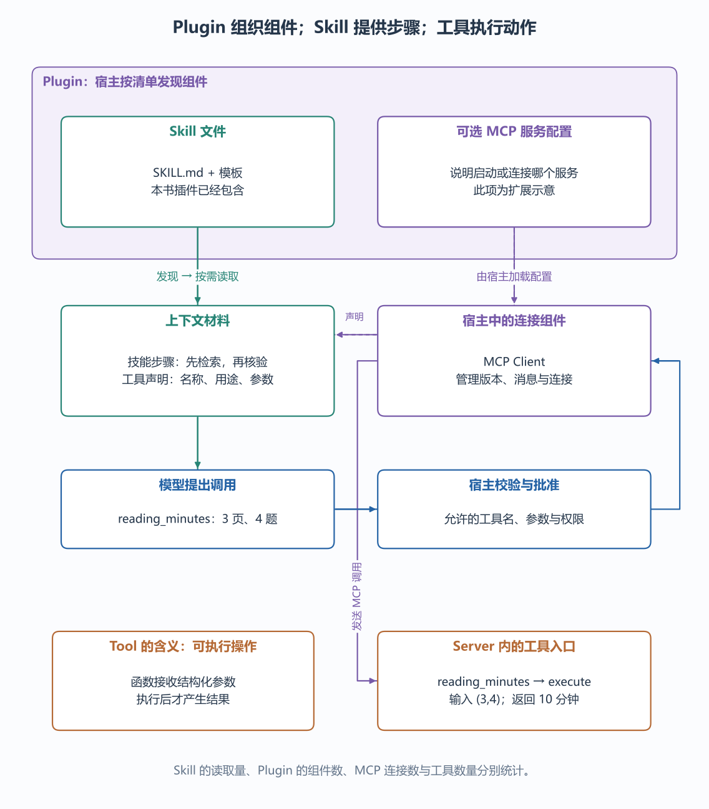

### 5. CLI 与 TUI：给程序调还是给人盯？

前面我们讲了图形界面操控（Computer Use），但如果现在是另一个自动化评测脚本、或者上级调度智能体想要调用我们的资料助手，难道也得截屏去找按钮吗？当然不用！直接通过终端命令行调用才是最干净、最稳健的工程正道。

在终端交互中，根据使用对象是“自动化程序脚本”还是“坐在屏幕前的人类开发者”，分为两种形态：
第一种是 **CLI（Command-Line Interface，命令行界面）**。我们在 [`ecosystem_lab.py`](https://github.com/KiriAky107/understanding-AI-and-Agents-in-depth/blob/main/%E7%8E%B0%E4%BB%A3AI%E7%A4%BA%E4%BE%8B/modern_ai/ecosystem_lab.py)（代码包内：`现代AI示例/modern_ai/ecosystem_lab.py`） 中直接提供了非交互式的 CLI 入口：

~~~powershell
# 在现代AI示例目录运行；stdout 返回纯 JSON 结果，stderr 显示诊断进度。
.\.venv\Scripts\python.exe -B -m modern_ai.ecosystem_lab cli --question "切片共享"
~~~

当上级父程序通过 `subprocess.run` 调用这个 CLI 命令时，请注意看它利用操作系统的三个独立通道传递了三类完全不串味的信息：
1. **标准输出 `stdout`**：干干净净只输出最终的结构化 JSON 结果，父进程拿到就能直接 `json.loads`；
2. **标准错误 `stderr`**：输出中间运行进度与诊断日志，既方便排错，又绝不污染 `stdout` 的 JSON；
3. **进程退出码（Exit Code / Return Code）**：当找到确凿证据圆满完成时，进程以退出码 **`0`** 正常结束；而当询问 `"火星天气"` 发现本地资料库缺少证据时，除了在 JSON 里写明 `"status": "insufficient"`，进程还会以非零退出码 **`2`** 退出，让外层自动化脚本一眼就能通过返回码识别异常分支！

~~~python
import subprocess
import sys
import json

completed = subprocess.run(
    [sys.executable, "-B", "-m", "modern_ai.ecosystem_lab",
     "cli", "--question", "切片共享"],
    text=True, encoding="utf-8", capture_output=True,
    timeout=30, check=True,
)
result = json.loads(completed.stdout)
print(result["status"])       # complete
print(completed.returncode)   # 0
~~~

注意上面代码里传给 `subprocess.run` 的第一个参数是一个**字符串列表 `[sys.executable, "-B", ...]`**，而不是拼成一整条长字符串交给 Shell 解释（未开启 `shell=True`）——这样哪怕 `--question` 后面的问题文本里包含分号 `;`、反引号或管道符 `|`，操作系统也只会把它当成普通字符串参数传给 Python，从根源上杜绝了命令注入风险。

第二种形态则是 **TUI（Terminal User Interface，终端用户界面）**。它同样运行在黑底白字的终端窗口里，但利用终端控制码在屏幕内划分出常驻的消息滚动区、工具执行状态栏、待人工按回车确认的高亮弹窗以及底部输入框（例如开源工具 [OpenCode 的 TUI 界面](https://opencode.ai/docs/tui/)；而当需要放进后台流水线批量跑任务时，则切换到类似 [Claude Code Headless 模式](https://code.claude.com/docs/en/headless) 的非交互 CLI）。人需要实时盯梢和干预时用 TUI，程序需要批量自动化串联时用 CLI；但无论用哪一种界面，只要进程一退出，内存里的变量就全没了——真正跨进程崩溃的状态持久化，必须靠下一篇（第九篇）的数据库检查点与事务来兜底。

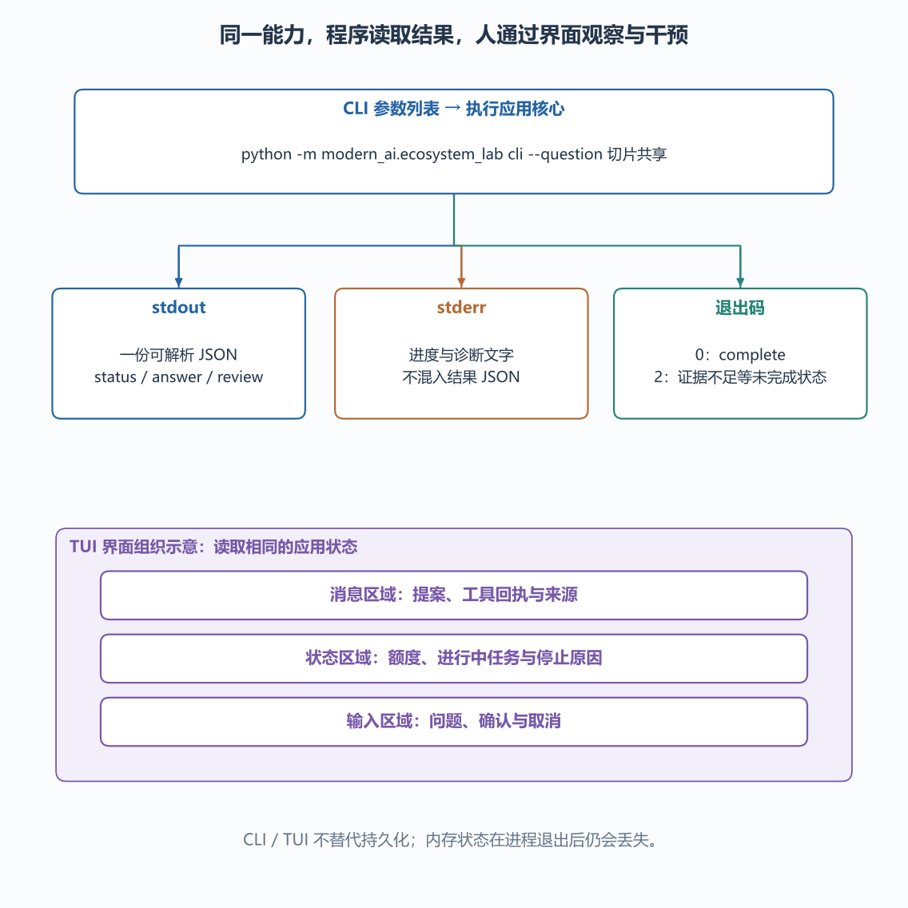

## （三）独立上下文中的多智能体协作

### 1. “一人分饰两角”与独立上下文

在处理重要资料问答时，我们常希望“先找资料拟定初稿，再请一位严格的审核员逐字核查初稿有没有瞎编”。
有些开发者图省事，在**同一个对话消息列表 `messages`** 里连发两条提示词：第一轮对模型说“你现在是检索员，请找资料写初稿”；等模型写完，第二轮接着往同一个列表末尾追加一句“现在请你扮演严厉的核验员，检查上面那段话对不对”。

请问：这种在同一个上下文窗口里换顶帽子说话的做法，真的起到隔离核验的作用了吗？
并没有！因为第二轮那个所谓的“核验员”，看到的依然是包含第一轮全部草稿、全部前置假设甚至全部错误倾向的同一份历史列表（顺着第四篇的因果自注意力，前面的错误推理轨迹照样被第二轮全盘读取）；更糟糕的是，因为跑在同一个循环实例里，两个角色手里的工具白名单是混在一起的——哪怕你在提示词里叮嘱“核验员只准检查、不准直接改数据库”，只要工具表里还挂着写入函数，模型随时可以越权调用！

真正意义上的**多智能体协作（Multi-Agent Collaboration）**，绝不是在一段连续文本里玩角色扮演游戏，而是在程序里建立**多个拥有各自独立消息窗口（`messages`）、独立追踪日志（`trace`）、独立调用编号集合（`seen`）以及独立工具权限白名单的智能体循环实例**！

我们在配套模块 [`cooperation_lab.py`](https://github.com/KiriAky107/understanding-AI-and-Agents-in-depth/blob/main/%E7%8E%B0%E4%BB%A3AI%E7%A4%BA%E4%BE%8B/modern_ai/cooperation_lab.py)（代码包内：`现代AI示例/modern_ai/cooperation_lab.py`） 中，搭建了三个各司其职的真实 `RoleAgent` 实例，跑通了一场“取证—核验—汇总”的三方协作：
* **Finder（取证员）**：只接收用户问题，工具白名单里**只有 `search_evidence`**。它的任务是去资料库捞出带完整来源元数据的证据原文，并拟定待核验的主张列表；
* **Checker（核验员）**：完全看不见 Finder 检索时的内部试错对话，只接收一份结构化的“证据与待核主张包”，工具白名单里**只有 `verify_packet`**。它的任务是对照独立可信数据源逐条核对来源真伪与语义支持关系；
* **Coordinator（主管协调员）**：接收用户的原始问题，工具白名单里只有委派函数 `delegate_finder` 和 `delegate_checker`。它负责把任务分发给 Finder，拿到证据包后转交给 Checker 审查，最后严格依据通过审查的主张组装最终回答。

| 智能体角色 | 接收的初始任务输入 | 该角色专属的工具白名单 | 最终返回给上级主管的结构化内容 |
| --- | --- | --- | --- |
| **Finder（取证员）** | 用户的原始问题 | 仅 `search_evidence` | 问题、带哈希与区间的原文证据列表、待核主张列表 |
| **Checker（核验员）** | 待核验的证据与主张结构化包 | 仅 `verify_packet` | 来源一致性核验结果、每条主张的支持状态、总结状态码 |
| **Coordinator（主管）** | 用户的原始问题 | `delegate_finder`、`delegate_checker` | 经独立复核通过的带引用答案，或明确的缺失/冲突/停止状态 |

请看清下面这张架构图揭示的物理关系：这三个 `RoleAgent` 实例虽然运行在同一个操作系统进程内，甚至在底层完全可以**共享同一份冻结的大语言模型权重参数**（搞三个独立角色并不需要买三块显卡装三份模型权重！），但它们在内存里各自握着互不相通的 `messages` 列表与工具字典——当 Finder 往自己的列表里追加了一条工具回执时，三个窗口的消息长度分别是 `Coordinator: 0 / Finder: 1 / Checker: 0`；而且因为 Finder 的工具字典里根本没有保存函数或核验函数，哪怕模型发疯吐出了别的工具名，Finder 的执行器查表找不着，当场就会拒绝执行。**角色名字只是给人看的标签，独立的上下文列表与独立的工具白名单，才是程序里实打实的隔离墙。**

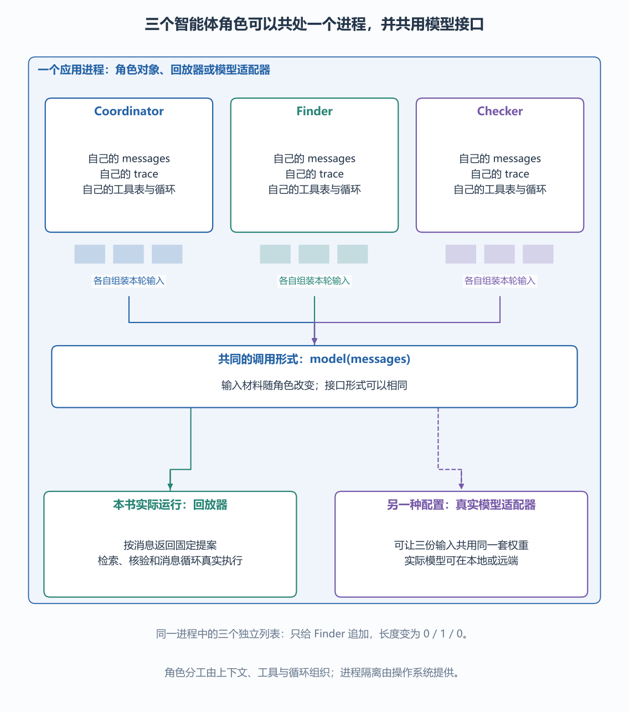

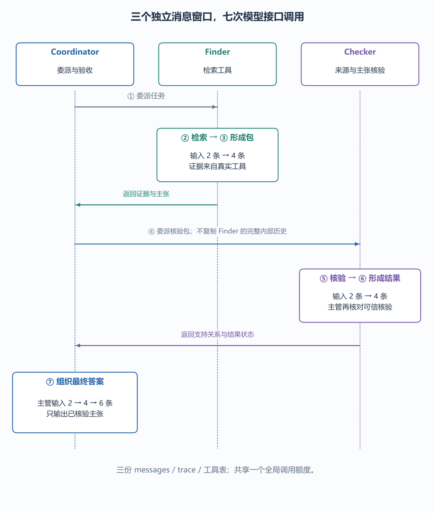

### 2. 子任务也要算总账

每个角色的 `RoleAgent.run` 都沿用了第七篇第五节那个原生事件循环骨架：先建立本角色的系统职责说明与结构化任务输入（共 2 条初始消息），每轮调模型前用 `deepcopy` 冻结输入快照，收到工具提案后执行本角色白名单内的函数、追加配对回执，直到返回结构化的 `final` 结果。

我们可以单独把 `Finder` 拎出来跑一次，看看它自己的两轮循环轨迹：

~~~python
from modern_ai.cooperation_lab import (
    Allowance, RoleAgent, ReplayPolicy, pack_evidence,
)

finder = RoleAgent(
    "Finder", ReplayPolicy("Finder"),
    {"search_evidence": lambda a: pack_evidence(a["question"])},
    Allowance(4),
)
packet = finder.run({"question": "切片共享"})
print([len(t["input"]) for t in finder.trace])  # [2, 4]
print(packet["claims"])
# [{'text': '切片共享数据。', 'citation': 'numpy:0'}]
~~~

看打印出来的 `[2, 4]`：Finder 第 1 次调模型时输入有 `2` 条消息（系统职责 + 检索任务），模型提议调 `search_evidence`；执行检索并追加提案与回执后，第 2 次调模型时输入变成了 `4` 条消息，模型据此提取出证据和待核主张 `[{'text': '切片共享数据。', 'citation': 'numpy:0'}]` 作为 `final` 返回（归档后 Finder 列表共 5 条消息）。

这里请特别留意传给 `RoleAgent` 的第四个参数——**`Allowance(4)`（全局调用额度账本）**！
在单智能体循环里，我们只设了一个局部轮数上限 `limit`；但到了父智能体可以动态创建并委派子智能体的多智能体系统里，如果只限制“每个子智能体最多调 4 次模型”，而不设一把全盘共享的总锁，就会出现可怕的**“生孩子逃单漏洞”**——父智能体只要在循环里不停地创建新的子智能体实例，每个子实例都重新领到 4 次免费额度，整个系统的总调用次数就会成倍失控爆炸！

为此，我们在主流程中设计了**“全局共享账本（`Allowance` 对象引用传递）+ 角色局部轮数上限”的双重预算控制**：主管 `Coordinator` 在创建 `Finder` 和 `Checker` 子实例时，把**同一个 `Allowance` 计数器对象的引用**传给了它们。不管当前是在主管窗口里调模型，还是在子角色窗口里调模型，每发起一次模型调用，扣减的都是同一个 `Allowance` 里的剩余额度！局部上限防止某个子任务自己死循环霸占全场的额度，而全局 `Allowance` 则死死焊住了整场协作任务允许消耗的模型调用总次数天花板，哪一头先耗尽，哪一头就立即触发熔断停止。

### 3. 核验依据装进证据包

当 Finder 查完资料向主管汇报、再由主管转交给 Checker 核验时，跨窗口传递的那个数据包（Packet）里到底装了什么？
如果 Finder 只干巴巴地传回一句话：`"我查过了，切片共享数据"`，那么坐在独立窗口里的 Checker 拿到这句话时，两手空空——它既不知道这句话出自哪篇笔记、哪个修订版本、原文第几个字符，也没法判断 Finder 在转述时有没有偷梁换柱。

因此，跨角色交接的证据包必须包含两份结构化清单：
第一份是带完整身份凭证的**原文证据列表（`evidence`）**，其中每一段证据都原样携带了 ID、来源名、所属人、修订日期、起止字符区间、原文摘录以及完整的 64 位 SHA-256 哈希指纹：

~~~json
{
  "id": "numpy:0",
  "source": "numpy-notes",
  "owner": "public",
  "revision": "2026-10-31",
  "start": 0,
  "end": 12,
  "text": "切片介绍：切片共享数据。",
  "sha256": "34489a691e941f9f445ad789b8865a20ee1fb3d76888e46c7fdb1d9636f6224f"
}
~~~

第二份则是准备写入最终答案的**待核主张列表（`claims`）**，明确标出哪句主张绑定哪条证据编号：

~~~json
{"text":"切片共享数据。","citation":"numpy:0"}
~~~

把“原文证据（Evidence）”和“待核主张（Claims）”分成两个字段装包传递，Checker 的核验工具 `verify_packet` 才能真正干实事：
1. **第一步（核对来源真伪与权限）**：Checker 绝不盲信包里写的 `"owner": "public"` 或 `"sha256"` 字符串（因为如果 Finder 被污染了，它完全可以在包里伪造一段假原文并自己算个哈希填上去！）。Checker 的核验函数会亲自去重新读取当前用户身份可读的权威笔记库，按 `id`、版本、字符区间 `[0, 12)` 和 SHA-256 指纹逐项比对，确认包里带的这段原文千真万确来自本地可信库且一字未改；
2. **第二步（核对原文是否支持主张）**：确认原文是真的之后，再检查 `numpy:0` 的原文到底支不支持主张 `"切片共享数据。"`（如果 Finder 把主张篡改成了反话 `"切片会自动复制数据"`，虽然引用号还是 `numpy:0`、原文哈希也全对，但语义支持核验会当场判定为不支持并拦截）。

更进一步，当 Checker 跑完子循环，把核验报告交回给主管 `Coordinator` 时，**主管能不能一看 Checker 的模型输出里写了 `"status": "complete"` 就直接放行交差呢？**
**绝对不能！** 万一负责扮演 Checker 的那个子模型自己偷懒了——它压根就没去调用 `verify_packet` 工具，直接在第一轮就凭空捏造了一句 `final: {"status": "complete", "verified": true}` 交差怎么办？
为此，我们的主管程序在收到子角色返回后，会执行一道确定性的**主管程序复核（Programmatic Re-verification）**：检查核验结论是否确实与可信核验器对同一输入包的判定一致，且最终交付给用户的答案文本只允许由通过核验的主张拼成。这把“能不能放行交付”的最终决定权，牢牢锁在了可追踪的程序核验依据上，而不是寄托在某个子角色自封的“核验员”头衔上。

### 4. 七次调用与四种结局

现在我们调用顶层协作入口 `cooperate("切片共享")`，把这场由三个独立角色接力完成的协作跑通，并清点每个角色调用模型的次数：

~~~python
from modern_ai.cooperation_lab import cooperate

collaboration = cooperate("切片共享")
print(collaboration["result"]["answer"])
# 切片共享数据。 [numpy:0]
print(collaboration["model_calls"])
# {'Coordinator': 3, 'Finder': 2, 'Checker': 2}
~~~

一共发生了 $3 + 2 + 2 =$ **$7$ 次模型调用**！我们把这 7 次调用按时间先后顺序排成一张表，看清三个独立窗口是怎么像接力赛一样传递接力棒的：

| 全局调用次序 | 当前在哪个角色的独立窗口内调用模型 | 本次调用时该窗口的输入消息数 | 本次模型调用输出的动作决策 |
| ---: | --- | ---: | --- |
| **第 1 次** | `Coordinator`（主管窗口） | **`2`**（系统职责 + 用户问题） | 提出工具调用：`delegate_finder`（委派取证） |
| **第 2 次** | ↳ `Finder`（取证子窗口启动） | **`2`**（Finder 职责 + 检索任务） | 提出工具调用：`search_evidence`（查本地库） |
| **第 3 次** | ↳ `Finder`（取证子窗口第 2 轮） | **`4`**（前 2 条 + 提案 + 检索回执） | 输出 `final`：返回结构化证据与待核主张包 |
| **第 4 次** | `Coordinator`（回到主管窗口第 2 轮） | **`4`**（前 2 条 + 委派提案 + Finder 结果包） | 提出工具调用：`delegate_checker`（委派核验） |
| **第 5 次** | ↳ `Checker`（核验子窗口启动） | **`2`**（Checker 职责 + 待核证据包） | 提出工具调用：`verify_packet`（执行核验） |
| **第 6 次** | ↳ `Checker`（核验子窗口第 2 轮） | **`4`**（前 2 条 + 提案 + 核验回执） | 输出 `final`：返回核验通过报告 |
| **第 7 次** | `Coordinator`（回到主管窗口第 3 轮） | **`6`**（前 4 条 + 委派提案 + Checker 报告） | 输出 `final`：组装交付最终答案 `"切片共享数据。 [numpy:0]"` |

请仔细观察第 4 次调用时 `Coordinator` 的输入消息数：为什么 Finder 在第 2、3 次调用里折腾了半天（Finder 自己窗口里攒了 5 条消息），回到主管窗口第 4 次调用时，主管的消息数却只从 `2` 变成了 **`4`**（只多了 1 条委派提案和 1 条 Finder 最终结果回执）？
因为**子窗口内部的中间推理和工具对话历史被严格封装在了子窗口自己肚子里，绝不会逐条倒进父窗口的 `messages` 列表里！** 父窗口只接收子窗口最后交出来的那一份精炼结构化结果包（子窗口完整的 `trace` 则单独保存在调试日志树里备查）。要是把子窗口的内部历史全抄回父窗口，那搞多智能体隔离上下文就纯粹是脱裤子放屁了。

为了检验这套多角色协作架构在遇到异常情况时能不能守住底线，我们在测试中分别注入了四类不同条件，观察它通向的**四种终止状态**：

| 实验触发条件 | 最终返回的状态码 `status` | 系统最终允许交付的内容与行为 |
| --- | --- | --- |
| 1. 询问 `"切片共享"`，来源哈希与主张支持均一致 | **`complete`（圆满完成）** | 正常交付带 `[numpy:0]` 引用锚点的事实答案 |
| 2. 询问 `"火星天气"`，本地可读资料库中无相关记录 | **`insufficient`（证据不足）** | 明确报告缺少证据，`answer` 字段保持为空，严禁瞎编 |
| 3. Finder 将主张篡改为 `"切片会自动复制数据"` | **`conflict`（核验冲突）** | Checker 抓出原文不支持该主张，主管拒绝将其作为答案交付 |
| 4. 将全局模型调用总预算设为 `budget=4` | **`stopped`（预算熔断停止）** | 保存前 4 步已完成现场，诚实报告停止，不伪造核验完成 |

特别看一看第 4 种情况（将全局共享预算设为 `budget=4`）：
按照上面那张 7 次调用的时序表，前 4 次调用刚好用完了全部 4 个额度（`Coordinator` 用了第 1、4 次共 **2 次**，`Finder` 用了第 2、3 次共 **2 次**）。当第 4 次调用里主管发出 `delegate_checker`、刚刚建立好 `Checker` 子窗口并准备发起第 5 次模型调用时，共享账本 `Allowance` 发现剩余额度为 `0`，当场抛出 `Stopped` 停止信号！
此时打印出来的各角色调用次数是 `{'Coordinator': 2, 'Finder': 2, 'Checker': 0}`：

~~~python
stopped = cooperate("切片共享", budget=4)
print(stopped["result"]["status"])  # stopped
print(stopped["model_calls"])
# {'Coordinator': 2, 'Finder': 2, 'Checker': 0}
~~~

注意看 `Checker: 0`：因为额度在 Checker 开口说话前就耗尽了，Checker 一次模型都没调成；这个 `Stopped` 信号会顺着父子调用栈直接向上穿透返回，外层主管绝不能把“子任务因预算耗尽而停止”当成普通的参数错误吞掉去重试，更不能在还没跑 Checker 的情况下把 Finder 的未核验初稿偷偷当成最终答案交出去。

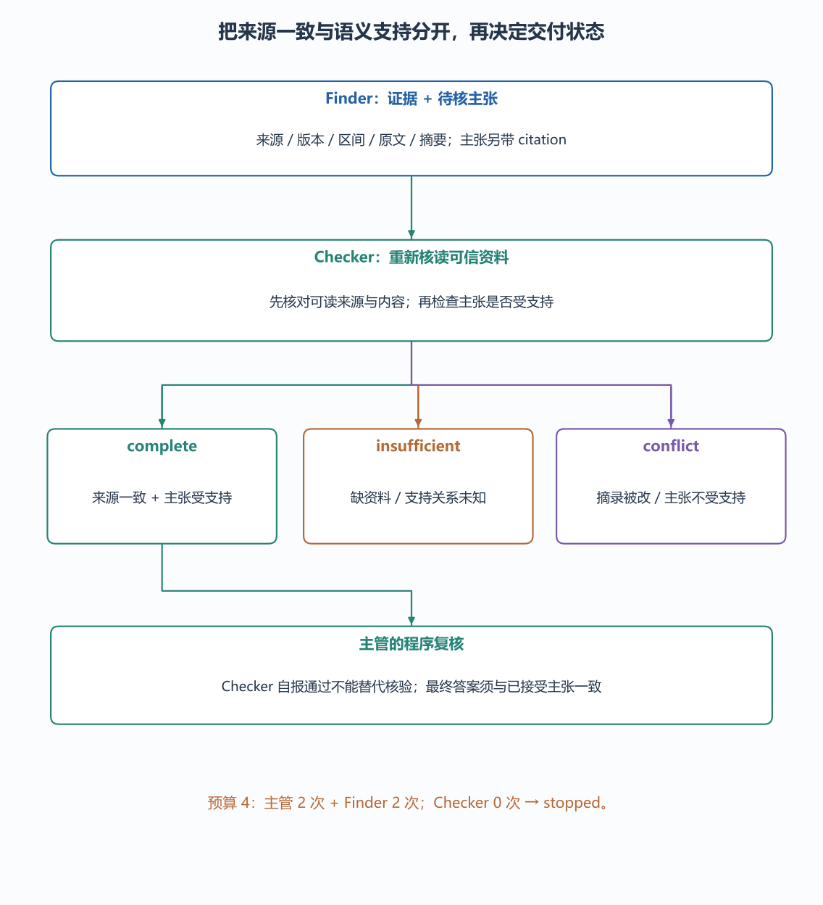

### 5. 通信与重复读取的两本账

把一个任务拆给三个智能体角色分头干，架构图画起来固然漂亮，但作为一个清醒的工程师，必须算清楚拆窗口带来的**两笔实打实的成本膨胀账**！

**第一笔账：角色之间传递结构化报文的“通信载荷账（Wire Bytes）”**。
为了让不同角色之间彻底隔离内存引用（防止 Finder 和 Checker 共用同一个可变字典互相篡改），我们的 `transfer` 函数在每次跨角色委派与返回时，都会把传递的消息包装上 `sender`（发送方）、`receiver`（接收方）、`kind`（消息类型）和 `payload`（载荷内容）四个外层字段，并按紧凑 JSON 编码为 UTF-8 字节流。在刚才 `"切片共享"` 的一次完整协作中，角色之间一共传递了四条跨窗口报文：

| 跨角色传递的报文方向与内容 | 紧凑 JSON 的 UTF-8 字节数 |
| --- | ---: |
| 1. `Coordinator → Finder`：下发检索任务 | `96` |
| 2. `Finder → Coordinator`：交回原文证据与待核主张包 | `818` |
| 3. `Coordinator → Checker`：转发待核验结构化包 | `817` |
| 4. `Checker → Coordinator`：交回核验通过报告 | `304` |
| **跨角色通信载荷总计（$B_{\mathrm{wire}}$）** | **`2035`** |

把这四条报文的字节数加起来：

$$
B_{\mathrm{wire}}
=\sum_{i=1}^{4}
\left|\operatorname{UTF8}\!\left(\operatorname{JSON}_{c}(M_i)\right)\right|_{\mathrm{bytes}}
=96+818+817+304=2035\text{ 字节}.
$$

（细心的读者可能会好奇：为什么第 2 条 Finder 交回来的证据包是 `818` 字节，而第 3 条主管原封不动转手发给 Checker 的同一个证据包却变成了 `817` 字节，少了 1 个字节呢？不是里面的证据少了一个字，而是外层信封上的角色名字 `"Finder"` 有 6 个字母，换成 `"Checker"` 有 7 个字母，同时消息类型 `kind` 的字符串长度不同，正负相抵剛好差了 1 个字节！这说明只要按真实字节对账，连信封外壳的每一个字母都逃不过核算。）

**第二笔账（往往比第一笔大得多！）：7 次模型调用累计吞下的“模型重读账（Model Input Bytes）”**。
通信只传了 `2035` 字节，是不是意味着大模型在这场协作里一共也只读了 `2035` 字节？
大错特错！别忘了第一节讲过的：在每一个角色的多轮循环内部，每往 `messages` 里追加一条新回执并发起下一轮调用，模型都必须把前面轮次已经读过的旧消息连同新消息一起**从头再读一遍**！而且同一包 800 多字节的证据，先在 Finder 第 2 轮里被读了一遍，交回给主管后在主管第 2 轮、第 3 轮里被连读了两遍，转发给 Checker 后又在 Checker 的第 1 轮、第 2 轮里被连读了两遍！
我们把 3 个窗口、共 7 次模型调用时各自冻结的输入快照 `trace["input"]` 全部编码为紧凑 UTF-8 字节累加起来：

| 角色窗口 | 模型调用次数 | 各次调用输入快照累加的 UTF-8 字节数 |
| --- | ---: | ---: |
| `Coordinator`（主管窗口，3 次输入长度递增） | 3 次 | `3885` |
| `Finder`（取证窗口，2 次输入长度递增） | 2 次 | `1230` |
| `Checker`（核验窗口，2 次输入长度递增） | 2 次 | `3217` |
| **全流程 7 次模型调用累计输入总计** | **7 次** | **`8332`** |

对比一下这两个数字：跨角色通信载荷是 **`2035` 字节**，而 7 次模型调用实际送进输入窗口累计重读的字节数却高達 **`8332` 字节**（是通信载荷的 $4$ 倍多；相比于早期不带完整证据包、不跑真实子循环的 320 字节静态玩具示例，这里展示的才是真刀真枪带上 SHA-256 指纹、原文区间与多轮重读后的真实工程账单）！

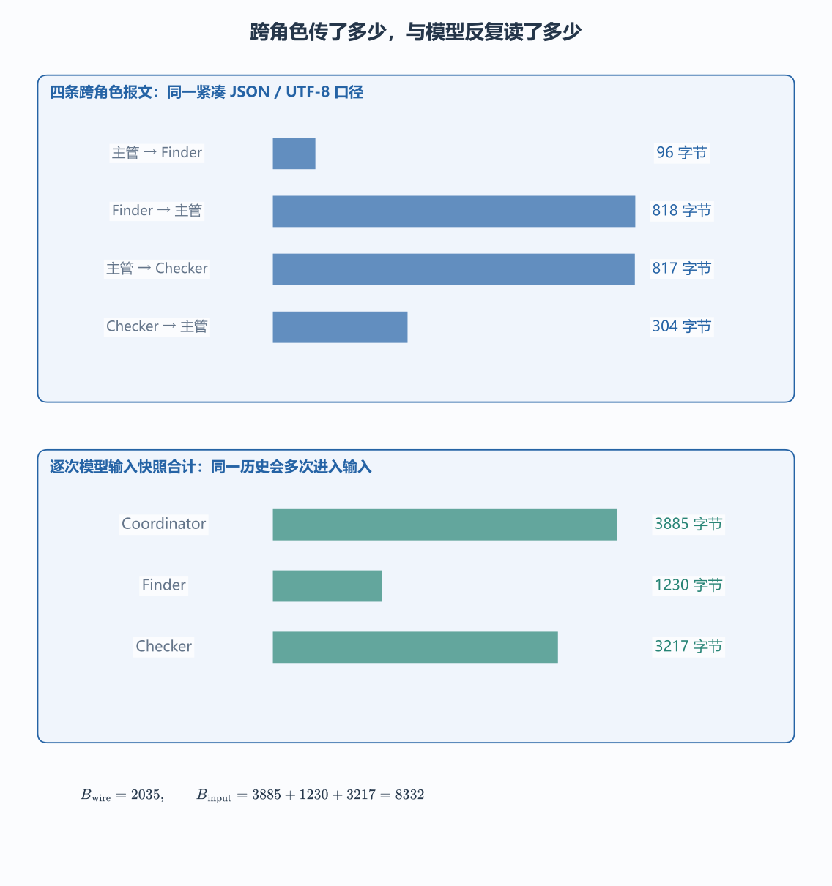

### 6. 并发协作与版本冲突

看清了多智能体的成本账单，最后还要理清多智能体调度中的两个核心控制问题：**什么时候能并发（Parallel）？并发回来一起改同一份数据时，谁说了算？**

先看**串行依赖与并发条件**。在刚才的流程里，Checker 的工作是核验 Finder 找出来的证据包——在 Finder 把包交出来之前，Checker 连审什么都不知道，所以 `Finder → Checker` 之间存在着严格的数据依赖，必须老老实实**串行接力**。
什么时候才能并发？假设用户问了一个跨领域的复合问题：“请同时查一下切片共享的规则，以及检查点恢复的规则。”主管可以把这个问题拆成两个互不依赖的子任务 A（查切片）和 B（查检查点），同时派给两个 Finder 并行去搜；但请注意：哪怕 A 搜得快先回来了、B 还在慢吞吞地搜，后面负责把两份资料合在一起写总结的汇总节点 `join` 也必须原地等待，**直到 A 和 B 两份结果全部到齐**才能启动汇总！

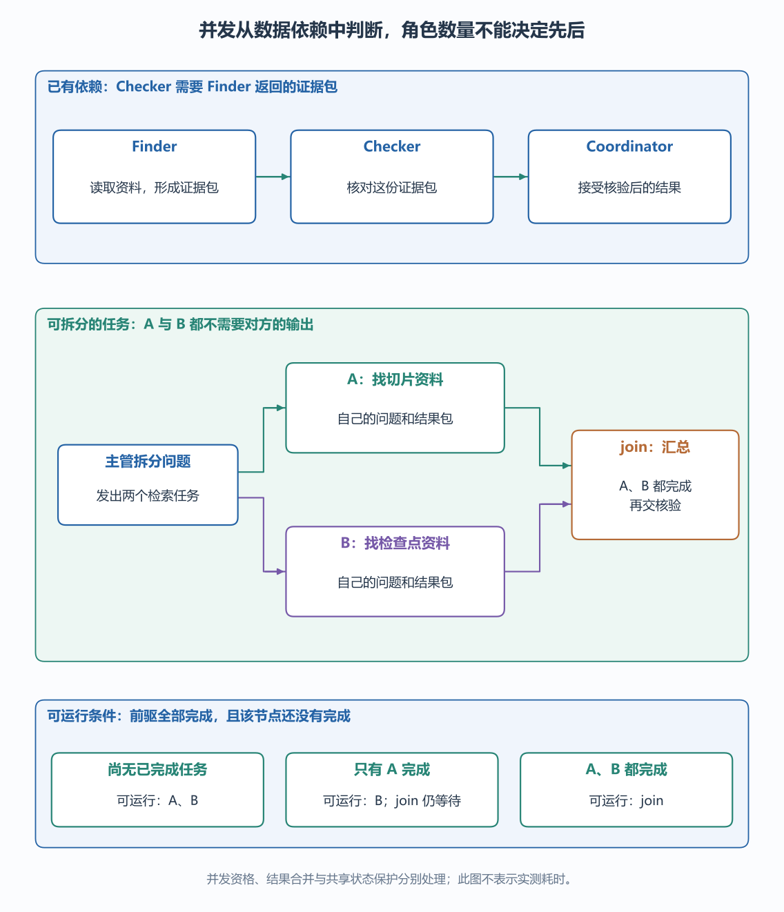

再看更棘手的第二个问题：**当两个并发的子任务 A 和 B 都要去修改同一份共享的阅读计划时，怎么防止后回来的把先回来的成果给盲目覆盖掉？**
设想当前计划的最新版本号是 **`version = 7`**。子任务 A 和子任务 B 在启动时，看到的都是版本 `7` 的底稿，于是它俩各自基于版本 `7` 拟定了修改提案：

~~~text
子任务 A 提交提案：expected_version = 7，请求写入“方案 A”
子任务 B 提交提案：expected_version = 7，请求写入“方案 B”
~~~

如果主管程序写得毫无防备，谁后交上来就无脑覆盖谁（Last-Write-Wins），那么先交上来的“方案 A”还没热乎两秒钟，就会被晚一步交上来的“方案 B”彻底抹掉，而且 B 在写“方案 B”时根本不知道 A 刚才已经改过计划了！
为了守住状态合并的一致性，主管必须实行**乐观并发控制（Optimistic Concurrency Control，即核对期望版本号 `expected_version`）**：
1. 子任务 A 先到达，它声明自己基于 `expected_version = 7`；主管一看当前计划版本确实是 `7`，两者匹配！于是接受“方案 A”，并把当前计划的版本号向上推进为 **`version = 8`**；
2. 紧接着子任务 B 姗姗来迟，它声明自己也是基于 `expected_version = 7` 写的；主管一核对，发现当前最新版本已经是 `8` 了（`7 != 8`，说明在 B 干活期间底稿已经被别人改过了！），于是当场**拒绝 B 的直接覆盖**，记录下这次版本冲突，要求基于最新的版本 `8` 重新核对后再提交！

配套函数 `conflicts()` 在单进程内完整演示了这一“接受 A（升至版本 8）、拒绝过期的 B”的裁决过程（到了下一篇第九篇，当多个操作系统进程真的同时去读写同一个 SQLite 数据库文件时，这步“检查版本号并更新”还必须放进数据库的原子写事务里执行，防止两个进程在同一微秒同时读到版本 7）。这也给我们设计多智能体系统立下了最后一条铁律：**不要为了凑热闹而堆砌智能体角色数量——如果三个角色拿着一模一样的上下文、握着一模一样的工具、干着同质化的复读，那除了把账单从 1000 字节刷到 8332 字节之外毫无益处；只有当不同角色之间确实存在独立的上下文隔离、明确的权限拆分（如取证权、独立核验权与最终合并交付权分离）时，多智能体协作才真正创造了工程价值。**

## （四）框架映射：组件与控制流

### 1. 统一接口中的业务条件

在第七篇和本篇前三节里，我们没借助任何第三方大模型应用框架，纯靠几十行原生 Python 代码就把 RAG 混合检索、JSON 严格解析、工具闭环、MCP 协议与多智能体协作写得清清楚楚。
那工业界广泛使用的 **LangChain** 与 **LangGraph** 框架到底干了什么？说白了，框架提供了一套统一的接口外壳（比如把各种文档都叫 `Document`、把各种可串联的步骤都叫 `Runnable`、把带分支的流程组织成 `StateGraph`），帮你省去重复编写胶水适配代码的功夫。

但请牢记一条贯穿本书的原则：**换上框架的外壳，绝不会让第七篇和本篇前面讲过的任何一条业务与数学约束自动消失！** 权限和版本依然不会自己过滤，坐标顺序错了余弦值照样算歪，重复键照样需要提前拦截。

为了确保每一行框架代码都能在本地精确复现，本书唯一虚拟环境 `.venv` 严格锁定了以下版本：**`langchain 1.4.7`、`langchain-core 1.7.3`、`langgraph 1.2.18`、`pydantic 2.14.2`**。我们先列出一张从原生代码到框架组件的 1:1 映射总表，看清换壳之后哪些业务条件依然必须由你亲手把关：

| 原生程序中的对象或动作 | 对应的框架组件入口 | 换用框架后依然必须由工程代码保证的业务条件 |
| --- | --- | --- |
| 1. 笔记片段正文与来源字典 | `langchain_core.documents.Document` | 入库前的 `owner` 权限筛选、`revision` 版本与字符区间 `[start, end)` |
| 2. 查询与文档向量编码函数 | `langchain_core.embeddings.Embeddings` | 查询侧与文档侧使用完全相同的编码器版本与九维词表坐标契约 |
| 3. 内存向量与片段映射检索 | `InMemoryVectorStore` | 建库前的候选池过滤、原文修改后的索引同步重建（注意仅限单路向量且无持久化） |
| 4. 普通 Python 函数顺序串联 | `RunnableLambda` 与管道符 `\|` | 每一棒函数的输入输出类型匹配及异常捕获边界 |
| 5. 带槽位的消息列表模板填充 | `ChatPromptTemplate` | 变量内容的真实来源、角色映射格式以及总上下文 Token 预算 |
| 6. 工具参数的严格类型与范围校验 | Pydantic `BaseModel`（`strict=True`） | 在进 Pydantic 字典校验前，仍需先用 `strict_json` 拦截原始文本中的重复键 |
| 7. 进程内状态字段更新与条件分支 | LangGraph `StateGraph` | 各节点职责边界、字段是覆盖还是累加（Reducer），以及明确的终止条件 |

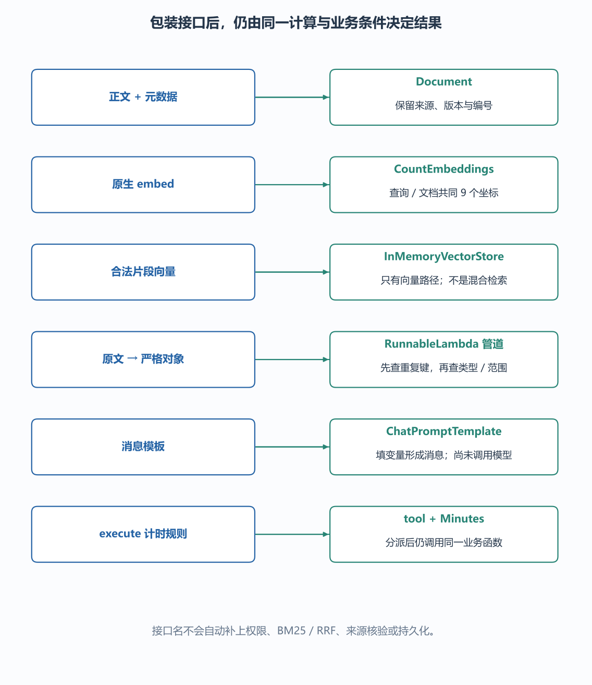

### 2. Document 与 Embeddings

在原生代码里，我们用一个 Python 字典 `{"id": "numpy:0", "text": "...", "source": "...", "owner": "public", "revision": "..."}` 来保存切分好的一个笔记片段。
换到 LangChain 里，对应的标准容器叫做 `Document`：它把片段正文放进 `page_content` 属性，把片段编号放进 `id` 属性，把其余所有来源、版本和权限字段统统塞进 `metadata` 字典里。注意：`Document` 只是一个装着字符串的被动数据结构，它的 `metadata` 里写着 `"owner": "alice"` 并不会在查询时自动触发权限拦截；因此，我们在构造 `Document` 列表之前，依然先调用第七篇的 `load_chunks(owner="alice")` 完成前置过滤：

~~~python
from langchain_core.documents import Document
from modern_ai.retrieval import load_chunks

chunks = load_chunks(owner="alice")
documents = [
    Document(
        id=c["id"],
        page_content=c["text"],
        metadata={k: c[k] for k in ("id", "source", "owner", "revision")},
    )
    for c in chunks
]
print(len(documents))   # 6
print(documents[0].id)  # numpy:0
~~~

接着看向量编码器。LangChain 的 `Embeddings` 抽象基类要求实现两个标准方法：批量编码文档列表的 `embed_documents(texts)` 和单独编码一条查询的 `embed_query(text)`。我们在 [`modern_ai/frameworks.py`](https://github.com/KiriAky107/understanding-AI-and-Agents-in-depth/blob/main/%E7%8E%B0%E4%BB%A3AI%E7%A4%BA%E4%BE%8B/modern_ai/frameworks.py)（代码包内：`现代AI示例/modern_ai/frameworks.py`） 中编写了 `CountEmbeddings` 类，不引入任何外部黑盒模型，直接把第七篇那个九维单位向量编码函数 `embed` 包装进这两个方法里：

~~~python
from modern_ai.frameworks import CountEmbeddings
from modern_ai.retrieval import embed

encoder = CountEmbeddings()
query_vector = encoder.embed_query("切片共享")
document_vectors = encoder.embed_documents(
    [d.page_content for d in documents]
)
assert query_vector == embed("切片共享").tolist()
print(len(query_vector), len(document_vectors), len(document_vectors[0]))
# 9 6 9
~~~

看打印出来的维度 `9 6 9`：单条查询返回长度为 `9` 的浮点数列表，6 个文档片段返回 `6` 行、每行长度为 `9` 的二维列表。因为底层调的是同一个 `embed` 函数，`"切片共享"` 与 `numpy:0` 算出来的余弦相似度依然是分毫不差的：

$$
s(\text{切片共享},\mathrm{numpy{:}0})=\frac3{\sqrt{10}}
\approx0.948683.
$$

### 3. 内存向量库的替换边界

有了 `documents` 列表和 `encoder` 编码器，一行代码就能把它们塞进 LangChain 内置的内存向量库 [`InMemoryVectorStore`](https://docs.langchain.com/oss/python/integrations/vectorstores/in_memory) 并执行 Top-$k$ 相似度搜索：

~~~python
from langchain_core.vectorstores import InMemoryVectorStore

index = InMemoryVectorStore.from_documents(documents, encoder)
pairs = index.similarity_search_with_score("切片共享", k=3)
print([(d.id, round(float(score), 6)) for d, score in pairs])
# [('numpy:0', 0.948683), ('slice:0', 0.707107), ('copy:0', 0.316228)]
~~~

在这道 `"切片共享"` 测试题上，`InMemoryVectorStore` 返回的前三名编号和分数，与第七篇的原生 `search` 看起来一模一样。
但就在这里，无数初学者在做“框架重构”时会犯下一个严重的降级错误——他们看到这两行代码这么短、结果又一样，就兴高采烈地把原来写的 `retrieval.search` 删了，全换成了 `index.similarity_search_with_score`！

为什么说这是严重的降级？请对比两者的真实计算路径：
1. **丢掉了 BM25 词法通道与 RRF 融合**：`InMemoryVectorStore` **只算了单路向量余弦相似度**！在 `"切片共享"` 上它之所以碰巧和混合检索同序，纯粹是因为这道题里的词恰好都在九维向量词表里；一旦用户问一句包含九维词表之外字面线索的问题（比如含“原数组”或某个特定报错码），纯向量库算出来的余弦分就会归零漏检，而第七篇的原生混合检索却能靠 BM25 词法通道稳稳把它捞回来！（如果你既想用框架接口、又不想丢掉混合检索，正确的做法是把整个原生 `retrieval.search` 包装成一个 `Runnable` 或自定义 `Retriever`，而不是退化成单路向量库。）
2. **没有跨进程持久化，也没有绑定用户隔离**：`InMemoryVectorStore` 存在当前进程内存里，进程一退出索引就烟消云散；而且上面这个 `index` 是拿 Alice 可读的 6 个片段建出来的，如果下一个请求换成了用户 Bob，绝不能不加检查就直接去查同一个内存 `index` 对象。

### 4. Runnable 管道与两道参数检查

在 LangChain 体系里，可以用 `RunnableLambda(func)` 把任何普通 Python 函数包装成标准可执行组件，然后用竖线管道符 **`|`** 把两个组件一前一后串起来：`A | B` 的意思就是“先調 A，再把 A 的返回值传给 B 当输入”（注意这里的 `|` 是重载后的管道连接符，不是布尔或运算，里面也没有偷偷调用任何语言模型）。

我们拿第七篇第四节讲过的“工具参数解析与校验”来搭一条双步管道：第一步把原始 JSON 字符串解析成 Python 字典，第二步用 **Pydantic** 数据模型做严格的字段类型与数值范围校验。
先看第二步的 Pydantic 模型 `StrictMinutes` 是怎么写的：

~~~python
from pydantic import BaseModel, ConfigDict, Field

class StrictMinutes(BaseModel):
    model_config = ConfigDict(strict=True, extra="forbid")
    pages: int = Field(ge=0, le=1000)
    questions: int = Field(ge=0, le=1000)

good = StrictMinutes.model_validate({"pages": 3, "questions": 4})
assert good.model_dump() == {"pages": 3, "questions": 4}
~~~

注意看 `ConfigDict(strict=True, extra="forbid")` 这两个关键配置：
* 开启 **[`strict=True`（严格模式）](https://docs.pydantic.dev/latest/concepts/strict_mode/)** 后，Pydantic 就不再搞默认的类型强转讨好了——对于声明为 `int` 的 `pages` 字段，不仅字符串 `"3"` 和浮点数 `3.0` 会被当场拒绝，连第七篇那个最狡猾的 Python 布尔子类陷阱 `True` 也会被直接拦下！
* 开启 **`extra="forbid"`** 则对应 JSON Schema 的 `additionalProperties: false`，任何未声明的额外字段（如偷偷塞进来的 `"owner": "bob"`）一律报错退回；而 `Field(ge=0, le=1000)` 则严格卡死了 $0\le x\le 1000$ 的闭区间上下界。

既然 Pydantic 的 `StrictMinutes` 已经这么严密了，为什么我们在下面搭 `parser` 管道时，还要在它前面先串一个第七篇手写的 **`RunnableLambda(strict_json)`**，而不是直接调 Pydantic 自带的 JSON 解析呢？

~~~python
from langchain_core.runnables import RunnableLambda
from modern_ai.agent import strict_json
from modern_ai.frameworks import Minutes

parser = (
    RunnableLambda(strict_json)
    | RunnableLambda(Minutes.model_validate)
)
parsed = parser.invoke('{"pages":3,"questions":4}')
print(parsed.model_dump())  # {'pages': 3, 'questions': 4}
~~~

答案就在第七篇讲过的**重复键覆盖漏洞**里！
如果模型吐出的原始字符串是 `'{"pages": 3, "pages": 900, "questions": 4}'`，常规的 JSON 解析器在把它转成字典时，会静默地用后面的 `900` 覆盖掉前面的 `3`，生出一个看起来干干净净的单键字典 `{"pages": 900, "questions": 4}`；等第二步的 Pydantic `model_validate` 拿到这个字典时，犯罪现场早就已经被销毁了，Pydantic 根本无从得知原始文本里曾经出现过两个 `"pages"`！
因此，必须由第一步 `strict_json` 在字符解析阶段挂钩 `object_pairs_hook` 守住大门、拒掉重复键，再由第二步 `Minutes.model_validate` 守住二门、拒掉布尔值/字符串/浮点数/越界数与额外键。两步合在一起，才在本地实验中完整拦截了全部五类非法参数输入。

### 5. 消息模板与工具包装

同样地，拼接系统指令、用户问题与检索证据的动作，可以用 `ChatPromptTemplate` 包装成带 `{question}` 和 `{evidence}` 占位槽位的模板对象；而计时函数则可以用 `@tool(args_schema=Minutes)` 装饰器包装成框架标准工具：

~~~python
from langchain_core.prompts import ChatPromptTemplate
from modern_ai.frameworks import reading_minutes

prompt = ChatPromptTemplate.from_messages([
    ("system", "只依据所附资料回答，保留来源。"),
    ("human", "问题：{question}\n资料：{evidence}"),
])
messages = prompt.invoke({
    "question": "切片共享",
    "evidence": "[numpy:0] 切片介绍：切片共享数据。",
}).to_messages()
print([m.type for m in messages])  # ['system', 'human']

framework_value = reading_minutes.invoke({"pages": 3, "questions": 4})
print(framework_value)  # {'minutes': 10}
~~~

这里有一条极其重要的代码维护纪律——**单一真值源（Single Source of Truth）**：
在 `frameworks.reading_minutes` 的内部实现中，我们绝没有把 `$2p+n$` 的算术公式再抄写一遍，而是直接调用了原生模块里的 `agent.execute("reading_minutes", ...)`！这样一来，无论是本地函数、HTTP 端点、MCP 服务还是 LangChain 工具，全天下只有唯一一处地方写着计时业务规则；日后要是业务规则改成了“每页 3 分钟”，只需改 `agent.execute` 一处，所有四个接口的结果就会同步更新，绝不会出现“框架算出来是 13 分钟、MCP 算出来还是 10 分钟”的精神分裂。

### 6. StateGraph 与三种状态

当业务流程里出现了“先检索，如果搜到了证据就走回答节点，如果没搜到证据就走拒答节点”这样的条件分支时，用 **LangGraph** 的状态图（`StateGraph`）可以把“当前攒下了哪些业务数据（状态 State）”、“每个步骤干什么活（节点 Node）”以及“下一步往哪走（边 Edge）”清晰地拆开。
（注意：按照全书的认知阶梯规划，本篇只介绍**进程内存里的无状态/单次运行图控制流**；至于跨进程崩溃的 SQLite 检查点持久化、人工中断 `interrupt` 与节点重入，我们将留在第九篇讲完事务与状态机之后再做二次映射。）

在动手写 `StateGraph` 之前，必须先把 AI 工程里经常被混用同一个词称呼的**三种“状态（State）”**彻底分清：

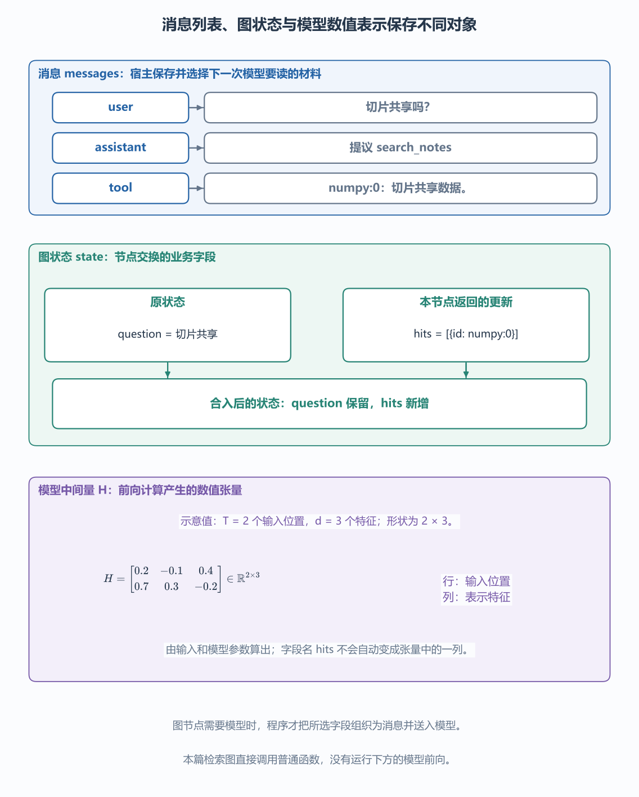

看上面这张对照图：
1. **第一种是 `messages`（对话消息列表）**：保存的是发给语言模型的带角色（`system` / `user` / `assistant` / `tool`）文本材料；
2. **第二种是 LangGraph 的图业务状态 `RetrievalState`**：它是我们在 Python 里定义的一个结构化字典，专门用来在图的各个节点函数之间传递业务变量（比如当前的问题 `question`、搜出来的命中列表 `hits`、最终生成的回答字符串 `answer`）：
   ~~~python
   from typing import TypedDict
   
   class RetrievalState(TypedDict):
       question: str
       hits: list[dict]
       answer: str
   ~~~
   （顺带解释一句：这里的 `TypedDict` 是 Python 标准库提供的类型标注工具，用来告诉编辑器和 LangGraph“这个状态字典里预计会有哪几个键、分别是什么类型”；但要注意，`TypedDict` 本身在运行时就是一个普通 Python `dict`，它不会像前面的 Pydantic `BaseModel` 那样在赋值时自动做严格运行时类型拦截。）
3. **第三种则是神经网络内部的隐藏状态张量 $H$**（比如第四篇 Transformer 层与层之间传递的 $2\times 3$ 浮点数矩阵）。图的业务字段 `hits` 不会自动变成神经网络里的某一列浮点数，只有当某个节点函数把 `hits` 里的文本拼成消息、经过分词和嵌入查表送进模型时，才会产生神经网络张量；而在我们下面这个纯确定性检索图里，三个节点全都是普通 Python 函数，整个图跑完连一次语言模型都不需要调用！

现在我们用 `StateGraph(RetrievalState)` 把“检索（`retrieve`） $\to$ 有结果则回答（`reply`） / 无结果则拒答（`abstain`）”组装成一张可执行图：

~~~python
from langgraph.graph import StateGraph, START, END
from modern_ai.retrieval import search

def retrieve_node(state):
    # 复用原生混合检索，只返回本节点需要更新的字段字典。
    return {"hits": search(state["question"])["selected"]}

def reply_node(state):
    # 把实际命中和来源编号组织成可核读的内容。
    return {"answer": "\n".join(
        f'{item["text"]} [{item["id"]}]' for item in state["hits"]
    )}

def abstain_node(state):
    return {"answer": "资料中没有可引用的证据。"}

builder = StateGraph(RetrievalState)
builder.add_node("retrieve", retrieve_node)
builder.add_node("reply", reply_node)
builder.add_node("abstain", abstain_node)
builder.add_edge(START, "retrieve")
builder.add_conditional_edges(
    "retrieve", lambda state: bool(state["hits"]),
    {True: "reply", False: "abstain"},
)
builder.add_edge("reply", END)
builder.add_edge("abstain", END)
graph = builder.compile()
~~~

看清这段图组装代码的三个核心机制：
第一，[`Graph API` 的状态更新约定](https://docs.langchain.com/oss/python/langgraph/graph-api)允许每个节点函数**只返回它这一步新产生或修改的那几个字段**（称为增量更新 Update）。比如 `retrieve_node` 只返回了 `{"hits": [...]}`，它不需要把原状态里的 `"question"` 再抄一遍返回去；图引擎收到返回字典后，会自动把新字段合并进当前状态，而没被提及的 `"question"` 依然完好保留在状态里。
第二，`add_conditional_edges` 定义了**条件边**：跑完 `"retrieve"` 节点后，图引擎调用匿名函数 `lambda state: bool(state["hits"])` 检查当前命中列表是否非空，并根据映射表 `{True: "reply", False: "abstain"}` 精确路由到下一个节点（注意：因为这里的选路规则是由确定性的布尔函数写死的，所以按照第七篇第五节的定义，这张图本质上是一个**确定性工作流 Workflow**，并不会因为套上了 `LangGraph` 的名字就自动变成由模型动态选路的 Agent）。
第三，当我们调用 `graph.stream(..., stream_mode="updates")` 观察运行轨迹时，流式吐出来的每一项是**“刚才跑完的那个节点名字，以及它本次返回的增量更新字典”**：

~~~python
steps = list(graph.stream({"question": "切片共享"}, stream_mode="updates"))
print([next(iter(step)) for step in steps])  # ['retrieve', 'reply']

missing_steps = list(
    graph.stream({"question": "火星天气"}, stream_mode="updates")
)
print([next(iter(step)) for step in missing_steps])  # ['retrieve', 'abstain']
~~~

问 `"切片共享"` 时走的是 `['retrieve', 'reply']`，问库里没有的 `"火星天气"` 时则精准切换到了 `['retrieve', 'abstain']`。

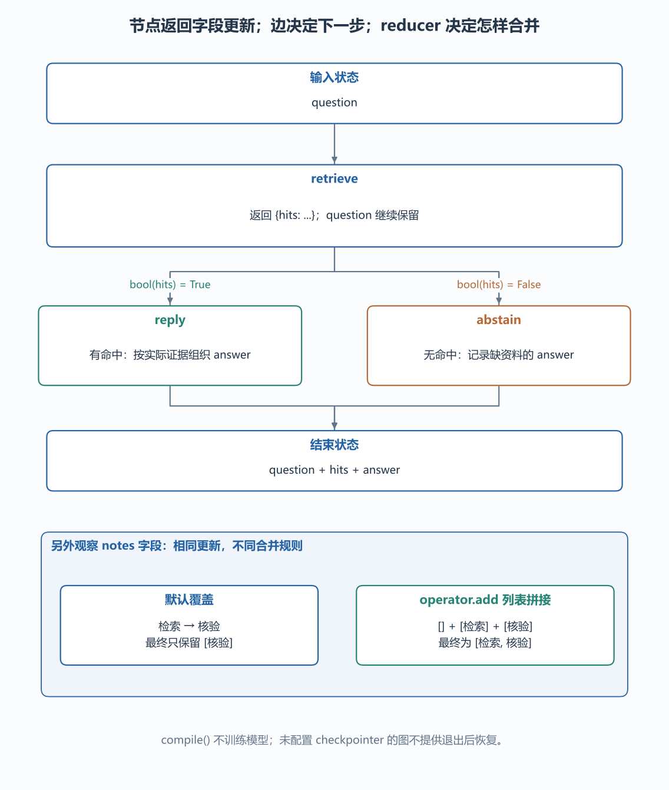

### 7. 状态字段：覆盖与累加

在结束本篇之前，还有一个关于 LangGraph 状态合并的关键细节必须点透：
在上面那个 `RetrievalState` 里，如果前后两个节点都返回了同名字段的更新，图引擎默认会怎么做？**默认规则是直接覆盖（Overwrite，即后一个节点返回的值彻底替换掉前一个节点留下的值）**！

对于 `answer` 这种只需要保留最终结果的字段，覆盖是合理的；但如果我们在状态里设了一个用来记录已执行步骤日志的列表字段 `notes: list[str]`，第 1 个节点返回 `{"notes": ["检索"]}`，第 2 个节点返回 `{"notes": ["核验"]}`——要是沿用默认覆盖规则，跑完第 2 个节点后，状态里的 `notes` 就只剩下 `["核验"]`，前面的 `"检索"` 被直接抹掉了！

要想让同名列表字段在每次节点返回时自动首尾拼接累加，我们需要利用 Python 的 ` typing.Annotated` 类型注解，为该字段显式绑定一个**状态归约合并函数（Reducer）**——比如代表列表相加拼接的标准库函数 `operator.add`：

~~~python
from typing import Annotated, TypedDict
import operator

class AccumulatingState(TypedDict):
    notes: Annotated[list[str], operator.add]
~~~

写了 `Annotated[list[str], operator.add]` 之后，每当有节点返回 `{"notes": update}`，图引擎就不再直接覆盖，而是自动调用 `operator.add(old_notes, update)`（对 Python 列表而言即执行 `old_notes + update`）：

$$
[]+[\text{检索}]=[\text{检索}],
$$

$$
[\text{检索}]+[\text{核验}]=[\text{检索},\text{核验}].
$$

我们在配套实验中用完全相同的两个节点分别跑了“不带 Reducer（默认覆盖）”和“带 `operator.add` Reducer（列表累加）”两种状态图，前者最终只剩 `["核验"]`，后者则完整保留了 `["检索", "核验"]`。

但请紧接着再往深想一层：是不是只要挂上了 `operator.add`，状态累加就高枕无忧了？
并不是！设想第 1 个节点在运行中途因为网络抖动触发了重试（Retry），同一个节点函数被执行了两次，每次都返回 `["检索"]`——由于 `operator.add` 只管无脑拼接列表，重试一次就会在状态里留下两条重复的 `["检索", "检索"]`！如果想要在重试或并发合并时做到按事件 ID 自动去重，就必须编写带 ID 判重的自定义 Reducer 函数。

更重要的是，本节构建的 `StateGraph` 并没有挂载任何持久化存储（Checkpointer）。无论图里面的 `notes` 累加得多漂亮，它们全都悬浮在当前 Python 进程的临时内存里——只要程序运行结束退出，或者跑到一半进程崩溃，这些内存状态瞬间就会灰飞烟灭。怎样让智能体的执行位置、人工确认状态与外部业务写入真正跨过进程生死的边界？这正是下一篇（第九篇：《Agent Runtime：状态机、事务、队列与跨进程恢复》）将要正面攻坚的核心课题。

## （五）运行与练习

### 1. 实验入口

本篇所有命令均在 `现代AI示例` 目录中运行，沿用已有的唯一虚拟环境 `.venv`，无需额外安装依赖或配置远程模型密钥：

~~~powershell
# 一键运行本篇全部实验：MCP 协议握手与错误分层、三种调用入口对账、Skill 三级按需读取、三角色多智能体协作与框架映射。
.\.venv\Scripts\python.exe -B -m modern_ai.ecosystem_lab all

# 也可按模块单独观察：协议报文、Skill 读取事件、多角色协作轨迹或 LangChain/LangGraph 状态更新。
.\.venv\Scripts\python.exe -B -m modern_ai.ecosystem_lab protocol
.\.venv\Scripts\python.exe -B -m modern_ai.ecosystem_lab skills
.\.venv\Scripts\python.exe -B -m modern_ai.ecosystem_lab cooperate
.\.venv\Scripts\python.exe -B -m modern_ai.ecosystem_lab frameworks

# 按稳定题号单独查看各题中间状态与核验结果（PE-01 至 PE-06）。
.\.venv\Scripts\python.exe -B -m modern_ai.solutions PE-04
~~~

| 正式源码文件 | 负责的核心职责 |
| --- | --- |
| [`modern_ai/mcp_stdio.py`](https://github.com/KiriAky107/understanding-AI-and-Agents-in-depth/blob/main/%E7%8E%B0%E4%BB%A3AI%E7%A4%BA%E4%BE%8B/modern_ai/mcp_stdio.py)（代码包内：`现代AI示例/modern_ai/mcp_stdio.py`） | 锁定 `2025-11-25` 版本的最小 MCP `stdio` 服务端、初始化状态机与双线程管道客户端 |
| [`modern_ai/application_details.py`](https://github.com/KiriAky107/understanding-AI-and-Agents-in-depth/blob/main/%E7%8E%B0%E4%BB%A3AI%E7%A4%BA%E4%BE%8B/modern_ai/application_details.py)（代码包内：`现代AI示例/modern_ai/application_details.py`） | 本地函数、HTTP 端点与 MCP 协议三种调用边界的实测对账 |
| [`modern_ai/ecosystem_lab.py`](https://github.com/KiriAky107/understanding-AI-and-Agents-in-depth/blob/main/%E7%8E%B0%E4%BB%A3AI%E7%A4%BA%E4%BE%8B/modern_ai/ecosystem_lab.py)（代码包内：`现代AI示例/modern_ai/ecosystem_lab.py`） | 协议失败分支测试、Skill 三级渐进读取与路径沙箱、框架组件映射与 CLI 入口 |
| [`modern_ai/cooperation_lab.py`](https://github.com/KiriAky107/understanding-AI-and-Agents-in-depth/blob/main/%E7%8E%B0%E4%BB%A3AI%E7%A4%BA%E4%BE%8B/modern_ai/cooperation_lab.py)（代码包内：`现代AI示例/modern_ai/cooperation_lab.py`） | `Finder / Checker / Coordinator` 独立窗口循环、证据包核验、共享预算停止、字节账单与版本冲突 |
| [`modern_ai/frameworks.py`](https://github.com/KiriAky107/understanding-AI-and-Agents-in-depth/blob/main/%E7%8E%B0%E4%BB%A3AI%E7%A4%BA%E4%BE%8B/modern_ai/frameworks.py)（代码包内：`现代AI示例/modern_ai/frameworks.py`） | `CountEmbeddings` 包装、`StrictMinutes` 严格模型、`@tool` 工具与 `StateGraph` 检索图 |
| [`modern_ai/retrieval.py`](https://github.com/KiriAky107/understanding-AI-and-Agents-in-depth/blob/main/%E7%8E%B0%E4%BB%A3AI%E7%A4%BA%E4%BE%8B/modern_ai/retrieval.py)（代码包内：`现代AI示例/modern_ai/retrieval.py`） | 全书唯一复用的原生权限版本过滤、混合检索与九维编码真值源 |

### 2. 报文与状态练习

| 题号 | 要求 | 需要完成的核对 |
| --- | --- | --- |
| PE-01 | **必做** | 画出初始化三条消息，再标出 `tools/list` 和 `tools/call` 的位置。说明通知为什么没有响应，以及版本失配时客户端最后发送了什么。 |
| PE-02 | **必做** | 对 3 页、4 题比较函数、HTTP 和 MCP 返回值。逐层取出 MCP 文本块内的分钟数，再说明 `pages:true` 为什么属于工具错误结果。 |
| PE-03 | **必做** | 实际记录技能的三次读取。算出只发现、已激活、已读取模板时的字节总量；尝试越界资源名，说明拒绝发生在什么位置。 |
| PE-04 | **必做** | 按时间排列三个角色的七次模型调用，写出每次输入消息数。核对四条跨角色报文字节和三份模型输入账单。 |
| PE-05 | **拓展选做** | 分别触发缺证据、错误主张、摘录篡改、预算耗尽和伪造 Checker 成功结果。说明每次失败依据，以及最后能否交付事实答案。 |
| PE-06 | **拓展选做** | 对照原生编码与 CountEmbeddings。运行检索图两条分支，再比较默认覆盖和列表累加；说明这些内存状态为什么不能在进程退出后自动恢复。 |

[逐题题解](https://github.com/KiriAky107/understanding-AI-and-Agents-in-depth/blob/main/docs/%E7%BB%83%E4%B9%A0%E9%A2%98%E8%A7%A3.md)（代码包内：`docs/练习题解.md`）保留了期望的中间状态与可运行入口。每当修改协议分派、工具参数约束或图状态合并规则时，都应重新运行上述核验分支，确认底层业务约束依然完好生效。
