# 九、Agent Runtime：状态、事务与恢复

[TOC]

## （一）进程退出之后

设想这样一个再真实不过的日常场景：你的学习资料助手刚刚帮你检索完关于“检查点恢复”的笔记，整理好了一份阅读计划提案，并把“确认提交”的按钮展示在了界面上。偏偏就在你端起水杯、还没来得及点下确认按钮的这一秒，终端窗口被误关了，或者后台服务进程因为内存波动退出了。

等你重新打开程序时，你希望看到什么？你肯定希望它把刚才那份已经准备好的计划原封不动地拿回来，继续停在等待你点确认的位置上——而不是像个失忆的陌生人一样重新问你一遍问题、重新跑一遍检索，更不是在未经你同意的情况下擅自替你提交一份内容已经变了的计划。

我们再把故障出现的位置往后挪半步：假设你已经点下了确认按钮，后台数据库也确实把正式计划存进去了，但偏偏在服务端把“提交成功”的响应发回界面之前，网络断了或者进程崩了。坐在屏幕前的你没收到成功提示，最自然的反应就是**再点一次确认按钮**。如果后台程序把你的第二次点击傻乎乎地当成了一项全新的提交任务，那么同一份阅读计划就会在数据库里存下两遍，发往外部系统的通知也会重复轰炸两次。

你看，上面这两个极常见的工程故障，逼着我们把平时混为一谈的两件事彻底拆开：**“某段代码在内存里运行过”**，与**“某项业务事实已经在持久化存储里正式完成”**。前者只存在于单个进程短暂的生命周期里，进程一死就烟消云散；而后者则必须留下哪怕换一个全新的进程也能读取、核对并接着往下走的客观记录。**Agent Runtime（智能体运行时）** 所承担的核心职责，正是在不可靠的进程与网络之上建立这种跨故障的连续性：认出是不是同一项任务、保存已经推进到的业务阶段，并在系统重新启动时精准迈出合法的下一步。

### 1. 内存现场与持久记录

在第七篇和第八篇的实验里，无论是对话消息列表 `messages`、当前函数执行到哪一行的局部变量，还是 LangGraph 节点刚刚算出来的字典，统统都放在当前 Python 进程的**内存（RAM）**里。操作系统给每个进程划分了独立的虚拟内存空间；一旦当前进程退出，操作系统就会把这块内存悉数回收。哪怕你在一秒钟后重新启动同一个 Python 脚本、又定义了一个同名的变量 `messages`，那也是新进程在全新内存地址上分配出来的新对象，里面绝不会自动浮现出上一个进程留下的旧消息。

怎样让状态跨过进程的生死边界？靠的是像 **SQLite** 这样落盘在硬盘文件里的关系型数据库。当新进程启动时，它可以打开同一个 `.sqlite` 数据库文件，按任务编号查出之前提交的记录，并在自己的内存里重新构造出 Python 字典。

请仔细看清这“一存一取”中间发生的两次物理转换：在旧进程保存状态时，程序先把内存里的 Python 字典序列化成一段纯文本的 **JSON 字符串**写进磁盘文件；在新进程恢复状态时，程序再从磁盘读出这段 JSON 字符串，调用解析器在自己的内存里生成一个新的 Python 字典。**持久化保存下来的仅仅是数据的值及其结构关系，而绝不是把旧进程的物理内存地址或 Python 函数调用栈原封不动地冷冻在硬盘上！**

如果你开发或部署过像 **[AstrBot](https://github.com/AstrBotDevs/AstrBot)** 这样接入了 QQ（OneBot）、Telegram 或网页端的开源智能体框架，对“内存现场”与“持久记录”的区别一定有切肤之痛：新手写插件时，最喜欢在 Python 插件类的 `__init__` 里随手定义一个字典 `self.user_plans = {}`，把用户刚生成的计划存在里面。平时聊得好好的，结果只要你在后台点一下“重载插件”或者重启一次 AstrBot 容器，上一秒还拍着胸脯自称“因为我是高性能的嘛！”的智能体，下一秒就会彻底失忆，对着用户的确认指令茫然反问：“请问您要确认什么？”

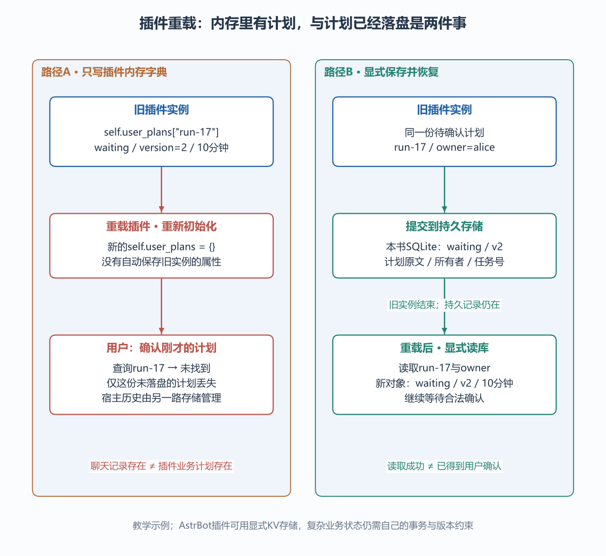

AstrBot 的[插件存储指南](https://github.com/AstrBotDevs/AstrBot/blob/6c942855cb06b6d43854e8b841859d60a5c6043e/docs/zh/dev/star/guides/storage.md)提供 `put_kv_data`、`get_kv_data` 等显式存取接口。图中的阅读计划沿用本书 SQLite 状态例子，展示的是插件业务数据的保存选择。

这就像经典视觉小说[《ATRI》](https://atri-mdm.com/character/?chara=atri)里的机器人亚托莉——因为脑机内存存在硬件缺陷，每晚睡眠重启后临时内存就会被清空；她要想在第二天醒来时还记得昨天和夏生先生约定好的计划，唯一的办法就是在睡前老老实实地把今天发生的事**用笔写进那本随身携带的纸质日记本里**，第二天早上醒来先翻开日记本读一遍！（这里的OOC是服务于叙述需要）

在我们的系统里，Python 进程内存里的 `messages` 列表和局部变量，就是一睡醒就会清空的临时记忆；而磁盘上的 **SQLite 数据库文件**，就是那本不会被重启抹掉的“实体日记本”。当新进程启动时，它可以打开同一个 `.sqlite` 文件，按任务编号查出旧进程睡前写下的记录，并在自己的内存里重新构造出 Python 字典。

请看清这“一写一读”中间经历的两次物理转换：保存时，把内存字典序列化成一段纯文本的 **JSON 字符串**写进磁盘；恢复时，再把 JSON 字符串解析成新进程内存里的新字典。**日记本保存下来的仅仅是数据的值及其关系，而绝不是把旧进程的物理内存地址或 Python 函数调用栈原封不动地冷冻在硬盘上！**

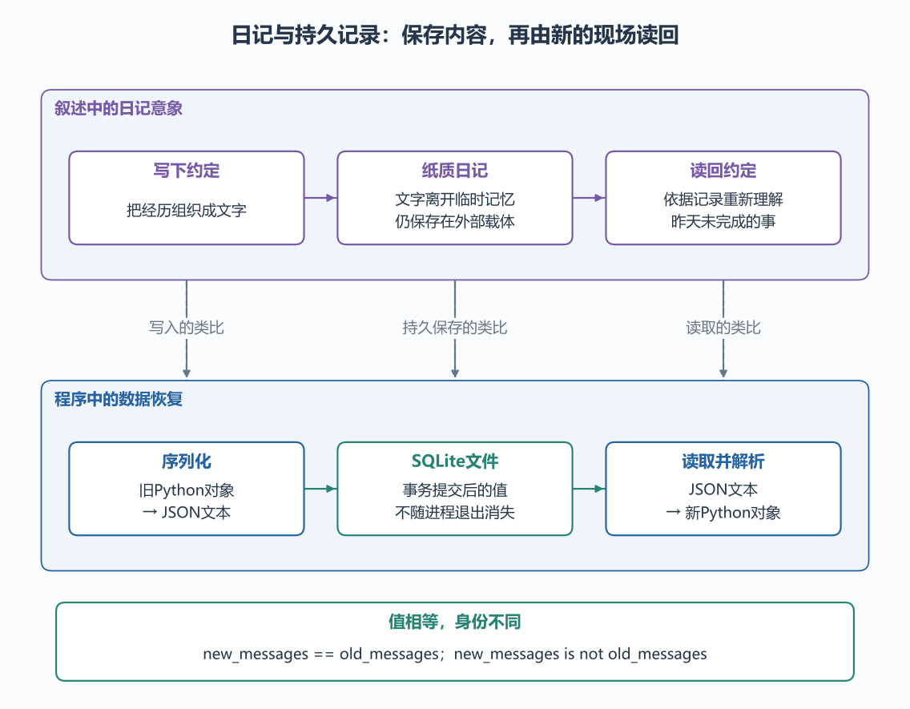

把这个过程与前面的语言模型联系起来，就能把 AI 系统里常说的几种“记住”彻底分清位置：

* **模型的权重参数**：保存在磁盘上的 `.safetensors` 或 `.gguf` 文件里，相当于出厂时焊死在芯片里的基础语言能力；
* **单次推理的激活值与 KV Cache**：属于模型前向计算时的临时显存现场，进程一关或会话一断就彻底释放；
* **会话历史消息（`messages`）**：是外围宿主程序（如 AstrBot 的[对话管理器](https://github.com/AstrBotDevs/AstrBot/blob/6c942855cb06b6d43854e8b841859d60a5c6043e/astrbot/core/conversation_mgr.py)）替模型保管的输入材料；
* **阅读计划的业务阶段与正式成果**：则是保存在 SQLite 数据库表里的持久化业务记录。

当程序崩溃重启后，之所以能接着上一轮的话茬继续跟模型交互，并不是模型自己的神经元“记住了刚才停在哪”，而是宿主程序翻开了数据库这本日记本，把旧消息重新读出来塞进了一次全新的模型前向请求里。

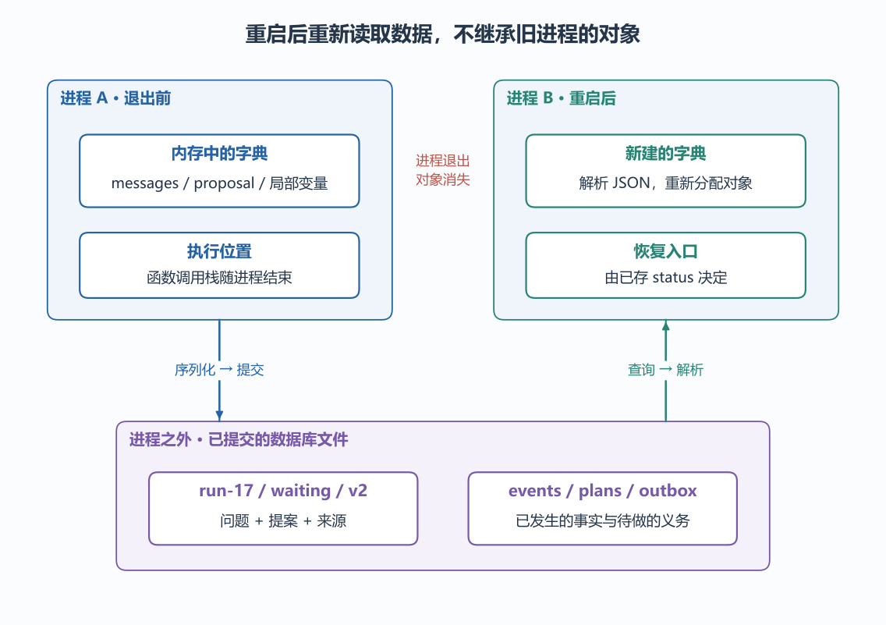

看上面这张图：上方左右两块分别属于“旧进程”和“新进程”的内存区域之间，没有任何直接相连的通道。恢复的箭头必须绕道下方那块已经提交落盘的 SQLite 数据库：只有当旧进程在退出前把 `waiting`（等待确认）状态连同提案正文一起提交进了数据库，新进程启动后才有可能知道“提案已经准备好了，现在正等着用户按确认”。如果旧进程只在日志里打了一行含糊其辞的 `"我正在处理中..."`，新进程醒来后依然不知道提案长什么样、版本号是多少、下一步该调哪个入口函数。

我们可以在几行代码里直接观察一次 JSON 序列化往返，分清 Python 里的**值相等（`==`）**与**对象身份同一（`is`）**：

~~~python
import json

old_messages = [{"role": "user", "content": "检查点恢复"}]
saved_text = json.dumps(old_messages, ensure_ascii=False)
new_messages = json.loads(saved_text)
assert new_messages == old_messages          # 内容（值）完全相同。
assert new_messages is not old_messages      # 外层列表已不是同一个内存对象。
assert new_messages[0] is not old_messages[0]  # 内层字典也是全新创建的独立对象。
~~~

在 Python 中，双等号 `==` 检查的是两个容器里装的数据值是否相等，而关键字 `is` 检查的则是两个变量是不是指向内存里的同一个地址（即 `id(a) == id(b)`）。上面这段代码虽然还没启动两个进程，但已经把“恢复出相同的数据内容”与“保留原来的内存对象”之间的界限划得一清二楚。在本章随后的正式恢复实验里，我们会让每一步操作都在各自独立的 Python 子进程中执行完毕并彻底退出，再由下一个全新启动的子进程去读库核验接力结果。

### 2. 四种编号，各管一件事

在真实的智能体宿主（比如同时挂载了多个群聊、私聊与插件工具的 **[AstrBot](https://github.com/AstrBotDevs/AstrBot/blob/6c942855cb06b6d43854e8b841859d60a5c6043e/docs/zh/dev/star/guides/ai.md)** 实例）里，用户发来的一句提问会引发一连串连锁反应：一句提问可能触发多轮模型推理，一轮推理可能调用多个插件工具（比如先调 RAG 查笔记，再调 TTS 合成语音或调 SMTP 插件发邮件），万一某个工具网络超时触发了重试，外层的整项阅读计划任务却依然是原来那一项任务。

如果你在写代码时图省事，把所有这些不同层级的对象统统起名叫一个笼统的 `"id"`，那么一旦线上发生“A 群发的指令，结果把回执发到了 B 群”或者“同一封邮件连发了三遍”的串台事故，你翻开满屏都是 `id` 的日志，根本分不清到底是哪一层的哪一件事重复了！

因此，我们在架构设计之初，就必须把**四种分属不同层级的身份编号**严格区分开来：

| 身份编号名称     | 它唯一标识的对象层级（以本书与 AstrBot 类比）                | 当发生重试或跨进程恢复时的编号变化规律                       |
| ---------------- | ------------------------------------------------------------ | ------------------------------------------------------------ |
| **`message_id`** | 宿主归档的一条单句消息（对应聊天平台单条消息 ID，用于引用回复或防消息重推） | 同一条历史消息归档身份不变；每产生一条新消息则分配新编号     |
| **`call_id`**    | 一次具体的工具调用提案及回执（如单次调用计时、TTS 或邮件工具的配对号） | 工具回执必须原样填回所答复提案的 `call_id`；下一轮发起的新提案必须换用新编号 |
| **`thread_id`**  | LangGraph 中一条图控制流的执行历史（对应 AstrBot 中标识会话上下文的 [`session_id` / `unified_msg_origin`](https://github.com/AstrBotDevs/AstrBot/blob/6c942855cb06b6d43854e8b841859d60a5c6043e/astrbot/core/platform/astr_message_event.py)） | 跨进程恢复同一条图执行流时，必须继续传入原有的 `thread_id`   |
| **`run_id`**     | 一项完整的业务任务（如生成并确认这一份特定的阅读计划）       | 无论是网络卡顿后用户连点两次确认，还是进程重启后接力，全程锁死同一个 `run_id` |

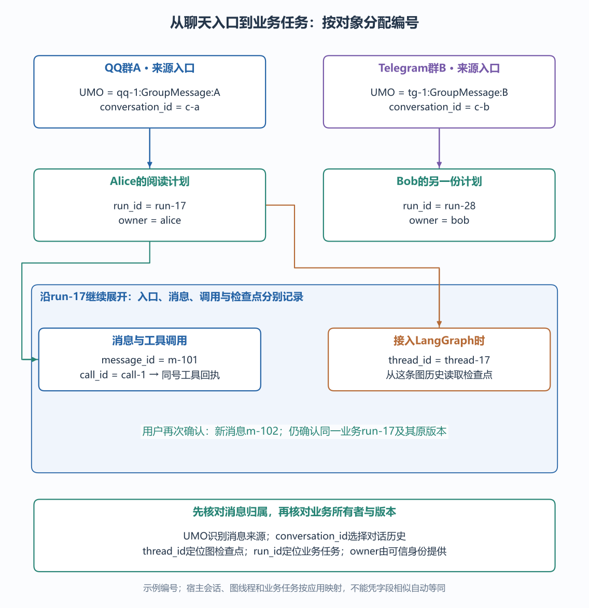

AstrBot 的[会话与对话管理实现](https://github.com/AstrBotDevs/AstrBot/blob/6c942855cb06b6d43854e8b841859d60a5c6043e/astrbot/core/conversation_mgr.py)将来源会话与 `conversation_id` 分开：同一会话可以切换不同对话。图中的 `thread_id` 则在接入 LangGraph 后定位图检查点，`run_id` 由业务自己维护；这些关系要由应用显式关联。

`run_id="run-17"` 是我们自己定义的业务任务编号。配套表 `runs` 的主键列叫 `id`，图状态中的 `task_id` 也传入这个值，它们在本例中指向同一个业务对象（注意：某些外部模型 API 或框架也会把单次接口调用叫做一个 run，切勿仅凭字段同名就认定它们指向同一层）。

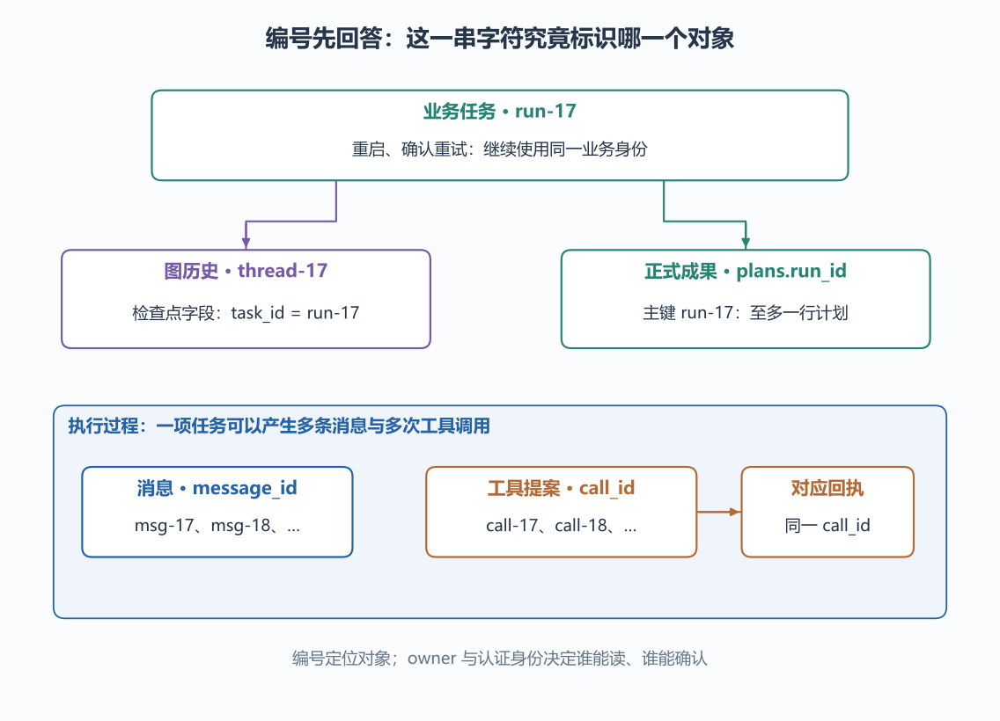

顺着上面这张一对多关系图看过去：同一个业务任务 `run-17` 底下，可以挂着多条消息和多次工具调用 `call_id`；而 `thread-17` 则专门负责替图引擎记住控制流走到哪一个节点了。当用户因为网络卡顿连续点了两次“确认”按钮时，两次请求携带的必须是**同一个业务编号 `run_id="run-17"`**，数据库才能认出“这是对同一份计划的重复确认”；要是前端每次点按钮都随机生成一个新的 `run_id`，数据库就只能把它们当成两份素不相识的新任务照单全收了！

同时，任何编号在查询时都必须与**用户归属权（`owner`）**死死绑在一起。用户 Alice 创建的任务记录里写着 `owner="alice"`；服务端在执行任何读取或修改 SQL 时，查询条件都必须写成 `WHERE id = ? AND owner = ?`，其中的 `owner` 必须由服务端经过身份认证的会话直接提供。**仅仅猜中或拿到了一个 `run_id` 或 `thread_id` 字符串，绝不等于自动获得了读取或确认他人任务的权限！**

### 3. 七张表里的进度、成果与尝试

打开一个智能体运行时的 SQLite 数据库文件，初学者最容易犯的迷糊，就是看到表里已经存了一行记录，就以为“任务已经干完了”。其实，在一条任务从创建到落地的生命周期里，不同性质的事实必须分门别类地存进不同的表里。我们的 `Store` 在初始化时建立了如下 **七张核心业务表**：

| 数据库表名 | 核心字段构成 | 表中每一行记录所表达的确切业务事实 |
| --- | --- | --- |
| **`runs`** | `id, owner, status, version, payload` | 某项业务任务**当前推进到了哪个阶段**（进度卡），以及当前持有的提案与消息快照 |
| **`plans`** | `run_id, owner, body` | 经过用户正式确认后、**已经最终提交生效的一份阅读计划成果** |
| **`events`** | `seq, run_id, kind, body, at` | 某项任务在何时发生过哪一次具体的**阶段转换事件**（只追加不篡改的审计流水） |
| **`outbox`** | `key, owner, payload, status, receipt` | 本地事务已承诺必须向外发送的通知内容，以及当前的**外部投递回执状态** |
| **`attempts`** | `run_id, attempt_id, reason, details` | 某一次具体的执行尝试因何种异常（如预算耗尽）而停止，以及**停止那一刻留下的现场** |
| **`memories`** | `owner, key, raw, summary, digest, revision` | 某位用户的某项长期记忆**当前正在生效的最新版本** |
| **`memory_history`** | `owner, key, revision, raw, summary, digest` | 同一项长期记忆从第 1 版以来的**全部历史修订档案** |

在读这七张表的结构时，有三个数据库基本功需要先对齐：
第一，像 `payload`、`body`、`details` 这些列，在 SQLite 表定义里的列类型是 `TEXT`（文本字符串），里面存的是序列化后的 JSON 字符串。对 SQLite 而言它只是一段普通文本，Python 程序把它读出来之后必须调用 `json.loads()` 解析成字典，才能去访问里面的 `payload["proposal"]`——千万不要把 JSON 字符串内部的字典键名和 SQL 表本身的列名混为一谈。
第二，每张表的 **`PRIMARY KEY`（主键）** 决定了“什么叫做同一条记录”，由数据库引擎在底层强制保证绝对不允许重复。例如，正式成果表 `plans` 的主键是单列 `run_id`，这意味着在数据库物理层面，同一个业务任务 `run-17` **最多只能插入一行正式计划**，任何企图插入第二行的操作都会被主键唯一性约束当场拦下！而在长期记忆历史表 `memory_history` 中，主键是由 `(owner, key, revision)` 三列共同组成的**复合主键（Composite Primary Key）**——这意味着同一个用户（`alice`）的同一个记忆键（`preference`），可以合法地并存第 `1` 版、第 `2` 版、第 `3` 版共三行历史记录，但绝不允许出现两行同为第 `3` 版的记录！
第三，后面四节还会引入任务队列表 `jobs`，第五节接入 LangGraph 检查点后框架也会自动建表；而表中的 `attempts`、`memories` 和 `memory_history` 三张表我们先在这里占好位置、立好规矩，它们的深度实战将在下一篇（第十篇 Agent Harness）中全面展开——这样从一开始就把“业务阶段（`runs`）”、“正式成果（`plans`）”、“半路异常中止的尝试现场（`attempts`）”和“跨任务长期记忆（`memories`）”拆在各自独立的表里，绝不把所有东西揉成一锅粥。

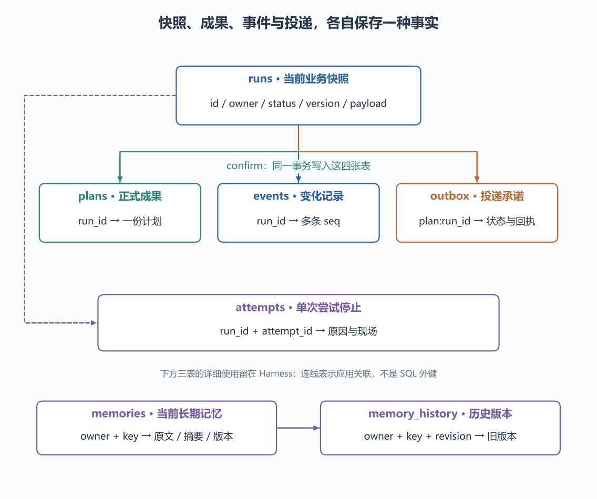

我们可以直接写几行代码查询 SQLite 内置的系统目录表 `sqlite_master`，核对 `Store` 初始化出来的这七张表：

~~~python
from pathlib import Path
from tempfile import TemporaryDirectory
from modern_ai.runtime import Store
from modern_ai.persistence_lab import ROOT

with TemporaryDirectory(dir=ROOT / ".tmp", prefix="chapter09-schema-") as folder:
    store = Store(Path(folder) / "state.sqlite")
    with store.connection() as connection:
        names = [row[0] for row in connection.execute(
            "SELECT name FROM sqlite_master "
            "WHERE type='table' AND name NOT LIKE 'sqlite_%' ORDER BY name"
        )]
    assert len(names) == 7
    print(names)
~~~

（代码里的 `WHERE type='table' AND name NOT LIKE 'sqlite_%'` 排除了 SQLite 引擎自己内部维护的系统表，如用于记录自增序列的 `sqlite_sequence`。）

### 4. 当前快照与事件流水

为什么有了记录当前状态的 `runs` 表，还要再配一张记录历史变化的 `events` 表？它们两个在恢复任务时到底看谁？
打个比方：`runs` 表就像是贴在任务文件夹封皮上的**“当前最新进度卡”**，恢复程序一打开数据库，直接看一眼 `runs` 表里的 `status` 和 `payload`，就能立刻知道现在该从哪一步接着干；而 `events` 表则是夹在文件夹里的**“全流程审计流水账”**，按先后顺序忠实记录着这张进度卡是怎么一步步变成今天这个样子的（注意：本系统以 `runs` 表的当前快照作为恢复的直接依据，并不是那种“把 `runs` 表删了、每次启动都把几万条历史事件从头重放一遍来拼出当前状态”的纯事件溯源 Event Sourcing 系统，因此恢复所需的全部字段必须完完整整地保存在 `runs` 的当前快照里）。

在查看 `events` 表的流水序号 `seq` 时，有一个非常容易让新手误报 Bug 的现象：假设系统里先后创建了任务 A 和任务 B，接着 A 和 B 各自往前推进了一步。此时去查 `events` 全表，看到的记录顺序是这样的：

| 全局事件序号 `seq` | 所属任务 `run_id` | 事件类型 `kind` |
| ---: | --- | --- |
| 1 | A | `created` |
| 2 | B | `created` |
| 3 | A | `prepared` |
| 4 | B | `prepared` |

这时候，如果你单独按 `WHERE run_id = 'A' ORDER BY seq` 去查任务 A 自己的事件历史，拿回来的序号列表是 **`[1, 3]`**！
请问：中间少掉的那个 `2` 去哪儿了？是不是任务 A 弄丢了一条事件？
当然不是！因为 `seq` 列定义的是 `INTEGER PRIMARY KEY AUTOINCREMENT`，它是给**整张 `events` 表**所有任务共享分配的全局单调递增行号，而不是给每个 `run_id` 单独开的私家计数器——中间的序号 `2` 分给了同一时期插入的任务 B（此外，按照 [SQLite 官方对 `AUTOINCREMENT` 的说明](https://www.sqlite.org/autoinc.html)，如果某次事务申请了行号后发生回滚，该行号也不会被回收重用，同样会在序列里留下跳号间隙）。因此，验收事件流水时看的是同一任务下事件的先后相对次序（`1 < 3`）与事件种类是否齐全，绝不能死板地要求单个任务的 `seq` 必须紧挨着相差 1。

## （二）状态机与确认版本

### 1. 状态机：五种事实与合法跳转

现在我们给资料助手的“整理并提交阅读计划”任务划定清晰的业务阶段。在 `runs.status` 列里，一共只允许出现以下 **五种状态**，每一种状态都严格对应着一项**已经落盘成立的客观事实**，并死死框定了下一步只准往哪走：

| 状态名 `status` | 该状态成立所代表的客观事实 | 当前状态下唯一允许执行的后继动作 |
| --- | --- | --- |
| **`created`** | 原始问题已落盘保存，尚未生成可提交的提案 | 执行检索准备提案（转入 `prepared`），或取消任务（转入 `cancelled`） |
| **`prepared`** | 检索出的来源证据与阅读提案已保存在 `payload` 中 | 开放人工确认入口（转入 `waiting`），或取消任务（转入 `cancelled`） |
| **`waiting`** | 提案已就绪并展示给用户，正在等待人工拍板确认 | 确认提交（转入 `done`）、取消（转入 `cancelled`），或带版本号在线修订提案（仍留任 `waiting`，版本号 `+1`） |
| **`done`** | 正式计划已写入 `plans` 表，且本地发件箱承诺已提交 | 终态：仅允许读取既有成果（重复确认按幂等返回，严禁再取消或修改） |
| **`cancelled`** | 任务已被明确取消，未产生任何正式计划 | 终态：仅允许读取已取消状态（严禁再推进或确认） |

这套结构在计算机科学里就叫做**有限状态机（Finite State Machine，简称 FSM）**：系统可能处于的状态集合是有限且预先穷举好的，每一次操作都只能沿着图里画出的合法有向边（Transition）从一个状态跳到另一个状态。它不需要语言模型去“思考自己现在处于什么心理状态”，而是由确定性的 Python 与 SQL 代码直接读取数据库里的 `status` 字符串来严格分派分支！

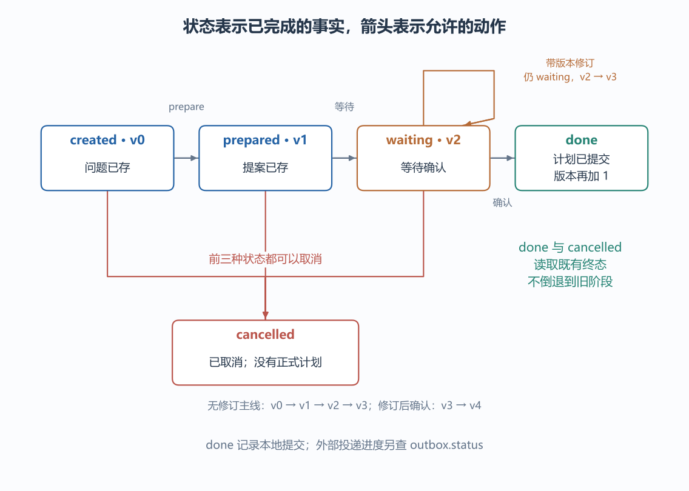

请看上面状态转换图里的两个精妙设计：
第一，看中间的 `waiting` 状态，它头顶上有一条绕回它自己的自环箭头（`revise` 修订）：当任务处于 `waiting` 等待确认期间，如果用户或协作者修改了提案标题，状态名依然保持为 `waiting` 不变，但旁边的整数版本号 `version` 会从 `2` 递增到 **`3`**！这说明：**状态名 `status` 回答的是“当前走到了哪一个业务大阶段”，而版本号 `version` 回答的则是“在这个阶段里，底下的数据已经被改过几次了”**。光看状态名都是 `waiting`，是分不清用户眼前的提案有没有被半路偷换的，必须把状态名与版本号合在一起才能锁死同一份数据。
第二，为什么我们要避免设计像 `"thinking"`（思考中）或 `"working"`（处理中）这样模棱两可的状态名？因为如果旧进程写下 `"working"` 就崩溃了，新进程重启后看到 `"working"` 根本无从判断它死前到底检索完了没有；而在我们的状态表里，每一个状态名都绑定着硬核的数据验收条件——叫 `prepared` 就意味着 `payload` 里必定已经存好了检索证据与提案，叫 `done` 就意味着 `plans` 表里必定已经躺着那份正式计划（至于外部通知有没有真正发到远端服务器，则由 `outbox.status` 单独记录，哪怕远端服务器暂时宕机，本地计划也已经稳稳落盘为 `done`，绝不会因为发通知超时就把已经确认好的计划退回成“未完成”）。

### 2. 事务外准备，事务内再读

看从 `created` 推进到 `prepared` 的这一步（`Store.advance`）：程序需要先调用检索函数去查笔记并组装提案，然后再把提案写进数据库的 `runs` 表里。
这里藏着一个数据库并发编程的经典陷阱：如果程序员一进 `advance` 函数，第一行就先开启数据库的独占写事务（`BEGIN IMMEDIATE`），然后**占着数据库的写锁不放**，慢吞吞地去读磁盘文件甚至调远端模型生成提案，等花了几秒钟拿到结果后再写表提交——在这漫长的几秒钟里，整个 SQLite 数据库的写入通道就被这一个任务死死堵住了，其他所有用户的写入请求全都要在门外排队傻等！

为了不让耗时的检索与推理阻塞数据库，正确的工程做法是**“写事务外准备材料，进写事务后二次查库核对”**：
1. `Store.advance` 先用普通只读查询读出当前任务的快照，确认它是 `created`；
2. **立即释放数据库连接**，在没有任何数据库锁的情况下，在内存里完成检索与提案组装（如果检索发现没有任何可用证据，直接报错退出，`runs` 表保持原样 `created, version=0`，绝不把一份空提案伪装成 `prepared` 写进去）；
3. 等提案材料全部准备妥当，**正式开启短暂的数据库写事务**，并在真正执行 `UPDATE` 改写之前，**在写事务内部重新查询一次 `runs` 表的最新状态**！

为什么要多此一举做这“第二次读取”？因为在你刚才释放连接、埋头做检索的那几百毫秒空档里，数据库里的这个任务完全可能已经被别的进程改过了！
* 设想进程 A 和进程 B 在同一时刻都读到了 `created`，分头去跑检索。进程 A 手快，先一步拿到写事务把提案存了进去，把数据库状态推進到了 `prepared, version=1`。紧接着进程 B 检索完也开启了写事务——如果 B 不做二次查库，闭着眼睛把自己手头那份基于旧快照的提案硬盖上去，就会抹掉 A 刚刚提交的状态；而有了写事务内的二次查库，B 一进事务读到最新状态已经是 `prepared` 了，它就立刻明白“准备提案这一步别人已经替我干完了”，于是顺水推舟执行 `prepared` 的后继动作，把状态推进到 `waiting, version=2`！
* 同理，如果在进程 A 埋头检索的空档里，用户在界面上按下了“取消任务”，数据库状态已经变成了终态 `cancelled`；等 A 检索完开启写事务二次查库时，一眼看到 `cancelled`，就会立刻停手放弃写入，绝不会把已经取消的任务诈尸改回 `prepared`。

~~~python
from modern_ai.persistence_lab import snapshot

with TemporaryDirectory(dir=ROOT / ".tmp", prefix="chapter09-state-") as folder:
    store = Store(Path(folder) / "state.sqlite")
    store.create("run-17", "检查点恢复")  # 初始状态 created，version=0。
    prepared = store.advance("run-17")   # 推进第 1 步：保存检索所得提案，进入 prepared。
    waiting = store.advance("run-17")    # 推进第 2 步：开放人工确认入口，进入 waiting。
    assert (prepared["status"], prepared["version"]) == ("prepared", 1)
    assert (waiting["status"], waiting["version"]) == ("waiting", 2)
    assert snapshot(store, "run-17")["plans"] == 0  # 此时仅在 waiting 等待确认，plans 表里尚无正式成果。
~~~

### 3. 四个进程接力恢复

如果在同一个 Python 脚本函数里连续调三次 `store.advance`，哪怕代码写得有漏洞（比如偷偷把状态存在了类的全局内存属性里），在同一个进程内也能侥幸跑通。为了百分百证明我们的 Runtime 状态机真的能跨越进程销毁与重启，配套实验 `persistence_lab.states`（对应练习 `RT-02`）采用了最严苛的验证方式：**每走一步，都用 `subprocess.Popen` 启动一个全新的 Python 解释器子进程，只传给它数据库文件路径和业务编号 `"run-17"`，等这个子进程干完活彻底退出销毁后，再启动下一个子进程接力往下走！**

| 接力子进程与执行动作 | 该进程退出后数据库中的 `status` | 版本号 `version` | `runs` 中是否已有提案 | `plans` 表中的正式计划数 |
| --- | --- | ---: | --- | ---: |
| **进程 A**：执行 `create` | `created` | `0` | 否 | `0` |
| **进程 B**：执行 `step`（第 1 次推进） | `prepared` | `1` | 是 | `0` |
| **进程 C**：执行 `step`（第 2 次推进） | `waiting` | `2` | 是 | `0` |
| **进程 D**：执行 `confirm`（人工确认） | `done` | `3` | 是 | **`1`** |

你看，进程 B 根本不可能拿到进程 A 内存里的 `Store` 对象，进程 D 也不可能认识进程 C 的局部变量；四个进程每次启动的操作系统 PID 各不相同，它们之间唯一的纽带就是磁盘上那个 `state.sqlite` 文件！当进程 D 完成确认退出后，我们再启动**第五个进程**去重复执行一次 `confirm`：数据库里的状态依然稳稳停在 `done`、版本号依然是 `3`、`plans` 表里的正式计划依然只有 `1` 份、`events` 表里的 `done` 事件也依然只有 `1` 条；而如果对已经 `done` 的任务再发去取消请求 `cancel`，程序则会当场拒绝——因为已经正式提交生效的业务成果，绝不能靠调一下取消接口就偷偷抹杀成“从未发生过”。

### 4. 乐观锁：确认的是哪一版提案

用户在页面（或聊天窗口）上看到的，是版本号为 `version = 2` 的阅读计划提案，标题规规矩矩地写着 `"阅读计划"`。偏偏就在用户盯着屏幕端详的这几秒钟里，另一处并发操作（比如后台协同插件或另一个终端窗口）把这份提案的内容改成了 `"方案 A"`，并将数据库里的版本号推进到了 `version = 3`。一秒钟后，毫不知情的用户点下了“确认”按钮——请问，这时候他确认的究竟是哪一份计划？

这就好比你在聊天机器人里让插件拟了一封请假邮件草稿（版本 `2`），机器人提示你回复“确认”即可发给导师；结果就在你打下“确认”两个字按下回车的半秒钟前，群里另一个损友触发了一条修改指令把草稿正文改成了“老师我想退学”（版本 `3`）！如果服务端的确认接口只认任务号 `run_id`、不核对版本号，直接把此刻数据库里最新的版本 `3` 给发了出去，那就是典型的**“人在家中坐，社死天上来”**——用户眼睛确认的旧对象与程序实际提交的新对象发生了致命错位！

为了彻底杜绝这种“所见非所签”的掉包事故，确认请求必须在传 `run_id` 的同时，显式携带用户刚才亲眼看到的那一版编号 `expected_version=2`，让服务端把“你到底是在对哪一版点头”也纳入硬性核验条件。设数据库里当前实际保存的版本号为非负整数 $v_{\mathrm{current}}$，请求里携带的预期版本号为 $v_{\mathrm{expected}}$，允许提交或修订的前提条件是两者必须严格相等：
$$
v_{\mathrm{current}}=v_{\mathrm{expected}}
$$
只要发现 $3 \neq 2$，服务端就必须当场拒绝这次提交，提示前端界面重新刷新读取最新的版本 `3` 展示给用户看，绝不能自作聪明地把请求里的 `2` 自动改成 `3` 蒙混过关！

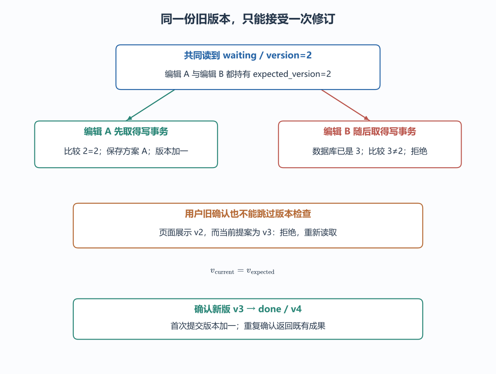

在 SQLite 中，我们不需要在用户看页面的那几分钟里一直锁死数据库，只需要在真正执行修改的 SQL `UPDATE` 语句的 `WHERE` 子句里，把任务号、所属人、当前阶段和预期版本号四个条件同时卡死——这就是数据库工程中标准的**乐观锁（Optimistic Locking）**：

~~~sql
UPDATE runs
SET payload = ?, version = version + 1
WHERE id = ? AND owner = 'alice'
  AND status = 'waiting' AND version = ?;
~~~

（顺带强调一条铁打的安全红线：SQL 语句里的问号 `?` 是**参数化查询占位符**，变量值由数据库驱动在底层安全绑定，**绝对禁止用 Python 的字符串格式化 `f"WHERE id = '{user_input}'"` 去拼接 SQL 语句**，否则用户输入一段包含单引号和分号的字符串就能直接造成 SQL 注入删库！）

执行完上面那条带 `AND version = ?` 的 `UPDATE` 语句后，程序怎么知道刚才那一下到底改没改成功？看数据库游标返回的受影响行数 **`cursor.rowcount`**：
* 如果当时数据库里的版本确实等于传入的 `expected_version`，条件全部命中，SQLite 会更新这一行并将 `version` 加 1，此时 **`rowcount == 1`**，代表更新成功；
* 如果已经被别人抢先一步改成了版本 `3`，那么 `AND version = 2` 条件不成立，SQLite 一行都不会改，也不会报语法错，而是静默返回 **`rowcount == 0`**！我们的程序一检查 `rowcount == 0`，就知道发生了版本冲突，立刻在事务内抛出冲突异常！

在配套实验 `revise_waiting`（对应练习 `RT-03`）中，我们不仅验证了“修订到版本 3 后，拿着旧版本 2 的确认请求被当场拦截（`plan_count == 0`），重新传入版本 3 后才成功确认升至版本 4”，还专门启动了两个并发线程同时拿着 `expected_version=2` 去争抢修改同一个任务，实测结果永远是“恰好一个线程成功升至版本 3、另一个线程因 `rowcount == 0` 被拒绝”：

~~~python
from modern_ai.runtime_details import ready
from modern_ai.persistence_lab import revise_waiting

with TemporaryDirectory(dir=ROOT / ".tmp", prefix="chapter09-version-") as folder:
    store = Store(Path(folder) / "state.sqlite")
    ready(store, "review-17")  # 推进至 waiting，此时 version=2。
    revised = revise_waiting(store, "review-17", "方案 A", expected_version=2)
    assert revised["version"] == 3
    try:
        store.confirm("review-17", expected_version=2)
    except ValueError:
        pass  # 成功拦截基于旧版本 2 的过期确认；plans 表仍为 0。
    else:
        raise AssertionError("旧确认不应成功")
    assert store.audit("review-17")["plan_count"] == 0
    accepted = store.confirm("review-17", expected_version=3)
    assert (accepted["status"], accepted["version"]) == ("done", 4)
~~~

## （三）事务、重试与发件箱

### 1. 四次写入，一次原子提交

当用户点下确认、版本号也核对无误后，`Store.confirm` 需要依次往数据库的**四张表**里写入数据：
1. 往 `plans` 表插入正式的阅读计划（`INSERT INTO plans`）；
2. 把 `runs` 表的状态改成 `done`、版本号加 1（`UPDATE runs`）；
3. 往 `events` 表追加一条 `done` 完成事件（`INSERT INTO events`）；
4. 往 `outbox` 表插入一条待向外投递的通知记录（`INSERT INTO outbox`）。

请想一想：如果这四条 SQL 语句是各自独立提交的，万一程序刚跑完第 1 条（`plans` 已经插进去了）和第 2 条（`runs` 已经改成 `done` 了），正准备跑第 3、4 条时进程突然崩溃退出了，数据库里会留下什么烂摊子？
会留下一份**精神分裂的残缺账本**：`runs` 表说任务已经完成了，但 `events` 审计流水里根本查不到完成事件，更重要的是 `outbox` 发件箱里空空如也——系统永远忘记了还欠外部服务一次通知！反过来，如果先改了 `runs` 为 `done`，在插 `plans` 时磁盘满了报错退出，下次恢复程序一看状态是 `done` 去读 `plans` 表，却连计划的影子都找不到！
把这四行 SQL 写在同一个 Python 函数里是毫无保护作用的，因为操作系统进程完全可以在函数的第 2 行和第 3 行之间暴毙。

要想让这四张表的修改“要么四张表全都成功落盘、要么遇到任何意外四张表全都恢复原状（就像从来没执行过一样）”，必须使用**数据库事务（Database Transaction）**把这四次写入捆绑成一个不可分割的**原子提交单位（Atomicity）**。看看 `Store.transaction` 上下文管理器是怎么用 15 行代码立住这道防线的：

~~~python
from contextlib import contextmanager
import sqlite3

@contextmanager
def writing(path):
    connection = sqlite3.connect(path, timeout=5)
    try:
        connection.execute("BEGIN IMMEDIATE")  # 事务伊始立即申请独占写锁资格。
        try:
            yield connection     # with 块内的多条 SQL 共用这同一个事务连接。
            connection.commit()  # 四条 SQL 全部正常跑完，一次性原子提交！
        except BaseException:
            connection.rollback()  # 只要中途抛出任何异常，立即全盘回滚撤销！
            raise
    finally:
        connection.close()  # 无论成功还是报错，最后必须关闭底层文件连接句柄。
~~~

请逐行细品这段代码里的三个硬核工程细节：
* **第一，为什么要显式执行 `BEGIN IMMEDIATE`？** 根据 [SQLite 官方事务规范](https://www.sqlite.org/lang_transaction.html)，默认事务在刚开启时只是只读的，直到遇到第一条 `INSERT/UPDATE` 时才临时去升级申请写锁；如果两个连接同时先读后写，很容易在升级锁时撞车死锁。而一上来就执行 **`BEGIN IMMEDIATE`**，会在事务开启的第一时间直接向 SQLite 申请写事务资格（同一时刻全库只允许有一个活动写事务，后来的写连接会根据 `timeout=5` 排队等待前一个写事务释放，避免半路升级锁冲突）。
* **第二，为什么捕获异常写的是 `except BaseException:` 而不是普通的 `except Exception:`？** 因为在 Python 的异常继承树里，像用户按 `Ctrl+C` 触发的 `KeyboardInterrupt` 或调用 `sys.exit()` 触发的 `SystemExit`，继承自顶层的 `BaseException` 而不属于 `Exception`！用 `BaseException` 能确保哪怕你在运行中途按下了 `Ctrl+C`，程序在退出前也会先把写了一半的未提交数据干净回滚（`rollback()`）。
* **第三，为什么最外层还要套一个 `finally: connection.close()`？** 很多写 Python 的人习惯写 `with sqlite3.connect(path) as conn:`，以为退出了 `with` 块数据库连接就自动关闭了。但查阅 [Python 标准库 `sqlite3` 官方文档](https://docs.python.org/3.12/library/sqlite3.html#how-to-use-the-connection-context-manager) 就会发现：`sqlite3` 连接对象自带的 `with` 上下文管理器**只负责自动 `commit` 或 `rollback`，根本不会调用 `conn.close()` 关闭底层的操作系统文件句柄**！在 Linux/macOS 上未关闭的句柄可能只是暂时占着内存，而在 **Windows 操作系统**上，只要有一个连接句柄没调 `.close()`，Windows 文件系统就会死死锁住这个 `.sqlite` 文件，导致测试结束清理临时目录时直接报 `PermissionError: [WinError 32] 另一个程序正在使用此文件`！因此，显式把 `connection.close()` 放进 `finally` 块，是保证跨平台零残留的基本功。

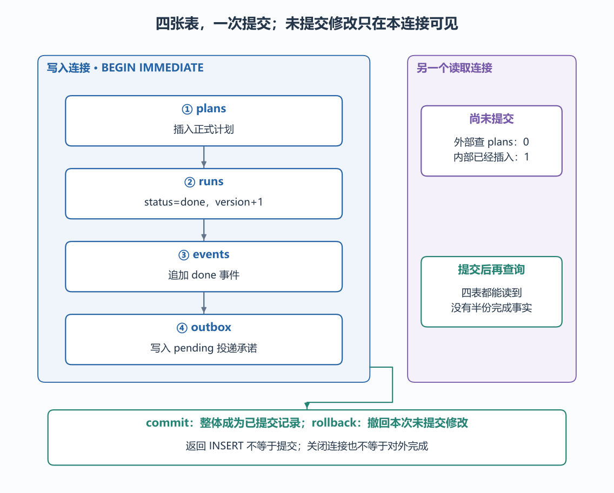

在事务调用 `connection.commit()` 之前，事务内部已经执行的修改对外部其他连接是严格不可见的（隔离性 Isolation）。我们在下面这段代码里专门把镜头定格在“写连接已经执行了 `INSERT INTO plans`、但还没调 `commit()`”的那一瞬间：

~~~python
with TemporaryDirectory(dir=ROOT / ".tmp", prefix="chapter09-visible-") as folder:
    path = Path(folder) / "state.sqlite"
    store = Store(path)
    ready(store, "visibility")
    with store.connection() as writer:
        writer.execute("BEGIN IMMEDIATE")
        writer.execute("INSERT INTO plans VALUES(?,?,?)",
                       ("visibility", "alice", "{}"))
        inside = writer.execute("SELECT count(*) FROM plans").fetchone()[0]
        outside = store.audit("visibility")["plan_count"]  # 另开一个独立连接查询。
        assert (inside, outside) == (1, 0)
        writer.rollback()
    assert store.audit("visibility")["plan_count"] == 0
~~~

你看，在事务内部用 `writer` 自己查，看到的是 `inside == 1`；而在同一时刻由外部另一个连接 `store.audit` 去查，看到的依然是 **`outside == 0`**！紧接着调 `writer.rollback()` 回滚后，刚才插进去的那半截记录被擦得干干净净，内外两边查出来全都是 `0`。

### 2. 提交前后的四个故障窗口

有了四表原子事务，我们把故障注入点精准卡在 `connection.commit()` 这条分水岭的**前一秒（`before_commit`）**和**后一秒（`after_commit`）**，并且分别用两种方式杀死程序：
一种是在 Python 里抛出普通异常（会经过上面的 `except BaseException: connection.rollback()`）；
另一种则是调用 **`os._exit(71)` / `os._exit(72)`**——在操作系统层面直接把当前子进程当场击毙，**完全绕过 Python 的异常处理栈、不执行 `rollback()` 代码、也不执行 `finally` 块**！
等受控子进程暴毙退出后，我们启动一个全新的进程打开同一个数据库文件，看看四种故障下留下的真实账本（对应练习 `RT-04`）：

| 故障注入位置与方式 | 暴毙子进程的退出码 | 新进程读到的 `runs.status` | `plans` 表计划数 | `events` 中 `done` 数 | `outbox` 表行数 |
| --- | ---: | --- | ---: | ---: | ---: |
| 1. `commit()` **之前**抛出 Python 异常 | `2` | **`waiting`** | **`0`** | **`0`** | **`0`** |
| 2. `commit()` **之后**抛出 Python 异常 | `2` | **`done`** | **`1`** | **`1`** | **`1`** |
| 3. `commit()` **之前**调用 `os._exit(71)` 强退 | `71` | **`waiting`** | **`0`** | **`0`** | **`0`** |
| 4. `commit()` **之后**调用 `os._exit(72)` 强退 | `72` | **`done`** | **`1`** | **`1`** | **`1`** |

（表中的退出码 `2`、`71`、`72` 是实验脚本为了向父进程清楚标识“刚才死在了哪条分支”而人为指定的整数标记。）
请看第 3 行（提交前 `os._exit(71)` 强退）：虽然子进程被直接击毙、根本没机会运行 Python 代码里的 `connection.rollback()`，但当新进程打开 SQLite 数据库时，SQLite 引擎凭借自身的回滚日志（Rollback Journal / WAL）检测到上一个写事务没有完成提交，自动把已写入的半截数据清理恢复到了事务前的 **`waiting`（三个 `0`）**！
再看第 2 行和第 4 行（提交后抛异常或 `os._exit(72)` 强退）：虽然子进程最终都是以非零错误码异常退出的，给外层调用方造成了“这次确认失败了”的假象，但因为故障发生在 `commit()` 落盘**之后**，新进程去查库时，四张表里的成果（`done` 和三个 `1`）早就已经稳如泰山地立在那里了！这铁证如山地告诉我们：**绝对不能单凭子进程退出码非零或 HTTP 请求报错，就盲目断定数据库写入没有发生！**（当然，严谨起见也要说明边界：`os._exit` 模拟的是应用进程崩溃，此时操作系统内核与磁盘供电仍在正常工作；若要测试拔掉服务器电源线的物理断电场景，则还涉及文件系统缓存与硬盘 `fsync` 落盘机制，需按 [SQLite 原子提交硬件规范](https://www.sqlite.org/atomiccommit.html) 另行评测。）

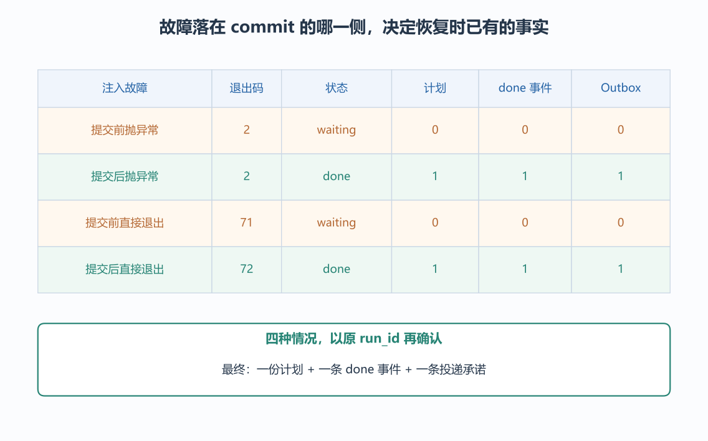

### 3. 重试时先认出已完成的任务

既然在“提交后、返回响应前”发生故障时，数据库里其实已经存好了计划，而前端用户因为没收到响应必然会再点一次确认发起**重试（Retry）**，那么我们的 `Store.confirm` 在面对第二次、第三次重复确认请求时，该怎么处理？

这就要求确认操作必须具备**业务幂等性（Idempotency）**。把数据库的整体状态记为 $s$，把“针对固定业务编号 $r$（如 `run-17`）执行确认提交”这一操作记为函数 $F_r$，幂等性的数学定义就是：对同一个状态连续执行两次 $F_r$，所产生的数据库业务状态与只执行一次完全相同：

$$
F_r\bigl(F_r(s)\bigr)=F_r(s)
$$
请注意下标 $r$ 是固定不变的！只有当重试请求继续携带**同一个业务编号 $r=\text{“run-17”}$** 时，它才是在调用同一个算子 $F_r$（同时，服务器日志里可以照常记录“收到了第 2 次 HTTP 请求”，幂等要求保持不变的是 `plans`、`runs`、`events`、`outbox` 里的核心业务成果，而不是抹掉网络访问日志）。

为了实现这个 $F_r(F_r(s))=F_r(s)$，在编写 `Store.confirm(run_id, expected_version=2)` 的代码逻辑时，有一个极其关键的**判断先后顺序陷阱**：
回想一下：当第 1 次确认（携带 `expected_version=2`）在数据库里提交成功的那一瞬间，`runs` 表里的状态已经从 `waiting` 变成了 **`done`**，而且版本号已经从 `2` 自增变成了 **`version = 3`**！
这时候，因为第一次响应在网络上丢了，用户发起了第 2 次重试请求——请注意，用户手里的重试请求携带的参数依然是刚才那个 **`expected_version = 2`**！
如果在 `Store.confirm` 的开头，你先去检查版本号 `if current_version != expected_version: raise ValueError("版本冲突")`，会发生什么？程序一看数据库里是 `3`、重试请求传的是 `2`（$3\neq 2$），就会把一次完全合法的成功重试当成“版本冲突错误”一脚踢飞，让用户永远卡死在报错页面上！

正确的代码顺序是：进入写事务读出当前记录后，**第一步先检查 `if run["status"] == "done":`**！只要发现这项任务已经处于终态 `done`（且归属用户一致），说明之前的某次请求早就已经帮它办妥了，此时根本不需要再比对 `expected_version`，直接把数据库里已经存好的那份正式成果原样读出来返回给用户即可，既不新插 `plans`，也不再把版本号往 `4` 加，更不追加第二条 `done` 事件！只有当状态还停留在 `waiting` 时，才进入第二步核对 `version == expected_version` 并执行四表写入（当然，如果有人拿着同一个 `run_id` 调 `Store.create` 企图绑定另一个不同的用户或另一个不同的问题，那属于身份盗用冲突而非幂等重试，程序会当场报错拦截）：

~~~python
with TemporaryDirectory(dir=ROOT / ".tmp", prefix="chapter09-repeat-") as folder:
    store = Store(Path(folder) / "state.sqlite")
    ready(store, "repeat-17")
    store.confirm("repeat-17", expected_version=2)
    once = snapshot(store, "repeat-17")
    store.confirm("repeat-17", expected_version=2)  # 模拟响应丢失后携带原参数重试确认。
    twice = snapshot(store, "repeat-17")
    assert once == twice
    assert twice["plans"] == 1 and twice["events"].count("done") == 1
~~~

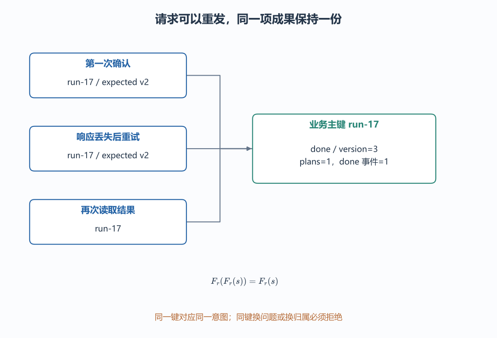

### 4. Outbox：把外部动作接到事务之后

四表事务完美管住了同一个 SQLite 数据库文件内部的修改。但是，如果确认计划后还需要调用外部通知服务（比如发一封邮件、调一次飞书 Webhook 或通知下游子系统），这个**跨网络发请求**的动作，可是不归本地 SQLite 的 `rollback()` 管的！

哪怕你把 `send_http_notification()` 硬塞进 `with store.transaction():` 的代码块里，也依然面临一个无解的先后死局：
* 如果你**先提交本地数据库事务，再发外部网络通知**：万一本地 `commit()` 刚成功，还没来得及发网络请求进程就崩了，本地计划虽然存下了，但外部通知永远漏发了；
* 如果你**先发外部网络通知，再提交本地数据库事务**：万一外部接收方已经收到了通知，结果本地在 `commit()` 时因为锁冲突或异常回滚了，外部系统收到了一份本地根本不存在的幽灵计划，而且 SQLite 回滚是不可能替你把已经飞出去的网络数据包抓回来的！

设想你的智能体插件在确认阅读计划后，还需要通过 SMTP 协议给用户的邮箱发一封确认信，或者调消息接口往群里推一条通知。这个“跨网络发信”的动作，是绝对不归本地 SQLite 的 `rollback()` 管的——覆水难收，哪怕本地数据库事务下一秒回滚了，已经飞进对方邮件服务器的数据包也绝不可能时光倒流退回来！

为了既不漏发通知（不当“吞消息的黑洞”），又不在崩溃重发时变成连发十封信的“狂暴复读机”，**发件箱模式（Transactional Outbox）**把“本地记下投递承诺”与“后台实际跨网发送”拆成了两步：

怎么破解这个跨系统的双写一致性难题？工业界最成熟的标准架构就是**事务性发件箱模式（Transactional Outbox Pattern**，参见 [Azure 架构中心 Outbox 指南](https://learn.microsoft.com/en-us/azure/architecture/databases/guide/transactional-out-box-cosmos)）：
**在确认计划的那个本地数据库事务里，绝不直接发起外部网络调用，而是把“需要向外发送的通知内容”与唯一投递键 `key="plan:delivery-17"` 作为一行 `status='pending'`（待投递）的记录，写进同一个 SQLite 数据库的 `outbox`（发件箱）表里，与 `plans`、`runs`、`events` 四表一起原子提交！**

这样一来，“计划正式生效”与“欠外部一次通知”在本地数据库里就成了同生共死的铁板一块。本地事务提交完成后，再由独立的后台投递进程（Relay / Worker）去扫描 `outbox` 表里所有 `status='pending'` 的记录，把保存好的固定 `payload` 发给外部接收方（注意：投递进程必须直接读取 `outbox.payload` 原文发送，绝不能在重发时临时又去调一次大模型重新生成一段话，否则重发的内容就变味了），等拿到外部接收方的成功回执后，再把本地 `outbox.status` 改写为 `'delivered'`。

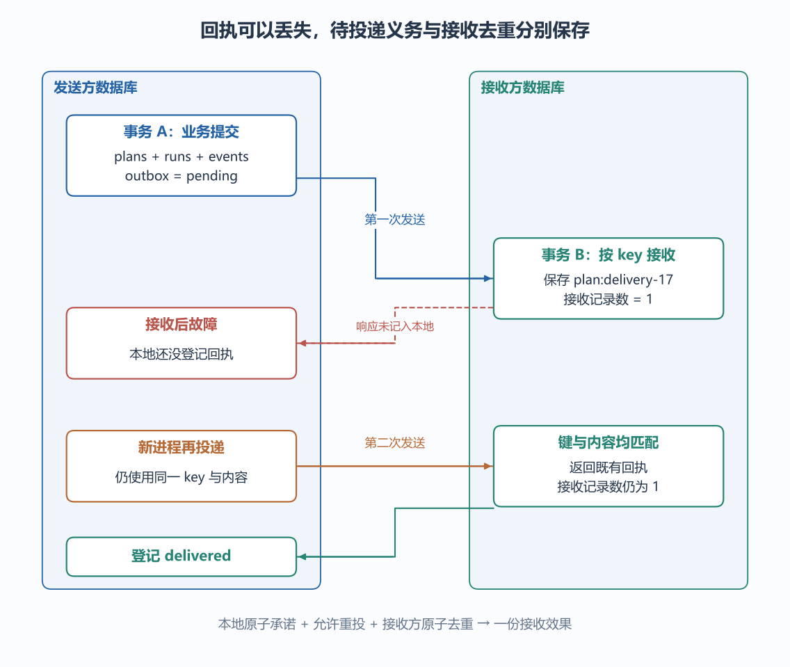

### 5. 两次发送，一次接收效果

请顺着上面这张 Outbox 流转图，思考整条链路里最惊险的一个故障窗口：
假设后台投递进程第 1 次把 `key="plan:delivery-17"` 的通知发给了远端接收方，接收方也确实收下并存进了自己的数据库，并返回了成功回执；偏偏就在发送方收到回执、正准备把本地 `outbox` 表从 `'pending'` 改成 `'delivered'` 的前一微秒，发送方进程崩溃退出了！

等发送方重启之后，它去查自己的 `outbox` 表，看到 `plan:delivery-17` 的状态依然是 `'pending'`！它不知道自己死前到底发成功了没有，为了保证不漏发（At-least-once delivery，至少投递一次），发送方唯一能做的选择就是**把同一条消息再发第 2 次**！
这时候，球就传到了接收方脚下：发送方因为本地回执没落盘而被迫发了**两次**，怎样保证接收方那边只产生**一次**实际的业务效果？

答案是：**接收方必须建立自己的原子去重账本（在本章代码中实现为另一个独立 SQLite 数据库文件里的 `ReceiptLedger`）**！
当接收方收到携带幂等键 `key="plan:delivery-17"` 和内容 `body` 的投递请求时，它在接收方自己的数据库写事务里执行三步检查：
1. 如果 `key` 还不存在：正式保存内容、生成回执编号并写入账本；
2. 如果 `key` **已经存在，且保存的内容与本次发来的 `body` 完全一致**：认出这是一次因回执丢失引发的合法重投，不再重复执行业务动作，直接把上次保存的既有回执原样返回给发送方；
3. 如果 `key` **已经存在，但发来的内容与上次保存的不同（同键异内容）**：说明发送方破坏了幂等契约把同一个键张冠李戴了，当场抛出异常拒绝！

我们在 `outbox` 实验（对应练习 `RT-05`）中用两个独立的 SQLite 数据库（发送库与接收库）完整复现了这次故障接力：

| 故障实验观察时刻 | 发送方 `outbox.status` | 接收方 `ReceiptLedger` 中的记录条数 |
| --- | --- | ---: |
| 1. 本地确认计划刚提交完成时 | `pending`（待投递） | `0` |
| 2. 第 1 次投递：接收方已落盘，发送方写回执前崩溃 | `pending`（仍为待投递） | **`1`** |
| 3. 第 2 次重投：新进程重发，接收方去重返回原回执 | `delivered`（已送达） | **`1`**（未产生第 2 条记录！） |

~~~python
from modern_ai.runtime_details import ReceiptLedger

with TemporaryDirectory(dir=ROOT / ".tmp", prefix="chapter09-receipt-") as folder:
    receiver = ReceiptLedger(Path(folder) / "receiver.sqlite")
    body = {"title": "阅读计划"}
    first = receiver.accept("plan:delivery-17", body)
    second = receiver.accept("plan:delivery-17", body)
    assert first == second and receiver.count() == 1
    try:
        receiver.accept("plan:delivery-17", {"title": "另一份计划"})
    except ValueError:
        pass  # 同键异内容属于严重契约冲突，必须拒绝。
    else:
        raise AssertionError("同键异内容必须被拒绝")
~~~

看清这张表背后的分布式系统铁律：**“发送方 Outbox 保证至少发出去一次（不漏发）”**，加上**“接收方按幂等键原子去重保证最多生效一次（不重做）”**，只有发送端和接收端这两块拼图同时严丝合缝地咬合在一起，才能在网络与进程故障下实现真正的“精确一次业务效果（Effectively-once）”。

## （四）队列、租约与旧 Worker

### 1. 任务入队与原子认领

前面三节解决的是“用户在界面上点一下，后台怎么推进和恢复”。但在真实的生产环境里，还有大量长程任务是由定时器（比如每周一凌晨自动整理周报）或外部事件流触发的，并没有一个真人坐在屏幕前盯着点重试。这就需要引入一张持久化任务队列表 **`jobs`**，把所有待办工作存下来，由后台的工作进程（称为 **Worker**）去队列里认领（Claim）并执行。

在配套模块 [`harness.py`](https://github.com/KiriAky107/understanding-AI-and-Agents-in-depth/blob/main/%E7%8E%B0%E4%BB%A3AI%E7%A4%BA%E4%BE%8B/modern_ai/harness.py)（代码包内：`现代AI示例/modern_ai/harness.py`） 的 `Queue` 实现中，`jobs` 表包含如下六个核心字段：

| 队列表字段名 | 示例值 | 字段承担的调度含义 |
| --- | --- | --- |
| **`id`** | `"job-17"` | 这条调度工作项自身的唯一编号（与业务任务号 `run-17` 显式配对绑定） |
| **`origin`** | `"timer:weekly:17"` | 触发来源标识（区分是人工发起、外部事件还是某次特定周期的定时器触发） |
| **`due`** | `100` | 任务允许被 Worker 认领的最早到期时刻（逻辑秒） |
| **`lease_until`** | `130` | 当前认领该任务的 Worker 所持有的**租约截止时刻**（到此秒数即过期失效） |
| **`token`** | `1` | 当前任务被认领的**单调递增代次令牌（Fencing Token）**，每次被重新认领就 `+1` |
| **`status`** | `"running"` | 队列层面的调度状态（`queued` 待认领、`running` 执行中、`done` 已完成） |

请先把队列的调度状态 `jobs.status` 与前面业务表的阶段 `runs.status` 分清楚：`runs` 里的 `waiting` 说的是“阅读计划提案正等着人类用户拍板”，而 `jobs` 里的 `running` 说的则是“当前有一个后台 Worker 进程领走了这项调度活、正握着临时执行资格”。
由于操作系统的定时触发器（Cron / Timer）有可能因为抖动在同一秒内重复发送两次触发信号，`Queue.enqueue` 在入队时对相同的 `(id, origin, due)` 执行幂等去重，只保留一行记录；但如果有人拿着相同的 `job_id` 却传了不同的触发来源 `origin` 或不同的到期时刻 `due`，程序会当场判定为编号冲突报错拒绝（因此每周一次的定时任务必须把当周日期编进身份里，如 `weekly-2026-11-02`，绝不能常年累月共用同一个死编号把后续周的任务全吞掉）。

为了在测试中无需真的让读者对着屏幕干等 30 秒，我们在实验中使用一条显式传入的**整数逻辑时间轴**（单位为秒，如 `now=100` 代表相对实验起点的第 100 秒；在真实线上服务中，这个 `now` 时刻必须由数据库或队列服务端统一读取权威时钟，绝不能相信各个 Worker 节点自己机器上可能快慢不一的本地时钟）。

### 2. 租约：一张有期限的执行凭证

当一个 Worker 进程在时刻 $t_{\mathrm{claim}}=100$ 从队列里认领了任务 `job-17` 时，怎么防止别的 Worker 也一窝蜂冲上来重复干同一件活？
最天真的想法是：只要 Worker A 在时刻 `100` 领了任务，就把这行记录永久锁死，直到 Worker A 干完活主动调 `finish` 解锁为止。
但请问：**万一 Worker A 领走任务刚过两秒钟，它所在的机器突然断网、内存溢出崩溃了，再也回不来调 `finish` 了呢？** 那这项任务就会永远卡死在数据库里，变成谁也碰不得的死尸任务！

因此，分布式调度系统绝不使用无限期的死锁，而是发放一张**带有效期限的租约（Lease）**：设认领时刻为 $t_{\mathrm{claim}}$，单次授予的租期长度为 $\ell$ 秒（本实验取 $\ell=30$ 秒），那么这张租约的失效截止时刻 $t_{\mathrm{until}}$ 就是：

$$t_{\mathrm{until}}=t_{\mathrm{claim}}+\ell.$$

代入 $t_{\mathrm{claim}}=100,\ \ell=30$，算出截止时刻 $t_{\mathrm{until}} = 130$。
这意味着：在左闭右开的时间区间 $100 \le t < 130$ 内，Worker A 拥有合法的执行资格，别的 Worker 不准插手；而一旦时钟走到 $t \ge 130$（哪怕恰好到了第 `130` 秒整），Worker A 的租约就正式过期作废！此时只要任务还没 `done`，队列就允许新的 Worker B 在时刻 `131` 重新认领这项任务，把代次令牌 `token` 从 `1` 递增为 **`2`**，并批出一段新的租期 `131 + 30 = 161`！

在配套实验 `leases` 中，我们先测试了两个独立 Worker 在同一时刻 `100` 同时争抢同一个任务的并发安全性：因为 `Queue.claim` 把“查询满足 `status != 'done' AND due <= now AND lease_until <= now` 的任务”与“将 `token` 加 1、更新 `lease_until`”全部锁在同一个 `BEGIN IMMEDIATE` 数据库写事务里一气呵成，所以无论多少个 Worker 同时扑上来，永远只有唯一一个 Worker 能拿到认领凭据，其余竞争者全部安全返回 `None`。

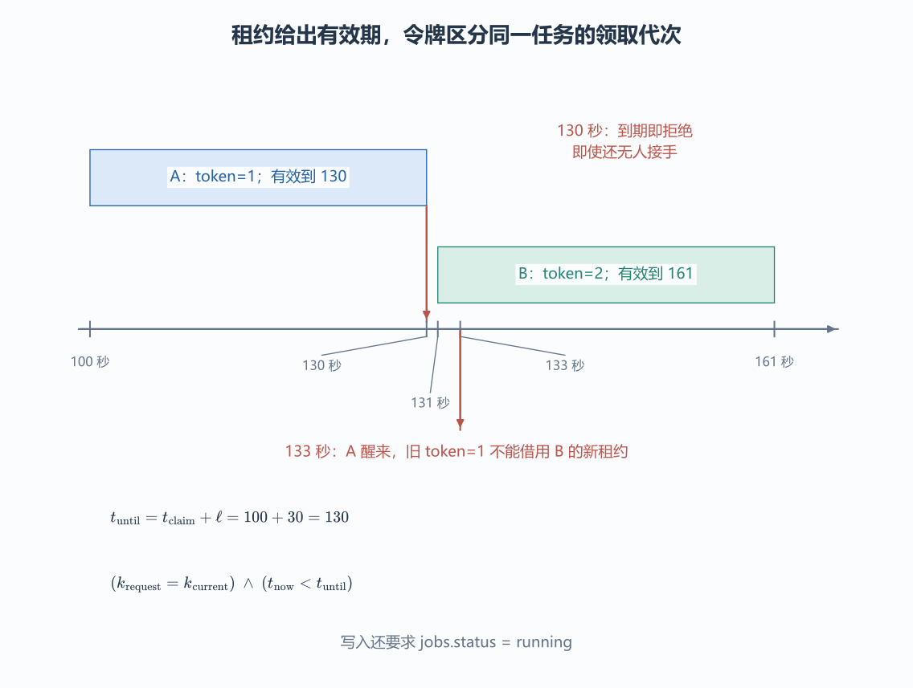

### 3. 租约时间与防护令牌

现在，整章最惊心动魄的分布式故障场景登场了（请对照上面那张时间轴图）：
1. 在第 `100` 秒，**Worker A** 领走了任务，拿到了第 1 代令牌 **`token = 1`**，租约截止时刻为 **`130`**；
2. Worker A 在执行途中并没有彻底死透，而是遭遇了一次长达 33 秒的进程暂停（比如操作系统发生了剧烈的内存交换抖动、容器 CPU 被限流挂起、或者网络卡死）；
3. 时钟走过了 `130` 秒，Worker A 的租约过期了！在第 `131` 秒，健康的 **Worker B** 合法接手认领了同一项任务，数据库把令牌递增为第 2 代 **`token = 2`**，并把数据库里的租约截止时刻刷新成了 **`lease_until = 161`**；
4. 到了第 **`133` 秒**，原本暂停假死的 **Worker A 突然缓过神醒来了**！它的内存里还攥着自己当初领到的 `token = 1` 和半截旧数据，它浑然不知外面的世界已经换了人间，兴冲冲地向数据库发起了写入请求！

请仔细思考：当数据库在时刻 $t_{\mathrm{now}}=133$ 收到 Worker A 的写入请求时，要检查哪几个条件才能把这个“死而复生的僵尸旧 Worker A”精准拦在门外？
设请求方携带的令牌为 $k_{\mathrm{request}}$，数据库当前记录的最新令牌为 $k_{\mathrm{current}}$，当前租约截止时刻为 $t_{\mathrm{until}}$，判定时刻为 $t_{\mathrm{now}}$。允许执行写入，必须**同时满足（逻辑与 `and`）**以下三个条件：
$$
\begin{aligned}
\mathrm{status}&=\mathrm{running},\\
k_{\mathrm{request}}&=k_{\mathrm{current}},\\
t_{\mathrm{now}}&<t_{\mathrm{until}}.
\end{aligned}
$$

为什么后面两个条件（“令牌相等 $k_{\mathrm{request}}=k_{\mathrm{current}}$”与“时间未超期 $t_{\mathrm{now}}<t_{\mathrm{until}}$”）缺一不可？我们用反证法分别拆掉其中一个看看会出什么大乱子：

* **假如只检查令牌相等（$k_{\mathrm{request}} = k_{\mathrm{current}}$），不检查时间 $t_{\mathrm{now}} < t_{\mathrm{until}}$**：
  假设时间已经走到了第 `130` 秒，Worker A 的租约明明已经到期作废了，但恰好此刻还没有新的 Worker B 过来接手，所以数据库里的 `current_token` 依然停留在 `1`。如果只比对令牌 `1 == 1`，已经过期的 Worker A 在第 `130` 秒甚至第 `200` 秒依然能畅通无阻地往里写数据，30 秒的租期限制就形同虚设了！
* 再看“只检查数据库租约截止时间（$t_{\mathrm{now}} < t_{\mathrm{until}}$），却不检查代次令牌（$k_{\mathrm{request}} = k_{\mathrm{current}}$）”会发生什么灾难：
  在第 `131` 秒，新 Worker B 合法接手了任务，数据库里这行任务的截止时刻已经被 B 刷新成了 `161`，代次令牌也升到了本朝的第 `2` 代（`current_token = 2`）。
  到了第 `133` 秒，刚才假死暂停的旧 Worker A 突然幽幽醒转！它全然不知自己早已被免职，手里还攥着前朝的第 `1` 代旧令牌（`request_token = 1`）冲进衙门要改数据库。如果守门的数据库只看一眼墙上的钟：“现在是 `133` 秒，小于截止时间 `161` 秒，还在有效期内，放行！”，那就闹出了**“拿着前朝的剑，来斩本朝的官”**的大笑话——旧 Worker A 借着新 Worker B 刚续上的命，一刀把 B 正在干的新结果给砍没了！
  唯有把时间检查与令牌检查用 `and` 死死绑在一起，当场验明正身发现 `1 != 2`（你是前朝第 1 代，现在当家的是第 2 代），才能把苏醒的僵尸旧 Worker 稳稳挡在门外！

~~~python
def may_write(status, request_token, current_token, now, until):
    # 三个条件分别约束队列阶段、领取代次与当前剩余有效期，缺一不可。
    return status == "running" and request_token == current_token and now < until

assert may_write("running", 1, 1, 129, 130)      # 第 129 秒，第 1 代有效期内，允许写入。
assert not may_write("running", 1, 1, 130, 130)  # 恰好到第 130 秒，即使无新代次接手也已过期拒绝！
assert not may_write("running", 1, 2, 133, 161)  # 第 133 秒，虽在 161 内，但旧令牌 1 != 2 被当场拦截！
assert may_write("running", 2, 2, 133, 161)      # 第 133 秒，持有新令牌 2 的 Worker B 合法写入。
~~~

这个单调递增的代次编号 `token`，在分布式系统理论中就叫做**防护令牌（Fencing Token）**。正如分布式系统名家 [Martin Kleppmann 对分布式锁的经典剖析](https://martin.kleppmann.com/2016/02/08/how-to-do-distributed-locking.html) 所指出的：绝对不能只靠 Worker 进程自己在内存里觉得“我还没超时、我还持有锁”，**校验令牌与有效期的铁门必须焊死在最终接收写入的存储资源那一侧**！

### 4. 把检查放到实际写入处

看懂了上面的 `may_write` 三个条件，接下来还有一个关乎防线安放位置的工程问题：
我们的队列类里有一个登记任务彻底完工的 `Queue.finish(job_id, token, now)` 方法，它内部当然做了上面那三项检查。但是，如果僵尸 Worker A 醒来之后，它的代码顺序是：**先调业务函数改写了业务表（比如覆盖了共享资源表或提交了计划），最后才去调 `Queue.finish` 报完工**——请问，这时候就算 `Queue.finish` 把它拦下来报了错，还有用吗？
晚了！业务表里的真实数据早就已经被僵尸 Worker A 的脏数据给覆盖破坏了！

这就是“只在最后报完工时检查一次”与**“在每一次实际产生业务副作用的写入事务内部设防”**之间的本质区别。
为了确保从“检查租约令牌”到“真正修改业务表”之间连一微秒的缝隙都不留（防止刚检查完还没写表，新 Worker B 就插进来领走了任务），配套代码中的 `ClaimedStore` 和 `guarded_update` 把 `check_claim` 令牌有效期检查**直接放进了业务修改的同一个 `BEGIN IMMEDIATE` 数据库写事务内部**：

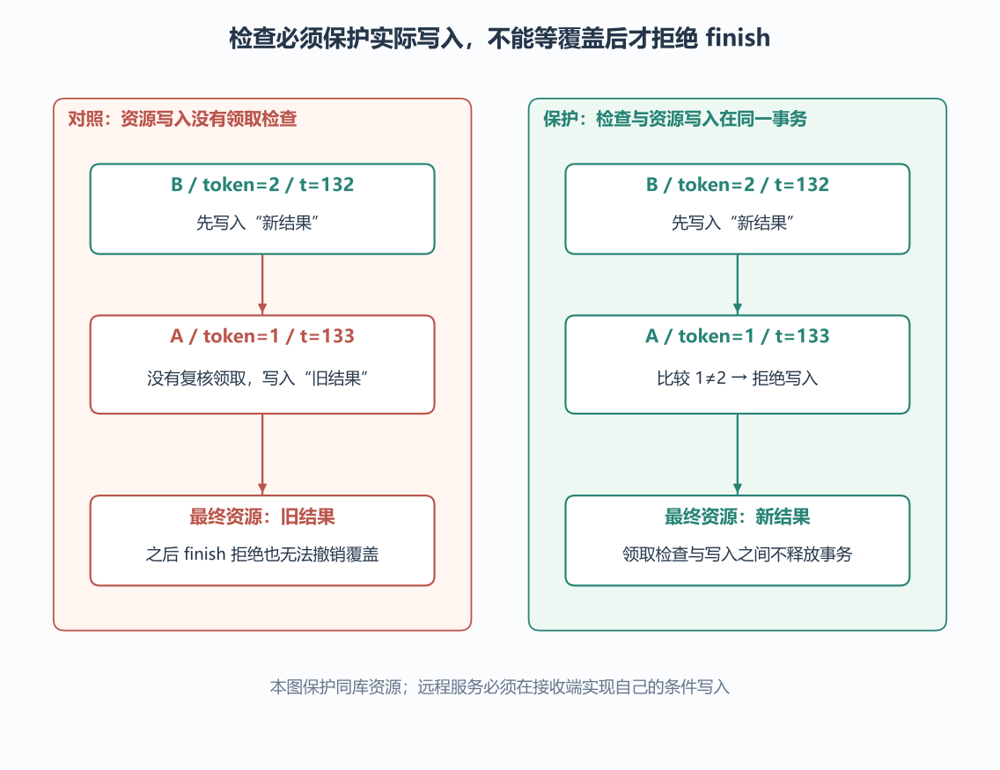

~~~python
from modern_ai.persistence_lab import check_claim

def guarded_update(store, job_id, token, now, body):
    # resource_effects 表由 leases 实验创建，job_id 是它的主键。
    with store.transaction() as connection:
        check_claim(connection, job_id, token, now)  # 在同一写事务内先验明正身（令牌与时间）！
        connection.execute(
            "INSERT INTO resource_effects(job_id,token,body) VALUES(?,?,?) "
            "ON CONFLICT(job_id) DO UPDATE SET token=excluded.token,body=excluded.body",
            (job_id, token, body)
        )
~~~

（顺带解释一下上面 SQL 语句里的 `ON CONFLICT(job_id) DO UPDATE SET token=excluded.token...`：这是 SQLite 标准的主键冲突更新语法 Upsert；当表中还没有这个 `job_id` 时正常插入新行，当主键 `job_id` 已存在时，关键字 `excluded` 就代表本次原本准备插入的那行新数据，用它的 `token` 和 `body` 原地更新旧行。）

因为 `check_claim` 和下面的 `INSERT ... DO UPDATE` 处在同一个独占写事务里，只要 `check_claim` 发现 Worker A 拿的是过期令牌 `token=1`，当场抛出异常触发事务回滚，后面的 SQL 连执行的门都摸不到！我们在 `leases` 实验中设置了两张对照表：
* 在受同事务令牌保护的表上：Worker B 在第 `132` 秒带 `token=2` 写入了 `"新结果"`，随后苏醒的旧 Worker A 在第 `133` 秒带 `token=1` 企图写入 `"旧结果"` 被当场拦截，表里稳稳保留着 B 的 **`"新结果"`**；
* 而在去掉了写入处令牌检查的对照表上：A 在第 `133` 秒毫无阻碍地把 B 刚写好的 `"新结果"` 覆盖倒退成了错误的 **`"旧结果"`**！两相对照，哪里设防才算真正护住业务一目了然。

### 5. 续租与业务幂等

如果一个健康的 Worker 在第 `200` 秒领了 30 秒租期（最初截止时刻为 `230`），干到第 `220` 秒时发现任务比较重、还差十来秒才能干完，它可以主动调用 **`Queue.renew`（续租 / 心跳）**来延长自己的有效期。
注意续租截止时刻的算法：在第 `220` 秒成功续租 30 秒后，新的截止时刻是从当前续租时刻往后推 30 秒，即 **`220 + 30 = 250` 秒**（而不是在原来的 `230` 上累加变成 `260` 秒）。而且续租同样必须满足“当前令牌匹配且尚未过期（`now < lease_until`）”——要是已经拖到了第 `231` 秒租约都已经作废了才来申请续租，队列会直接拒绝，要求它重新走 `claim` 流程按新代次排队。

最后把第三节的**业务幂等（`run_id`）**与本节的**租约令牌（`token`）**放在一起，看清它俩是怎么联手保驾护航的：
* **租约与防护令牌管的是“谁现在有资格动手写”**——防止已经过期的旧 Worker A 醒来后乱写覆盖新状态；
* **业务幂等管的是“新接手的人会不会把前人已经干完的事重干一遍”**——假如旧 Worker A 在第 `125` 秒（租约期内）其实已经成功提交了 `run-17` 的正式计划，只是在调 `Queue.finish` 前崩了；等第 `131` 秒新 Worker B 合法接手去确认 `run-17` 时，正是靠着业务表对 `run-17` 的幂等检查，B 才能直接认出“原来前任 A 已经把计划提交过了”，从而直接拿回既有成果去完成队列收尾，绝不会再往数据库里插第二份计划。

## （五）框架映射：检查点与业务恢复

### 1. 业务进度与图进度

在第八篇第四节里，我们用 LangGraph 的 `StateGraph` 搭了一个进程内的检索条件分支图，但当时并没有给它挂任何持久化存储——进程一退，图走到哪一步就全忘了。现在我们要把本章的“准备提案 $\to$ 暂停等待人工确认 $\to$ 确认后提交正式计划”搬进 LangGraph，让它也能跨越进程崩溃和重启。

一旦给 LangGraph 挂上 SQLite 检查点保存器（`SqliteSaver`），系统里就同时存在**两份各自记录进度的持久化账本**：
1. 第一份是我们前三节手写的**业务记录账本**（以 `run_id="run-17"` 为主键，保存在 `runs`、`plans` 等业务表里），它关心的是：“`run-17` 这份计划现在是 `waiting` 还是 `done`？提案版本号是几？正式计划落盘了没有？”；
2. 第二份则是 LangGraph 框架自己维护的**图检查点账本**（以 `thread_id="thread-17"` 为索引，由 [`SqliteSaver`](https://docs.langchain.com/oss/python/langgraph/persistence) 保存在框架专用的 `checkpoints` 表里），它关心的是：“在 `thread-17` 这条图控制流里，状态字典当前的键值是什么？哪个节点刚跑完？下一步该唤醒 `review` 节点还是 `commit` 节点？”。

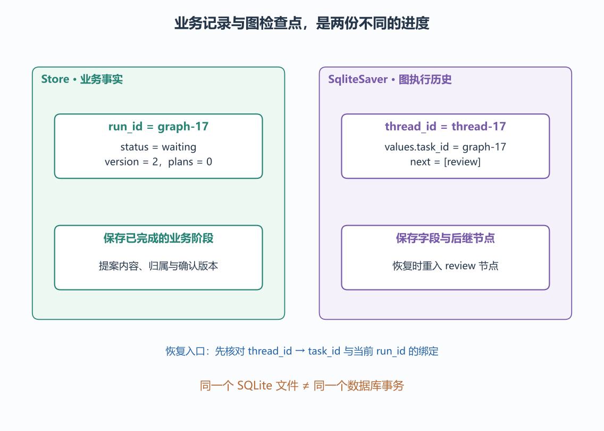

既然有两套编号（图线程号 `thread_id` 与业务任务号 `run_id`），在跨进程恢复时就绝不能让它们各吹各的号！
设想有人调用恢复接口时，配置里传的是线程 A 的 `thread_id="thread-17"`，但请求参数里却传了另一项业务 B 的 `run_id="other-run"`。如果入口不加核对，就会把线程 A 的图状态张冠李戴地套到业务 B 头上！因此，我们在图状态字典里专门存下了业务编号字段 `task_id`；外层恢复包装函数 `bound_graph_action` 在恢复任何图线程之前，都会先从检查点里读出已保存的状态，强制核对：第一，该 `thread_id` 确实存在已保存的检查点历史；第二，检查点内绑定的 `task_id` 与本次请求声明操作的 `run_id` 严格相等；第三，当前用户确实拥有该业务记录的操作权限。只有三项核对全部过关，才允许唤醒图继续往下走。

### 2. 用 SqliteSaver 保存图进度

我们来看这张接入了持久化检查点与人工审批分支的 `StateGraph` 主干结构：

~~~text
START → prepare → review → commit → END
                         ↘ cancel → END
~~~

四个节点各自调用的依然是我们前面写好的原生 `Store` 方法：
* **`prepare` 节点**：调用 `store.create` 并推进 `store.advance` 直到进入 `waiting` 状态，将此时的业务快照字典存入图状态的 `result` 字段（里面包含当前的 `version = 2`）；
* **`review` 节点**：暂停图的执行，把提案内容抛给外部界面等待人工确认，拿到布尔确认结果 `approved`；
* **条件边路由**：若 `approved is True` 则走向 **`commit` 节点**（调用 `store.confirm(task_id, expected_version=...)`）；若 `approved is False` 则走向 **`cancel` 节点**（调用 `store.cancel(task_id)`）。注意看：`commit` 节点在调确认时，直接从图状态 `state["result"]["version"]` 里取出当初进入等待时的版本号作为 `expected_version` 传进去——如果在等待期间底下的数据库提案被别人改成了版本 `3`，`commit` 节点里的原生乐观锁照样会精准触发拒绝！

在编译这张图时，我们通过 `with SqliteSaver.from_conn_string(str(path)) as saver:` 实例化 SQLite 检查点保存器，并传给 `builder.compile(checkpointer=saver)`（当前环境固定使用 `langgraph 1.2.18` 与 `langgraph-checkpoint-sqlite 3.1.2`）：

~~~python
from langgraph.checkpoint.sqlite import SqliteSaver
from modern_ai.frameworks import build_graph

with TemporaryDirectory(dir=ROOT / ".tmp", prefix="chapter09-graph-") as folder:
    path = Path(folder) / "state.sqlite"
    store = Store(path)
    config = {"configurable": {"thread_id": "thread-17"}}
    with SqliteSaver.from_conn_string(str(path)) as saver:
        graph = build_graph(saver, store)
        graph.invoke({"task_id": "graph-17", "question": "检查点恢复"}, config)
        saved = graph.get_state(config)
        assert saved.next == ("review",)  # 检查点已记录：下一步停在 review 节点。
        assert saved.values["result"]["status"] == "waiting"
    # 退出 with 块后保存器连接已关闭；独立查询业务表，记录同样处于 waiting。
    assert store.get("graph-17")["status"] == "waiting"
~~~

看第一次 `graph.invoke` 返回后的状态查询 `saved = graph.get_state(config)`：`saved.values` 里保存着当前的图状态字典，而 `saved.next` 返回的是单元素元组 `("review",)`，表明图在进入 `review` 节点时遇到了人工中断暂停了下来，并且已经把这个暂停位置落盘写进了 SQLite 文件里。

### 3. interrupt：从节点开头重新执行

在 LangGraph 中，实现“暂停等待人工输入”的标准写法是在节点函数内部调用 [`interrupt(...)`](https://docs.langchain.com/oss/python/langgraph/interrupts)：

~~~python
from langgraph.types import interrupt

def review(state):
    approved = interrupt({
        "task_id": state["task_id"],
        "proposal": state["result"]["payload"]["proposal"]
    })
    if type(approved) is not bool:
        raise ValueError("确认值必须为布尔值")
    return {"approved": approved}
~~~

当第 1 个进程第一次跑进 `review` 函数、执行到 `interrupt(...)` 这一行时，LangGraph 会在内部抛出一个特殊的控制信号暂停图的运行，并把传给 `interrupt` 的字典记录下来展示给用户；等到第 2 个进程收到用户的确认点击、带着相同的 `thread_id` 调用 `graph.invoke(Command(resume=True), config)` 恢复运行时，`True` 就会成为 `interrupt(...)` 函数的返回值赋给 `approved`，继续往下走完 `review` 节点！

请在此处停下来，回答一个写 LangGraph 代码时最容易踩爆雷的问题：
**当第 2 个进程调用 `Command(resume=True)` 恢复运行 `review` 节点时，Python 解释器到底是直接空降到 `interrupt(...)` 那一行往下走，还是从 `def review(state):` 的第一行代码重新开始往下跑？**

很多人凭着对普通协程 `yield` 的印象，想当然地以为“当然是从 `interrupt` 下一行接着走啦”。
**大错特错！** 正如我们在本章第一节开头就强调过的：旧进程早就已经退出了，它的 Python 调用栈早就灰飞烟灭了！新进程根本不可能跳进一个普通 Python 函数的半腰处开始执行！在 LangGraph 的实际恢复机制中，**当从 `interrupt` 恢复时，发生中断的那个节点函数（`review`）会从它的第一行代码开始完完整整地重新执行一遍（Node Re-entry，节点重入）**，直到再次运行到 `interrupt(...)` 那一行时，框架才不再暂停，而是直接把 `resume=True` 的值返回给它继续往下走！

为了让你亲眼看到这个重入范围，我们在 `interrupt_probe` 实验（对应练习 `RT-07`）中，在三个位置向一张独立的数据库访问记录表写入了探针标签：

~~~text
1. prepare 节点内部：               写入标签 "prepare"
2. review 节点内、interrupt() 之前：写入标签 "review:before"
3. review 节点内、interrupt() 之后：写入标签 "review:after"
~~~

看看跨两个进程跑完“启动暂停 $\to$ 恢复确认”之后，数据库访问记录表里留下的真实轨迹：
* 在第 1 个进程启动并停在 `interrupt` 时，记录表里是：`["prepare", "review:before"]`；
* 第 1 个进程退出，启动第 2 个进程传入 `Command(resume=True)` 恢复运行完毕后，记录表里的累计列表变成了：
  **`["prepare", "review:before", "review:before", "review:after"]`**！

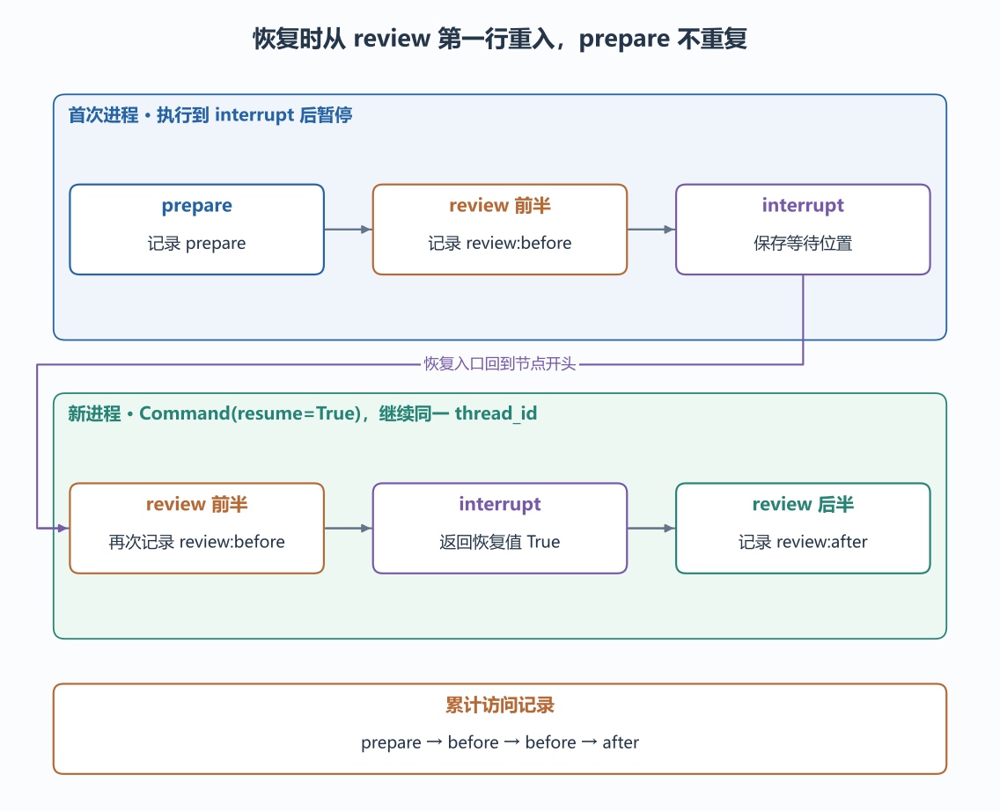

图中的重复执行区间，从 `review` 节点函数的第一行代码开始，一直延伸到 `interrupt(...)` 那一行为止。框架并没有把整张图从最开头的 `START` 重跑（前面已经跑完存好检查点的 `prepare` 节点被稳稳跳过），但它也没有能力恢复旧进程早已销毁的 Python 函数调用栈，只能依据检查点重新调用一次 `review` 函数。

看清了这个“从节点第一行重入”的机制，你就知道如果把“调用 TTS 合成语音并发到群里”、“发送 SMTP 邮件”或“扣除用户积分”这类有外部副作用的代码写在 `interrupt(...)` **前面**会发生什么惨剧了：第 1 次跑到 `interrupt` 暂停时，机器人已经往群里发了一遍语音；等用户回复确认、`Command(resume=True)` 唤醒节点时，`review` 从第一行重跑，在到达 `interrupt` 之前又把那段语音合成并发送了一遍，当场给你表演一个**“梅开二度”**！

实验中的访问计数探针之所以故意放在 `interrupt` 前面，正是为了把这次重入抓个现行；而在正式业务节点里，任何不可重复的外部动作都必须放到确认通过之后（或下游独立的 `commit` 节点中），并套上业务幂等锁。

这个探针实验立下了编写 `interrupt` 节点的三条保命军规：
1. **严禁在 `interrupt()` 语句之前放置任何非幂等的外部副作用操作**（比如发邮件、扣费、生成随机新单号或无去重地写库）——因为一旦恢复，写在 `interrupt` 前面的代码百分之百会再跑第二遍！所有不可重复的业务提交动作，必须放在确认通过之后（或者放在独立的下游 `commit` 节点里），并受业务幂等键保护；
2. **严禁在 `interrupt()` 外面套一个笼统的 `try ... except Exception:` 把异常吞掉**——因为 LangGraph 的 `interrupt()` 在底层正是靠抛出一个特殊的 `GraphInterrupt` 异常来通知外层图引擎暂停的！要是你在节点里写了宽泛的 `try/except` 把它当成普通报错给截胡吞了，图就根本停不下来；
3. **对 `interrupt` 返回的恢复值 `approved` 必须做严格类型检查 `type(approved) is not bool`**——在 Python 里，非空字符串 `"false"` 转成布尔值 `bool("false")` 居然是 **`True`**！如果前端误传了字符串 `"false"` 而你用 `if approved:` 去判断，用户明明点的是拒绝，程序却当成同意给提交了！

### 4. 业务已提交，检查点还没跟上

当用户在 `review` 节点确认通过后，图沿着条件边走进了 `commit` 节点。在 `commit` 节点内部，代码调用了 `store.confirm("graph-17", expected_version=2)`。
这时候，一个极其隐蔽的双事务间隙出现了：
别看我们的业务 `Store` 和 LangGraph 的 `SqliteSaver` 传的是**同一个 `state.sqlite` 文件路径**，但在底层代码里，`store.confirm` 开的是它自己的数据库连接和 `BEGIN IMMEDIATE` 事务（第 1 个事务），而要等 `commit` 节点函数正常 `return` 返回给 LangGraph 框架之后，`SqliteSaver` 才会开启它自己的连接去写入“`commit` 节点已完成”的图检查点（第 2 个事务）！**放在同一个数据库文件里，绝不等于自动合并成了同一个数据库事务！**

如果故障偏偏就卡在这两个事务中间的缝隙里呢？我们在 `graph` 实验中专门注入了这个故障：
1. `commit` 节点调用 `store.confirm`，**业务四表事务已经成功 `commit()` 落盘**（`plans` 表里已经有了 1 份正式计划，`runs.status` 已经变成了 `"done"`）；
2. 紧接着，在 `store.confirm` 返回前的 `after_commit` 钩子处抛出异常（或进程崩溃）；
3. 因为 `commit` 节点函数异常中断、没有正常返回，LangGraph 的 `SqliteSaver` **根本没来得及保存新的图检查点**！

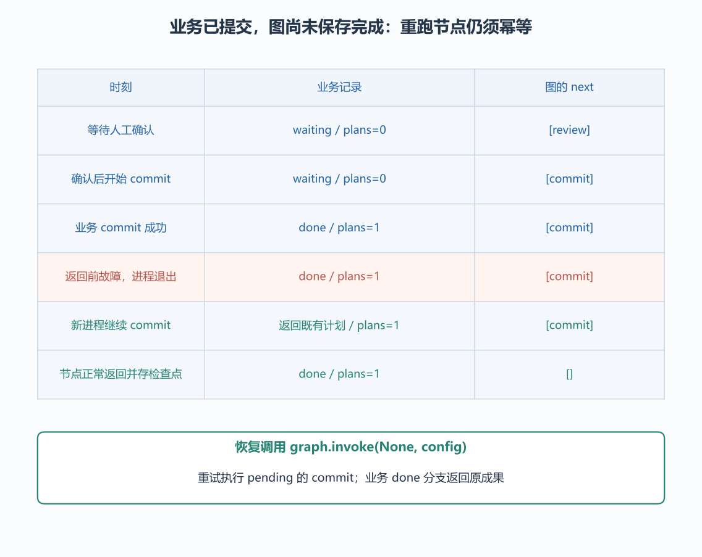

此时启动一个新进程去同时查图检查点和业务表，你会看到一幅分裂的画面：

~~~text
LangGraph 图检查点的 next 待办节点： ["commit"]（图以为 commit 还没跑完！）
业务表 runs.status：                 "done"（业务其实早就提交完了！）
业务表 plans 中的正式计划数：        1
业务表 events 中 done 事件的次数：   1
~~~

面对这种“业务已 `done`、但图的 `next` 还停在 `["commit"]`”的半截故障现场，恢复程序该怎么办？
首先注意恢复调用的写法：因为上一次在 `review` 节点的人工中断早就已经答复过了，现在只是要让图把卡在半路的待办节点 `commit` 跑完，所以恢复时调用的是 **`graph.invoke(None, config)`**（传入 `None` 表示不提供新输入、也不是回答 `interrupt`，而是让图直接从上次保存的检查点待办节点 `commit` 处继续往下跑）。
当图重新执行 `commit` 节点、第二次调用 `store.confirm("graph-17", ...)` 时，第三节写的**业务幂等性**当场立下了大功：`store.confirm` 一进事务查到 `graph-17` 已经是 `done` 了，二话不说直接把上次存好的那份计划原样返回！`commit` 节点顺利拿到返回值正常结束，`SqliteSaver` 随后把图的检查点推进到终点 `next = ()`，而数据库里的正式计划数依然是 `1`、完成事件数依然是 `1`！

这个实验把框架检查点与业务幂等的关系讲透了：**LangGraph 的检查点（`SqliteSaver`）只负责帮控制流记住“下次重启该从哪个节点函数入口接着调”，它绝对替代不了节点内部对外部业务副作用的幂等保护；只有“图检查点重入”加上“业务层按 `run_id` 原子幂等”，两者合璧才能跨越两个事务之间的故障间隙。**

### 5. 拒绝、取消与错误状态的边界

最后看一眼 `review` 节点之后的另一条分支：当用户明确点下“拒绝提案”按钮、调用方传入 `Command(resume=False)` 时，`review` 返回 `{"approved": False}`，条件边将图路由到 `cancel` 节点，调用 `store.cancel` 将业务状态置为终态 `cancelled`，图同样正常抵达终点 `END`（此时 `saved.next == ()`，但 `plans` 表中计划数为 `0`——可见“图正常走到了 `END`”只说明流程走完了，至于到底是确认提交了还是被用户取消了，必须看业务状态是 `done` 还是 `cancelled`）。

同时在工程上要严守一条底线：只有当用户本人真真切切地表达了“我不接受这份提案”时，才能把 `approved` 设为 `False` 走入 `cancel` 取消终态；如果在确认过程中发生了参数类型错误、提案版本号冲突（`3 != 2`）或者数据库锁超时，那些属于**执行异常**，必须原样抛出异常保留 `waiting` 现场供后续重试或刷新，绝对不能在 `except` 里糊里糊涂地把系统故障改写成 `approved = False` 去把用户的任务给静默取消掉！

## （六）运行与练习

### 1. 一次任务穿过全部故障

在本篇的压轴综合实验 `persistence_lab.integrated`（对应练习 `RT-08`）中，我们把前面四节拆解的所有组件全部串到同一条时间轴上，让定时任务 `job-17`（绑定业务编号 `run-17`）经历一场九死一生的全链路故障接力：
1. **入队与三进程接力准备**：在第 `100` 秒，任务 `job-17` 入队；Worker A 认领任务拿到第 1 代令牌 `token=1`（租约至 `130` 秒），随后三个独立子进程接力将业务 `run-17` 从 `created` 推进到 `prepared`、再到 `waiting, version=2`；
2. **租约到期与新旧 Worker 交接**：Worker A 发生卡顿未能在 `130` 秒前完成；到了第 `131` 秒，Worker B 合法接手认领，拿到第 2 代令牌 `token=2`（新租约至 `161` 秒）；
3. **拦截僵尸旧 Worker 写入**：苏醒过来的旧 Worker A 拿着过期的 `token=1` 企图去确认提交计划，`ClaimedStore` 在写事务内当场将其拦截拒绝，`plans` 表依然为 `0`；
4. **有效 Worker 的幂等重复确认**：持有有效令牌 `token=2` 的 Worker B 带着 `expected_version=2` 连续发起了两次确认调用，第一次成功完成四表原子提交，第二次按幂等原样返回，`plans` 表严格只有 `1` 份计划，`outbox` 产生 `1` 条 `pending` 待投递记录；
5. **跨系统投递中断与接收去重**：投递进程第 1 次发送通知，接收方 `ReceiptLedger` 已收下落盘，但发送方在写回执前崩溃（仍为 `pending`）；新进程发起第 2 次重投，接收方按键去重未产生重复记录，发送方成功更新为 `delivered`；
6. **队列收尾**：最后，Worker B 在自己的有效租期内调用 `Queue.finish`，将调度任务 `job-17` 正式标记为 `done`。

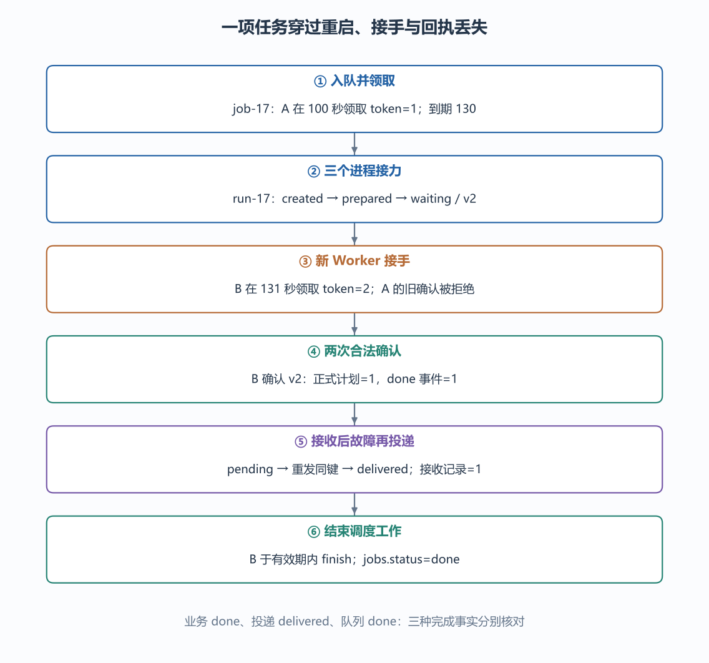

看上面这张接力全景图，全链路里出现了三个名为“完成”的状态标签，但它们各自驻守在不同的表里、回答不同的核查问题：**`runs.status = 'done'`** 代表本地业务计划已确认提交；**`outbox.status = 'delivered'`** 代表跨系统外部通知已拿到对方回执；**`jobs.status = 'done'`** 代表后台队列的这次调度工作已圆满结案。只有三张表上的这三个标签全部就位，整条链路才算真正没有欠账。

### 2. 单一环境与实验入口

在正式的 `现代AI示例` 目录运行以下命令，全程使用该目录已有的唯一 `.venv` 虚拟环境，无需安装任何新依赖：

~~~powershell
# 1. 观察四个独立操作系统子进程接力推进业务状态机。
.\.venv\Scripts\python.exe -B -m modern_ai.persistence_lab states
# 2. 观察 commit 前后普通异常与 os._exit(71/72) 强退共四种故障窗口及恢复。
.\.venv\Scripts\python.exe -B -m modern_ai.persistence_lab atomic
# 3. 观察队列并发争抢、130 秒租约到期、133 秒僵尸旧令牌拦截与续租。
.\.venv\Scripts\python.exe -B -m modern_ai.persistence_lab leases
# 4. 观察 LangGraph interrupt 节点重入探针，以及业务已提交而图未前进的间隙恢复。
.\.venv\Scripts\python.exe -B -m modern_ai.persistence_lab graph
# 5. 一键运行全部八组实验，或单独运行单任务全故障穿刺接力。
.\.venv\Scripts\python.exe -B -m modern_ai.persistence_lab all
.\.venv\Scripts\python.exe -B -m modern_ai.persistence_lab integrated
~~~

实验入口统一在 `.tmp` 下创建受控的 `TemporaryDirectory`，所有子进程直接从正式源码目录导入模块；每组实验结束时自动关闭所有 SQLite 连接句柄、回收子进程并清理临时数据库文件（`os._exit` 强退仅发生在受控子进程内，父进程始终完整履行清理职责）。完整源码见 [persistence_lab.py](https://github.com/KiriAky107/understanding-AI-and-Agents-in-depth/blob/main/%E7%8E%B0%E4%BB%A3AI%E7%A4%BA%E4%BE%8B/modern_ai/persistence_lab.py)（代码包内：`现代AI示例/modern_ai/persistence_lab.py`）、[runtime.py](https://github.com/KiriAky107/understanding-AI-and-Agents-in-depth/blob/main/%E7%8E%B0%E4%BB%A3AI%E7%A4%BA%E4%BE%8B/modern_ai/runtime.py)（代码包内：`现代AI示例/modern_ai/runtime.py`）、[harness.py](https://github.com/KiriAky107/understanding-AI-and-Agents-in-depth/blob/main/%E7%8E%B0%E4%BB%A3AI%E7%A4%BA%E4%BE%8B/modern_ai/harness.py)（代码包内：`现代AI示例/modern_ai/harness.py`） 与 [frameworks.py](https://github.com/KiriAky107/understanding-AI-and-Agents-in-depth/blob/main/%E7%8E%B0%E4%BB%A3AI%E7%A4%BA%E4%BE%8B/modern_ai/frameworks.py)（代码包内：`现代AI示例/modern_ai/frameworks.py`），核验数据保存在 新第九篇实验核验（代码包内：`docs/新第九篇实验核验.json`）。

### 3. 练习

| 题号 | 要求 | 动手任务 | 对应题解 |
| --- | --- | --- | --- |
| RT-01 | **必做** | 创建 A、B 两项任务并交错推进，解释 A 的事件序号为何是 1、3；比较 Store 与 Queue 初始化后的表数量 | 表与事件（代码包内：`docs/练习题解.md`；定位：`RT-01`） |
| RT-02 | **必做** | 让四个独立进程接力推进一项任务；重复确认、取消终态、无来源准备分别会怎样 | 状态接力（代码包内：`docs/练习题解.md`；定位：`RT-02`） |
| RT-03 | **必做** | 两位编辑都持有版本 2，同时修订等待中的提案；核对成功次数、旧确认拒绝与最终版本 | 版本竞争（代码包内：`docs/练习题解.md`；定位：`RT-03`） |
| RT-04 | **必做** | 注入四种提交故障，由新进程查询四张表，再重试；解释退出码和业务是否完成为何不能直接画等号 | 故障窗口（代码包内：`docs/练习题解.md`；定位：`RT-04`） |
| RT-05 | **必做** | 在接收方接受后、发送方登记回执前中断；重投后核对两端，并试一次同键异内容 | 投递去重（代码包内：`docs/练习题解.md`；定位：`RT-05`） |
| RT-06 | **必做** | 手算 130 秒到期与 133 秒旧令牌两种拒绝；实际比较有无写入保护，并核对续租到 250 秒 | 租约与写入（代码包内：`docs/练习题解.md`；定位：`RT-06`） |
| RT-07 | **拓展选做** | 统计 interrupt 前后的节点访问；注入业务已提交而图未前进的故障，再恢复并检查计划数 | 图恢复（代码包内：`docs/练习题解.md`；定位：`RT-07`） |
| RT-08 | **拓展选做** | 串起入队、进程恢复、旧 Worker 拒绝、重复确认和投递重试，指出每项完成事实属于哪张表 | 完整接力（代码包内：`docs/练习题解.md`；定位：`RT-08`） |

~~~powershell
# 按题号单独运行并查看中间核验状态（RT-01 至 RT-08）。
.\.venv\Scripts\python.exe -B -m modern_ai.solutions RT-07
# 一键执行正文代码片段与八道练习题核验，检查结束后不残留临时数据库。
.\.venv\Scripts\python.exe -B ..\tools\check_persistence.py
~~~

到这里，我们的智能体已经拥有了颗坚实的 Runtime 心脏：进程死了能活过来接力，僵尸旧 Worker 的迟到写入能被当场挡回，网络超时后的重复点击能按幂等原样交差。但是，当下一轮真的要把数据库里存着的历史记录重新喂给大模型时，新的麻烦又来了：数据库里攒下的几十轮对话和长篇笔记根本塞不进有限的上下文窗口！到底该挑哪些原文、哪些摘要放进去？某次尝试把调用预算烧光了该怎么留存现场？模型生成的路径和命令又该怎么关进安全沙箱？这些包裹在 Runtime 外围的工程护栏，正是下一篇（第十篇：《Agent Harness 与长程任务》）将要解决的主题。
